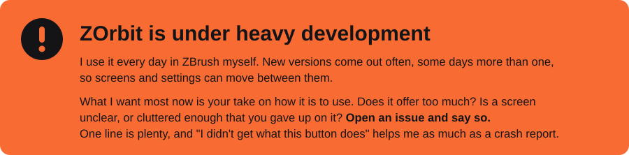
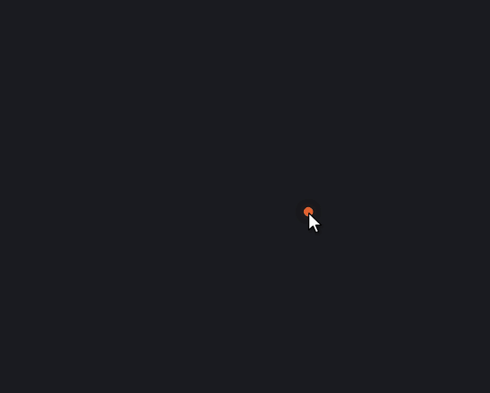
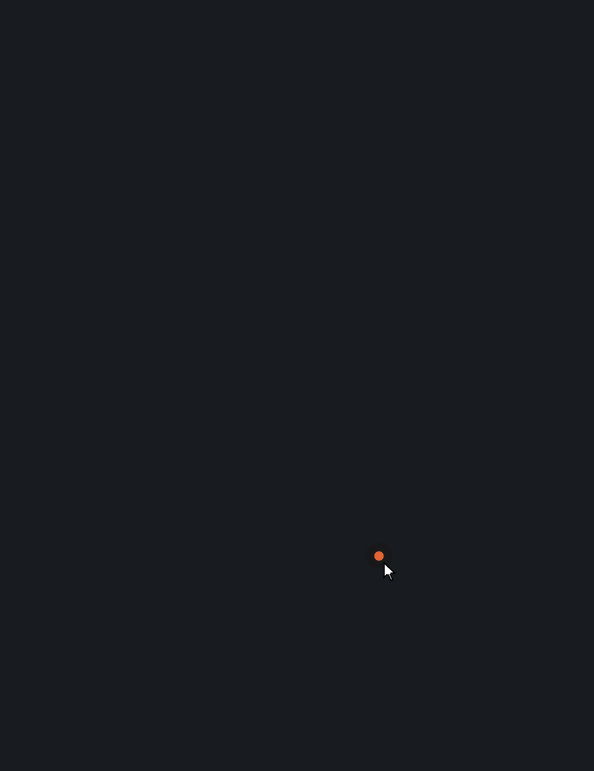
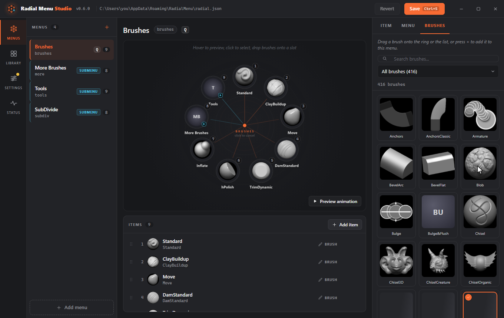

<h1>
  
  ZOrbit
</h1>

<a href="https://github.com/combwizard/zorbit/issues"></a>

ZOrbit is a radial brush menu for ZBrush. Press **Q** over ZBrush and a ring of your favourite brushes and buttons appears around the cursor. Flick toward one and let go, and ZBrush switches to it. You choose what goes on the ring in a small editor called ZOrbit Studio. It is free, open source (GPL-3.0), and runs on Windows.

If you know pie menus from Blender or marking menus from Maya, ZOrbit brings that to ZBrush.

<p align="center">
  
</p>

**Contents**

- [Documentation](#documentation)
- [Roadmap and ideas](#roadmap-and-ideas)
- [Features](#features)
- [Requirements](#requirements)
- [Install](#install)
  - [Windows says "Windows protected your PC"](#windows-says-windows-protected-your-pc)
- [First steps](#first-steps)
- [Upgrading, uninstalling and troubleshooting](#upgrading-uninstalling-and-troubleshooting)
- [Build from source](#build-from-source)
- [Licence](#licence)
- [Disclaimer](#disclaimer)

## Documentation

The full documentation is at **[zorbit.lol/docs](https://zorbit.lol/docs/)**: every setting and item type, tags, the browser, hotkeys, files and logs, and how ZOrbit talks to ZBrush.

## Roadmap and ideas

The **[roadmap board](https://github.com/users/combwizard/projects/2)** shows what's next, what's later and the ideas that aren't planned yet. Each card is an issue: add a thumbs-up to the ones you want, or comment on how you'd use them. Have ZBrush 2023 or 2025? The [needs testing](https://github.com/combwizard/zorbit/issues?q=is%3Aissue%20is%3Aopen%20label%3A%22needs%20testing%22) issues list a few quick checks.

## Features

- **Fast picking.** Hold the hotkey and flick past a slot, or move toward it and release. Or tap the hotkey and click.
- **More than brushes.** A slot can select a brush, load an alpha, material or texture, press any ZBrush button, set a slider, flip a switch, run several of those in a row, or open another ring.
- **Submenus.** Rings can open other rings, so a handful of hotkeys can reach a lot. Hover a submenu and it opens on the spot, so one stroke can reach an item two rings deep.
- **Fan-out submenus.** Switch a menu to fan out and it opens in place: its items spread in an arc beyond its slot while the ring you came from stays put. Fans can open fans, up to three deep.
- **Tags and a browser.** Tag your brushes, alphas, materials and textures in Studio, colour their slots by tag (an icon tint, a glow, or a band through the ring), and give a slot a tag to open a fan of every item that carries it. A hotkey (Alt+B) opens a browser over ZBrush with four tabs (brushes, alphas, materials and textures), search, folders, tag chips and thumbnails; Enter picks the item. Star your favourites with one press, and a Recent list shows what you picked last.
- **ZOrbit Studio.** Edit menus with a live preview of the real ring. Drag brushes in from a searchable library with thumbnails, record hotkeys, change colours, size and animation. A Setup screen walks a new install through finding ZBrush and trying the ring, and Import and export moves your menus, settings and tags to another PC.
- **Twelve open animations**, from instant to a swirling spiral, plus ring size, dead zone and label options.
- **Starts and stops with ZBrush.** There is nothing to launch by hand.
- **Safe with your stroke.** In ZBrush 2026 and newer, a pick that arrives mid-stroke waits until you lift the pen. ZBrush 2022 to 2025 cannot wait and apply it at once.
- **High-DPI and multi-monitor aware.** The ring stays on screen, even at the screen edge.
- **Plain JSON menus** in `%APPDATA%\ZOrbit\radial.json`, so you can back them up, share them and keep them in version control.

<p align="center">
  
</p>

### Fan-out submenus

A menu can open as a fan: hover its slot and its items spread out beyond it, with the ring you came from still in place. The [menus page](https://zorbit.lol/docs/menus/#submenu) explains how to turn it on.

<p align="center">
  
</p>

## Requirements

- Windows 10 or 11
- ZBrush 2022 or newer. ZBrush 2026 and newer load the Python plugin that the installer sets up. ZBrush 2022 to 2025 have no Python API, so they get a ZScript plugin, which you install from Studio (see [ZBrush 2022 to 2025](https://zorbit.lol/docs/install/#zbrush-2022-to-2025)).
- The Microsoft Edge WebView2 runtime, which Studio uses for its window. It is part of Windows 11 and of up-to-date Windows 10.

## Install

1. Download the installer from the [Releases page](https://github.com/combwizard/zorbit/releases).
2. Run it. It installs for your user only and does not need administrator rights. It adds the plugin folder to your `ZBRUSH_PLUGIN_PATH` user environment variable and creates a Start menu shortcut called **ZOrbit Studio**.
3. **Restart ZBrush once.** ZBrush reads `ZBRUSH_PLUGIN_PATH` only when it starts.
4. Open a canvas, hover over it and press **Q**.

The first time you open **ZOrbit Studio** it starts on its **Setup** screen. Setup walks through the rest: it finds your ZBrush, tells you whether to restart it, installs the plugin for ZBrush 2022 to 2025, and has you try the ring once. You can reopen it any time with Alt+6.

The first run puts a starter set of menus in `%APPDATA%\ZOrbit\radial.json`. They use only brushes that come with ZBrush.

### Windows says "Windows protected your PC"

The installer is not code-signed yet. Code-signing certificates cost money every year, and this is a free hobby project, so Windows SmartScreen shows its warning for any program it does not recognise. The warning does not mean it found a problem.

To continue, click **More info**, then **Run anyway**. If you would rather not run a binary you did not build, the whole source is in this repository and [Build from source](#build-from-source) explains how to make the installer yourself.

## First steps

1. Open **ZOrbit Studio** from the Start menu (or from ZBrush: **Zplugin > ZOrbit > Studio**).
2. On the **Menus** screen, pick a menu on the left. The ring preview in the middle is drawn by the same code that draws it inside ZBrush.
3. Drag brushes from the **Library** onto the ring, or use **Add item** for buttons, sliders and switches.
4. Click **Save** (Ctrl+S). The next time you open the ring in ZBrush it uses your changes. There is no need to restart anything.

<p align="center">
  
</p>

The [documentation](https://zorbit.lol/docs/) covers every setting and item type.

## Upgrading, uninstalling and troubleshooting

- **Upgrading from Radial Menu for ZBrush:** run the new installer over the old one. Your menus and settings are copied over on the first start. See [Upgrading from Radial Menu for ZBrush](https://zorbit.lol/docs/install/#upgrading-from-radial-menu-for-zbrush).
- **ZBrush 2022 to 2025:** these versions get a ZScript plugin that you install from Studio. See [ZBrush 2022 to 2025](https://zorbit.lol/docs/install/#zbrush-2022-to-2025).
- **Uninstall:** remove ZOrbit in **Windows Settings > Apps > Installed apps**. Remove the plugin from a ZBrush 2022 to 2025 first. See [Uninstall](https://zorbit.lol/docs/install/#uninstall).
- **How it works:** a small app draws the ring outside ZBrush, and a plugin inside ZBrush carries out the pick. See [How ZOrbit talks to ZBrush](https://zorbit.lol/docs/bridge/).
- **Something not working?** See [Troubleshooting](https://zorbit.lol/docs/troubleshooting/).

## Build from source

You need Windows, Python 3.12 and the packages in `requirements-dev.txt`.

```powershell
pip install -r requirements-dev.txt
.\packaging\build.ps1
```

The script's header lists what else it needs and where the installer ends up.

To run straight from a checkout while you work on the code, use `tools\dev-install.ps1`. It registers the checkout's `bridge` folder in `ZBRUSH_PLUGIN_PATH` and adds the Start menu shortcut, and `-Uninstall` takes both away again. Add `-WhatIf` to see what it would do first.

## Licence

| | |
|---|---|
| **Licence key** | `FCKGW-RHQQ2-YXRKT-8TG6W-2B7Q8` |
| **Status** | Activated |
| **Seats** | All of them |
| **Expires** | Never |
| **Price** | 0.00 |

**Just kidding.** There is no licence key, no account, no trial and no expiry date. ZOrbit is licensed under the **GNU General Public License v3.0** (see [LICENSE](LICENSE)): free to use on as many machines as you like, to study, change and share. It stays free: if you distribute a modified version, you must also publish its source under the same licence. You are licensed. Forever.

(The Studio has the same Licence screen. Its buttons work exactly as well as this table does. Not amused? Hide it with the link at the bottom of that page, or in Settings > Studio.)

Third-party components and their licences are listed in [THIRD_PARTY_NOTICES.md](THIRD_PARTY_NOTICES.md). Contributions are welcome; see [CONTRIBUTING.md](CONTRIBUTING.md).

## Disclaimer

ZOrbit is an independent project. It is not affiliated with or endorsed by Maxon. ZBrush is a trademark of Maxon.
