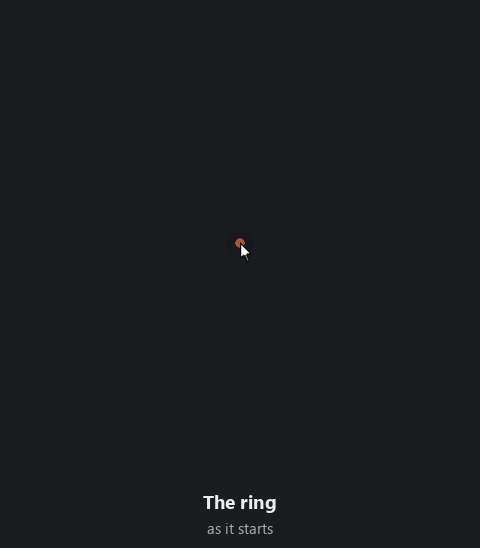
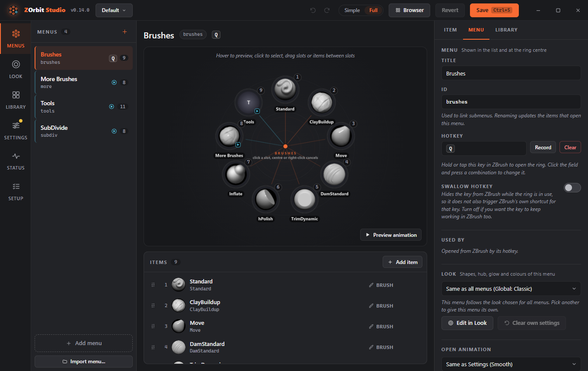

<h1>
  
  ZOrbit
</h1>

ZOrbit is a radial brush menu for ZBrush. Press **Q** over ZBrush and a ring of your favourite brushes and buttons appears around the cursor. Flick toward one and let go, and ZBrush switches to it. You choose what goes on the ring in a small editor called ZOrbit Studio. It is free, open source (GPL-3.0), and runs on Windows.

If you know pie menus from Blender or marking menus from Maya, ZOrbit brings that to ZBrush.

<p align="center">
  
</p>

[Download](https://github.com/combwizard/zorbit/releases) · [Documentation](https://zorbit.lol/docs/) · [FAQ](https://zorbit.lol/#faq) · [Roadmap](https://github.com/users/combwizard/projects/2)

## Features

- Hold the hotkey and flick past a slot, or move toward it and release. Or tap the hotkey and click.
- A slot can select a brush, load an alpha, material, texture, tool or interface layout, open a project, press any ZBrush button, set a slider, flip a switch, save the document as a PNG, or run several of those in a row.
- A slot can open another ring. A submenu can also fan out in place, beside the ring you came from, and fans can open fans up to three deep.
- An auto slot holds a brush you pick often, and ZOrbit fills it for you. A Recent slot opens a fan of the projects and tools ZBrush opened last.
- Tag your brushes, alphas, materials and textures, colour their slots by tag, and give a slot a tag to open a fan of every item that carries it.
- **Alt+B** opens a browser over ZBrush with search, folders, tag chips and thumbnails. It lists ZBrush's own items and, in ZBrush 2026 and newer, folders you add. Star your favourites and keep them in a small strip over ZBrush, where one click picks them.
- ZOrbit Studio edits your menus with a live preview of the real ring. Drag brushes in from a library with thumbnails, record hotkeys, and pick a dark or light theme or match ZBrush's own colours.
- Six slot shapes, seven built-in looks and twelve open animations, for every menu, one menu or one slot. You can save looks of your own.
- Profiles keep a set of menus, settings and tags per kind of work. Switch between them from Studio or the tray icon without a restart.
- A Stream Deck, tablet software or a script can open a menu, pick a brush or switch profile by running `ZOrbit.exe` with an option.
- ZOrbit starts and stops with ZBrush. In ZBrush 2026 and newer, a pick that arrives mid-stroke waits until you lift the pen.
- Menus are plain JSON in `%APPDATA%\ZOrbit\profiles\<profile>\radial.json`, so you can back them up or keep them in version control. **Export menu** saves one menu to a file you can send to someone.

The [documentation](https://zorbit.lol/docs/) covers each of these, with every setting and item type.

<p align="center">
  
</p>

## Install

You need 64-bit Windows 10 or 11 and ZBrush 2022 or newer. ZBrush Core and ZBrushCore Mini are not supported, because they do not load plugins. Studio uses the Microsoft Edge WebView2 runtime, which is part of Windows 11 and of up-to-date Windows 10.

1. Download the installer from the [Releases page](https://github.com/combwizard/zorbit/releases).
2. Run it. It installs for your user only and does not need administrator rights.
3. **ZBrush 2026 and newer:** restart ZBrush once. **ZBrush 2022 to 2025:** open **ZOrbit Studio**, go to **Setup**, press **Install** next to your ZBrush (approve the Windows prompt if it asks), then restart that ZBrush.
4. Open a canvas, hover over it and press **Q**.

The first time you open **ZOrbit Studio** it starts on its **Setup** screen, which finds your ZBrush and has you try the ring once. [Install and uninstall](https://zorbit.lol/docs/install/) has the rest: what the installer changes, checking the download against its SHA-256 file, updating, the portable zip, uninstalling, and upgrading from Radial Menu for ZBrush. [Getting started](https://zorbit.lol/docs/getting-started/) goes on from the first ring to your first edit in Studio.

### Windows says "Windows protected your PC"

The installer is not code-signed, because certificates cost money every year and this is a free hobby project. Windows SmartScreen shows its warning for any program it does not recognise, so the warning does not mean it found a problem. Click **More info**, then **Run anyway**.

If Windows offers no **Run anyway**, or an antivirus removed the program, see [Smart App Control and antivirus](https://zorbit.lol/docs/install/#smart-app-control-and-antivirus). If you would rather not run a binary you did not build, [build it from source](#build-from-source).

## How it works

A small app draws the ring outside ZBrush, and a plugin inside ZBrush carries out the pick. The app installs a Windows keyboard hook that compares each key press with your hotkeys and acts only when ZBrush is the front window. It does not record, store or send what you type. [How ZOrbit talks to ZBrush](https://zorbit.lol/docs/bridge/) has the details.

## Help and ideas

- The [FAQ](https://zorbit.lol/#faq) has short answers, such as [is it really free](https://zorbit.lol/#q-free), [how do I update](https://zorbit.lol/#q-update) and [does ZOrbit send any data](https://zorbit.lol/#q-data).
- [Troubleshooting](https://zorbit.lol/docs/troubleshooting/) is the page for when something does not work.
- The [roadmap board](https://github.com/users/combwizard/projects/2) shows what's next, what's later and the ideas that aren't planned yet. Each card is an issue: add a thumbs-up to the ones you want, or comment on how you'd use them.

## Build from source

You need Windows, Python 3.14 and the packages in `requirements-dev.txt`.

```powershell
pip install -r requirements-dev.txt
.\packaging\build.ps1
```

[Build from source](https://zorbit.lol/docs/building/) says what else the script needs and where the installer ends up. [CONTRIBUTING.md](CONTRIBUTING.md) covers running straight from a checkout.

## Licence

ZOrbit is licensed under the **GNU General Public License v3.0** (see [LICENSE](LICENSE)). The licences of the bundled libraries are listed in [THIRD_PARTY_NOTICES.md](THIRD_PARTY_NOTICES.md). Contributions are welcome; see [CONTRIBUTING.md](CONTRIBUTING.md).

## Disclaimer

ZOrbit is an independent project. It is not affiliated with or endorsed by Maxon. ZBrush is a trademark of Maxon.
