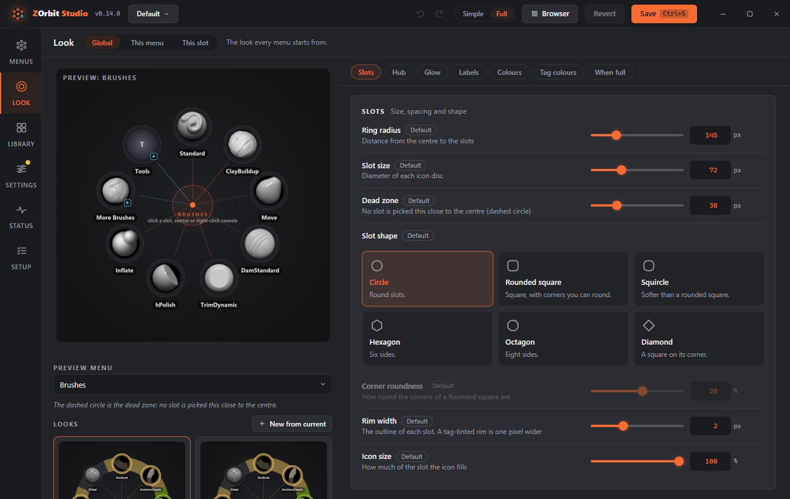
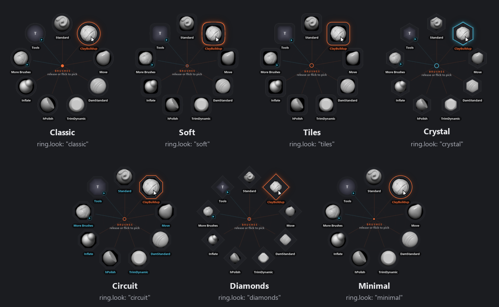
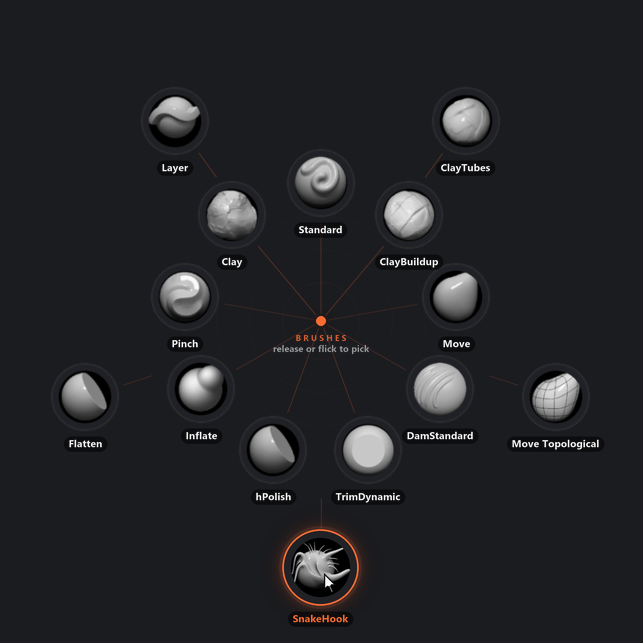
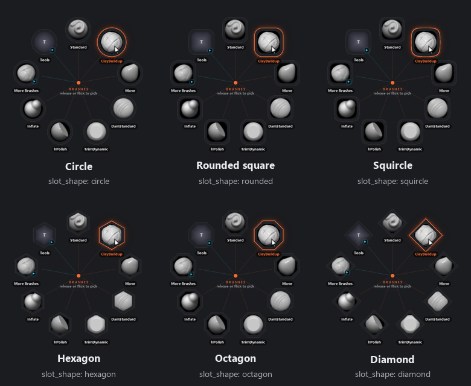
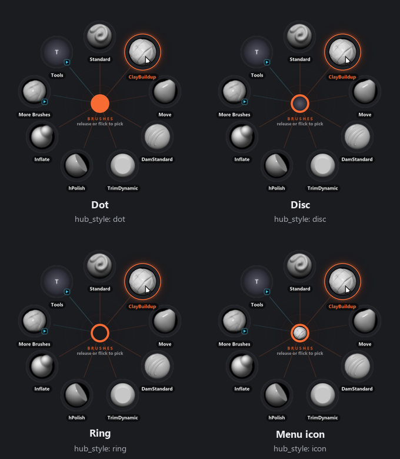
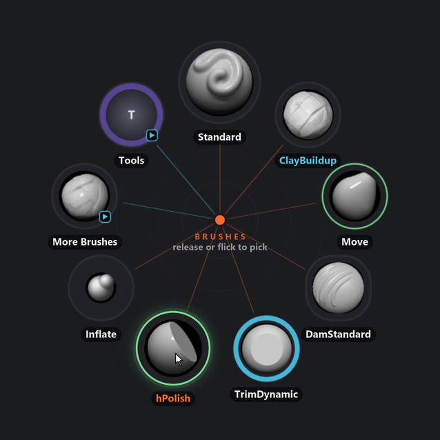
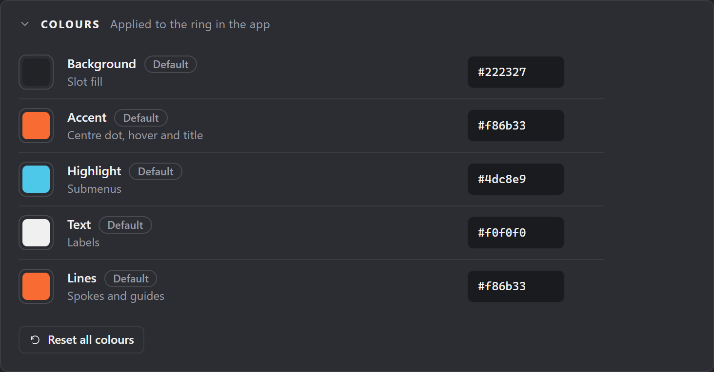

# Appearance

## Appearance and behaviour settings

The look settings are on the Look screen in Studio, the rest on Settings, and all are under `"ring"` in `radial.json`. A [look](#looks) holds the same look settings under a name, so a menu or a slot can have its own. Studio shows live previews. The [theme](#theme) is on Settings, but it is a Studio preference and not in `radial.json`.



| Setting (`ring.`) and its label in Studio | Default | Range | Meaning |
|---|---|---|---|
| `radius` (**Ring radius**; **Ring size** in Simple mode) | 145 | 60 to 400 | Distance from the centre to the slots, in pixels. This is the smallest the ring gets: a menu with many items spreads wider. |
| `slot` (**Slot size**) | 72 | 32 to 160 | Diameter of each icon disc, or the side of a rounded square. |
| `dead_zone` (**Dead zone**) | 38 | 10 to 120 | Radius around the centre where no slot is picked. |
| `hub` (**Hub size**) | 10 | 0 to 64 | Diameter of the hub in the middle of the ring, in pixels. 0 draws no hub. A larger hub moves the menu title and hint down to keep clear of it. It does not change the dead zone. See [Hub styles](#hub-styles). |
| `hub_style` (**Hub style**: **Dot**, **Disc**, **Ring**, **Menu icon**) | `dot` | `dot`, `disc`, `ring`, `icon` | How the hub is drawn. See [Hub styles](#hub-styles). |
| `hub_color` (**Hub colour**) | `accent` | a theme colour or `#rrggbb` | The colour of the hub and its glow. See [Colour values](#colour-values). |
| `hub_glow` (**Hub glow**) | 1 | 0 to 1 | How strong the halo around the hub is. 0 turns it off. Studio shows it as a percentage. |
| `tap_ms` (**Tap time**) | 250 | 0 to 1000 | A hotkey press shorter than this is a tap. |
| `timeout_s` (**Auto-close**) | 20 | 2 to 120 | An open ring closes itself after this many seconds. |
| `animation` (**Open animation**) | `smooth` | see [Open animations](#open-animations) | The open animation. |
| `labels` (**Labels**: **Icon and name**, **Icon only**) | `name` | `name`, `none` | Show names under the slots, or icons only. A name sits on a soft pill (dark in the Dark theme, light in the Light theme), so it stays readable when a neighbouring slot is close. |
| `label_color` (**Label colour**) | `text` | a theme colour or `#rrggbb` | The colour of the names under the slots. The pill behind them follows the theme. |
| `glow_color` (**Glow colour**) | `""` | a theme colour, `#rrggbb` or `""` | The colour of the soft light around a slot and of its rim when the pointer is on it. `""` is **Automatic**: the slot's tag colour when it has one, else the accent (the highlight for a submenu slot). |
| `glow_opacity` (**Glow strength**) | 0.55 | 0 to 1 | How strong that light is. Studio shows it as a percentage. |
| `slot_shape` (**Slot shape**) | `circle` | `circle`, `rounded`, `squircle`, `hexagon`, `octagon`, `diamond` | The shape of every slot. See [Slot shapes](#slot-shapes). |
| `slot_corner` (**Corner roundness**) | 0.28 | 0 to 0.5 | How round the corners of a `rounded` slot are, as a share of its side. It changes nothing for the other shapes. Studio shows it as a percentage. |
| `border_width` (**Rim width**) | 2 | 0 to 6 | The width of the outline of each slot, in pixels. 0 draws no rim. The tag-coloured rim of a tinted slot is one pixel wider. |
| `icon_scale` (**Icon size**) | 1 | 0.5 to 1 | How much of the slot the icon fills. Studio shows it as a percentage. |
| `flick` (**Flick to pick**) | `true` | `true`, `false` | Moving out past a slot picks it without releasing or clicking. |
| `hover_submenus` (**Open submenus on hover**) | `true` | `true`, `false` | Reaching a submenu slot opens the submenu, centred on that slot. |
| `hint` (**Show the hint**) | `true` | `true`, `false` | The line of help under the menu's title, such as "click a slot, centre or right-click cancels". `false` leaves it out and the title stays. |
| `tag_colors` (**Tag colours**: the **Icon tint** and **Glow** switches) | `tint` | `none`, `tint`, `glow`, `both` | Whether an item's first tag tints its icon, glows, or both. See [Tag colours](#tag-colours). |
| `tag_band` (**Tag colours > Band**: the switch and **Thickness**) | `medium` | `none`, `hairline`, `narrow`, `medium`, `wide` | Thickness of the band through the slot centres. `none` turns it off. |
| `tag_band_opacity` (**Band > Opacity**) | 0.45 | 0 to 1 | How solid the band is. |
| `tag_glow_opacity` (**Glow > Opacity**) | 0.4 | 0 to 1 | Strength of the halo. |
| `tag_tint_opacity` (**Icon tint > Opacity**) | 0.3 | 0 to 1 | Strength of the tag colour laid over the icon. |
| `tag_tint_style` (**Icon tint > Style**) | `gradient` | `flat`, `gradient` | `gradient` is stronger towards the rim. |
| `tag_tint_blend` (**Icon tint > Blend**) | `multiply` | `multiply`, `overlay` | `multiply` darkens the icon. `overlay` keeps its light and shade. |
| `when_full` (**When there are more items than fit**: **Grow**, **Second ring**, **More slot**) | `grow` | `grow`, `rings`, `more` | What a ring does when its menu has more items than fit at the radius. See [When a ring is full](#when-a-ring-is-full). |
| `look` (**Use for all menus** on a look) | none | the name of a look | The [look](#looks) every menu starts from. It is the only look setting that names another thing and not a value. |

Sizes are scaled for high-DPI screens automatically.

The radius is a minimum. When a menu has so many items that neighbouring slots would sit closer than 1.25 slot widths apart, the ring grows until they do not. With the default slot size that starts at 10 items: 12 items make a ring about 174 pixels in radius, 24 items about 345. The Studio preview grows the same way, so lowering **Ring radius** changes nothing once a menu is past that point. Studio shows a note above the item list when that happens, and says so if the grown ring is too big for your screen. Lower **Slot size** or cut the number of items to keep the ring smaller. Names in Chinese, Japanese or Korean are drawn with Microsoft YaHei, Yu Gothic or Malgun Gothic, whichever Windows has; other names use Segoe UI.

Studio's [Simple mode](studio.md#simple-and-full-mode) shows only some of these. Its **Ring size** slider moves `radius`, `slot` and `dead_zone` together and keeps their proportions. Full mode has the three separate sliders, and is the only mode that shows `slot_corner`, `border_width`, `icon_scale`, the hub settings, `glow_color`, `glow_opacity`, `label_color`, `hover_submenus`, `tap_ms`, `timeout_s`, the `tag_` settings and `colors`. The animation, `labels`, `slot_shape`, `when_full`, `flick` and the theme are in both. What Simple hides keeps its value.

### Looks

A look is a named group of look settings: the shape of the slots, the hub, the glow, the labels, the colours. You pick one instead of setting each value, and you can change what it gives you after. Seven looks come with ZOrbit, and you can make your own on the Look screen (see [Looks](studio.md#looks) in the Studio page for how).



| Look (`look` value) | What it changes |
|---|---|
| **Classic** (`classic`) | Round slots and an accent dot. It is what ZOrbit starts with, and it sets nothing. |
| **Soft** (`soft`) | Squircle slots with a thin rim and slightly smaller icons, a stronger glow and a quiet disc in the middle. |
| **Tiles** (`tiles`) | Rounded squares with smaller icons and a ring in the middle. |
| **Crystal** (`crystal`) | Hexagons with a bright glow in the highlight colour and a highlight ring in the middle. |
| **Circuit** (`circuit`) | Octagons with a thin rim, labels in the highlight colour, a glow in the lines colour and a ring in the middle. |
| **Diamonds** (`diamonds`) | Diamond slots with small icons and a disc in the middle. |
| **Minimal** (`minimal`) | No rim, a faint glow and a tiny dot with no glow. |

The built-in looks change the style only. They never set the size of the ring, the five [colours](#colours) or the tag colours, and they use theme colours, so they follow the [theme](#theme) and any colours you set.

A look applies at three levels:

- **All menus.** `ring.look` names the look every menu starts from. The other keys under `ring` are your own settings for all menus.
- **One menu.** `look` in the menu is a look's name (`"look": "soft"`), or an object that names a look as `preset` and changes some keys on top (`"look": {"preset": "soft", "hub": 14}`). See [Menus](menus.md#menus).
- **One slot.** `style` on an item changes how that slot looks over its menu. See [Slot styles](#slot-styles).

Each level is laid over the one before it, and a later layer wins. From the bottom:

1. The defaults in the table above.
2. The colours of the [theme](#theme).
3. The look chosen for all menus (`ring.look`).
4. Your own settings for all menus (the other look keys under `ring`).
5. The look of the menu.
6. The menu's own settings (the other keys in its `look` object).
7. The slot's `style`.

A key that a layer leaves out is taken from the layer below. The five `colors` are merged one colour at a time, so a look that sets only `accent` keeps the other four. The ring's behaviour settings (`tap_ms`, `timeout_s`, `flick`, `hover_submenus`, `hint` and `animation`) are not part of a look; `animation` can still be set for one menu on its own, as it always could.

Your own looks are saved under `looks` in `radial.json`, each with a name of 1 to 32 letters, digits, spaces, `-` or `_`. A name cannot be one of the built-in looks, and two looks cannot differ only in their capitals. A look holds look keys and cannot name another look.

```json
"looks": {
  "Night green": {"slot_shape": "hexagon", "hub_style": "ring", "colors": {"accent": "#7bd88f", "lines": "#7bd88f"}}
},
"ring": {"look": "Night green"}
```

A look is a live link. Change it, and every menu that uses it changes with it, and so does the ring when it is the look for all menus. Deleting a look that menus use asks you in Studio what to do with them: they can keep its settings as their own, or fall back to the look above. A name that is no look is listed as a problem, and the menu or the ring follows the level above it. Exporting a menu carries the looks of your own that it uses (see [Share a menu](menus.md#share-a-menu)).

#### Colour values

The colour settings of a look (`hub_color`, `glow_color`, `label_color`, and a slot's `fill_color` and `border_color`) take either:

- a theme colour: `bg`, `accent`, `highlight`, `text` or `lines`. It is the colour that role has at that point, so it follows the theme and any `colors` you set. A hub in `accent` turns green when you set `colors.accent` to green;
- a fixed `#rrggbb`, which stays as it is whatever the theme does.

`glow_color`, `fill_color` and `border_color` can also be `""`, which is none chosen. The five palette colours inside `colors` are different: they take `#rrggbb` only, because they are what the theme colours stand for.

### When a ring is full

A look can set `when_full` instead of letting the ring grow. In Studio it is **When full** on the Look screen. `grow` is the default, `rings` is described here, and `more` is in [When a ring is full](menus.md#when-a-ring-is-full). With `rings`, the items that fit at **Ring radius** stay on the inner ring, at least three of them, and a second ring outside it holds the rest, in menu order, with its slots between the inner ones. It never uses more than two rings, and the outer ring grows if it needs the room. A menu that fits, or one where fewer than three items would fit, behaves as before. Each ring has its own band, and a slot is picked by which ring the cursor is over and then by angle. Only the outer ring flicks, so going out past an inner slot does not pick it. A submenu on an inner slot may open as a ring instead of a fan when the fan would not have room between the two rings.



### Slot shapes

**Slot shape** is under **Slots** on the Look screen, in Simple and Full mode, and offers all six shapes:

- **Circle** is the default.
- **Rounded square** is a square with rounded corners, the same size as the circle. Its corner radius is `slot_corner`, 0 to 0.5 of the side, 0.28 by default.
- **Squircle** is a square with soft corners, rounder than the rounded square and squarer than the circle.
- **Hexagon** has a point at the top and bottom and flat sides left and right.
- **Octagon** is a square with its corners cut off, flat at the top.
- **Diamond** is a square turned on its corner. Its tips reach a little past where a circle's edge would be, so a diamond looks larger than the other shapes at the same slot size.

The icon, the hover glow, the tag colours and the submenu badge follow the shape, and a slot is picked where the shape is (a rounded square answers anywhere in its box). The names, the lines and the spacing of the ring do not change. The setting is for every menu unless a menu's look or a slot's [style](#slot-styles) sets another, and it holds for fans as well as rings. A single slot can be made bigger or smaller than the rest: `style.size` on an item is a share of **Slot size**, from 0.75 to 1.25 (1 by default; see [Labels and icons](menus.md#labels-and-icons)). The ring grows to give the two neighbours that need the most room their space, the slots stay evenly spaced, and a bigger slot is also picked over a bigger area and flicked a little further out.



### Hub styles

**Hub style** is under **Hub** on the Look screen (Full mode). The hub is drawn in one of four styles, all the same size (`hub`) and all with a soft glow in the hub colour. In Studio the styles are **Dot**, **Disc**, **Ring** and **Menu icon**:

- `dot` is a filled dot in the hub colour. It is the default.
- `disc` is a filled disc with a rim in the hub colour. It is filled like an empty slot, so it reads as a disc and not as the `ring` style.
- `ring` is the rim alone, so the middle of the ring shows through it. The spokes start at its edge.
- `icon` is a round disc showing the menu's icon. A menu with no icon, or an icon that cannot be found, shows the first letters of its title instead.

`hub_color` (**Hub colour**) sets the colour of the dot, the rim and the glow. It takes a theme colour or a `#rrggbb` colour (see [Colour values](#colour-values)), and `accent` is the default. `hub_glow` (**Hub glow**) is how strong the glow is, 0 to 1 (1 by default; 0 turns it off). The open animations that start from the middle (**Ripple** and **Breath**) start from the hub's edge and use its colour. The `icon` style uses `icon` in the menu (see [Menus](menus.md#menus)); the picture below gives the menu ClayBuildup as its icon.



### Slot styles

One slot can look unlike the rest. Give its item a `style` (see [Labels and icons](menus.md#labels-and-icons)). It takes these keys, and a value you leave out comes from the menu's look:

| Key | Meaning |
|---|---|
| `size` | The slot's size as a share of **Slot size**, 0.75 to 1.25. 1 by default. See [Slot shapes](#slot-shapes). |
| `slot_shape`, `slot_corner` | The slot's own shape, and the corner roundness of a `rounded` one. |
| `border_width` | The width of the slot's rim, 0 to 6. |
| `border_color` | The colour of the rim, or `""` for the usual one. |
| `fill_color` | The colour behind the icon, or `""` for the usual one. It shows around the icon, so it shows most on a slot with a small icon or a placeholder. |
| `icon_scale` | How much of the slot the icon fills, 0.5 to 1. |
| `label_color` | The colour of the slot's name. |
| `glow_color` | The colour of the slot's glow. It wins over the slot's tag colour for the glow only. The tint and the band keep the tag colour. |

The colours take a theme colour or a `#rrggbb` (see [Colour values](#colour-values)). In Studio, click a slot in the Look screen's preview (Full mode) to set them under **This slot**; the item panel's **Style** field lists what a slot has and has **Edit in Look**. A value that is not valid is listed as a problem and left out.

```json
{"brush": "hPolish", "style": {"glow_color": "#7bd88f", "border_color": "#7bd88f"}}
```

In the picture, the Brushes ring has a style on eight slots:

- **Standard** is bigger (`size` 1.25).
- **ClayBuildup** has a highlight label (`label_color`).
- **Move** has a green rim (`border_color`).
- **DamStandard** is a rounded square with rounder corners (`slot_shape`, `slot_corner` 0.42).
- **TrimDynamic** has a thick blue rim (`border_width` 6, `border_color`).
- **hPolish** has a green glow (`glow_color`). It is the slot the pointer is on.
- **Inflate** has a smaller icon (`icon_scale` 0.6).
- **Tools** has a purple fill (`fill_color`).



### Theme

Themes are experimental, and the card says so. The colours, those of **Light** and **Match ZBrush** most of all, will change as they are tuned. If something is hard to read, [open an issue](https://github.com/combwizard/zorbit/issues) with a screenshot and a line about your setup.

The **Theme** card is at the top of **Settings**, in Simple and Full mode. It has four choices:

- **Dark** is the default.
- **Light** is for ZBrush and Windows set to a light theme.
- **Follow Windows** uses Windows' app colour mode (**Settings > Personalisation > Colours > Choose your default app mode**) and changes with it. The app checks that setting twice a second, so the ring follows within about half a second. Studio and the browser follow as soon as Windows changes.
- **Match ZBrush** uses the colours you last stored in ZBrush. See [Match ZBrush](#match-zbrush).


The theme applies to Studio, the browser and the ring. It belongs to the PC, not to a profile: it is kept as `theme` in `studio.json` (`dark`, `light`, `system` or `zbrush`), not in `radial.json`, so it is not part of an [export](files.md#import-and-export). An open [browser](browser.md) changes with it at once when you pick a theme in Studio, and within about half a second when Windows or ZBrush changes. The plain colour Windows shows for a moment while Studio or the browser is being resized is the one the window started with; it changes when the window is next opened.


A change shows on the ring within about half a second, or at the next open at the latest.

The theme sets the ring's colour defaults (see the table under [Colours](#colours)), and a colour you set under **Colours** still wins. A dark `bg` kept under Light stays dark. The label pill, the hint text, the submenu badge and the [message near the cursor](troubleshooting.md#the-ring-opens-but-picks-do-nothing) follow the theme and not your colours, so a very light `text` can be hard to read on Light's white pill. There is no setting for the pill and badge colours.

#### Match ZBrush

**Match ZBrush** colours the ring, the browser and Studio with the interface colours you set in ZBrush under **Preferences > Icolors**. ZOrbit reads the scheme ZBrush stores when you press **Preferences > Config > Store Config**. ZBrush keeps it in `ZStartup\CustomUserInterface<year>.cfg`, in `%PUBLIC%\Documents\ZBrushData<year>` and, for ZBrush 2026.1 and newer, also in `%APPDATA%\Maxon\ZBrush <year>_<id>\ZStartup\UserInterfaceLayouts` (see [Files and logs](files.md#files-and-logs)). ZOrbit only reads it and never changes it. A colour you changed in ZBrush but did not store is not seen, so press **Store Config**. It works the same on ZBrush 2022 and 2026.

If ZBrush is running, ZOrbit uses that version. Otherwise it uses the newest installed version that has a stored scheme. The card says which: the version and when it was stored, with swatches of five of its colours.


| ZBrush colour (**Preferences > Icolors**) | Used for |
|---|---|
| Bt1 (button) | The ring's slot fill (`bg`), and buttons in Studio and the browser |
| Text2, else Text1 | The ring's label colour (`text`), and text in Studio and the browser |
| Sw1 (a switch that is on) | The ring's `accent` and `lines`, and the accent in Studio and the browser |
| K1 | The ring's `highlight`, unless it is the same hue as Sw1 (in stock ZBrush both are orange), then Dark's or Light's cyan |
| Main | The window background of Studio and the browser |
| Palette1, Palette2 | The panels of Studio and the browser |

The rest of the look (the label pill, the hints, and everything the scheme does not give) comes from Dark or Light, whichever is closer to ZBrush's Main colour. Any colour that would be hard to read on what it sits on is replaced by the Dark or Light one. A colour you set under **Colours** still wins, as with the other themes.

After a new **Store Config** the ring and an open browser follow within about half a second, and Studio when its window next gets the focus.

If ZOrbit finds no stored scheme, it uses Dark and the card says so. See [Match ZBrush shows the Dark colours](troubleshooting.md#match-zbrush-shows-the-dark-colours).

### Colours

`ring.colors` takes `#rrggbb` values. In Studio they are on the **Colours** card, which needs [Full mode](studio.md#simple-and-full-mode). The defaults depend on the [theme](#theme).

| Colour | Dark default | Light default | Used for |
|---|---|---|---|
| `bg` | `#222327` | `#f3f4f6` | Slot fill |
| `accent` | `#f86b33` | `#a8360f` | Centre dot, hover, title |
| `highlight` | `#4dc8e9` | `#066785` | Submenu slots and badges |
| `text` | `#f0f0f0` | `#1b1c20` | Labels |
| `lines` | `#f86b33` | `#a8360f` | Spokes and guide circles |



```json
"ring": {
  "radius": 160,
  "animation": "spiral",
  "colors": {"accent": "#7bd88f", "lines": "#7bd88f"}
}
```

Anything you leave out keeps the theme's default. Values outside the allowed range are reported as problems and the default is used. In Studio, a slider or switch put back to its default is taken out of the file again, so it counts as no change.

### Tag colours

The colour of an item's first tag (see [Tags](tags.md)) can show on its slot in three ways: an icon tint, a glow and a band. In Studio they are the three groups of **Tag colours** on the Look screen (Full mode), each with its own switch. The preview on that screen shows the menu you pick, and **Sample ring with tags** in its menu list shows a ring of your brushes coloured with your tags, so every change is visible.


- **Icon tint** is a rim in the tag colour, and the tag colour laid over the brush icon. **Opacity** (`tag_tint_opacity`, 0 to 1, default 0.3) sets how strong it is. **Style** (`tag_tint_style`) is `flat`, or `gradient` (the default), which is stronger towards the rim. **Blend** (`tag_tint_blend`) is `multiply` (the default, **Darken** in Studio), which darkens the icon, or `overlay` (**Keep highlights**), which keeps its light and shade.
- **Glow** is a soft halo in the tag colour around the slot. **Opacity** (`tag_glow_opacity`, 0 to 1, default 0.4) sets how strong it is. A slot's own **Glow** colour (`style.glow_color` on the item, see [Labels and icons](menus.md#labels-and-icons)) wins over its tag colour for the glow, and the soft halo then shows on that slot when **Glow** is on, even without a tag.
- **Band** is a strip through the slot centres. Each slot's stretch of it is in its tag colour, an untagged slot gets a faint grey stretch, and a ring with no tagged slots has no band. **Thickness** (`tag_band`) is `hairline`, `narrow`, `medium` (the default) or `wide`, or `none` to turn the band off. **Opacity** (`tag_band_opacity`, 0 to 1, default 0.45) sets how solid it is.

The tint and glow switches together set `ring.tag_colors`. The band switch sets `tag_band` to `none`, or back to its thickness.

| `tag_colors` | What you see |
|---|---|
| `none` | Neither tint nor glow. |
| `tint` | The icon tint. The default. |
| `glow` | The glow. |
| `both` | The tint and the glow together. |

The band does not depend on `tag_colors`. Slot colours are dropped entirely, hover border, spoke, label and band included, only when `tag_colors` is `none` and `tag_band` is `none`. A `tag` slot is always drawn in its tag's colour, and so are the dashed lines to its fan, whatever these settings say. The items inside the fan follow the settings like any other slot, so they stay plain when tint, glow and band are all off. Items without a tag look as before. The colours are drawn when the ring opens, so they cost no speed.

In Studio, opacities show as percentages (45%) but are 0 to 1 in the file. Controls under a switch that is off are dimmed.

```json
"ring": {
  "tag_colors": "both",
  "tag_band": "narrow",
  "tag_tint_opacity": 0.4,
  "tag_tint_style": "flat"
}
```

### Browser hotkey

```json
"browser": {"hotkey": "Alt+B"}
```

The hotkey that opens the [browser window](browser.md) and, pressed over it, hands the keyboard back to ZBrush. On Settings it is the **Browser** card, where you record it like a menu hotkey and Studio warns if a menu already uses it. New installs get **Alt+B**. An existing `radial.json` has no `browser` section until you add one, so the hotkey does nothing there. Leave it out for no hotkey. The browser then opens from a **Browser** slot, **More...** in a tag's fan, the tray menu, Studio's **Browser** buttons and the Start menu shortcut (see [Opening it](browser.md#opening-it)).

## Open animations

Set `ring.animation` (or pick one in Studio, which plays a preview). Closing is always instant, so a pick never waits for an animation.

Any menu or submenu can use a different one: give it its own `animation`, or pick one under **Open animation** in its menu settings in Studio. Menus without one use `ring.animation`.

```json
"more": {
  "title": "More Brushes",
  "animation": "spiral",
  "items": [ ... ]
}
```

| Mode | What you see |
|---|---|
| `smooth` | Slots scale in together with a slight overshoot. The default. |
| `bounce` | A bigger, springier overshoot. |
| `pop` | Quick and crisp, no overshoot. |
| `zoom` | Slots settle down from slightly larger. |
| `fade` | A soft fade-in with no movement. |
| `drift` | Slots rise gently into place. |
| `fancy` | Slots fly out from the centre dot. |
| `spiral` | Slots spin out from the centre, one after another, clockwise. |
| `ripple` | Slots move out from the centre while rings expand from the dot. |
| `breath` | A soft halo grows behind the dot as the slots ease out. |
| `mist` | Slots sharpen in from beyond their seats. |
| `snappy` | No animation. The ring appears instantly. |

Only `spiral` staggers its slots; every other mode animates all slots at the same time.

Frames from a few modes, partway through opening:


