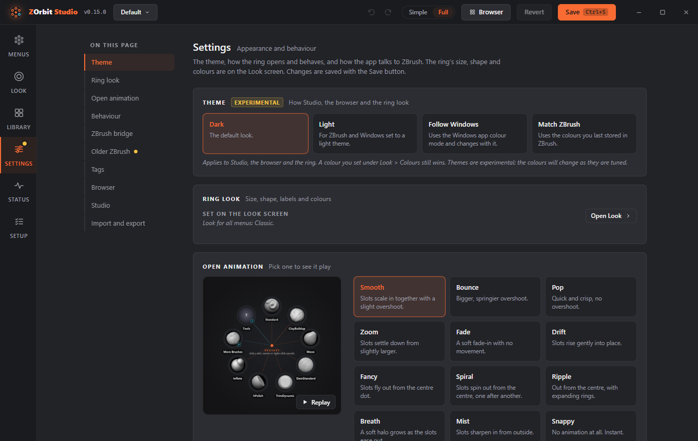
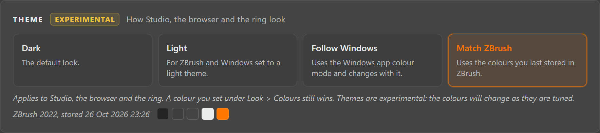
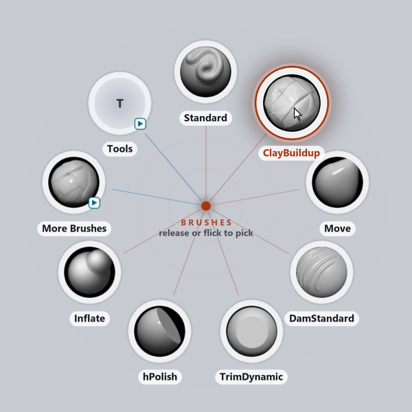
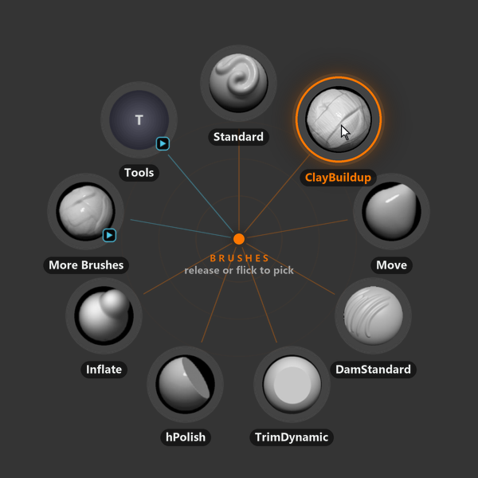
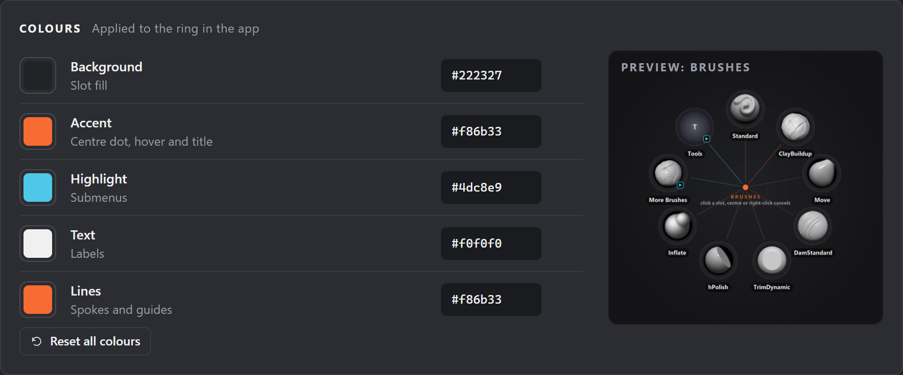
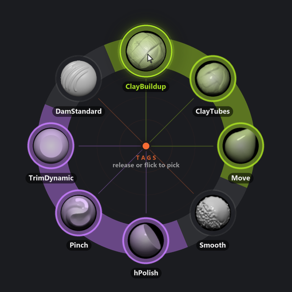
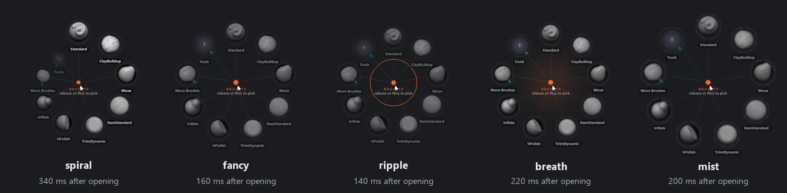

# Appearance

## Appearance and behaviour settings

These are on the Settings screen in Studio, and under `"ring"` in `radial.json`. Studio shows live previews. The [theme](#theme) is on Settings too, but it is a Studio preference and not in `radial.json`.



| Setting (`ring.`) and its label in Studio | Default | Range | Meaning |
|---|---|---|---|
| `radius` (**Ring radius**; **Ring size** in Simple mode) | 145 | 60 to 400 | Distance from the centre to the slots, in pixels. This is the smallest the ring gets: a menu with many items spreads wider. |
| `slot` (**Slot size**) | 72 | 32 to 160 | Diameter of each icon disc. |
| `dead_zone` (**Dead zone**) | 38 | 10 to 120 | Radius around the centre where no slot is picked. |
| `tap_ms` (**Tap time**) | 250 | 0 to 1000 | A hotkey press shorter than this is a tap. |
| `timeout_s` (**Auto-close**) | 20 | 2 to 120 | An open ring closes itself after this many seconds. |
| `animation` (**Open animation**) | `smooth` | see [Open animations](#open-animations) | The open animation. |
| `labels` (**Labels**: **Icon and name**, **Icon only**) | `name` | `name`, `none` | Show names under the slots, or icons only. A name sits on a soft pill (dark in the Dark theme, light in the Light theme), so it stays readable when a neighbouring slot is close. |
| `flick` (**Flick to pick**) | `true` | `true`, `false` | Moving out past a slot picks it without releasing or clicking. |
| `hover_submenus` (**Open submenus on hover**) | `true` | `true`, `false` | Reaching a submenu slot opens the submenu, centred on that slot. |
| `tag_colors` (**Tag colours**: the **Icon tint** and **Glow** switches) | `tint` | `none`, `tint`, `glow`, `both` | Whether an item's first tag tints its icon, glows, or both. See [Tag colours](#tag-colours). |
| `tag_band` (**Tag colours > Band**: the switch and **Thickness**) | `medium` | `none`, `hairline`, `narrow`, `medium`, `wide` | Thickness of the band through the slot centres. `none` turns it off. |
| `tag_band_opacity` (**Band > Opacity**) | 0.45 | 0 to 1 | How solid the band is. |
| `tag_glow_opacity` (**Glow > Opacity**) | 0.4 | 0 to 1 | Strength of the halo. |
| `tag_tint_opacity` (**Icon tint > Opacity**) | 0.3 | 0 to 1 | Strength of the tag colour laid over the icon. |
| `tag_tint_style` (**Icon tint > Style**) | `gradient` | `flat`, `gradient` | `gradient` is stronger towards the rim. |
| `tag_tint_blend` (**Icon tint > Blend**) | `multiply` | `multiply`, `overlay` | `multiply` darkens the icon. `overlay` keeps its light and shade. |

Sizes are scaled for high-DPI screens automatically.

The radius is a minimum. When a menu has so many items that neighbouring slots would sit closer than 1.25 slot widths apart, the ring grows until they do not. With the default slot size that starts at 10 items: 12 items make a ring about 174 pixels in radius, 24 items about 345. The Studio preview grows the same way, so lowering **Ring radius** changes nothing once a menu is past that point. Raise **Slot size** or cut the number of items to keep the ring smaller. Names in Chinese, Japanese or Korean are drawn with Microsoft YaHei, Yu Gothic or Malgun Gothic, whichever Windows has; other names use Segoe UI.
Studio's [Simple mode](studio.md#simple-and-full-mode) shows only some of these. Its **Ring size** slider moves `radius`, `slot` and `dead_zone` together and keeps their proportions. Full mode has the three separate sliders, and is the only mode that shows `hover_submenus`, `tap_ms`, `timeout_s`, the `tag_` settings and `colors`. The animation, `labels`, `flick` and the theme are in both. What Simple hides keeps its value.

### Theme

Themes are experimental, and the card says so. The colours, those of **Light** and **Match ZBrush** most of all, will change as they are tuned. If something is hard to read with your setup, say so on [issue #32](https://github.com/combwizard/zorbit/issues/32) or in a new issue.

The **Theme** card is at the top of **Settings**, in Simple and Full mode. It has four choices:

- **Dark** is the default.
- **Light** is for ZBrush and Windows set to a light theme.
- **Follow Windows** uses Windows' app colour mode (**Settings > Personalisation > Colours > Choose your default app mode**) and changes with it. The app checks that setting twice a second, so the ring follows within about half a second. Studio and the browser follow as soon as Windows changes.
- **Match ZBrush** uses the colours you last stored in ZBrush. See [Match ZBrush](#match-zbrush).



The theme applies to Studio, the browser and the ring. It belongs to the PC, not to a profile: it is kept as `theme` in `studio.json` (`dark`, `light`, `system` or `zbrush`), not in `radial.json`, so it is not part of an [export](files.md#import-and-export). An open [browser](browser.md) changes with it within about half a second. The plain colour Windows shows for a moment while Studio or the browser is being resized is the one the window started with; it changes when the window is next opened.



A change shows on the ring within about half a second, or at the next open at the latest.

The theme sets the ring's colour defaults (see the table under [Colours](#colours)), and a colour you set under **Colours** still wins. A dark `bg` kept under Light stays dark. The label pill, the hint text, the submenu badge and the [message near the cursor](troubleshooting.md#the-ring-opens-but-picks-do-nothing) follow the theme and not your colours, so a very light `text` can be hard to read on Light's white pill. There is no setting for the pill and badge colours.

#### Match ZBrush

**Match ZBrush** colours the ring, the browser and Studio with the interface colours you set in ZBrush under **Preferences > Icolors**. ZOrbit reads the scheme ZBrush stores when you press **Preferences > Config > Store Config**. ZBrush keeps it in `ZStartup\CustomUserInterface<year>.cfg`, in `%PUBLIC%\Documents\ZBrushData<year>` and, for ZBrush 2026.1 and newer, also in `%APPDATA%\Maxon\ZBrush <year>_<id>\ZStartup\UserInterfaceLayouts` (see [Files and logs](files.md#files-and-logs)). ZOrbit only reads it and never changes it. A colour you changed in ZBrush but did not store is not seen, so press **Store Config**. It works the same on ZBrush 2022 and 2026.

If ZBrush is running, ZOrbit uses that version. Otherwise it uses the newest installed version that has a stored scheme. The card says which: the version and when it was stored, with swatches of five of its colours.



| ZBrush colour (**Preferences > Icolors**) | Used for |
|---|---|
| Bt1 (button) | The ring's slot fill (`bg`), and buttons in Studio and the browser |
| Text2, else Text1 | The ring's label colour (`text`), and text in Studio and the browser |
| Sw1 (a switch that is on) | The ring's `accent` and `lines`, and the accent in Studio and the browser |
| K1 | The ring's `highlight`, unless it is the same hue as Sw1 (in stock ZBrush both are orange), then Dark's or Light's cyan |
| Main | The window background of Studio and the browser |
| Palette1, Palette2 | The panels of Studio and the browser |

The rest of the look (the label pill, the hints, and everything the scheme does not give) comes from Dark or Light, whichever is closer to ZBrush's Main colour. Any colour that would be hard to read on what it sits on is replaced by the Dark or Light one. A colour you set under **Colours** still wins, as with the other themes.

After a new **Store Config** the ring and an open browser follow within about half a second, and Studio when its window next gets the focus.

If ZOrbit finds no stored scheme, it uses Dark and the card says so. See [Match ZBrush shows the Dark colours](troubleshooting.md#match-zbrush-shows-the-dark-colours).

### Colours

`ring.colors` takes `#rrggbb` values. In Studio they are on the **Colours** card, which needs [Full mode](studio.md#simple-and-full-mode). The defaults depend on the [theme](#theme).

| Colour | Dark default | Light default | Used for |
|---|---|---|---|
| `bg` | `#222327` | `#f3f4f6` | Slot fill |
| `accent` | `#f86b33` | `#a8360f` | Centre dot, hover, title |
| `highlight` | `#4dc8e9` | `#066785` | Submenu slots and badges |
| `text` | `#f0f0f0` | `#1b1c20` | Labels |
| `lines` | `#f86b33` | `#a8360f` | Spokes and guide circles |



```json
"ring": {
  "radius": 160,
  "animation": "spiral",
  "colors": {"accent": "#7bd88f", "lines": "#7bd88f"}
}
```

Anything you leave out keeps the theme's default. Values outside the allowed range are reported as problems and the default is used. In Studio, a slider or switch put back to its default is taken out of the file again, so it counts as no change.

### Tag colours

The colour of an item's first tag (see [Tags](tags.md)) can show on its slot in three ways: an icon tint, a glow and a band. In Studio they are the three groups of the **Tag colours** card on the Settings screen (Full mode), each with its own switch. Beside them is a preview. It shows the current menu if it has a tagged brush, and otherwise a sample ring of your brushes coloured with your tags, so every change is visible.



- **Icon tint** is a rim in the tag colour, and the tag colour laid over the brush icon. **Opacity** (`tag_tint_opacity`, 0 to 1, default 0.3) sets how strong it is. **Style** (`tag_tint_style`) is `flat`, or `gradient` (the default), which is stronger towards the rim. **Blend** (`tag_tint_blend`) is `multiply` (the default, **Darken** in Studio), which darkens the icon, or `overlay` (**Keep highlights**), which keeps its light and shade.
- **Glow** is a soft halo in the tag colour around the slot. **Opacity** (`tag_glow_opacity`, 0 to 1, default 0.4) sets how strong it is.
- **Band** is a strip through the slot centres. Each slot's stretch of it is in its tag colour, an untagged slot gets a faint grey stretch, and a ring with no tagged slots has no band. **Thickness** (`tag_band`) is `hairline`, `narrow`, `medium` (the default) or `wide`, or `none` to turn the band off. **Opacity** (`tag_band_opacity`, 0 to 1, default 0.45) sets how solid it is.

The tint and glow switches together set `ring.tag_colors`. The band switch sets `tag_band` to `none`, or back to its thickness.

| `tag_colors` | What you see |
|---|---|
| `none` | Neither tint nor glow. |
| `tint` | The icon tint. The default. |
| `glow` | The glow. |
| `both` | The tint and the glow together. |

The band does not depend on `tag_colors`. Slot colours are dropped entirely, hover border, spoke, label and band included, only when `tag_colors` is `none` and `tag_band` is `none`. A `tag` slot is always drawn in its tag's colour, and so are the dashed lines to its fan, whatever these settings say. The items inside the fan follow the settings like any other slot, so they stay plain when tint, glow and band are all off. Items without a tag look as before. The colours are drawn when the ring opens, so they cost no speed.

In Studio, opacities show as percentages (45%) but are 0 to 1 in the file. Controls under a switch that is off are dimmed.

```json
"ring": {
  "tag_colors": "both",
  "tag_band": "narrow",
  "tag_tint_opacity": 0.4,
  "tag_tint_style": "flat"
}
```

### Browser hotkey

```json
"browser": {"hotkey": "Alt+B"}
```

The hotkey that opens the [browser window](browser.md) and, pressed over it, hands the keyboard back to ZBrush. On Settings it is the **Browser** card, where you record it like a menu hotkey and Studio warns if a menu already uses it. New installs get **Alt+B**. An existing `radial.json` has no `browser` section until you add one, so the hotkey does nothing there. Leave it out for no hotkey. The browser then opens from a **Browser** slot, **More...** in a tag's fan, the tray menu, Studio's **Browser** buttons and the Start menu shortcut (see [Opening it](browser.md#opening-it)).

## Open animations

Set `ring.animation` (or pick one in Studio, which plays a preview). Closing is always instant, so a pick never waits for an animation.

Any menu or submenu can use a different one: give it its own `animation`, or pick one under **Open animation** in its menu settings in Studio. Menus without one use `ring.animation`.

```json
"more": {
  "title": "More Brushes",
  "animation": "spiral",
  "items": [ ... ]
}
```

| Mode | What you see |
|---|---|
| `smooth` | Slots scale in together with a slight overshoot. The default. |
| `bounce` | A bigger, springier overshoot. |
| `pop` | Quick and crisp, no overshoot. |
| `zoom` | Slots settle down from slightly larger. |
| `fade` | A soft fade-in with no movement. |
| `drift` | Slots rise gently into place. |
| `fancy` | Slots fly out from the centre dot. |
| `spiral` | Slots spin out from the centre, one after another, clockwise. |
| `ripple` | Slots move out from the centre while rings expand from the dot. |
| `breath` | A soft halo grows behind the dot as the slots ease out. |
| `mist` | Slots sharpen in from beyond their seats. |
| `snappy` | No animation. The ring appears instantly. |

Only `spiral` staggers its slots; every other mode animates all slots at the same time.

Frames from a few modes, partway through opening:


