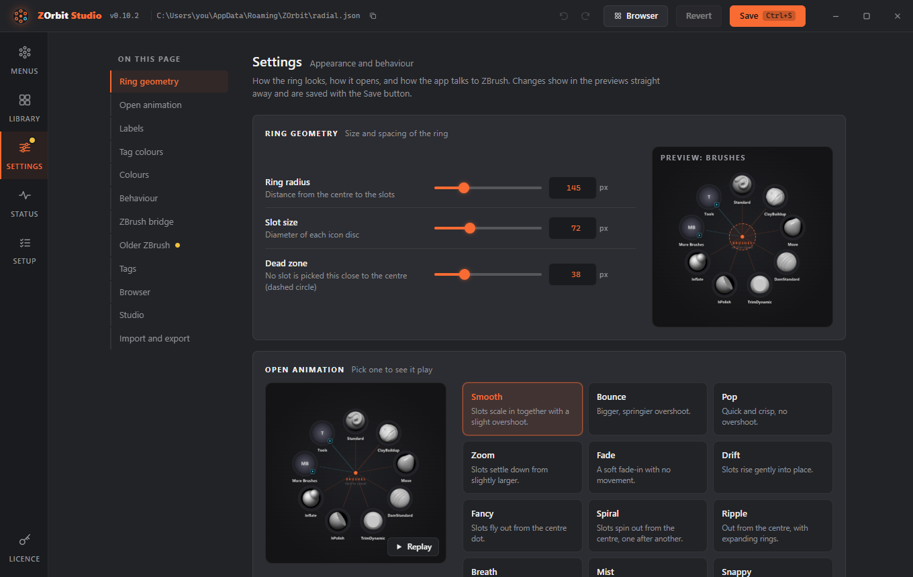
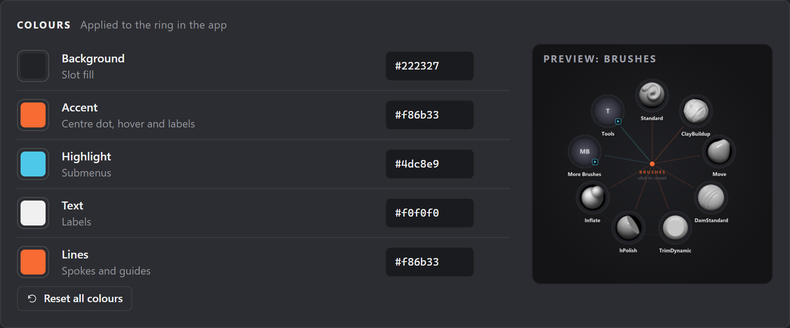
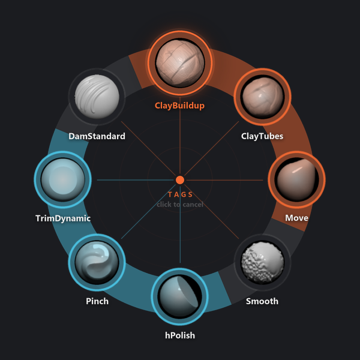

# Appearance

## Appearance and behaviour settings

These are on the Settings screen in Studio, and under `"ring"` in `radial.json`. Studio shows live previews.



| Setting (`ring.`) | Default | Range | Meaning |
|---|---|---|---|
| `radius` | 145 | 60 to 400 | Distance from the centre to the slots, in pixels. |
| `slot` | 72 | 32 to 160 | Diameter of each icon disc. |
| `dead_zone` | 38 | 10 to 120 | Radius around the centre where no slot is picked. |
| `tap_ms` | 250 | 0 to 1000 | A hotkey press shorter than this is a tap. |
| `timeout_s` | 20 | 2 to 120 | An open ring closes itself after this many seconds. |
| `animation` | `smooth` | see [Open animations](#open-animations) | The open animation. |
| `labels` | `name` | `name`, `none` | Show names under the slots, or icons only. |
| `flick` | `true` | `true`, `false` | Moving out past a slot picks it without releasing or clicking. |
| `hover_submenus` | `true` | `true`, `false` | Reaching a submenu slot opens the submenu, centred on that slot. |
| `tag_colors` | `tint` | `none`, `tint`, `glow`, `both` | Whether an item's first tag tints its icon, glows, or both. See [Tag colours](#tag-colours). |
| `tag_band` | `medium` | `none`, `hairline`, `narrow`, `medium`, `wide` | Thickness of the band through the slot centres. `none` turns it off. |
| `tag_band_opacity` | 0.45 | 0 to 1 | How solid the band is. |
| `tag_glow_opacity` | 0.4 | 0 to 1 | Strength of the halo. |
| `tag_tint_opacity` | 0.3 | 0 to 1 | Strength of the tag colour laid over the icon. |
| `tag_tint_style` | `gradient` | `flat`, `gradient` | `gradient` is stronger towards the rim. |
| `tag_tint_blend` | `multiply` | `multiply`, `overlay` | `multiply` darkens the icon. `overlay` keeps its light and shade. |

Sizes are scaled for high-DPI screens automatically.

### Colours

`ring.colors` takes `#rrggbb` values:

| Colour | Default | Used for |
|---|---|---|
| `bg` | `#222327` | Slot fill |
| `accent` | `#f86b33` | Centre dot, hover, title |
| `highlight` | `#4dc8e9` | Submenu slots and badges |
| `text` | `#f0f0f0` | Labels |
| `lines` | `#f86b33` | Spokes and guide circles |



```json
"ring": {
  "radius": 160,
  "animation": "spiral",
  "colors": {"accent": "#7bd88f", "lines": "#7bd88f"}
}
```

Anything you leave out keeps its default. Values outside the allowed range are reported as problems and the default is used.

### Tag colours

The colour of an item's first tag (see [Tags](tags.md)) can show on its slot in three ways: an icon tint, a glow and a band. In Studio they are the three groups of the **Tag colours** card on the Settings screen, each with its own switch. Beside them is a preview. It shows the current menu if it has a tagged brush, and otherwise a sample ring of your brushes coloured with your tags, so every change is visible.



- **Icon tint** is a rim in the tag colour, and the tag colour laid over the brush icon. **Opacity** (`tag_tint_opacity`, 0 to 1, default 0.3) sets how strong it is. **Style** (`tag_tint_style`) is `flat`, or `gradient` (the default), which is stronger towards the rim. **Blend** (`tag_tint_blend`) is `multiply` (the default, **Darken** in Studio), which darkens the icon, or `overlay` (**Keep highlights**), which keeps its light and shade.
- **Glow** is a soft halo in the tag colour around the slot. **Opacity** (`tag_glow_opacity`, 0 to 1, default 0.4) sets how strong it is.
- **Band** is a strip through the slot centres. Each slot's stretch of it is in its tag colour, an untagged slot gets a faint grey stretch, and a ring with no tagged slots has no band. **Thickness** (`tag_band`) is `hairline`, `narrow`, `medium` (the default) or `wide`, or `none` to turn the band off. **Opacity** (`tag_band_opacity`, 0 to 1, default 0.45) sets how solid it is.

The tint and glow switches together set `ring.tag_colors`. The band switch sets `tag_band` to `none`, or back to its thickness.

| `tag_colors` | What you see |
|---|---|
| `none` | Neither tint nor glow. |
| `tint` | The icon tint. The default. |
| `glow` | The glow. |
| `both` | The tint and the glow together. |

The band does not depend on `tag_colors`. Slot colours are dropped entirely, hover border, spoke, label and band included, only when `tag_colors` is `none` and `tag_band` is `none`. The fan of a `tag` slot is always drawn in that tag's colour, and so is the slot itself. Items without a tag look as before. The colours are drawn when the ring opens, so they cost no speed.

In Studio, opacities show as percentages (45%) but are 0 to 1 in the file. Controls under a switch that is off are dimmed.

```json
"ring": {
  "tag_colors": "both",
  "tag_band": "narrow",
  "tag_tint_opacity": 0.4,
  "tag_tint_style": "flat"
}
```

### Browser hotkey

```json
"browser": {"hotkey": "Alt+B"}
```

The hotkey that opens the [browser window](browser.md) and, pressed over it, hands the keyboard back to ZBrush. On Settings it is the **Browser** card, where you record it like a menu hotkey and Studio warns if a menu already uses it. New installs get **Alt+B**. An existing `radial.json` has no `browser` section until you add one, so the hotkey does nothing there. Leave it out for no hotkey; the browser then opens from **Browser** slots only.

## Open animations

Set `ring.animation` (or pick one in Studio, which plays a preview). Closing is always instant, so a pick never waits for an animation.

Any menu or submenu can use a different one: give it its own `animation`, or pick one under **Open animation** in its menu settings in Studio. Menus without one use `ring.animation`.

```json
"more": {
  "title": "More Brushes",
  "animation": "spiral",
  "items": [ ... ]
}
```

| Mode | What you see |
|---|---|
| `smooth` | Slots scale in together with a slight overshoot. The default. |
| `bounce` | A bigger, springier overshoot. |
| `pop` | Quick and crisp, no overshoot. |
| `zoom` | Slots settle down from slightly larger. |
| `fade` | A soft fade-in with no movement. |
| `drift` | Slots rise gently into place. |
| `fancy` | Slots fly out from the centre dot. |
| `spiral` | Slots spin out from the centre, one after another, clockwise. |
| `ripple` | Slots move out from the centre while rings expand from the dot. |
| `breath` | A soft halo grows behind the dot as the slots ease out. |
| `mist` | Slots sharpen in from beyond their seats. |
| `snappy` | No animation. The ring appears instantly. |

Only `spiral` staggers its slots; every other mode animates all slots at the same time.

Frames from a few modes, partway through opening:


