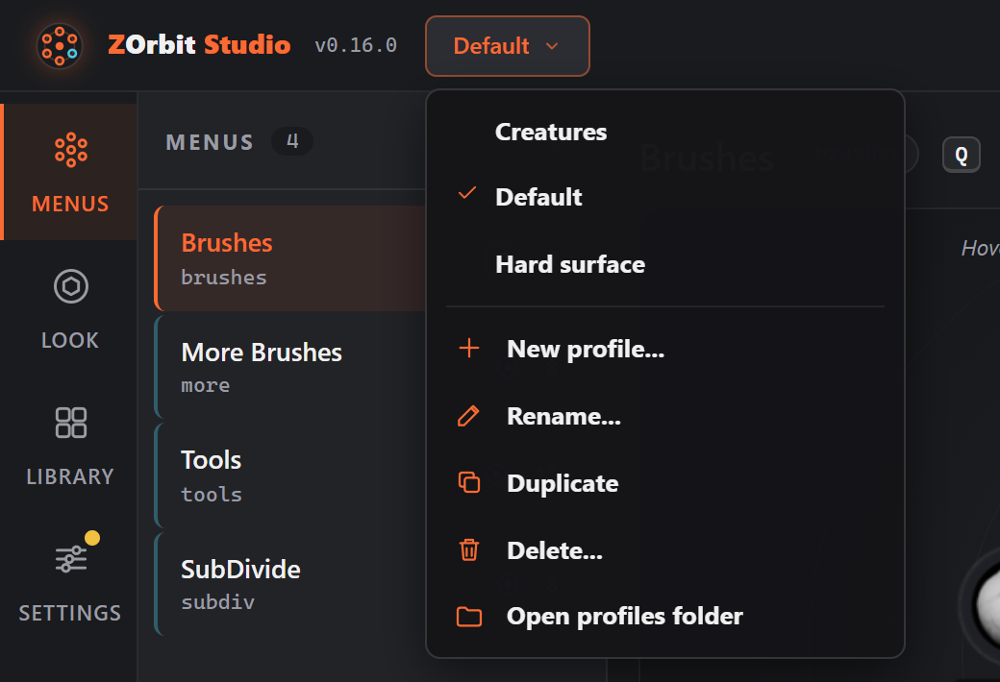
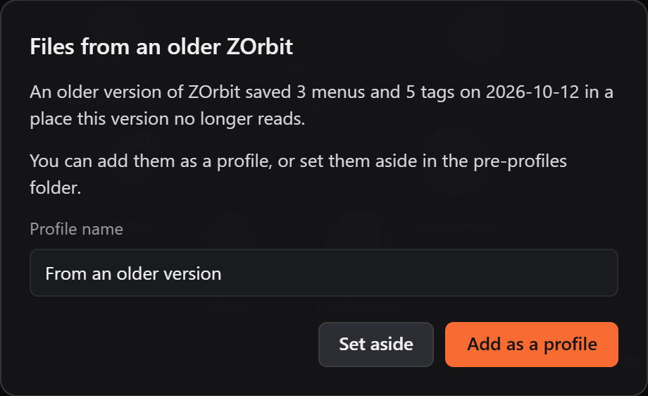

# ZOrbit 0.13.0: profiles

0.13.0 adds profiles. A profile is a whole setup: your menus and ring settings, your tags, and the usage that fills the auto slots and Recent. You can keep one for sculpting and one for hard-surface work, and switch between them without restarting anything.

To make room for them, this release moves every file ZOrbit keeps. Most of the testing in this release went into that move.

<!-- more -->

## Why profiles

The brushes you reach for on a creature aren't the ones you want for a hard-surface prop or a client's pipeline. Until now ZOrbit had one set of menus, so you either lived with a compromise or swapped `radial.json` by hand. I opened [#19](https://github.com/combwizard/zorbit/issues/19) for this a while ago and marked it for 1.0, because it changes where ZOrbit keeps its files, but it was ready before then.

## Using them

The button next to the wordmark in Studio's top bar names the profile you're editing. Click it to switch, or to make a new profile from the starter menus, an empty menu, a copy of the current profile, or a settings file someone exported. The tray icon has a **Profile** submenu as well.

The ring follows a switch within half a second, and the browser within a few seconds.

I changed one thing from the plan in #19. I meant to keep usage shared between profiles, but then a sculpting profile's auto slots would fill up with the brushes you used for hard-surface work. So each profile has its own `usage.json` and learns its own auto slots.

A hotkey that cycles through profiles, and switching by itself when ZBrush opens a matching project, didn't make it in. They're in [#94](https://github.com/combwizard/zorbit/issues/94).

The [Profiles page](../../profiles.md) covers naming, renaming and deleting profiles, and sharing one with another PC.

## Moving your files

On the first start after the update, your menus, tags and usage move into `%APPDATA%\ZOrbit\profiles\Default\`. Apart from the new button, nothing should look different. The old files are kept in `%APPDATA%\ZOrbit\pre-profiles\`, and you can delete that folder once you're happy.

A move like this can cost someone hours of setup if it goes wrong, so I tested it on real data. The tests run the move over files that 0.7.0, 0.7.1, 0.9.0 and 0.12.0 wrote, made by running each release's own code. Every build also runs the finished exe over the same files before it can become a release.

You can also go back. 0.12.0 doesn't know about profiles, so if you install it again it starts with the starter menus, while your real files stay in the **Default** profile. When you update again, Studio finds whatever 0.12.0 saved and offers to add it as a new profile or set it aside.

A few smaller things came with the move:

- From this version on, ZOrbit leaves alone any files that a newer version wrote, and tells you which version to install to read them.
- A newer ZOrbit takes over from an older copy that is still running, such as a portable copy you forgot about. **Studio > Status** offers **Restart app** when the app running is older than Studio.
- Studio shows **What's new** once after an update, with a short summary of each release since the last one you saw. Posts here are for the longer version.

## Also in 0.13.0

- **Export menu...** and **Import menu...** share one menu and its submenus as a small file, with the tags it uses ([#67](https://github.com/combwizard/zorbit/issues/67)).
- In ZBrush 2026, a pick made during a stroke that lasted more than 10 seconds was dropped without a word. It now goes through.
- Studio and the browser no longer wipe their own settings file after one failed read. Before, a `studio.json` held open by another program could cost you your window positions and preferences.

The full list is in the [release notes](https://github.com/combwizard/zorbit/releases/tag/v0.13.0).

If you use profiles, I'd like to hear how you split your menus. Comment on [#94](https://github.com/combwizard/zorbit/issues/94) or [open an issue](https://github.com/combwizard/zorbit/issues).
