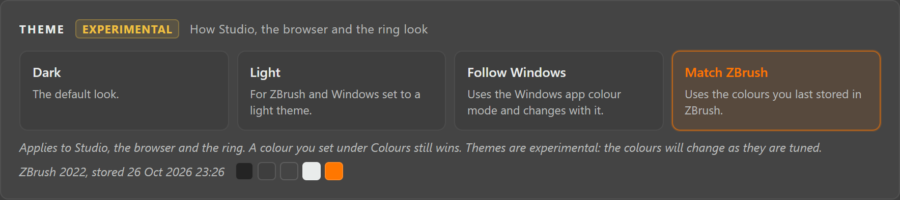
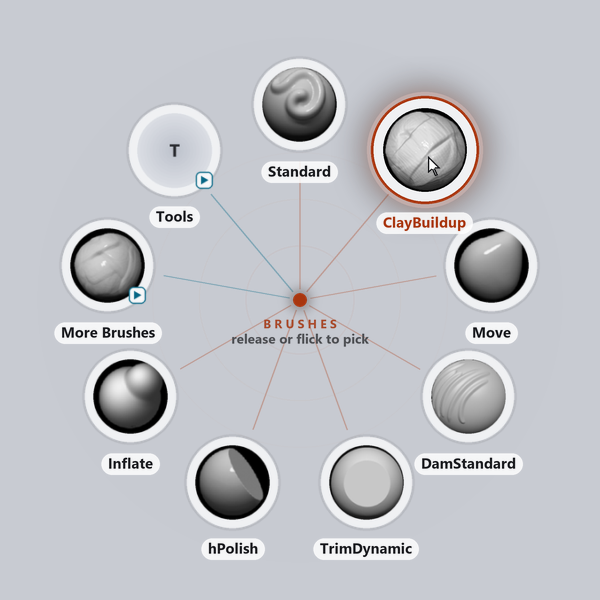
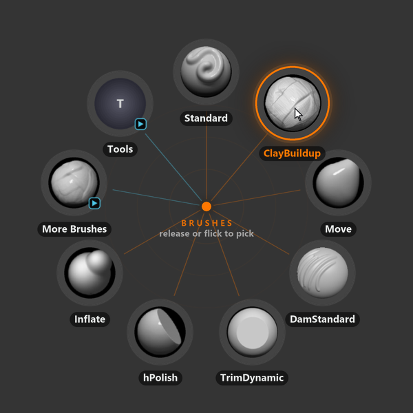

# ZOrbit 0.14.0: themes

0.14.0 adds a **Theme** setting. Until now the ring, the browser and Studio came in dark only, which looks out of place if you run ZBrush or Windows with lighter colours, and plenty of people do. There are four choices now: Dark, Light, Follow Windows, and Match ZBrush, which takes its colours from ZBrush itself.

Themes are experimental in this release, and Studio marks them that way. I expect the colours to change a fair amount once more people use them, so I'd like to hear how they look on your setup.

<!-- more -->

## The four choices

The **Theme** card is at the top of **Settings**, in Simple and Full mode.

- **Dark** is the look ZOrbit has always had, and it stays the default.
- **Light** is for a light ZBrush or Windows. The ring gets pale slots with dark labels, and Studio and the browser turn light too. Brush, alpha and material pictures keep their dark backgrounds, because ZBrush draws them light on dark.
- **Follow Windows** switches between the two when Windows changes its app mode, on a schedule for instance.
- **Match ZBrush** has its own section below.

The theme belongs to the PC, not to a profile. It changes the ring, the browser and Studio at once, window border included. The ring and an open browser follow a change within about half a second, so you can keep the browser open next to Studio and try each theme in turn. A colour you set under **Colours** still wins over the theme, as before.

## Match ZBrush

ZBrush lets you set its own interface colours under **Preferences > Icolors**, and a lot of people change them. Match ZBrush uses those colours: ZBrush's button colour for the ring's slots, its text colour for the labels, the colour of a switch that is on (orange, unless you changed it) for the accent, and its background and palette colours for Studio and the browser.

It reads the scheme ZBrush saves when you press **Preferences > Config > Store Config**, so colours you changed but haven't stored don't count yet. ZOrbit only reads that file and never writes to it. With several ZBrush versions installed it uses the one that is running, and otherwise the newest one with a stored scheme. The Theme card shows which version it is reading and when that was stored.

ZBrush doesn't document the file, so I had to work out its layout first. A small script starts ZBrush, sets each colour patch to a marker colour in turn, saves the scheme after each change and compares the files. That showed where each colour sits and how it is packed, and the layout is the same in ZBrush 2022 and 2026. [#32](https://github.com/combwizard/zorbit/issues/32) has the details, and the script is in the repository in case a later ZBrush changes the format.

Some schemes would put light text on a light button, or something similar. Where a colour would be hard to read, ZOrbit uses the one from Dark or Light instead, whichever is closer to your scheme.

## Experimental: tell me what reads badly

I tuned the light colours and the matching on one PC and a handful of ZBrush schemes. Your monitor, your scheme and the way you work will turn up cases I haven't seen, and I'd rather fix those than guess at them. If something is hard to read, looks wrong next to ZBrush, or Match ZBrush picks colours you wouldn't, send a screenshot with a line about your setup. Comment on [#32](https://github.com/combwizard/zorbit/issues/32) or [open an issue](https://github.com/combwizard/zorbit/issues).

Two follow-ups are already open: [custom themes](https://github.com/combwizard/zorbit/issues/98) you can make, save and share, and a small one about the browser taking a theme from Studio at once instead of within half a second ([#97](https://github.com/combwizard/zorbit/issues/97)).

## Also in 0.14.0

- Studio has a short tour of its window. It is offered once after Setup, and you can take it again from **Settings > Studio** ([#41](https://github.com/combwizard/zorbit/issues/41)).
- Studio's header now has the same colour as the bar on the left, and the browser's tabs no longer sit on a darker strip.
- A menu id such as `constructor` or `toString` broke Studio. Those ids are now refused.
- Studio no longer opens on a blank screen when its settings file names a screen that doesn't exist.

The full list is in the [release notes](https://github.com/combwizard/zorbit/releases/tag/v0.14.0).
