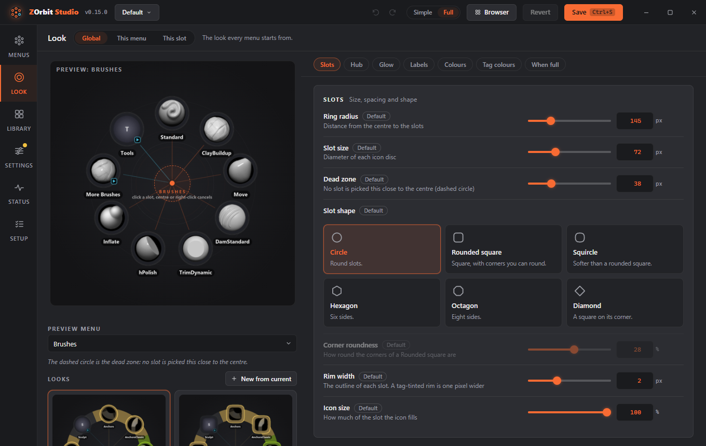
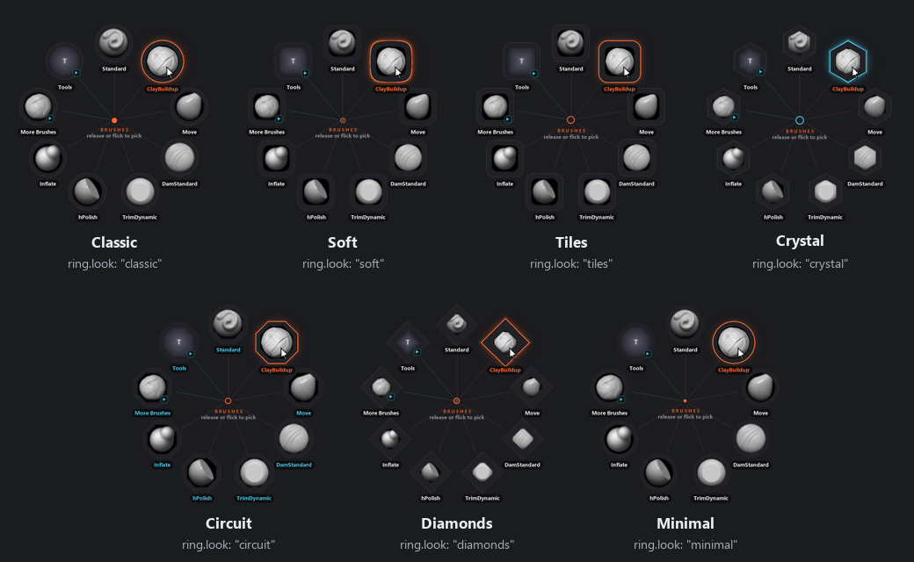
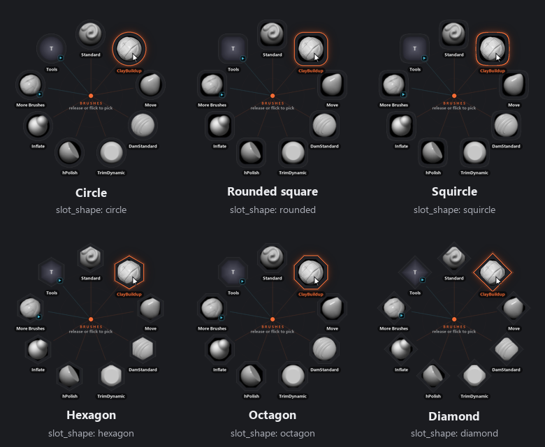
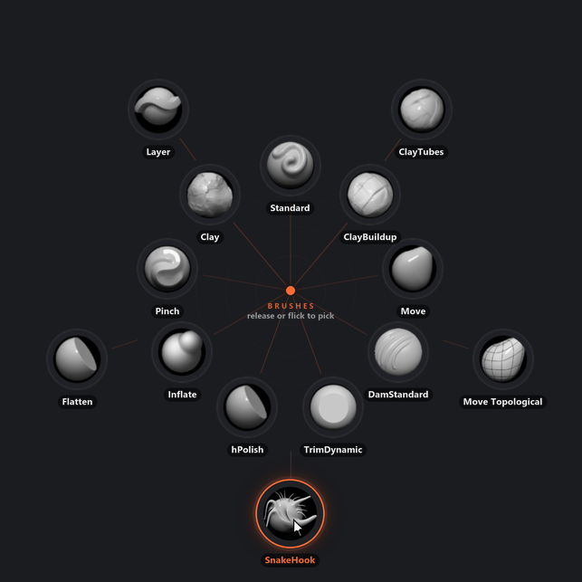
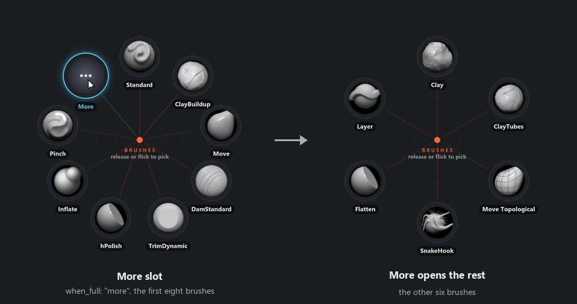

# ZOrbit 0.15.0: looks

0.15.0 adds looks. Until now the way the ring looked was one set of settings for every menu: the slot size, the colours, the labels. If you wanted your Tools ring to look different from your Brushes ring, you couldn't. Now a menu can have its own look, and so can a single slot.

A look is a named group of those settings. Seven come with ZOrbit and you can save your own. A look is a live link: change it, and every menu that uses it changes with it.

Studio has a new **Look** screen for all of this, and a menu with more items than fit can now spill onto a second ring or end in a **More** slot instead of growing.

<!-- more -->

## The Look screen

**Look** is on **Alt+2**. The ring size, the labels and the colours used to be on **Settings**, and they have moved here.

The bar at the top says what you are editing:

- **Global** is the look every menu starts from.
- **This menu** is one menu, picked from the list beside it. Anything you leave alone follows Global.
- **This slot** (Full mode) is one slot of that menu.

Each setting has a small badge that says where its value comes from: the default, the theme, a look, Global, the menu or the slot. Click the badge and you go to that level. With three levels it would otherwise be hard to tell why a slot looks the way it does.

On the left is a preview drawn by the same code as the ring, with the gallery of looks under it.

## Seven looks, and your own

**Classic** is what ZOrbit has always looked like, and it is still the default. The others are **Soft**, **Tiles**, **Crystal**, **Circuit**, **Diamonds** and **Minimal**. They change the shape of the slots, the hub, the glow and the labels. They never set the size of the ring or your colours.

**Use for all menus** applies a look. It also clears the settings of your own that would hide it, and a toast tells you how many it cleared and has an **Undo**. **New from current** saves what the preview shows as a look of your own. Your looks are saved under `looks` in `radial.json`, and **Export menu...** takes the ones a menu uses along with it.

## Slot shapes and hubs

There are six slot shapes now: circle, rounded square, squircle, hexagon, octagon and diamond. **Slot shape** is under **Slots** on the Look screen. There are also **Corner roundness**, **Rim width** and **Icon size**.

The icon, the hover glow and the tag colours follow the shape, and a slot is picked where the shape is. One slot can also have its own shape, size (75% to 125%), fill and rim colours, icon size, label colour and glow colour. Click it in the preview with **This slot** chosen. The item panel's **Style** field lists what a slot has and has an **Edit in Look** link.

The hub in the middle of the ring has a size from 0 to 64 px and a style too: a dot, which is what it was before, a disc, a ring, or the menu's icon. It has its own colour and glow.

Colours in a look can be a theme colour (bg, accent, highlight, text or lines) or a plain `#rrggbb`. A theme colour follows the theme and any colours you set, so a hub in accent turns green when you make accent green. A fixed colour stays as it is.

## When a ring is full

A ring is full when its slots would sit closer than about 1.25 slot widths apart. Before, the ring just grew until they fit, which is still the default and is called **Grow**. **When full** now has two other choices.

**Second ring** keeps the radius and puts the rest of the items on a ring outside it. Only the outer ring picks on a flick, so going out past an inner slot doesn't pick it. **More slot** keeps the radius too, shows as many slots as fit less one, and makes the last one a **More** slot, drawn with three dots, that opens a ring with the rest.

Fans are never paged. The note above the item list on Menus now says when a ring is full at its radius, how many items fit and what the ring does about it.

## One thing that moved

The Look screen took **Alt+2**, so the screens after Menus have each moved down one. **Library** is **Alt+3**, **Settings** **Alt+4**, **Status** **Alt+5** and **Setup** **Alt+6**.

## Tell me what you'd use

Your menus will turn up cases I haven't seen. If a look reads badly or a setting does something you didn't expect, [open an issue](https://github.com/combwizard/zorbit/issues) with a screenshot. The [Look screen](../../studio.md#the-look-screen) and [Appearance](../../appearance.md#looks) pages describe every setting.

## Also in 0.15.0

- Studio can install an update itself. Click the new version at the top, or **Install update** in **Settings > Studio**. It checks the installer's SHA-256 before it runs it.
- The **Revert** confirmation lists the unsaved changes it would discard.
- Studio no longer opens as an empty dark window when it was closed maximised.
- The path to `radial.json` is gone from Studio's top bar, because it pushed the version number out of sight. **Open menus folder** on **Status** still opens the folder.

The full list is in the [release notes](https://github.com/combwizard/zorbit/releases/tag/v0.15.0).
