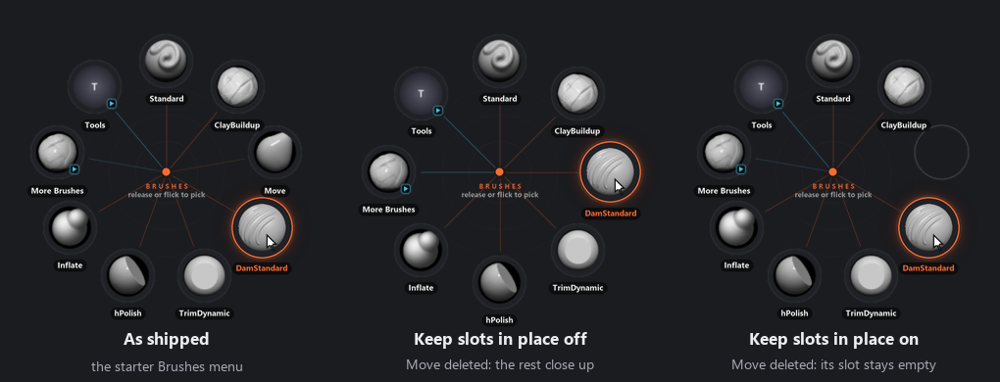

# ZOrbit 0.17.0: empty slots

A radial menu works because your hand learns it. After a week of sculpting, Move is off to the right and you flick there without looking. Until now, ZOrbit undid that the moment you edited the menu. Delete one brush and every brush after it moved round by a slot. Add one in the middle and they all moved the other way, and your hand had to learn the ring again.

0.17.0 adds empty slots. A slot can now hold nothing, and with **Keep slots in place** on, Studio leaves every other item where it is while you edit.

I have no idea why I didn't build it this way from the start. A ring is a set of places, and for every version up to now I treated it as a list.

<!-- more -->

## Delete one brush

On the left is the starter Brushes ring. In the middle, Move is deleted the old way: DamStandard slides up into its place, and so does everything after it. On the right it is deleted with **Keep slots in place** on. Move's slot is empty and nothing else has moved.

An empty slot on the ring is a faint outline in the slot's shape, with no label. Hovering it lights nothing up and releasing over it does nothing, so a gap is safe to flick across. In Studio's item list it shows dimmed and in italics. In `radial.json` it is one line, `{"empty": true}`, if you edit menus by hand.

## Keep slots in place

The switch is on the **Menu** tab. With it on:

- Deleting an item leaves an empty slot where it was. The toast says what was cleared and has **Undo**. Deleting a slot that is already empty removes it.
- A new item fills the first empty slot, or goes in a new slot at the end when there is none. That covers **Add item**, the Library, **Duplicate** and moving an item over from another menu.
- Dragging an item onto another slot in the ring preview swaps the two. Dropped on an empty slot, it moves there and its old slot stays empty. The hint under the pointer says which will happen before you let go.
- **Alt+Up** and **Alt+Down** swap an item with its neighbour.
- **+** and **−** at the top left of the ring preview add an empty slot at the end or remove the last one, so you can decide how many places the ring has before you fill them.

Moving things around is the part I like to watch. The brush glides to its new place along the ring, and when two slots trade, the two pictures pass each other on separate lanes. It takes a quarter of a second, which is enough to see which brush went where.

With the switch off, Studio edits a menu the way it always has. Turning it off also closes up the menu's gaps, and the toast has **Undo** for that too.

## Your menus

The switch is on for a new menu, which starts with eight empty slots, for a submenu made from an item, and for the starter menus in a fresh install. Menus you already have keep it off, so nothing moves on the update. Turn it on for each menu you want to keep still.

If you go back to an older ZOrbit, it skips the empty slots and the items after each gap close up. You lose the gaps but none of your brushes.

The [Menus page](../../menus.md#keep-slots-in-place) has the details, including how empty slots behave on a ring that ends in a **More** slot.

## Studio asks less of you

I went through Studio's Simple and Full modes to check that each shows what it should, and cut what got in the way:

- **Setup** has three steps. A step that is done folds to one line, and the tour after it has six stops instead of ten.
- **Settings** is shorter. **Theme** and **Behaviour** come first, and the browser hotkey is now a row in **Behaviour**.
- The open animation is set on the **Look** screen, in a new **Opening** group, and **Play** runs it on the preview there. A menu can have its own in Simple mode too.
- In Full mode the groups on **Look** fold, each showing a one-line summary until you open it, so turning Full on doesn't put every control in front of you at once.
- Simple mode no longer says you changed something in Full mode when you didn't. Press and Toggle items are everyday items now, so most of the starter Tools menu can be edited in Simple.

## Also in 0.17.0

- A **Match** switch for tag filters in the Library and the browser: **Any** shows items with at least one of the chosen tags, **All** only items with every one.
- **Tag fan slots** (Full mode) sets how many slots a tag fan holds, from 4 to 24.
- In ZBrush 2022 to 2025, an alpha, material or texture whose file name differs from its name in the menu is no longer imported again on every pick, and `radiald.log` keeps the result of every pick.
- ZOrbit now runs on Python 3.14. The installer and the portable zip bring their own, so there is nothing to install.

The full list is in the [release notes](https://github.com/combwizard/zorbit/releases/tag/v0.17.0).
