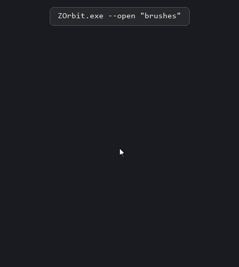
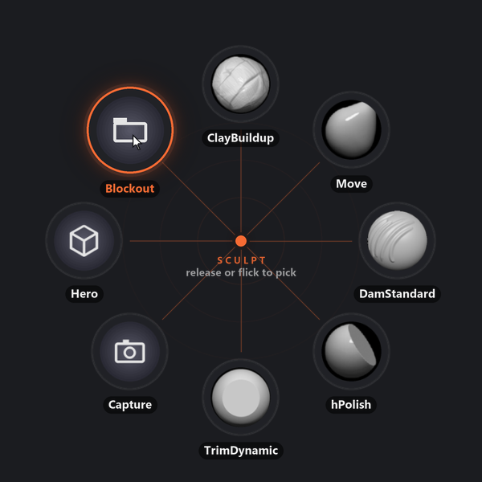
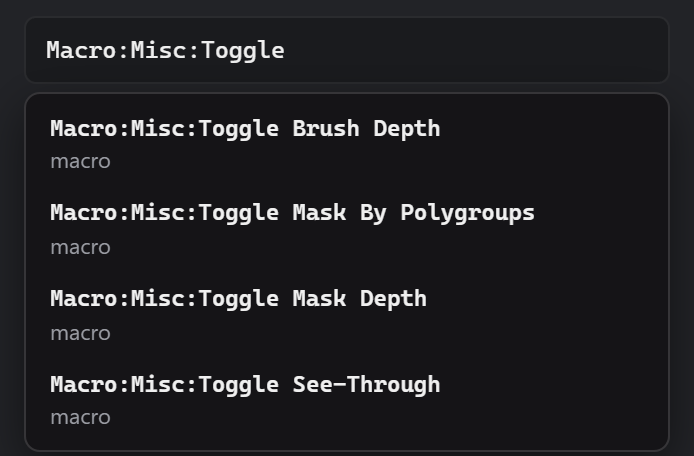
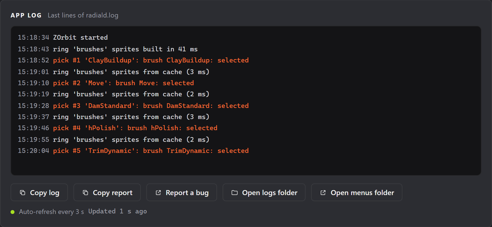

# ZOrbit 0.19.0: commands from other programs

Until now, opening a ring took a hotkey. In 0.19.0, anything that can run a program can do it too. `ZOrbit.exe` takes a command, hands it to the app that is already running and quits, so a Stream Deck button, the software that came with your tablet, AutoHotkey or a script can open a menu, pick a brush or switch profile.

There are also three new kinds of slot for things that used to mean a dialog in ZBrush. One saves the document as a PNG, one loads a tool and one opens a project.

<!-- more -->

## The commands



```
ZOrbit.exe --open "brushes"
ZOrbit.exe --pick "brush:ClayBuildup"
ZOrbit.exe --press "Tool:Masking:Clear"
ZOrbit.exe --set "Draw:Draw Size" 64
ZOrbit.exe --toggle "Transform:Activate Symmetry"
ZOrbit.exe --browser --kind alpha
ZOrbit.exe --profile next
```

A command never starts a second app, shows no window and doesn't move the focus. `--pick`, `--press`, `--set` and `--toggle` do what a slot with that action does: they reach ZBrush the same way, a pick waits for the pen in ZBrush 2026 and newer, and a failure shows the same message near the cursor.

`--open` needs ZBrush in front, like a hotkey. In ZBrush 2022 to 2025 a pick needs that too, and a device such as a Stream Deck usually leaves it there. In ZBrush 2026 and newer, a pick can also go through while another window is in front, if one ZBrush is running and its listener is working. `--browser` and `--profile` work whichever window is in front.

For scripts, the exit code says what happened: 0 means ZOrbit took the command, 1 means it was refused, and 2 means no ZOrbit answered within 2 seconds. An unknown brush still gives 0, because ZOrbit can't tell whether a brush exists until ZBrush tries it. The message near the cursor tells you in that case.

In a Stream Deck, add a **System > Open** action and put the whole command in **App / File**, with the full path of the program:

```
"C:\Users\you\AppData\Local\Programs\ZOrbit\ZOrbit.exe" --pick brush:ClayBuildup
```

Elgato doesn't document options in that field. If the button doesn't run the command, put the same line in a `.bat` file and choose that file instead. The [Hotkeys page](../../hotkeys.md#commands-from-other-programs) has the rest.

## Capture, Tool and Project slots



All three are Full mode types, and Studio has browse buttons for their paths.

A [Capture](../../menus.md#capture) slot saves ZBrush's document as a PNG. The picture is the canvas at its own size, so neither the ring nor ZBrush's interface is in it. The file is named for the time you picked it, and a name that is already taken gets `_2`, so nothing is overwritten. Leave the folder empty and it saves to the **ZBrush** folder in your **Pictures** folder.

A [Tool](../../menus.md#tool) slot loads a `.ZTL` into the **Tool** palette.

A [Project](../../menus.md#project) slot opens a `.ZPR`. It can also point at a folder, and then it opens the newest project in that folder, by the time it was saved. If you save `Blockout_012` after `Blockout_011`, the slot follows and the menu doesn't need touching.

A Project slot goes through ZBrush's own check for unsaved work, and that check has a trap in it. When ZBrush asks whether to save your changes, **Cancel** keeps you on your project and **No** drops the changes. **Yes** opens the save window, and if you cancel *that* window, ZBrush still opens the new project and your changes are gone. I measured this in ZBrush 2022 and 2026. To keep working, choose **Cancel** in the first box.

These paths usually hold your Windows name, so they stay out of a menu you export. A Tool or Project slot arrives as an empty slot that keeps its place, and a Capture slot arrives with an empty folder.

These slots need the new plugin, so do one thing after you update. Restart ZBrush 2026 or newer so it loads the plugin. In ZBrush 2022 to 2025, press **Update** on that ZBrush's row in Studio's **Setup** step 1.

## Your macros in a Press slot



Type `Macro` in a **Press** slot's path field and Studio lists your macros, as paths such as `Macro:Misc:Toggle See-Through`. It reads them from the macro folders of your ZBrush installs. A macro file with no button doesn't appear, because ZBrush doesn't make one for it.

## Copy report



When something goes wrong on your PC, I need your versions and your logs, and until now you had to go and find them. **Copy report** on the **Status** screen copies it all in one block: the ZOrbit and Windows versions, your ZBrush installs, the **Status** cards and the ends of the logs, with your Windows user name and folders hidden. **Report a bug** next to it opens the bug form with the versions filled in. Look the report over before you send it, and take out anything you'd rather not share.

## The window frame

Studio and the browser can now be resized from all four edges and corners, the top included. A thin strip around the page, in the theme's background colour, makes room for this, and it goes away while the window is maximised. A maximised window moved to another monitor with **Win+Shift+Arrow** now fills that monitor and stays on it when restored.

## Picks in ZBrush 2022 to 2025

A pick the bridge key doesn't reach now lands a few seconds later, through a fallback script. If ZBrush still doesn't take it, the pick is dropped and the message near the cursor says so. A pick that can't load an item or find a button also says so near the cursor now, as it already did in ZBrush 2026 and newer. Before, only the log said so.

## Tell me what's on your buttons

If you connect ZOrbit to a device or a script, I'd like to hear what you put on it and which command you missed. [Open an issue](https://github.com/combwizard/zorbit/issues) and tell me.

## Also in 0.19.0

- A **Next profile hotkey** in **Settings > Behaviour** (Full mode) steps to the next profile while ZBrush is in front.
- **Quit hidden browser after** (Full mode) quits a hidden browser that has sat unused for that many minutes, to give back its memory. It is off by default.
- The **PolyFrame** slot in the starter **Tools** menu did nothing, because its path was wrong. It works now, in menus you already have too.
- **Export menu** no longer carries an icon's file path, which could hold your Windows user name.
- Picks from a browser opened from Studio use the listener when one ZBrush is running, instead of pressing the bridge key.
- **Select in ZBrush** in the browser no longer refuses a single selected item.
- Studio's ring preview draws a fan's slots once and keeps them, so a preview with open fans comes up quicker.

The full list is in the [release notes](https://github.com/combwizard/zorbit/releases/tag/v0.19.0).
