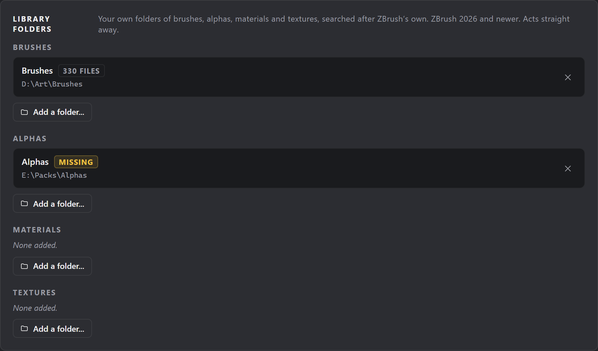
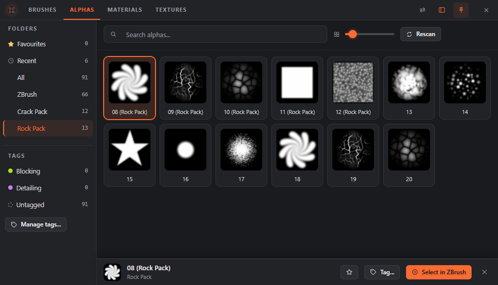
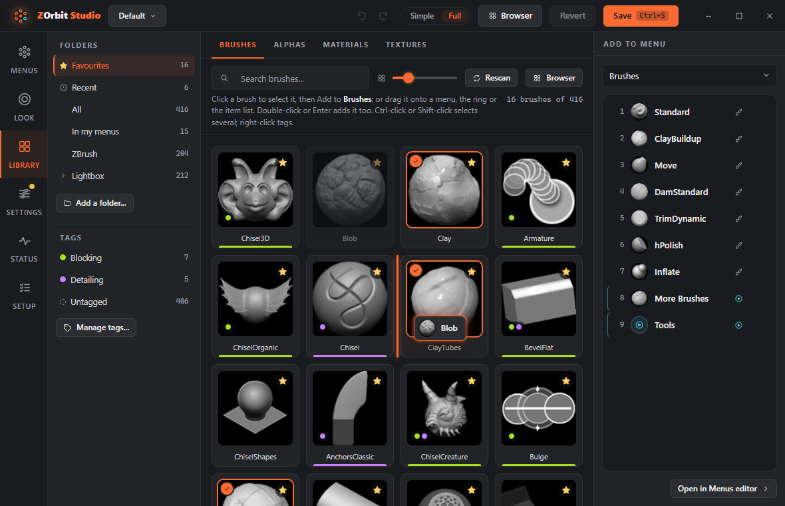
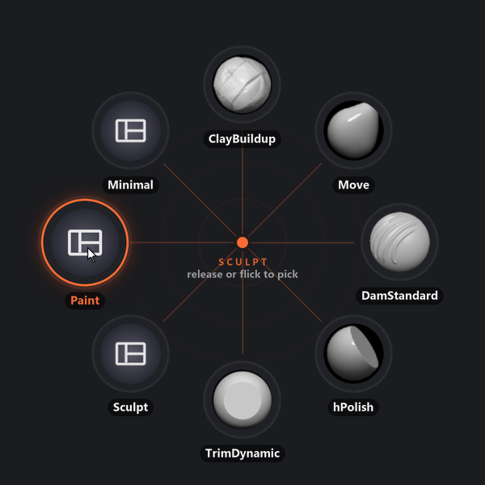
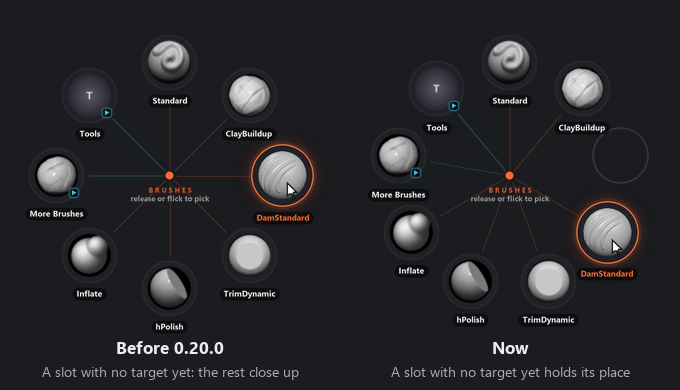

# ZOrbit 0.20.0: your own folders

Until now, ZOrbit only knew what was in ZBrush's own folders. An alpha pack you bought and kept on another drive never showed up in the browser or on the ring. In 0.20.0 you can add that folder, and in ZBrush 2026 and newer you can pick from it like anything else.

Favourites can now follow an order you drag them into, a new kind of slot loads an interface layout, and a tab of thousands of items opens at once.

<!-- more -->

## Your own folders

The **Library folders** card on Studio's **Settings** screen has a list each for brushes, alphas, materials and textures. Press **Add a folder...** under a list and pick the folder. The **Library** screen has the same button under its folders. ZOrbit searches your folders after ZBrush's own, in the order you added them, and each one shows as a folder of its own in the browser and the Library.

The lists belong to the PC. Switching profile doesn't change them, and an exported menu doesn't carry them. Studio refuses a network folder.

If a drive is unplugged, its folder keeps the items it had, and a line above the list says why it couldn't be read. The other folders are read as usual. Before, one folder that couldn't be read froze the whole list.

Picks from your folders need ZBrush 2026 or newer. ZBrush 2022 to 2025 still search only their own installation, so an item that only your folder has is listed, but picking it says it could not be found.

## Packs that reuse names

Packs love to name their files `10`, `11` and `12`, and the same names turn up in pack after pack. In a folder you added, a file whose name is taken is listed with its pack folder in brackets, so `10.png` in `Crack Alphas Vol 1` becomes **10 (Crack Alphas Vol 1)** when another `10` is already listed. A slot or a tag keeps that name.

This has two limits, and both are on the [Browser page](../../browser.md#names-in-a-folder-you-added).

ZBrush names a loaded item after its file. Once a `10` is loaded, picking **10 (Other pack)** selects the one that's already loaded and gives no warning. I confirmed this in ZBrush 2026, and I don't have a way around it. The first pick of each still loads the right file, as long as no other item with that file name is loaded.

A listed name can also change. If a file called `10` later lands in a folder searched earlier, the `10` in your added folder becomes **10 (its pack)**, and a slot holding `10` then points at the new file. Pick the item again from the Library if that happens.

## Long lists

Pack folders make long lists, and the old grid couldn't cope with them. It built a card for every item, and on a real library of 14,000 files the Alphas tab took 26 seconds to open. The browser and the Library now build only the cards near the view. These are the numbers for that tab, before and after:

| | Before | After |
|---|---|---|
| Open the tab | 26.5 s | 0.7 s |
| Scrolling | 3 fps | 144 fps |
| Clear a search | 28 s | 0.05 s |

Hover a card to see its whole name.

## Favourites in your own order

Favourites used to be most used first, so they moved around as you worked. Now you can open **Favourites** in the browser or the Library and drag a card to a new place. A line between the cards shows where it will land, and **Esc** leaves everything as it was.

Each tab has its own order, kept per profile, and your first drag on a tab starts it. After that the tab stays put. An item you star later goes at the end. A [Favourites slot](../../menus.md#tag) on the ring follows the order too, with brushes still first. A **Most used** button appears once a tab has its own order, and it takes you back.

## Layout slots

A [Layout](../../menus.md#layout) slot loads a ZBrush interface layout from a `.cfg` file, with no dialog. It's a Full mode type, and Studio has a **Browse...** button for the file. ZBrush ships with layouts such as Minimal and Sculpt01, and **Preferences > Config > Save Ui** saves your own.

The layout lasts until ZBrush closes, unless you press **Store Config**. Picks keep working after a layout that hides the palettes, and a second slot for Default gets you back. I tested it in ZBrush 2022.0.7 and 2026.2.1. In ZBrush 2022 to 2025 the slot needs the plugin to be up to date. Like the paths of Tool and Project slots, a layout's path stays out of a menu you export.

## A slot keeps its place while you fill it in

This one annoyed me. When you picked an action for a slot in Studio, the slot left the ring until you filled in its target, and every slot after it closed up, in the preview and in the real ring. So the ring jumped while you were still deciding what to put there.

Now the slot stays where it is as an empty outline, and Studio still lists what's missing. A submenu slot whose menu is gone does the same.

## Also in 0.20.0

- A folder that is slow to read no longer holds up a pick.
- The thumbnail cache keeps at least twice as many pictures as the library has items, instead of a fixed 8,000.
- The path field of a **Project** slot showed only about 9 characters of the path. On **Project**, **Tool** and **Capture** slots the browse buttons now sit under the field.
- Studio and the docs said a ZBrush under Program Files always asks for administrator rights. It only asks when your account can't write to that folder.

The full list is in the [release notes](https://github.com/combwizard/zorbit/releases/tag/v0.20.0).
