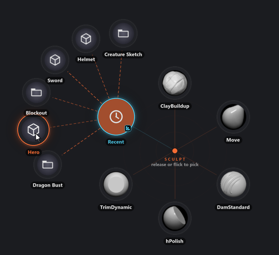
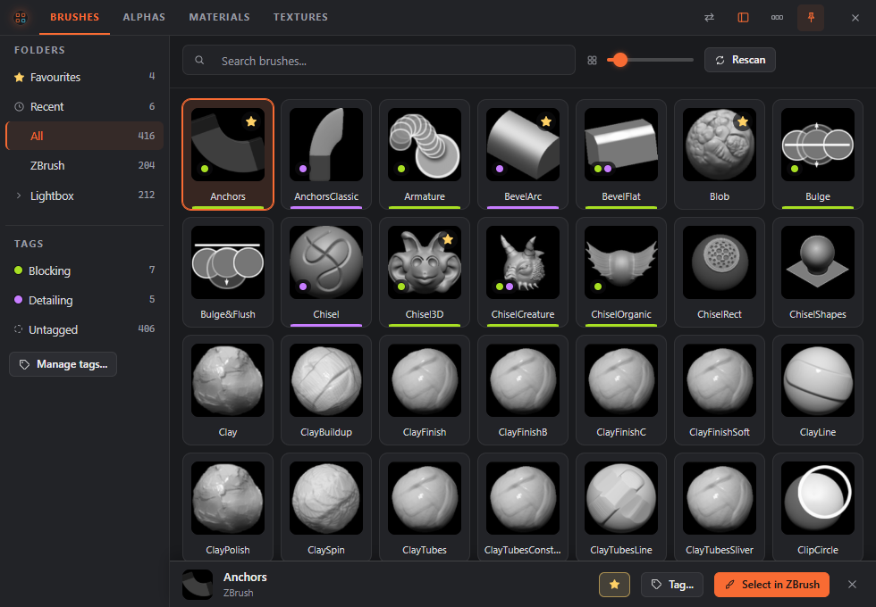
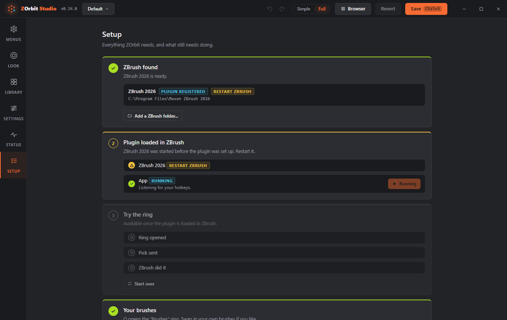
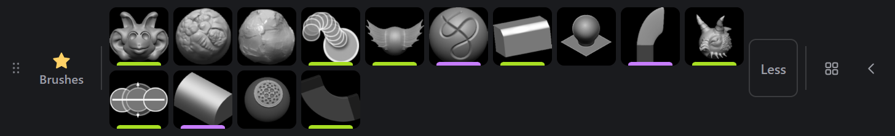

# ZOrbit 0.23.0: recent files on the ring

Getting back to a project you had open yesterday has meant a trip through Lightbox or **File > Open**. In 0.23.0 a slot on the ring can do it: a **Recent** slot opens a fan of the projects and tools ZBrush opened last, and a pick opens one.

The browser can also open more than one window now, each with its own **Keep on top**. Setup's step titles stopped claiming things that weren't true, and the strip no longer hangs around after ZBrush has closed.

<!-- more -->

## Recent projects and tools

In Studio, switch to Full mode, press **Add item** and pick **Recent**. Its **Shows** select picks projects, tools or both. In `radial.json` it is `{"recent": "project"}`, `"tool"` or `"any"`. Move onto the slot and the fan opens, newest first, with each file's name and the Project or Tool icon. The [Recent](../../menus.md#recent) section of the Menus page has the details.

The list is ZBrush's own, the one it keeps of recent files for Lightbox. ZOrbit only reads it, in the background, so the ring never waits on the disk. A file you opened a moment ago may only show the next time you open the ring.

A pick works as a [Project](../../menus.md#project) or [Tool](../../menus.md#tool) slot with that file does. A project goes through ZBrush's own check for unsaved work, so you still get the question about saving the one you have open. The fan holds as many files as **Tag fan slots** allows, 12 unless you changed it, and there is no **More...** slot for older ones. With several ZBrush versions installed, the list is that of the ZBrush in front.

The test run on a clean Windows install found a gap here before the release. On a ZBrush 2026 where no user assets folder has been chosen yet, ZBrush keeps its recent list in its own folder under `%APPDATA%\Maxon`, and ZOrbit only looked in the user assets folder, so the slot stayed empty. It reads that folder now.

## Several browser windows

The browser had one window, so keeping alphas on top of ZBrush meant giving up the brushes, or flipping tabs all the time. Now the new window button in the header, or **Ctrl+N**, opens another one, up to six in all. A new window starts as a copy of the one you opened it from (the same tab, **Keep on top**, column and thumbnail size), 32 pixels down and to the right. After that it keeps its own tab, pin, place and size, so you can keep alphas in a small window pinned over the canvas, say, and brushes in a big one on another screen.

The first window works as before: **X** hides it, and it is the only one that can become the [strip](../../browser.md#the-strip). **X** on any other window closes it for good. The hotkey, a **Browser** slot and the other ways in go to the window you used last, and the hotkey's toggle hands the keyboard back to ZBrush from that window too. Windows still open when you sign out or shut down come back where they were the next time you open the browser. The [Several windows](../../browser.md#several-windows) section has the rest.

## Setup says what it found

Setup's steps used to carry their goal as a title, so the first one said **ZBrush found** even when no ZBrush was found, and the second said **Plugin loaded in ZBrush** with a warning under it saying the opposite.

The titles now say what is true until the step is done: **No ZBrush found**, **ZBrush found, plugin not set up** and **Plugin not loaded in ZBrush**. Once a step is done, it reads as before.

## The strip goes with ZBrush

The strip came in 0.22.0: a small bar of one tab's favourites that stays on top of ZBrush and never takes the keyboard from it, so one click picks an item. Turn it on with the strip button in the browser's header. Its menu switches the tab and lays the strip **Vertical** or **Horizontal**.

With the [strip](../../browser.md#the-strip) on, you could open the full browser with the hotkey, close ZBrush, and then close the browser. The strip came back and sat on the desktop with nothing to pick into. Now the browser ends there, as it does without the strip, and the strip comes back the next time ZBrush starts ZOrbit. This one was in 0.22.0 too.

## How this release was tested

Before I tagged it, I tried 0.23.0 three ways: the real Studio and browser windows driven by a script; a real ZBrush 2026 with my own files; and a clean Windows install with ZBrush 2022 and 2026, set up with the installer. Between them they found the empty Recent slot above, a Studio preview that didn't open the Recent fan, and the strip that came back. All three are fixed in this release.

The full list is in the [release notes](https://github.com/combwizard/zorbit/releases/tag/v0.23.0).
