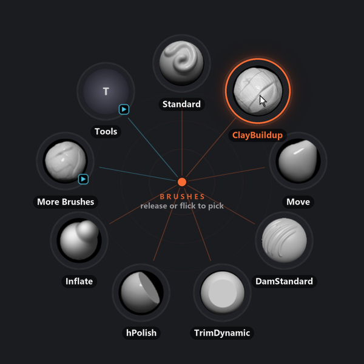

# ZOrbit 0.24.0: the ring opens sooner

The first press of the hotkey after ZBrush started used to be the slow one. On a 16-slot ring at 150% display scaling the ring took 378 ms to draw, and every open after that took about 100 ms. In 0.24.0 both take under 10 ms.

The ring looks exactly as it did, and there is no setting for any of this. Two small fixes for submenus and tags came out of the same work, and each release now has its SHA-256 hashes in a file.

<!-- more -->

## What was slow

A ring is put together from pictures. Each slot has its own, with the icon and the label. One more holds everything that stays still behind the slots: the guide rings, the spokes, the tag band, the title and the hint.

Until now ZOrbit drew the slot pictures the first time a ring opened and kept them. The still part it drew again on every open, and again after a tap of the hotkey. The dashed lines of a fan were drawn again each time the fan opened.

In 0.24.0 all of these are kept between opens. A slot that keeps its size is also no longer resized on every frame, so moving over the slots is smoother.

These are the medians I measured with the real drawing code, a 16-slot ring and 150% scaling:

| | 0.23.0 | 0.24.0 |
|---|---|---|
| First open after start | 378 ms | 8 ms |
| Open again | 98 ms | 7 ms |
| One frame while moving over the slots | 11.3 ms | 3.8 ms |
| One frame while a fan opens | 38 ms | 9 ms |
| The frame after a tap | 103 ms | 15 ms |

The numbers are from one PC and from the drawing code alone, without ZBrush running. A large ring at high display scaling gains the most. A small ring at 100% was never this slow, so it gains less.

## Drawing ahead

Keeping pictures only helps from the second open on. For the first one, ZOrbit now draws ahead. About a second after it starts, or after your menus change, it draws what the next open will look for: the rings your hotkeys open, their fans, the rings one level down from those, and the hint a tap leaves.

It draws one picture at a time, in between everything else it does, so a hotkey pressed in the middle waits for one picture at most. It stops while a ring is open, while a hotkey is held and while a pick is on its way to ZBrush, and carries on afterwards.

With my own menus that came to 50 pictures and 0.4 seconds of drawing. The longest picture took 15 ms, and the whole run was over two seconds after ZOrbit started.

A save in Studio starts it again, a second after the last change, so a slider you are dragging doesn't set it off at every step. Moving ZBrush to a monitor with a different display scaling starts it too, because the pictures are drawn for one scale.

The cost is memory. ZOrbit uses more of it just after it starts than it used to, about as much as it used to reach after some use, and the still pictures can take up to 32 MB.

`radiald.log` has a new line that starts `ring warm-up`, which says how many pictures were drawn and how long they took. [Files and logs](../../files.md#files-and-logs) says where the log is.

## It looks the same

Keeping pictures can go wrong in a way that is hard to spot: a picture that should have been drawn again is shown as it was, with the old colour or the old label.

So I first made a reference set of 1,195 pictures with 0.23.0: previews, frames of the animations, whole rings, fans, three looks and both themes. 0.24.0 draws every one of them the same, byte for byte, and it still does when the pictures come from the drawing ahead. The picture above is the one in the docs. Making it again with 0.24.0 gave the same file.

The one difference is too small to see. The frame is now prepared for Windows in one pass, and that can move a colour channel of a pixel on screen by one step out of 255.

## Two fixes found on the way

An [auto slot](../../menus.md#auto) fills itself with the brushes you use most. In a submenu that opens as a ring of its own, the auto slots could change places when you opened it, while one of them was still empty. They now stay where they were, as in any other ring.

A [tag slot](../../menus.md#tag) opens a fan of the tag's items, drawn in the tag's colour. By a screen edge the fan has no room, so the items open as a ring of their own. In that ring each item had the colour of its own first tag. Now they have the colour of the tag you opened there too.

Both were in earlier versions as well.

## Hashes in a file

Each release now comes with `ZOrbit-<version>-SHA256.txt`, which has the SHA-256 of the installer and of the portable zip. The hashes used to be in the release notes.

With the file, one line checks both downloads: put them in one folder with it and run `sha256sum -c ZOrbit-<version>-SHA256.txt` in Git Bash or WSL. In PowerShell, `Get-FileHash` prints a hash to compare. [Install](../../install.md) has both.

## How this release was tested

The reference pictures were the main check. Each part of the work also had a separate review, by a reviewer that had not seen it being written. Those reviews found four defects before the release: the auto slots that changed places, a pick that landed in a different auto slot than it would have before, pictures drawn for the wrong scale when two monitors have different display scaling, and drawing that could start while the thumbnails were still being read. All four are fixed in this release.

Then I ran it in a real ZBrush 2026. ZOrbit drew its pictures within two seconds of starting. The first open took all of them from the cache, and the ring was on screen 19 ms after ZOrbit was asked for it. The two fixes above held on menus made to show them.

The full list is in the [release notes](https://github.com/combwizard/zorbit/releases/tag/v0.24.0).
