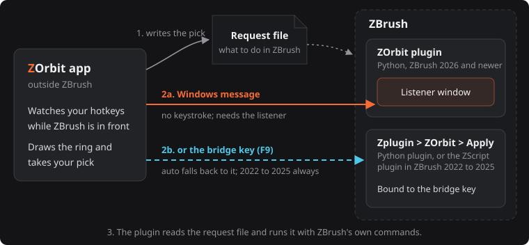
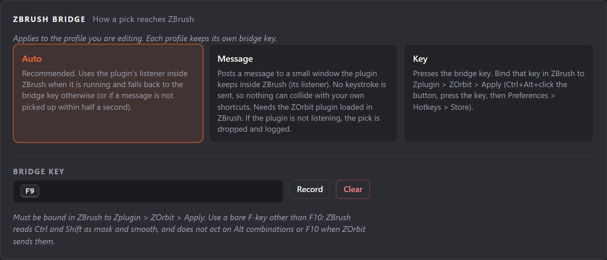
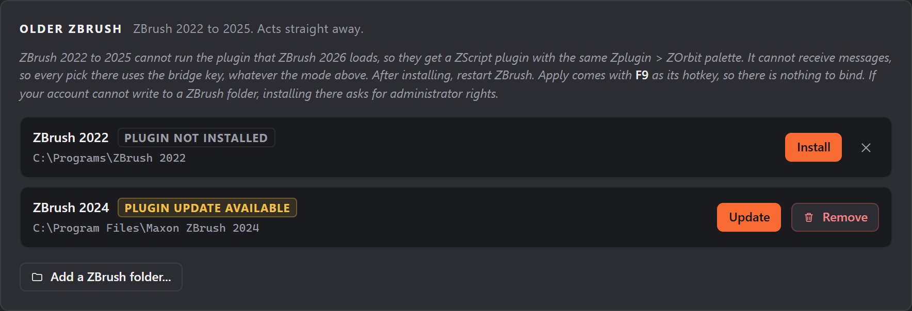

# How ZOrbit talks to ZBrush

## How it works

ZOrbit has two halves.

- **The app** (`zorbit\`) runs outside ZBrush. A keyboard hook, which runs on its own thread so the app's other work never delays it, watches for your menu hotkeys, but only while ZBrush is the front window. When one is pressed it draws the ring in a window that never takes focus, so ZBrush keeps working underneath.
- **The bridge** (`bridge\zorbit_bridge.py`) runs inside ZBrush as a Python plugin. It adds the **Zplugin > ZOrbit** palette, starts the app, and carries out picks by calling ZBrush's own commands.

When you pick a slot, the app writes the request to a small file and posts a Windows message to a hidden listener window the bridge keeps inside ZBrush. The bridge reads the file and does the work on ZBrush's main thread. If the listener is not available, the app can press a fallback key (F9) that you bind to **Zplugin > ZOrbit > Apply**. With more than one ZBrush running, the app uses a listener only when it belongs to the ZBrush you are picking in, and presses the bridge key otherwise.

A pick that could not be handed over (message mode with no listener, or a bridge key that could not be sent) is dropped and its request file is deleted, so it cannot be applied later by accident. The plugin also ignores a request that is more than 10 seconds old.



ZBrush 2022 to 2025 have no Python API, so for them the bridge is a ZScript plugin (`bridge\zscript\`) with the same palette. ZScript cannot host a listener window, so the app always presses the bridge key there. The app also writes each pick in a plain line-by-line form that ZScript can read, and loads brushes from that ZBrush version's own files.

The app exits when ZBrush does.

## How picks reach ZBrush (bridge modes)

When you pick a slot, the app has to tell ZBrush. It writes the request to a file and then triggers the plugin in one of two ways. The `bridge` section of `radial.json` (and **Settings > ZBrush bridge** in Studio) chooses:

```json
"bridge": {"mode": "auto", "key": "F9"}
```

| Mode | How it works |
|---|---|
| `auto` (default) | Uses the message route if the listener inside ZBrush is alive. Otherwise, or if a message is not picked up within half a second (counted from when you lift, if a stroke is going on), presses the bridge key. |
| `message` | Posts a window message to a hidden listener inside ZBrush. No keystroke is sent, so nothing can collide with your own shortcuts. If the listener is not available, the pick is dropped and logged. |
| `key` | Presses the bridge key every time. |



The **message** route needs nothing from you. It works once the plugin has loaded and its listener is verified (see **Zplugin > ZOrbit > Status**).

The **bridge key** is the fallback. To set it up:

1. In ZBrush, Ctrl+Alt+click **Zplugin > ZOrbit > Apply**.
2. Press the key you want, such as **F9**.
3. Open **Preferences > Hotkeys** and click **Store**.

Rules for the bridge key: use a bare F-key if you can (`Alt` combinations are allowed). `Ctrl` and `Shift` are rejected, because ZBrush reads them as mask and smooth. The app only presses the key while ZBrush is the front window, and releases any modifiers you are holding first.

If `radial.json` has no `bridge.key`, or an empty one, the key is **F9**. A key ZOrbit cannot use (one with `Ctrl` or `Shift`, or one it does not understand) is listed as a problem and F9 is used instead.

In ZBrush 2026 and newer, a pick that arrives while you are in the middle of a stroke (mouse button down) waits until you lift. The button is your primary one, so this also works when you have swapped the mouse buttons in Windows. That holds for both routes: the plugin holds a message back until the button is up, the app does not fall back to the bridge key while the button is down, and **Apply** waits the same way if it is run mid-stroke. The fallback key is pressed half a second after you lift, if the message still has not been picked up. ZBrush 2022 to 2025 cannot wait: the ZScript plugin applies a pick the moment the key arrives, even in the middle of a stroke. Right after a pick the app also makes a zero-distance mouse move, which wakes ZBrush's cursor and pen tracking.

Failures the plugin reports (a brush that is not installed, a button path that does not exist) are shown as a short message near the cursor, as are the cases where the app finds no plugin to hand the pick to. [Troubleshooting](troubleshooting.md#the-ring-opens-but-picks-do-nothing) lists the messages.

### ZBrush 2022 to 2025

These versions have no Python API, so they get a ZScript plugin with the same palette. Studio installs it (the steps are in [Install and uninstall](install.md#zbrush-2022-to-2025)): **Settings > Older ZBrush** lists the 2022 to 2025 versions it found, with **Install**, **Update** and **Remove** for each, and **Add a ZBrush folder** for one it missed (a folder you added can be forgotten again with the x next to it). The plugin goes into that ZBrush's `ZStartup\ZPlugs64` (the only place these versions load plugins from), together with a `ZOrbitData` folder. A ZBrush under Program Files asks for administrator rights: the row says "approve the prompt" while Windows waits for you, for up to five minutes. The elevated step checks that the destination is a ZBrush plugin folder and builds the plugin files from the installation's own copies, so nothing from a user-writable folder is copied with administrator rights.



Differences from ZBrush 2026 and newer:

- There is no listener, so **every pick uses the bridge key**, whatever the mode. When ZBrush loads the plugin it binds **F9** to **Apply** if **Apply** has no hotkey yet (checked in ZBrush 2022; in the other versions look at **Zplugin > ZOrbit > Apply** and bind F9 yourself if it is empty). If you choose another bridge key, bind and store it in each of these versions (the steps in [How picks reach ZBrush](#how-picks-reach-zbrush-bridge-modes)); each version keeps its own hotkeys.
- A pick does not wait for the end of a stroke (see above).
- Brushes load from that version's own `.zbp` files, because an older ZBrush cannot always read a newer version's brushes.
- Status shows where picks arrive, whether one is waiting, and the last pick. The plugin also writes that last pick to `zscript_bridge.log`, which Studio's Status screen shows. Pressing **Apply** when no pick is waiting changes nothing, so it does not replace that last pick.
- The start shortcuts may be left out. The plugin starts the app and Studio through two shortcuts (`app.lnk` and `studio.lnk` in `ZOrbitData`), which Studio makes with PowerShell. On a PC where PowerShell is restricted (Constrained Language Mode, AppLocker or an antivirus), Studio installs without them and says so. The plugin then starts ZOrbit the slower way, with the command lines in `bridge.cfg`, which can take a few seconds on Windows 11. `ZOrbitData\install.txt` records the reason.
- The data folder path has to fit the plugin. ZScript reads `bridge.cfg` in the Windows code page, one line of at most 255 characters. If the path of `%LOCALAPPDATA%\ZOrbit` has characters outside that code page (for example a user name in another script) and 8.3 short names are off, Studio refuses to install and says so. Move the data folder, or turn on 8.3 names with `fsutil 8dot3name set 0` as administrator, then install again.
- ZBrush 2021 and older are not supported. Studio lists them but refuses to install the plugin.

When this version of ZOrbit has a newer plugin than one you installed, **Settings** shows a badge and that row says **Update available**. After **Update**, restart that ZBrush.

### The Zplugin > ZOrbit palette

| Button | What it does |
|---|---|
| Studio | Opens ZOrbit Studio. |
| Apply | Carries out the pending pick. Bound to the bridge key for the fallback route. In ZBrush 2022 to 2025 the plugin binds F9 to it when it has no hotkey. |
| Start App | Starts the app if it is not running. Normally unnecessary. |
| Status | Shows whether the listener is verified, whether the app is running, and the last pick. |

If the plugin fails while it starts, it writes the error to `bridge.log` before ZBrush reports it, and a button or the listener that cannot be created is skipped without stopping the rest. Picks that load a brush, alpha, material or texture from a file press the button ZBrush names after that file (`ClayBuildup` for `ClayBuildup.zbp`), whatever the item is called in the menu.
