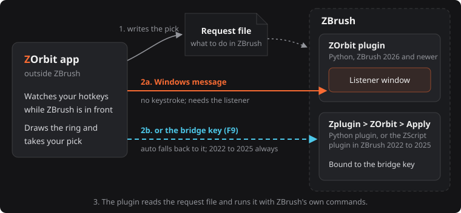
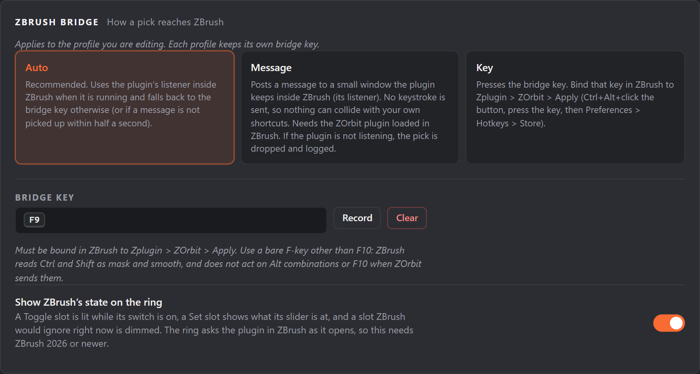
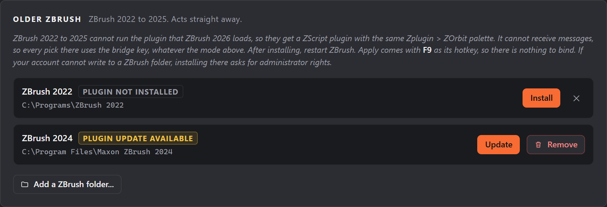

# How ZOrbit talks to ZBrush

## How it works

ZOrbit has two halves.

- **The app** (`zorbit\`) runs outside ZBrush. ZOrbit installs a Windows keyboard hook. It compares each key press with your hotkeys and acts only when ZBrush is the front window. It does not record, store or send what you type. The hook runs on its own thread, so the app's other work never delays it. When a hotkey is pressed, the app draws the ring in a window that never takes focus, so ZBrush keeps working underneath.
- **The bridge** (`bridge\zorbit_bridge.py`) runs inside ZBrush as a Python plugin. It adds the **Zplugin > ZOrbit** palette, starts the app, and carries out picks by calling ZBrush's own commands.

When you pick a slot, the app writes the request to a small file and posts a Windows message to a hidden listener window the bridge keeps inside ZBrush. The bridge reads the file and does the work on ZBrush's main thread. If the listener is not available, the app can press the bridge key (F9 unless you change it), which you bind to **Zplugin > ZOrbit > Apply**. With more than one ZBrush running, the app uses a listener only when it belongs to the ZBrush you are picking in, and presses the bridge key otherwise.

A pick that could not be handed over (message mode with no listener, or a bridge key that could not be sent) is dropped and its request file is deleted, so it cannot be applied later by accident. In ZBrush 2026 and newer, the plugin also ignores a request that is more than 10 seconds old when it arrives, but not one it held back while you finished a stroke, however long the stroke took.



ZBrush 2022 to 2025 have no Python API, so for them the bridge is a ZScript plugin (`bridge\zscript\`) with the same palette. ZScript cannot host a listener window, so the app always presses the bridge key there. The app also writes each pick in a plain line-by-line form that ZScript can read, and loads brushes from that ZBrush version's own files.

The app exits when ZBrush does.

## How picks reach ZBrush (bridge modes)

When you pick a slot, the app has to tell ZBrush. It writes the request to a file and then triggers the plugin in one of two ways. The `bridge` section of `radial.json` (and **Settings > ZBrush bridge** in Studio, which needs [Full mode](studio.md#simple-and-full-mode)) chooses:

```json
"bridge": {"mode": "auto", "key": "F9"}
```

| Mode | How it works |
|---|---|
| `auto` (default) | Uses the message route if the listener inside ZBrush is alive. Otherwise, or if a message is not picked up within half a second (counted from when you lift, if a stroke is going on), presses the bridge key. |
| `message` | Posts a window message to a hidden listener inside ZBrush. No keystroke is sent, so nothing can collide with your own shortcuts. If the listener is not available, the pick is dropped and logged. |
| `key` | Presses the bridge key every time. |



The **message** route needs nothing from you. It works once the plugin has loaded and its listener is verified (see **Zplugin > ZOrbit > Status**).

The **bridge key** is the fallback for the message route, and the only route in ZBrush 2022 to 2025. To set it up:

1. In ZBrush, Ctrl+Alt+click **Zplugin > ZOrbit > Apply**.
2. Press the key you want, such as **F9**.
3. Open **Preferences > Hotkeys** and click **Store**.

Rules for the bridge key: use a bare F-key other than **F10**, such as **F9** (the default), **F11** or **F12**. `Ctrl` and `Shift` are rejected, because ZBrush reads them as mask and smooth. `Alt` combinations and **F10** are rejected too: Windows sends them as system keys, and ZBrush does not run **Apply** for them when ZOrbit sends them (tested in ZBrush 2022 and 2025 with the key stored in ZBrush). The app only presses the key while ZBrush is the front window, and releases any modifiers you are holding first.

If `radial.json` has no `bridge.key`, or an empty one, the key is **F9**. A key ZOrbit cannot use (one with `Ctrl`, `Shift` or `Alt`, **F10**, or one it does not understand) is listed as a problem and F9 is used instead. Each [profile](profiles.md) has its own bridge settings, so if you change the key in one, change it in the others too.

In ZBrush 2026 and newer, a pick that arrives while you are in the middle of a stroke (mouse button down) waits until you lift. The button is your primary one, so this also works when you have swapped the mouse buttons in Windows. That holds for both routes: the plugin holds a message back until the button is up, the app does not fall back to the bridge key while the button is down, and **Apply** waits the same way if it is run mid-stroke. The bridge key is pressed half a second after you lift, if the message still has not been picked up. ZBrush 2022 to 2025 cannot wait: the ZScript plugin applies a pick the moment the key arrives, even in the middle of a stroke. Right after a pick the app also makes a zero-distance mouse move, which wakes ZBrush's cursor and pen tracking.

Failures the plugin reports (a brush that is not installed, a button path that does not exist) are shown as a short message near the cursor, as are the cases where the app finds no plugin to hand the pick to. [Troubleshooting](troubleshooting.md#the-ring-opens-but-picks-do-nothing) lists the messages.

### ZBrush 2022 to 2025

These versions have no Python API, so they get a ZScript plugin with the same palette. Studio installs it (the steps are in [Install and uninstall](install.md#zbrush-2022-to-2025)): **Setup** step 1 (and **Settings > Older ZBrush** in Full mode) lists the 2022 to 2025 versions it found, with **Install**, **Update** and **Remove** for each, and **Add a ZBrush folder** for one it missed (a folder you added can be forgotten again with the x next to it). The plugin goes into that ZBrush's `ZStartup\ZPlugs64` (the only place these versions load plugins from), together with a `ZOrbitData` folder. If your account cannot write to that ZBrush's folder, which can happen under Program Files, Windows asks for administrator rights: the row says "approve the prompt" while Windows waits for you, for up to five minutes. The elevated step checks that the destination is a ZBrush plugin folder. It ignores the staging folder and builds the plugin files itself, but it is ZOrbit's own program running from your user folder, so approve the prompt only on a PC you trust.



Differences from ZBrush 2026 and newer:

- There is no listener, so **every pick uses the bridge key**, whatever the mode. When ZBrush loads the plugin it binds **F9** to **Apply** if **Apply** has no hotkey yet (checked in ZBrush 2022, 2023 and 2025; in 2024 look at **Zplugin > ZOrbit > Apply** and bind F9 yourself if it is empty). A key you stored for **Apply** yourself is kept. If you choose another bridge key, bind and store it in each of these versions (the steps in [How picks reach ZBrush](#how-picks-reach-zbrush-bridge-modes)); each version keeps its own hotkeys.
- A pick does not wait for the end of a stroke (see above).
- The ring does not show [ZBrush's state](#how-zbrushs-state-reaches-the-ring). It needs the listener.
- The plugin does not check how old a request is: **Apply** carries out whichever pick is waiting.
- Brushes load from that version's own `.zbp` files, because an older ZBrush cannot always read a newer version's brushes.
- Status shows where picks arrive, whether one is waiting, and the last pick. The plugin also writes that last pick to `zscript_bridge.log`, which Studio's Status screen shows. The file holds only the last pick, so the app copies each result into `radiald.log` (`pick #12 result: ...`). If the result says an item could not be loaded or a button does not exist, the message near the cursor says so too. When none comes within 15 seconds, the app logs that the plugin wrote no result. A pick that runs a macro always ends that way, because the macro takes over before the plugin can write its line. Pressing **Apply** when no pick is waiting changes nothing, so it does not replace that last pick.
- The start shortcuts may be left out. The plugin starts the app and Studio through two shortcuts (`app.lnk` and `studio.lnk` in `ZOrbitData`), which Studio makes with PowerShell. On a PC where PowerShell is restricted (Constrained Language Mode, AppLocker or an antivirus), Studio installs without them and says so. The plugin then starts ZOrbit the slower way, with the command lines in `bridge.cfg`, which can take a few seconds on Windows 11. `ZOrbitData\install.txt` records the reason.
- The paths have to fit the plugin. ZScript reads `bridge.cfg` in the Windows code page, with one value per line and a string of at most 255 characters. If the path of `%LOCALAPPDATA%\ZOrbit` has characters outside that code page (for example a user name in another script) and 8.3 short names are off, or is longer than 255 characters, Studio refuses to install and says so. Move the data folder somewhere shorter, or turn on 8.3 names with `fsutil 8dot3name set 0` as administrator, then install again. The commands that start the app and Studio have the same limits, so install ZOrbit in a plain, short path. The same limits apply to each line of a pick: a name, label or file path with characters outside the code page, or over 255 bytes, reaches the plugin changed or cut, and `radiald.log` notes it as a problem with `request.txt`.
- ZBrush 2021 and older are not supported. Studio lists them but refuses to install the plugin.

If the bridge key does not reach **Apply**, the pick is not lost. When the pick is still waiting about a second after the key, ZOrbit gives ZBrush a small script, `ApplyFallback.txt` in `%LOCALAPPDATA%\ZOrbit`, that presses **Apply** another way. The pick usually lands a few seconds later, and `radiald.log` says "the bridge key (F9) did not reach Apply (is it bound to Zplugin > ZOrbit > Apply?)", with the key you use. A slow pick and that line both mean the key is not bound to **Apply**. If ZBrush still has not taken the pick about six seconds after that, ZOrbit drops it. While ZBrush is busy and Windows says it is not responding (a heavy Dynamesh, a big project loading), ZOrbit keeps waiting, for up to five minutes, because the key is queued in ZBrush and the pick lands when it answers. It gives up only once ZBrush is answering again and still has not taken the pick. If you close ZBrush meanwhile, the pick is dropped without a message. The script is not started while no ZBrush is running or while ZBrush is not responding, and a stroke holds it back, as it holds back a pick. Studio's **Status** screen and `activity.json` count such a pick as **ZScript (by script)**, route `zscript-fallback`. ZBrush 2026 and newer are not affected.

When this version of ZOrbit has a newer plugin than one you installed, **Settings** shows a badge and that row says **Plugin update available**. After **Update**, restart that ZBrush.

### The Zplugin > ZOrbit palette

| Button | What it does |
|---|---|
| Studio | Opens ZOrbit Studio. |
| Apply | Carries out the pending pick. Bound to the bridge key for the fallback route. In ZBrush 2022 to 2025 the plugin binds F9 to it when it has no hotkey. |
| Start App | Starts the app if it is not running. Normally unnecessary. |
| Status | Shows whether the listener is verified, whether the app is running, the last pick, and the **State channel** (see [below](#how-zbrushs-state-reaches-the-ring)). |

If the plugin fails while it starts, it writes the error to `bridge.log` before ZBrush reports it, and a button or the listener that cannot be created is skipped without stopping the rest. Picks that load a brush, alpha, material or texture from a file press the button ZBrush names after that file (`ClayBuildup` for `ClayBuildup.zbp`), whatever the item is called in the menu.

## How ZBrush's state reaches the ring

The ring can show what ZBrush is doing: which switches are on, where a slider is, which buttons ZBrush would ignore. [ZBrush's state on the ring](menus.md#zbrushs-state-on-the-ring) says what it shows, and [State marks](appearance.md#state-marks) how it looks. The state travels through the same listener as a pick, so it only works in ZBrush 2026 and newer.

1. The ring opens and is drawn at once. It never waits for ZBrush.
2. The app writes the interface paths of the ring's **Press**, **Set** and **Toggle** slots, and those of the fans it can open, to `zstate_query.json` and posts a Windows message to the listener of the ZBrush in front. Each path is asked once, up to 128 of them.
3. The plugin reads each one on ZBrush's main thread: whether the button is there, whether it is greyed, and for a switch or a slider its value and its range. It writes the answer to `zstate.json` and posts a message back to the app.
4. The app takes the answer if it belongs to the question it asked and to that ZBrush, and draws the marks on the open ring.

A question changes nothing in ZBrush, so the plugin answers it even in the middle of a stroke. The app keeps one question waiting per listener. If ZBrush has not answered after 2 seconds, it counts the question as lost and asks again when the next ring opens.

After every pick the plugin answers again by itself, without being asked, so the app already knows the new state when the next ring opens. A pick that waits for a stroke to end is answered once it has been carried out. The plugin stops doing this when the app takes `zstate_query.json` away: when you turn the setting off, when the ring is opened over a ZBrush that cannot answer, and when the app quits.

The plugin stops reading after 20 milliseconds. A slot whose path it did not reach by then gets no mark, and both logs say the answer was cut short.

The marks need all of these:

- ZBrush 2026 or newer with the plugin that comes with this ZOrbit. After you update ZOrbit, restart ZBrush once so it loads the new plugin. An older plugin does not say it can answer, so the app does not ask it and the ring shows no marks.
- The listener of the ZBrush in front is verified (**Zplugin > ZOrbit > Status**). The bridge mode does not matter: the question goes to the listener even in `key` mode.
- **Show ZBrush's state on the ring** is on. It is on by default. Turn it off in **Settings > ZBrush bridge** (Full mode), or in `radial.json`:

```json
"bridge": {"mode": "auto", "key": "F9", "show_state": false}
```

`show_state` is `true` or `false`. Without it the state is shown, and Studio writes it only when it is off. A value that is neither is listed as a problem, and the state is shown. Each [profile](profiles.md) has its own, and the ring follows a change the next time it opens.

**Zplugin > ZOrbit > Status** has a **State channel** line. It says `not asked yet` until the first question has been answered, then how many answers the plugin has given since it loaded and the last one, such as `3 answer(s), last #3 (asked): 9 paths in <n> ms, <n> ms after the question was written (1 missing)`. `asked` is an answer to a question and `after pick #12` one the plugin gave by itself after a pick. The brackets count the paths ZBrush does not have (`missing`), the greyed ones (`disabled`) and the ones it could not read (`error`), and the line ends with `truncated` when the plugin stopped at its time limit and with `NOT posted to the app` when it could not tell the app. If the line stays on `not asked yet` after you opened a ring over ZBrush, see [My slots show no state](troubleshooting.md#my-slots-show-no-state). The two files are in [Files and logs](files.md#files-and-logs).
