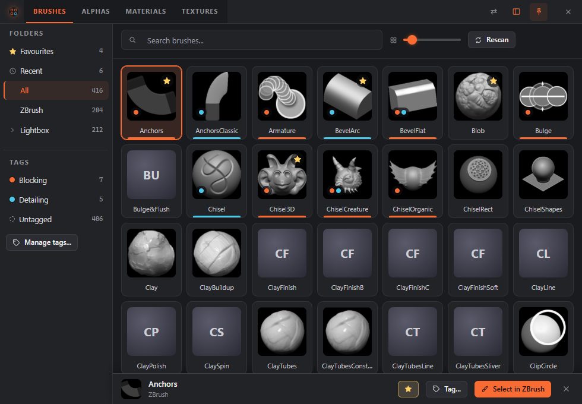

# Browser window

The browser is a window with your brushes, alphas, materials and textures in it, on four tabs. Each tab has search, folders, tag chips and thumbnails. Pick an item and ZBrush selects it (loading it first if it is not loaded yet), without going through the ring. It is a window like any other: it has a taskbar button, you can move, resize, minimise and maximise it, and snap or dock it to a screen edge (drag its header to an edge, or press Win+Arrow). It does not close by itself. It stays up until you close it with the **X** button or Alt+F4, so you can keep it beside ZBrush all day.

While Studio is open you can drag an item from the browser onto a menu in Studio's menu list, onto the ring or onto the item list. It is added exactly as when you drag it from the Library, and you can undo it. A drag carries only the item you pick up, even when several are selected.

## Opening it

- Press the browser hotkey (`browser.hotkey`; **Alt+B** on new installs). It works while ZBrush **or the browser** is in front. If the browser is hidden it appears; if it is open behind other windows it comes to the front; if it is already in front, the keyboard goes back to ZBrush and the window stays where it is.
- Pick a **Browser** slot on a ring (new installs have one in **Tools**).
- Pick **More...** in a tag's fan: the browser opens on that tag.
- Choose **Browser** in the tray menu (the ZOrbit icon in the notification area).
- Press **Browser** in Studio's top bar (on every screen), in the Library toolbar, or on **Settings > Browser**.
- Start it from the Start menu (**ZOrbit Browser**).
- Start it on a tab from the command line with `--kind brush`, `--kind alpha`, `--kind material` or `--kind texture`.

The Studio button and the Start menu shortcut work without ZBrush running, so you can browse and tag items on their own. The browser has its own icon in the taskbar, different from ZOrbit's. The first time it appears centred on a screen. After that it comes back where, and as large as, you left it, maximised or not.

## Using it

- The header has four tabs: **Brushes**, **Alphas**, **Materials** and **Textures**. Click a tab, or press **Ctrl+Tab** and **Ctrl+Shift+Tab** to move through them. With a tab focused, **Left** and **Right** move between them too. The search text, the tag filter and the thumbnail size stay when you switch tab. The folder and the selection do not: each tab opens on **All** with nothing selected. The tab you were on last is remembered.
- Type to search by name: any letter you type goes to the search box. Two files whose names differ only by capitals or spaces count as one item, and the first folder searched wins.
- Click chips to filter by tag, and folders to filter by folder, as in the Library. If you have collapsed the folders and tags column (see below), a filter that is on shows as a chip beside **Rescan**, such as **Filtered: Blocking** or **Folder: My Brushes**. Click it to clear that filter.
- **Arrow keys** move from item to item. After a search the first match is highlighted. The arrows and **Enter** work on what the search shows, even when you press them straight after typing.
- After you click a chip, a folder, a tab, **Rescan** or the pin, the cursor goes back to the search box, so **Enter** still picks the highlighted item and letters still search. Tab to a control and press **Enter** or **Space** and that control keeps the focus, as usual.
- **Enter** or a **double-click** picks the highlighted item. ZBrush gets the keyboard back, then the item is selected the same way as a ring pick. An alpha, material or texture that ZBrush does not have yet is loaded first. Only a brush counts towards auto slots. The browser stays open.
- A toast says **Sent Anchors to ZBrush** once the app has taken the pick. It means the pick was sent, not that ZBrush has acted on it: ZBrush's own line in `bridge.log` says whether it worked (see [Troubleshooting](troubleshooting.md#a-pick-in-the-browser-does-nothing)). If the app is not running the toast says **ZOrbit is not running. It starts and stops with ZBrush.** If it is running but does not answer in time, it says **ZOrbit did not answer. Try again in a moment.**
- **Esc** clears the search, then the selection, then gives the keyboard back to ZBrush. It never closes the window. The browser hotkey does the same when the browser is in front.
- The pin button in the header is **Keep on top**. It is on by default: the browser stays above other windows, so it is there when you glance at it. Switch it off and it sits in the stack like any other window. The choice is remembered.
- The panel button next to it collapses the folders and tags column, so the thumbnails get the whole window, and shows it again. The arrows button beside it moves the column to the right side of the window, and back. Both are remembered.
- **Rescan** looks for brush, alpha, material or texture files again, on the tab you are on. The browser also does this by itself when it appears, or when you open a tab, if the last look is more than a minute old, so a brush you saved in ZBrush a moment ago is there. The list updates where it is: the highlighted item and the scroll position stay. The toast says what it found, for example **Found 12 brushes, 2 new**. If the folders cannot be read, the list you had stays and the toast says why.

## Favourites and Recent

**Favourites** keeps the items you use most in one place. Star an item in the browser, on any tab, or in Studio's
Library: hover its card and press the star in its top-right corner. A starred item shows a filled gold star, and the
star stays visible while the item is starred. The selection strip has a star button for the whole selection.
**Ctrl+D** toggles Favourites on the selection or the highlighted card. The right-click tag picker lists Favourites
first, with a star.

Favourites is the first entry in the folders list on every tab, with a count. It lists starred items, most used first,
then by name. It is not among the tag chips, because it has its own entry.

**Recent** sits right under Favourites. It holds every brush, alpha, material or texture you pick in ZBrush, from a
ring or from the browser, newest first. Each tab keeps the latest 24, and the file keeps 200 across all kinds. To take
an item out of Recent, right-click it in the Recent view and choose **Remove from Recent**. This does not change a
brush's standing for auto slots.

Recent is stored in `%LOCALAPPDATA%\ZOrbit\usage.json`, under `"picks"`, next to the brush usage that fills the auto
slots (see [Files and logs](files.md#files-and-logs)).

## Picks, focus and ZBrush 2022 to 2025

The browser is a separate program that sends your pick to the ZOrbit app, which hands it to ZBrush like any other pick (see [bridge modes](bridge.md#how-picks-reach-zbrush-bridge-modes)). In ZBrush 2026 and newer that is a window message to the listener. In ZBrush 2022 to 2025 every pick presses the bridge key, which needs ZBrush to be the front window again. The browser hands the focus back before it sends, and the app waits up to 2 seconds for ZBrush to have it. If it does not, the pick is dropped and logged. So do not click another program right after you pick.

## In the background

The browser takes a moment to start, so when your config has a browser hotkey or a **Browser** slot, the app starts it hidden a few seconds after it starts itself, and the first press is quick. It stays hidden until you call it and holds its web view in memory while it waits. Closing it with **X** hides it again, ready for the next press. Without a hotkey or a Browser slot it starts the first time you use **More...**, the tray menu, Studio or the Start menu.

It does not depend on ZBrush. When ZBrush and the app quit, a browser you have open stays open; it just cannot select anything, and a pick says **ZOrbit is not running. It starts and stops with ZBrush.** until ZBrush is back. Closing it then ends it. A hidden one quits with the app. Its window position, whether it is maximised, Keep on top, the side of the folders column and whether it is shown, and the thumbnail size are in `popout.json`, and its log is `popout.log`.
