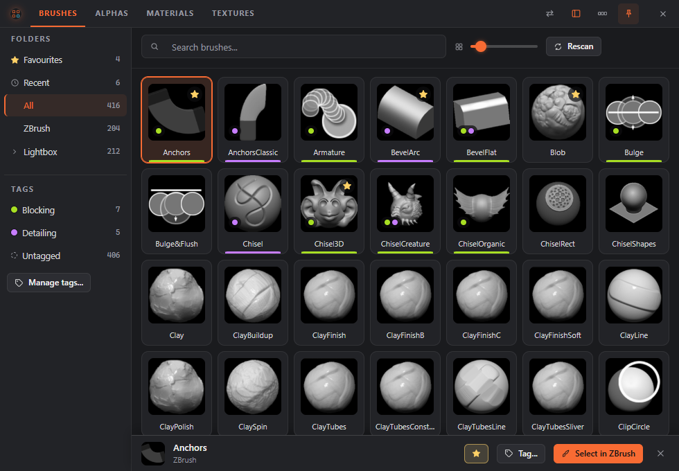
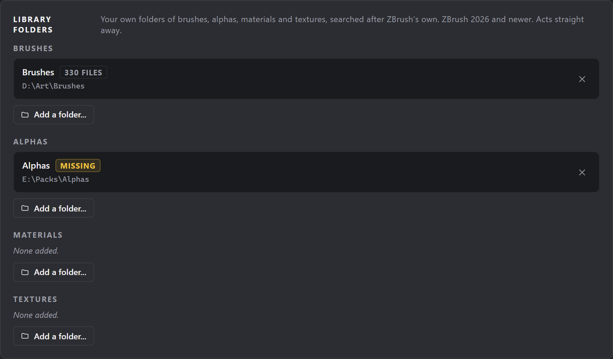
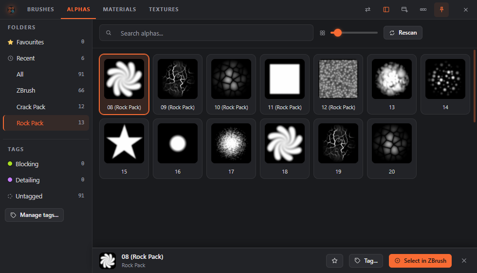
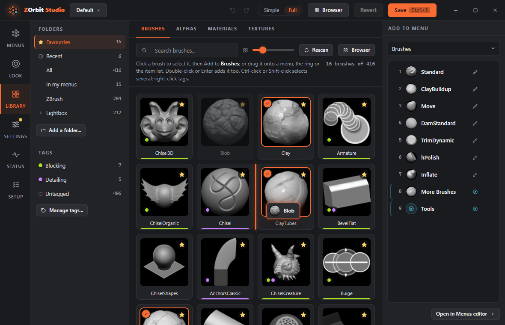
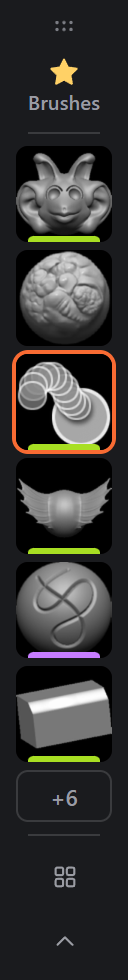
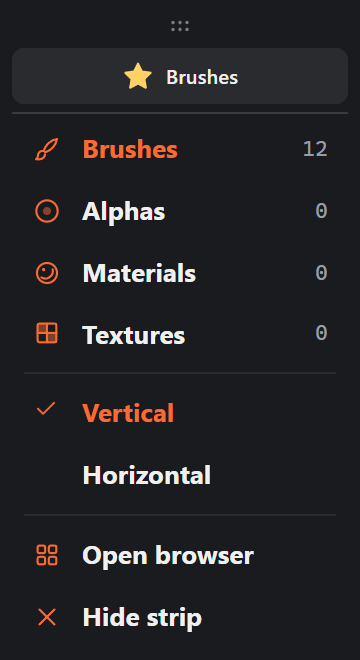
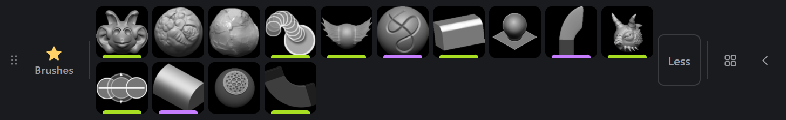

# Browser window

The browser is a window with your brushes, alphas, materials and textures in it, on four tabs. Each tab has search, folders, tag chips and thumbnails. Pick an item and ZBrush selects it (loading it first if it is not loaded yet), without going through the ring. It is a window like any other: it has a taskbar button, you can move, resize, minimise and maximise it, and snap or dock it to a screen edge (drag its header to an edge, or press Win+Arrow). It does not close by itself. It stays up until you close it with the **X** button or Alt+F4, so you can keep it beside ZBrush all day.

While Studio is open you can drag an item from the browser onto a menu in Studio's menu list, onto the ring or onto the item list. It is added exactly as when you drag it from the Library, and you can undo it. A drag carries only the item you pick up, even when several are selected.

## Opening it

- Press the browser hotkey (`browser.hotkey`; **Alt+B** on new installs). It works while ZBrush **or the browser** is in front. If the browser is hidden it appears; if it is open behind other windows it comes to the front; if it is already in front, the keyboard goes back to ZBrush and the window stays where it is. While the [strip](#the-strip) is up, it opens the full browser.
- Pick a **Browser** slot on a ring (new installs have one in **Tools**).
- Pick **More...** in a tag's fan: the browser opens on that tag.
- Choose **Browser** in the tray menu (the ZOrbit icon in the notification area).
- Press **Browser** in Studio's top bar (on every screen), or in the Library toolbar.
- Start it from the Start menu (**ZOrbit Browser**).
- From another program, `ZOrbit.exe --browser` asks the running app to open it. See [Commands from other programs](hotkeys.md#commands-from-other-programs).
- Start it from the command line with `ZOrbit.exe --popout --show` (from a source checkout, `python zorbit\main.py --popout --show`). Add `--kind brush`, `--kind alpha`, `--kind material` or `--kind texture` to open it on that tab, and `--tag KEY` to filter it to one tag. Without `--show` it starts hidden and waits to be called.

A browser that was hidden (it starts hidden, and **X** hides one that the app started, unless the [strip](#the-strip) is on) starts afresh when you open it: the search is empty, only the tag you asked for is on (none, for the hotkey), the folder is **All** (**Favourites** when you asked for it), the list is at the top and the first match is highlighted. The tab you were last on stays, unless you asked for another, and so do the thumbnail size, Keep on top, the folders column and the window's place. A browser that is already open just comes to the front, with its search and filters as they were, except that a tag or tab you asked for (from a **Browser** slot, say) is applied.

The Studio button and the Start menu shortcut work without ZBrush running, so you can browse and tag items on their own. The browser has its own icon in the taskbar, different from ZOrbit's. The first time it appears centred on a screen. After that it comes back where, and as large as, you left it, maximised or not. It resizes and moves between monitors like [Studio's window](studio.md#the-window).

The browser follows the Theme setting (**Dark**, **Light**, **Follow Windows** or **Match ZBrush**, see [Theme](appearance.md#theme)). An open browser changes at once when you pick another theme in Studio. It changes within about half a second when Windows changes its colour mode under **Follow Windows**, and when ZBrush stores a new scheme under **Match ZBrush**. A hidden browser takes the change the next time it appears.

## Using it

- The header has four tabs: **Brushes**, **Alphas**, **Materials** and **Textures**. Click a tab, or press **Ctrl+Tab** and **Ctrl+Shift+Tab** to move through them. With a tab focused, **Left** and **Right** move between them too. The search text, the tag filter and the thumbnail size stay when you switch tab. The folder and the selection do not: each tab opens on **All** with nothing selected. The tab you were on last is remembered.
- The **Back** and **Forward** buttons on a mouse step through the tabs and folders you have visited, like the pages of a web browser. A new choice drops whatever was ahead. The search text and the tag filter are not part of the history.
- A card cuts a long name short. Hover the card to see the whole name.
- Type to search by name: any letter you type goes to the search box. Two files whose names differ only by capitals or spaces count as one item, and the first folder searched wins, as it does on the ring. Subfolders are included; folders whose name starts with `_` are skipped. Folders you added yourself are searched after ZBrush's own and name their files a little differently: see [Your own folders](#your-own-folders). ZBrush's own folders (**My Brushes**, **ZBrush**, **Lightbox**) are those of the ZBrush that is running, or of the newest installed when none runs; see [Brush](menus.md#brush). After starting another ZBrush, press **Rescan**.
- Click chips to filter by tag, and folders to filter by folder, as in the Library. With two or more tags on, the **Match** switch chooses whether an item needs any of them (**Any**) or all of them (**All**); see [Filtering](tags.md#filtering). If you have collapsed the folders and tags column (see below), a filter that is on shows as a chip beside **Rescan**, such as **Filtered: Blocking** or **Folder: My Brushes** (**Filtered: Blocking + Hard** under **All**). Click it to clear that filter.
- **Arrow keys** move from item to item, and **Home** and **End** on a card jump to the first and last. After a search the first match is highlighted. The arrows and **Enter** work on what the search shows, even when you press them straight after typing.
- After you click a chip, a folder, a tab, **Rescan** or the pin, the cursor goes back to the search box, so **Enter** still picks the highlighted item and letters still search. Tab to a control and press **Enter** or **Space** and that control keeps the focus, as usual.
- The cards are one stop for the Tab key (the one you were last on), and so is the list of folders: the star and add buttons on a card are for the mouse, and **Ctrl+D** stars the card you are on. **Up** and **Down** move through the folders, and **Enter** opens one.
- **Enter**, a **double-click** or the **Select in ZBrush** button in the bar at the bottom picks the highlighted item. The bar shows the item's name and folder, and the button works while exactly one item is selected. ZBrush gets the keyboard back, then the item is selected the same way as a ring pick. An alpha, material or texture that ZBrush does not have yet is loaded first. Only a brush counts towards auto slots. The browser stays open.
- A toast says **Sent Anchors to ZBrush** once the app has taken the pick. It means the pick was sent, not that ZBrush has acted on it: ZBrush's own line in `bridge.log` says whether it worked (see [Troubleshooting](troubleshooting.md#a-pick-in-the-browser-does-nothing)). If the app is not running the toast says **ZOrbit is not running. It starts and stops with ZBrush.** and tells you to start ZBrush or press **Start app** on Studio's **Status** screen. If it is running but does not answer in time, it says **ZOrbit did not answer. Try again in a moment.**
- **Ctrl-click** adds a card to the selection or takes it out, **Shift-click** selects a range, and **Ctrl+A** selects every card on show. You can star or tag a selection together, but ZBrush takes one item at a time: **Enter** on several says, for example, **ZBrush takes one brush at a time. Select a single brush.**
- **Esc** clears the search, then the selection, then gives the keyboard back to ZBrush. It never closes the window. The browser hotkey does the same when the browser is in front.
- The pin button in the header is **Keep on top**. It is on by default: the browser stays above other windows, so it is there when you glance at it. Switch it off and it sits in the stack like any other window. The choice is remembered.
- The strip button next to it (three small squares, **Show as a strip**) turns the browser into a small strip of your favourites that stays over ZBrush. See [The strip](#the-strip).
- The panel button collapses the folders and tags column, so the thumbnails get the whole window, and shows it again. The arrows button beside it moves the column to the right side of the window, and back. Both are remembered.
- The slider next to the search box sets the size of the thumbnails, from 84 to 220 pixels. The size is remembered.
- An EXR texture has no picture, so its card shows letters. It still selects in ZBrush as usual (see [A slot shows letters instead of a picture](troubleshooting.md#a-slot-shows-letters-instead-of-a-picture)).
- **Rescan** looks for brush, alpha, material or texture files again, on the tab you are on. The browser also does this by itself when it appears, or when you open a tab, if the last look is more than a minute old, so a brush you saved in ZBrush a moment ago is there. The list updates where it is: the highlighted item and the scroll position stay. When the folders still hold the same files, the cards are left alone and nothing is redrawn, which keeps a rescan quick on a big library. A tab's thumbnails are fetched a few at a time, the ones in view first, so the first cards fill in before the rest. The toast says what it found, for example **Found 12 brushes, 2 new**. If no ZBrush is known and you have added no folder of your own, the list says **ZBrush was not found** and to start ZBrush once and press **Rescan**; with a folder added, the list shows without ZBrush. If the folders hold no files, the list names the file types it looks for, for example `.psd`, `.bmp`, `.jpg`, `.jpeg`, `.png`, `.tif` and `.tiff` for alphas. If a folder cannot be read (it was there before and is gone, or its drive cannot be reached), the items it had stay, the other folders are read afresh, and a line above the list and the toast say why (see [A folder that cannot be read](#a-folder-that-cannot-be-read)).

## Your own folders

If you keep brushes, alphas, materials or textures in folders of your own, such as a pack you bought, add the folder and the browser, the Library and the ring find its files. You add them in Studio, with **Add a folder...** under the folders on the **Library** screen (for the tab you are on), or on **Settings > Library folders**, which lists them all. It works in Simple and Full mode and needs ZBrush 2026 or newer.

The card has a list for each of **Brushes**, **Alphas**, **Materials** and **Textures**. Press **Add a folder...** under a list and pick the folder. Each row shows the folder's name, its path and a tag: how many files ZOrbit found in it, **Missing** when the folder is not there, or **Cannot be read**. **X** on a row (**Forget this folder**) takes the folder out of the list. It does not touch the folder or its files. The toast that follows has an **Undo** button for a few seconds: it puts the folder back in the same place in the list, with its name and file count. After that, **Add a folder...** is the way back. Both act straight away; there is no **Save**, and the undo and redo arrows at the top of Studio and **Revert** do not cover these lists.

The lists belong to this PC. They are in `studio.json` under `library_folders`, not in a profile, so switching profile does not change them and [exporting a menu](menus.md#share-a-menu) does not carry them.

ZOrbit searches the folders you added after ZBrush's own, in the order you added them. Subfolders are searched, except folders whose name starts with `_`. Studio refuses a folder when:

- it is a network folder ("That is a network folder. Add a folder on this PC.");
- it cannot be found;
- ZOrbit already searches it, because it is one of ZBrush's own folders or lies inside or around one ("ZOrbit already searches that folder: it is part of ZBrush (My Brushes).");
- it lies inside or around a folder you already added for that kind, since everything in it would be listed twice. A folder that is already in the list says so.

In the browser and the Library each folder you add is a folder of its own in the folders column, under its name. Two folders with the same name show as **Alphas** and **Alphas (2)**, and a name that clashes with **My Brushes**, **ZBrush** or **Lightbox** gets **(2)** too.

### Names in a folder you added

Packs often name their files `10`, `11`, `12`, and the same names sit in many packs. In ZBrush's own folders the first folder with a name wins, as before. In a folder you added, a file whose name is already taken is listed under its name with its pack folder in brackets. The pack folder is the first subfolder under the folder you added, or the added folder's own name for a file at its top. So `10.png` in the pack folder `Crack Alphas Vol 1` is listed as **10 (Crack Alphas Vol 1)** when another `10` is already listed. If that name is taken too, ZOrbit uses the whole subfolder path, such as **10 (Crack Alphas Vol 1, Tiled)**, and last it puts the added folder's name in front.

One folder lists one file per name. If `10.png` and `10.psd` sit side by side, they are one item, the first by name, and the other is counted as hidden: the tag on the Settings row says, for example, "212 files, 3 hidden".

A slot or a tag keeps the name as it is listed, so a slot can hold **10 (Crack Alphas Vol 1)**. Two limits come with this:

- **ZBrush names a loaded item after its file.** Once a `10` from one pack is loaded, picking **10 (another pack)** selects the loaded one instead of loading the other. The first pick of each loads the right file, as long as no other item with that file name is loaded.
- **A listed name can change.** If a file named `10` later appears in a folder searched earlier, such as **My Alphas**, the `10` in your added folder becomes **10 (its pack)**, and a slot that holds `10` then points at the new file. Pick the item again from the Library if that happens.

### A folder that cannot be read

When a folder you added cannot be read (its drive is unplugged, or the folder was renamed), it keeps the items it had, and the other folders are read afresh. The browser and the Library show the reason in a line above the list, and the **Rescan** toast says it too. On Settings the row says **Missing** or **Cannot be read**. Plug the drive back in or add the folder again under its new name, then press **Rescan**.

### When the lists change

The ring app notices a change to the lists within a second and reads the library again. `radiald.log` says `library folders changed: reading the library again`, then `library read again: N kinds, generation G`. Studio's Library updates at once. The browser takes it up on its next rescan (when it appears, or when you open a tab that was last read more than a minute ago), or when you press **Rescan**.

### ZBrush 2022 to 2025

A pick in ZBrush 2022 to 2025 searches only that ZBrush's own installation, as it always did. An item that only a folder you added has is listed, but a pick says **<name> could not be found in ZBrush**. See [Troubleshooting](troubleshooting.md#the-ring-opens-but-picks-do-nothing).

## Favourites and Recent

**Favourites** keeps the items you use most in one place. Star an item in the browser, on any tab, or in Studio's
Library: hover its card and press the star in its top-right corner. A starred item shows a filled gold star, and the
star stays visible while the item is starred. The selection strip has a star button for the whole selection.
**Ctrl+D** toggles Favourites on the selection or the highlighted card. The right-click tag picker lists Favourites
first, with a star.

Favourites is the first entry in the folders list on every tab, with a count. It lists starred items, most used first,
then by name, until you give the tab your own order. It is not among the tag chips, because it has its own entry.

To set your own order, open **Favourites** and drag a card to a new place in the grid. A line between the cards shows
where it will land, and the order is saved when you drop. It works the same in the browser and in Studio's Library. One
card moves at a time: with several selected, only the card you drag moves. **Esc**, or a drop outside the grid, leaves
the order as it was, and a drop on a Studio slot still fills that slot. While a search, a tag chip or **Untagged** is on, you cannot reorder, and a drag does what it does anywhere else.

Each tab has its own order, and your first drag on a tab starts it. Until then the tab stays most used first. After it,
the tab follows your order and no longer moves by itself as you pick. An item you star later goes at the end. Unstarring
an item takes it out of the order, so starring it again puts it at the end. An item that is not installed right now, such
as one on an unplugged drive, keeps its place in the order and returns to it when you plug the drive back in.

While a tab has its own order, a **Most used** button shows in Favourites: next to the count in the Library, and above
the cards in the browser. Press it and confirm, and ZOrbit forgets your order for that tab and goes back to most used first.

Your order is kept per [profile](profiles.md), in its `tags.json` (see [Where tags live](tags.md#where-tags-live)). A
[Favourites slot](menus.md#tag) on the ring follows it too.

**Recent** sits right under Favourites. It holds every brush, alpha, material or texture you pick in ZBrush, from a
ring or from the browser, newest first. Each tab keeps the latest 24, and the file keeps 200 across all kinds. To take
an item out of Recent, right-click it in the Recent view and choose **Remove from Recent**. This does not change a
brush's standing for auto slots.

Recent is stored in the `usage.json` of the [profile](profiles.md) you are using (`%APPDATA%\ZOrbit\profiles\<profile>\usage.json`), under `"picks"`, next to the brush usage that fills the auto
slots (see [Files and logs](files.md#files-and-logs)).

## The strip

The strip is the browser in a second form: a small bar that stays on top of ZBrush and shows one tab's favourites as thumbnails, in your [Favourites](#favourites-and-recent) order. Click a thumbnail and ZBrush selects the item. The strip never takes the keyboard from ZBrush, so your hotkeys keep working. It has no taskbar button.

### Turning it on and off

- Press the strip button in the browser's header (three small squares, **Show as a strip**). The browser window becomes the strip.
- While the strip is on, **X** on the full browser goes back to the strip instead of hiding the window.
- **Hide strip** in the strip's menu turns it off.
- The strip comes up by itself when the app starts the browser hidden, which it does when your menus have a browser hotkey or a **Browser** slot (see [In the background](#in-the-background)). Studio and the Start menu shortcut open the full browser, and **X** then takes it to the strip.

### Opening the full browser

Press the browser button near the end of the strip, choose **Open browser** in its menu, or press the browser hotkey (**Alt+B** on new installs). The hotkey opens the full browser while the strip is up.

### The menu

The star at the top (or the start of a horizontal strip) names the tab the strip shows, such as **Brushes**. Click it to open the strip's menu in place of the thumbnails.

- **Brushes**, **Alphas**, **Materials** and **Textures**, each with its number of favourites. Choose one to show it in the strip.
- **Vertical** and **Horizontal**.
- **Open browser** and **Hide strip**.

The menu closes when you choose something, when you click the star again, and a moment after the mouse leaves it.

### Using the strip

- A line holds up to ten thumbnails, fewer on a small screen. With more favourites a button such as **+6** wraps the rest into a second column, or a second row when the strip is horizontal. It then says **Less**.
- Hover a thumbnail to see its name beside the strip.
- The item you picked last through the strip has an orange rim. A tagged item has a band along its bottom in the colour of its first tag, as on the browser's cards.
- Drag a thumbnail to another place in the strip to change your Favourites order. It is the same order as the browser's **Favourites** folder.
- The arrow button at the end folds the strip down to its grip and star, and unfolds it again. The strip comes back folded the next time if you left it folded.
- With no favourites on its tab, the strip shows an empty star. Click it to open the browser on **Favourites**, and star some items there.
- Drag the grip (the six dots) to move the strip. It remembers its own place, apart from the browser's. The first time it sits against the left edge of the ZBrush window, centred top to bottom (against the top, centred across, when horizontal), or at the left edge of the main screen when no ZBrush is running. It stays on top of other windows whatever **Keep on top** says, and it is kept on a screen.

### When it shows

- The strip steps aside once another program has been in front for about a second, and comes back when ZBrush is. With no ZBrush running it stays where it is.
- It goes away with ZBrush. When the app quits, a strip the app started closes with it and comes back the next time the app starts the browser. A strip you started yourself (from the Start menu, Studio or `--popout --show`) stays up.
- It does not count as hidden for **Quit hidden browser after**.
- A click while no ZBrush is running shows **ZBrush is not running.** near the cursor. Other messages, such as **ZOrbit is not running.**, show there too.

If the strip is not where you expect it, see [The strip is not there](troubleshooting.md#the-strip-is-not-there).

The strip's settings are in `popout.json`: `strip_on` and, under `strip`, the orientation (`orient`), the tab (`kind`), its place (`window`), whether every favourite shows (`wrap`) and whether it is folded (`fold`). See [Files and logs](files.md#files-and-logs).

## Picks, focus and ZBrush 2022 to 2025

The browser is a separate program that sends your pick to the ZOrbit app, which hands it to ZBrush like any other pick (see [bridge modes](bridge.md#how-picks-reach-zbrush-bridge-modes)). In ZBrush 2026 and newer that is a window message to the listener. In ZBrush 2022 to 2025 every pick presses the bridge key, which needs ZBrush to be the front window again. The browser hands the focus back before it sends (the [strip](#the-strip) never takes it), and the app waits up to 2 seconds for ZBrush to have it. If it does not, the pick is dropped and logged. So do not click another program right after you pick.

A browser you opened from Studio has no ZBrush of its own, so its picks go to the only ZBrush running. With more than one running, ZOrbit cannot tell which you mean: in `auto` mode it presses the bridge key if a ZBrush is in front, and in `message` mode the pick is dropped.

The browser's list is the same whichever ZBrush is in front. A pick in ZBrush 2022 to 2025 only searches [that ZBrush's own folders](menus.md#brush), so an item that only a newer ZBrush has, or that only a folder you added has, can be listed and still not load. The message near the cursor then says it **could not be found in ZBrush**.

## In the background

The browser takes a moment to start, so when your config has a browser hotkey or a **Browser** slot, the app starts it hidden a few seconds after it starts itself, and the first press is quick. It stays hidden until you call it and holds its web view in memory while it waits. Closing it with **X** hides it again, ready for the next press, or goes back to the [strip](#the-strip) when the strip is on. Without a hotkey or a Browser slot it starts the first time you use **More...**, the tray menu, Studio or the Start menu. Started from Studio, the Start menu or the command line, it is on its own: the app is not waiting for it, so **X** ends it.

A hidden browser that the app started can also quit after it has sat unused for a while, to give back the memory its web view holds. It is off by default. Set **Quit hidden browser after** in **Settings > Behaviour** (Full mode), or `browser.quit_after_minutes` in `radial.json` (see [Quit hidden browser after](appearance.md#quit-hidden-browser-after)). A window that is up never quits. One started from Studio or the Start menu when none was running never quits this way. If the app had already started one, Studio and the Start menu just show that one, and it still counts as the app's, so its count starts over when it is hidden again. The time counts from when it was last hidden, or from a hidden start, and showing it cancels the count. The next press starts it again, a moment slower. While the setting is on, it stays gone until something asks for it, including across a config reload. Turn the setting off, or switch to a profile where it is off, and the next config load starts it hidden again if your config has a browser hotkey or a **Browser** slot. Restarting the app starts it hidden again, as usual, but only with a browser hotkey or a **Browser** slot. `popout.log` says why it quit, and `radiald.log` has the line `browser: the popout quit after sitting unused`.

It does not depend on ZBrush. When ZBrush and the app quit, a browser you have open stays open; it just cannot select anything, and a pick says **ZOrbit is not running. It starts and stops with ZBrush.** (and to start ZBrush or press **Start app** on Studio's **Status** screen) until ZBrush is back. Closing it then ends it. A hidden one quits with the app. It never holds up shutting Windows down, restarting or signing out: it saves its place and closes with the session. Its window position, whether it is maximised, Keep on top, the side of the folders column and whether it is shown, the thumbnail size and the [strip](#the-strip)'s settings are in `popout.json`, and its log is `popout.log`.
