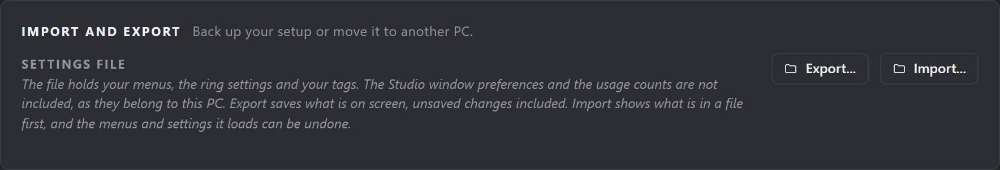

# Files, backups and logs

## Import and export

**Settings > Import and export** saves your setup to one file, or loads one back. Use it to move a setup to another PC or to keep a copy.

**Export...** writes one `.json` file with your menus and settings (everything in `radial.json`) and your tags. It saves what is on screen, including edits you have not saved yet. It leaves out Studio's window placement and preferences, the ZBrush folders you added by hand and the usage counts, since those belong to one PC.

**Import...** reads a file and shows what it holds before anything changes. It also accepts a plain `radial.json` or a plain `tags.json`, such as one you copied by hand.

- The menus and settings load into the editor as an unsaved change. **Save** keeps them and **Undo** takes them back.
- If the file has tags, you choose each time:
  - **Merge tags** adds the tags you do not have. A tag that matches one of yours, by key or by label, keeps your name and colour. Each item's tag list is joined with yours, your tags first and no repeats.
  - **Replace tags** swaps your tags for the file's. Your old `tags.json` is kept as `tags.json.bak` first.
- Tags save straight away, as tag edits always do, so they are not part of **Undo**.

## Files and logs

| Path | What |
|---|---|
| `%APPDATA%\ZOrbit\radial.json` | Your menus and settings. Created from the starter menus on first run. |
| `%APPDATA%\ZOrbit\radial.json.bak` | The version before your last save in Studio (only replaced when the file was readable and changed). |
| `%APPDATA%\ZOrbit\radial.json.broken` | The file Studio could not read, kept when you chose **Start from defaults** on the recovery screen. |
| `%APPDATA%\ZOrbit\launch.json` | Tells the plugin how to start the app and Studio. Rewritten on each start. |
| `%LOCALAPPDATA%\ZOrbit\radiald.log` | The app: config loads, hotkeys, rings, hand-offs. Trimmed automatically. |
| `%LOCALAPPDATA%\ZOrbit\bridge.log` | The plugin inside ZBrush: what each pick actually did. |
| `%LOCALAPPDATA%\ZOrbit\app_stderr.log` | Output when the app crashes on startup. |
| `%LOCALAPPDATA%\ZOrbit\listener.json` | The verified listener window (written by the plugin). |
| `%LOCALAPPDATA%\ZOrbit\activity.json` | The last ring the app opened and the last pick it sent: the route, whether it went out, and whether the plugin picked it up. Written by the app; Setup's **Try the ring** step reads it. Safe to delete. |
| `%LOCALAPPDATA%\ZOrbit\request.json` | The pick in transit. Normally gone in a moment. |
| `%LOCALAPPDATA%\ZOrbit\request.txt` | The same pick for the ZBrush 2022 to 2025 plugin. Only written when such a ZBrush is installed. |
| `%LOCALAPPDATA%\ZOrbit\zscript_bridge.log` | ZBrush 2022 to 2025: what the last pick did. |
| `%LOCALAPPDATA%\ZOrbit\zscript_launch.log` | ZBrush 2022 to 2025: how the plugin last started the app or Studio. |
| `%LOCALAPPDATA%\ZOrbit\zscript_hotkey.log` | ZBrush 2022 to 2025: the hotkey Apply had when the plugin loaded, and the one it has after (88 is F9). |
| `%APPDATA%\ZOrbit\studio.json` | Studio's own preferences: `show_licence` (the **Licence** button), `check_updates` (the update check), `setup_done` (Setup finished or skipped), `last_screen` (the screen Studio reopens on), `zbrush_folders` (ZBrush folders added by hand on Setup or Older ZBrush), and `window` (window placement). |
| `%APPDATA%\ZOrbit\tags.json` | Your tags: each tag's label and colour (Favourites included), and which items carry which tags. Created the first time you change a tag. See [Tags](tags.md#where-tags-live). |
| `%APPDATA%\ZOrbit\popout.json` | The browser's window position and size, whether it is maximised, Keep on top, thumbnail size, the side of the folders column (`side`), whether it is shown (`column`) and the tab you were last on (`kind`). Safe to delete. |
| `%LOCALAPPDATA%\ZOrbit\popout.log` | The browser: how it started, what it showed, the picks it sent to the app. |
| `%LOCALAPPDATA%\ZOrbit\studio.log` | How Studio started: which program launched it and how long each step took. A failed update check is noted here. |
| `%LOCALAPPDATA%\ZOrbit\usage.json` | Brush usage, which fills the auto slots, and your recent picks under `"picks"` (see [Favourites and Recent](browser.md#favourites-and-recent)). Names are kept in lower case without spaces, so `Clay Buildup` and `ClayBuildup` count as one brush. |
| `%LOCALAPPDATA%\ZOrbit\thumbs\` | Cached thumbnails of brushes, alphas, materials and textures. Safe to delete. |
| `<ZBrush>\ZStartup\ZPlugs64\ZOrbitBridge.zsc` | ZBrush 2022 to 2025: the plugin. Its `ZOrbitData` folder says where picks arrive and how to start the app. |

When you report a bug, paste the last lines of `radiald.log` and `bridge.log` (and `popout.log` for a problem with the browser). They contain brush names and menu ids, but have a quick look before you post them.
