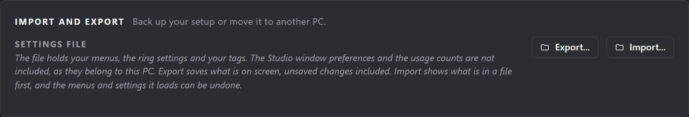

# Files, backups and logs

## Import and export

**Settings > Import and export** saves your setup to one file, or loads one back. Use it to move a setup to another PC or to keep a copy.

**Export...** writes the profile you are editing as one `.json` file: its menus and settings (everything in `radial.json`, the looks you saved under `looks` included) and its tags. It saves what is on screen, including edits you have not saved yet. It leaves out Studio's window placement and preferences, the ZBrush folders you added by hand and the usage counts, which stay with the profile on this PC.

**Import...** reads a file and shows what it holds before anything changes. It also accepts a plain `radial.json` or a plain `tags.json`, such as one you copied by hand. It loads the file into the profile you are editing. To make a new profile from a file instead, use **New profile... > From a file...** (see [Sharing a profile](profiles.md#sharing-a-profile)).

- The menus and settings load into the editor as an unsaved change. **Save** keeps them and **Undo** takes them back.
- If the file has tags, you choose each time (both buttons also load the file's menus and settings, as above):
  - **Merge tags** adds the tags you do not have. A tag that matches one of yours, by key or by label, keeps your name and colour. Each item's tag list is joined with yours, your tags first and no repeats. Your [Favourites order](browser.md#favourites-and-recent) stays and the file's is not used; an item that gains a star goes at the end of it.
  - **Replace tags** swaps your tags, and your Favourites order, for the file's. Your old `tags.json` is kept as `tags.json.bak` first.
- Tags save straight away, as tag edits always do, so they are not part of **Undo**.

To share one menu, use **Export menu...** in the **Menu** tab. It writes the menu, its submenus, their tags and the looks of your own that they use to a small file, which **Import menu...** in the **Menus** list adds to someone else's setup. Your Favourites order is not in it. See [Share a menu](menus.md#share-a-menu).

## Files and logs

| Path | What |
|---|---|
| `%APPDATA%\ZOrbit\profile.json` | Which profile is in use, as `{"active": "Default"}`. Every part of ZOrbit reads it fresh, so a switch needs no restart. See [Profiles](profiles.md#switching). |
| `%APPDATA%\ZOrbit\profiles\format.json` | The layout the profiles folder is kept in, as `{"format": 1, "version": "<version>"}`: the number, and the version of ZOrbit that wrote it last. A version that finds a higher number than it knows changes nothing. See [These files were made by a newer ZOrbit](troubleshooting.md#these-files-were-made-by-a-newer-zorbit). |
| `%APPDATA%\ZOrbit\profiles\leftovers.json` | The old files at the root that the first start after the update could not move to `pre-profiles` (a file in use, say), with their size and time. Each start tries again. See [Profiles](profiles.md#where-the-files-are). |
| `%APPDATA%\ZOrbit\profiles\<profile>\radial.json` | The menus and settings of one profile. A new profile starts from the starter menus, an empty menu or a copy, as you choose. See [Profiles](profiles.md#making-a-profile). |
| `%APPDATA%\ZOrbit\profiles\<profile>\radial.json.bak` | The version before your last save in Studio (only replaced when the file was readable and changed). |
| `%APPDATA%\ZOrbit\profiles\<profile>\radial.json.broken` | A copy of the profile's `radial.json` that Studio replaced: **Start from defaults** and **Restore backup** on the recovery screen keep the unreadable file here first, and so does a save over a file that is not valid JSON. Only the last one is kept. |
| `%APPDATA%\ZOrbit\profiles\.deleted\` | Deleted profiles, kept as `<name>-<date>`. ZOrbit removes each one 30 days after it was deleted; drag one out to recover it. See [Rename, duplicate, delete](profiles.md#rename-duplicate-delete). |
| `%APPDATA%\ZOrbit\pre-profiles\` | The `radial.json`, `tags.json` and `usage.json` files from before profiles existed, moved here by the first start after the update. They are no longer used. Safe to delete. |
| `%APPDATA%\ZOrbit\pre-profiles\<date and time>\` | Files an older ZOrbit wrote to the old places after the update, such as after going back to 0.12.0. They are set aside by **Set aside** in Studio, or by the start that added their brush usage. Named by the time they were set aside, such as `20261101-093000`. Safe to delete. See [Files from an older version](profiles.md#files-from-an-older-version). |
| `%APPDATA%\ZOrbit\launch.json` | Tells the plugin how to start the app and Studio. Rewritten on each start. |
| `%LOCALAPPDATA%\ZOrbit\radiald.log` | The app: config loads, hotkeys, rings, hand-offs. Trimmed automatically. |
| `%LOCALAPPDATA%\ZOrbit\bridge.log` | The plugin inside ZBrush: what each pick actually did. |
| `%LOCALAPPDATA%\ZOrbit\app_stderr.log` | Output when the app crashes on startup. When ZBrush 2026 starts the app, the app's log lines land here too. |
| `%LOCALAPPDATA%\ZOrbit\listener.json` | The verified listener window (written by the plugin). |
| `%LOCALAPPDATA%\ZOrbit\activity.json` | The last ring the app opened and the last pick it sent: the route, whether it went out, and whether the plugin picked it up. `elevated_zbrush` is `true` while a ZBrush running as administrator is open (the app cannot work with it). Written by the app; Setup's **Try the ring** step reads it. Safe to delete. |
| `%LOCALAPPDATA%\ZOrbit\request.json` | The pick in transit. Normally gone in a moment. A pick that could not be handed over is deleted again. |
| `%LOCALAPPDATA%\ZOrbit\request.txt` | The same pick for the ZBrush 2022 to 2025 plugin. Only written when such a ZBrush is installed. |
| `%LOCALAPPDATA%\ZOrbit\ApplyFallback.txt` | ZBrush 2022 to 2025: the script that presses **Apply** when the bridge key does not reach it. Written the first time a pick needs it. See [ZBrush 2022 to 2025](bridge.md#zbrush-2022-to-2025). |
| `%LOCALAPPDATA%\ZOrbit\ApplyFallback.zsc` | ZBrush 2022 to 2025: the compiled copy of `ApplyFallback.txt`, which ZBrush makes beside it. ZOrbit removes it when it rewrites the script. |
| `%LOCALAPPDATA%\ZOrbit\zscript_bridge.log` | ZBrush 2022 to 2025: what the last pick did. The app copies each of these into `radiald.log`, as a line that starts `pick #<number> result:`, so the earlier ones are kept there. |
| `%LOCALAPPDATA%\ZOrbit\zscript_launch.log` | ZBrush 2022 to 2025: how the plugin last started the app or Studio. |
| `%LOCALAPPDATA%\ZOrbit\zscript_hotkey.log` | ZBrush 2022 to 2025: the hotkey Apply had when the plugin loaded, and the one it has after (88 is F9). |
| `%APPDATA%\ZOrbit\studio.json` | Studio's own preferences: `check_updates` (the update check), `setup_done` (Setup finished or skipped), `last_screen` (the screen Studio reopens on), `mode` (`simple` or `full`, see [Simple and Full mode](studio.md#simple-and-full-mode)), `theme` (`dark`, `light`, `system` for **Follow Windows** or `zbrush` for **Match ZBrush**, see [Theme](appearance.md#theme)), `zbrush_folders` (ZBrush folders added by hand on Setup or Older ZBrush), `library_folders` (the folders of your own brushes, alphas, materials and textures you added on **Settings > Library folders**, a list for each kind; see [Your own folders](browser.md#your-own-folders)), `seen_version` (the version whose **What's new** you closed last, see [Version and update check](studio.md#version-and-update-check)), `tour_seen` (true once the [tour](studio.md#the-tour) has been offered or taken), `skipped_version` (the version you chose **Don't remind me again** for), and `window` (window placement). |
| `%APPDATA%\ZOrbit\profiles\<profile>\tags.json` | The tags of one profile: each tag's label and colour (Favourites included), which items carry which tags, and any order you dragged Favourites into. Created the first time you change a tag. See [Tags](tags.md#where-tags-live). |
| `%APPDATA%\ZOrbit\profiles\<profile>\tags.json.bak` | The profile's old `tags.json`, kept when you import a file with **Replace tags** (see [Import and export](#import-and-export)). Only the last one is kept. |
| `%APPDATA%\ZOrbit\popout.json` | The first browser window's position and size, whether it is maximised, Keep on top, thumbnail size, the side of the folders column (`side`), whether it is shown (`column`) and the tab you were last on (`kind`). Each other [browser window](browser.md#several-windows) has an entry under `extras` with the same settings (`id`, `window`, `on_top`, `kind`, `side`, `column`, `size`), and `last_used` (`main` or an extra's `id`) is the window the hotkey goes to. Also the [strip](browser.md#the-strip): `strip_on` (`true` while the strip is where the window rests) and `strip`, with `orient` (`vertical` or `horizontal`), `kind` (its tab), `window` (its place, `x` and `y`), `wrap` (`true` when every favourite shows) and `fold` (`true` when it is folded to its grip and star). Safe to delete. |
| `%LOCALAPPDATA%\ZOrbit\popout.log` | The browser: how it started, what it showed, the picks it sent to the app, and the windows it opened, brought back and closed. |
| `%LOCALAPPDATA%\ZOrbit\studio.log` | How Studio started: which program launched it and how long each step took. A failed update check is noted here, and each step of **Install update** in a line that starts with `update:`. |
| `%LOCALAPPDATA%\ZOrbit\updates\` | The installer that **Install update** in Studio downloaded, as `ZOrbitSetup-<version>.exe`. Studio deletes it once that version (or a newer one) runs. Safe to delete when no update is running. |
| `%LOCALAPPDATA%\ZOrbit\update-setup.log` | What Setup did during the last update started from Studio. Rewritten each time. |
| `%APPDATA%\ZOrbit\profiles\<profile>\usage.json` | Brush usage for one profile, which fills the auto slots, and its recent picks under `"picks"` (see [Favourites and Recent](browser.md#favourites-and-recent)). Names are kept in lower case without spaces, so `Clay Buildup` and `ClayBuildup` count as one brush. |
| `%APPDATA%\ZOrbit\profiles\<profile>\usage.json.bad` | A copy of the profile's `usage.json` made when the file could not be read (a stray character, say). The app goes on with what it had in memory. Safe to delete. |
| `%LOCALAPPDATA%\ZOrbit\*.log.old` | The older part of a log that grew too big. `bridge.log` moves to `bridge.log.old` at 500 KB, and `studio.log`, `popout.log` and `app_stderr.log` move at 200 KB; each time the last `.old` is replaced. `radiald.log` has no `.old`: when it passes 1 MB, the app keeps its newest half, at start and every few seconds while it runs. All the logs together take at most about 3 MB. The `zscript_*.log` files are rewritten on each pick or start. Safe to delete. |
| `%LOCALAPPDATA%\ZOrbit\zscript_stage\` | A work folder that Studio fills with the ZBrush 2022 to 2025 plugin files while it installs or updates the plugin, and rebuilds each time. Safe to delete when no install is running. |
| `%LOCALAPPDATA%\ZOrbit\thumbs\` | Cached thumbnails of brushes, alphas, materials and textures. Safe to delete. |
| `<ZBrush>\ZStartup\ZPlugs64\ZOrbitBridge.zsc` | ZBrush 2022 to 2025: the plugin. Its `ZOrbitData` folder says where picks arrive and how to start the app. |
| `ZStartup\ConfigFiles\LightboxRecentFiles.cfg` in the user assets folder of ZBrush 2026 and newer (in its folder under `%APPDATA%\Maxon` until one is chosen), or `%PUBLIC%\Documents\ZBrushData<year>\ZStartup\ConfigFiles\LightboxRecentFiles.cfg` for ZBrush 2022 to 2025 | ZBrush's own list of the files it opened last. ZOrbit reads it for a [Recent](menus.md#recent) slot and never changes it. |
| `%PUBLIC%\Documents\ZBrushData<year>\ZStartup\CustomUserInterface<year>.cfg`, and for ZBrush 2026.1 and newer `%APPDATA%\Maxon\ZBrush <year>_<id>\ZStartup\UserInterfaceLayouts\CustomUserInterface<year>.cfg` | ZBrush's own file, written when you press **Store Config**. ZOrbit reads the interface colours in it for the **Match ZBrush** [theme](appearance.md#match-zbrush) and never changes it. |

When you report a bug, use **Copy report** on Studio's **Status** screen. It takes the ends of the logs that fit your setup, lists the library folders you added, and [hides your user name and folders](troubleshooting.md#logs). If you copy a log by hand, read what you paste. The logs hold brush names and menu ids, and also your Windows user name and folder paths: the plugin logs where it loaded from and how it started the app, the app logs the command line of the browser, and `studio.log` and `popout.log` log the working directory. Black out those parts.
