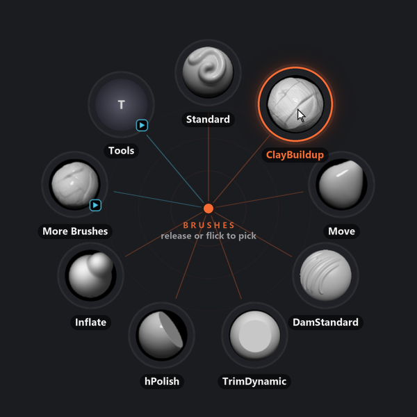
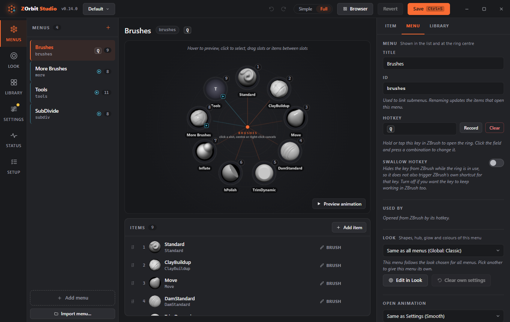

# Getting started

## The basics

ZOrbit is two things that work together:

- a small **app** that watches for your hotkeys and draws the ring, and
- a **plugin inside ZBrush** (the bridge, see [How ZOrbit talks to ZBrush](bridge.md)) that carries out what you picked.

You do not start either by hand. ZBrush loads the plugin when it starts, the plugin starts the app, and the app quits when ZBrush closes. The app has an icon in the notification area: left-click it to open Studio ([The tray icon](studio.md#the-tray-icon) lists its other commands, including **Profile** for switching between [profiles](profiles.md)).

With ZBrush in front, press **Q**. The ring opens centred on your cursor. Pick a slot (see [Pick modes](hotkeys.md#pick-modes)) and ZBrush does what the slot says.

Slots are laid out clockwise starting at the top. A slot with a small arrow badge opens another ring. A small fan badge means its items fan out from that slot instead. The menu's title and a short hint sit in the middle.

## What ZOrbit takes over

ZOrbit uses three keys that ZBrush may also want:

- **Q** is ZBrush's own key for Draw mode. The starter **Brushes** menu has **Swallow hotkey** switched off, so ZBrush still sees **Q**: it switches to Draw mode when the ring opens, and **Q** still types in ZBrush's own text fields. With **Swallow hotkey** on, ZOrbit hides the key from ZBrush whenever ZBrush is in front, text fields included, for as long as a menu uses it. Then you cannot type that letter in a rename box. To change the key or the switch, go to the **Menus** screen, pick the menu, click the **Hotkey** field and press the new key. **Swallow hotkey** is in the menu settings in [Full mode](studio.md#simple-and-full-mode). See [Hotkeys](hotkeys.md).
- **Alt+B** opens the [browser](browser.md). ZOrbit hides it from ZBrush. Change it in **Settings > Behaviour** (see [Browser hotkey](appearance.md#browser-hotkey)).
- **F9** is the bridge key. In ZBrush 2022 to 2025 the plugin binds it to **Zplugin > ZOrbit > Apply** if that button has no hotkey, and every pick presses it. In ZBrush 2026 and newer, in the default `auto` mode, the app presses it only when the plugin's listener does not answer, so it matters only if you bound it. If F9 does something else for you there, pick another bridge key. Change it in **Settings > ZBrush bridge** (Full mode), then bind the same key to **Apply** in ZBrush (see [ZBrush 2022 to 2025](bridge.md#zbrush-2022-to-2025) and [How picks reach ZBrush](bridge.md#how-picks-reach-zbrush-bridge-modes)).

**Pen tablets.** Keys sent by a tablet driver (the ExpressKeys of a Wacom, Huion or XP-Pen tablet, for example), a macro tool or a key remapper work like the real key. ZOrbit ignores only the key presses it sends itself.

**The tray icon.** While ZOrbit runs, its icon sits in the notification area. Windows may keep it behind the **^** arrow; drag it out to keep it in view.

**The browser.** **Alt+B** opens a window with every brush, alpha, material and texture ZBrush can load. Search, filter by tag, star favourites and pick with Enter. Your favourites can also sit in a small strip over ZBrush, where one click picks. See [Browser window](browser.md).

## First steps

1. Open **ZOrbit Studio** from the Start menu (or from ZBrush: **Zplugin > ZOrbit > Studio**). On a fresh install it opens on the **Setup** screen (Alt+6). Work down its steps, then press **Finish**. Setup finds your ZBrush, tells you whether to restart it and has you try the ring once (see [Setup](studio.md#setup)). After **Finish** or **Skip for now**, Studio offers a short [tour](studio.md#the-tour) of the window.
2. On the **Menus** screen (Alt+1), pick a menu on the left. The ring preview in the middle is drawn by the same code that draws it inside ZBrush.
3. Drag brushes from the **Library** onto the ring, or use **Add item** to add a brush, alpha, material, texture, press, toggle or submenu. Studio starts in **Simple** mode, which shows the everyday controls. Press **Full** in the top bar for buttons, sliders, switches and the rest (see [Simple and Full mode](studio.md#simple-and-full-mode)).
4. Click **Save** (Ctrl+S). The next time you open the ring in ZBrush it uses your changes. There is no need to restart anything.

Next: [ZOrbit Studio](studio.md) covers the editor, [Menus and items](menus.md) every item type, and [Appearance](appearance.md) every setting.
