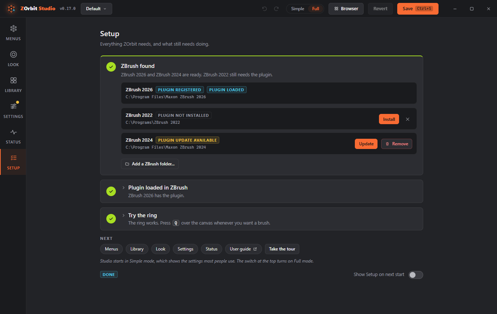

# Install and uninstall

## Requirements

- Windows 10 or 11
- ZBrush 2022 or newer. ZBrush 2026 and newer load the Python plugin that the installer sets up. ZBrush 2022 to 2025 have no Python API, so they get a ZScript plugin, which you install from Studio (see [ZBrush 2022 to 2025](#zbrush-2022-to-2025)). ZBrush Core and ZBrushCore Mini are not supported, because they do not load plugins.
- The Microsoft Edge WebView2 runtime, which Studio uses for its window. It is part of Windows 11 and of up-to-date Windows 10.

## Install

1. Download the installer from the [Releases page](https://github.com/combwizard/zorbit/releases).
2. Run it. It installs for your user only and does not need administrator rights. It adds the plugin folder to your `ZBRUSH_PLUGIN_PATH` user environment variable and creates two Start menu shortcuts, **ZOrbit Studio** and **ZOrbit Browser**, plus an optional desktop icon.
3. **ZBrush 2026 and newer:** restart ZBrush once (it reads `ZBRUSH_PLUGIN_PATH` only when it starts). **ZBrush 2022 to 2025:** open **ZOrbit Studio**, go to **Setup**, press **Install** next to your ZBrush (approve the Windows prompt if it asks), then restart that ZBrush.
4. Open a canvas, hover over it and press **Q**.

The first time you open **ZOrbit Studio** it starts on its **Setup** screen. Setup walks through the rest: it finds your ZBrush, tells you whether to restart it, lists each ZBrush 2022 to 2025 it finds with an **Install** button (press it for each version you use), and has you try the ring once. You can reopen it any time with Alt+6.

The first run puts a starter set of menus in the **Default** profile, `%APPDATA%\ZOrbit\profiles\Default\radial.json`. See [Profiles](profiles.md). They use only brushes that come with ZBrush.

The installer also puts `LICENSE` and `THIRD_PARTY_NOTICES.md` in the install folder. If your PC has a machine-wide `ZBRUSH_PLUGIN_PATH`, the installer keeps its entries: Windows ignores the machine value once you have your own, so the new user value starts with the machine entries and adds the ZOrbit folder after them.

### Updating

Studio can update itself: click the new version at the top of the window, or **Install update** in **Settings > Studio**, then **Download and install**. Studio downloads the installer, checks it, asks about any unsaved changes, and runs Setup for you. Studio and the ring app come back on their own when it is done. See [Installing an update](studio.md#version-and-update-check). A portable copy cannot update itself this way.

To update by hand, save your work in Studio and close it, then run the new installer over the old one. It closes ZOrbit for you, and it asks you to close Studio if it is still open. If ZOrbit Studio is open, it asks Studio to close the way you would, and Studio shows its own dialog when it has unsaved changes. Answer the dialog, or close Studio yourself, then run Setup again if it stopped with "Close ZOrbit Studio first". Setup never ends a Studio that is still open.

An update keeps the folder you installed to: if you chose a custom folder the first time, Setup offers the same one. It replaces the program files whole, so nothing from an older version stays behind. Your menus, settings and tags are not touched: they live in `%APPDATA%\ZOrbit`, outside the install folder. The first start after an update from a version before profiles moves your old menus, tags and usage into the **Default** profile. The originals go to `%APPDATA%\ZOrbit\pre-profiles\`, and you can delete them. See [Profiles](profiles.md#where-the-files-are).

After an update:

- **ZBrush 2026 and newer:** restart ZBrush so it loads the new plugin.
- **ZBrush 2022 to 2025:** the plugin inside ZBrush is not replaced by the installer. When the new version has a newer plugin, press **Update** next to your ZBrush in **Settings > Older ZBrush** ([Full mode](studio.md#simple-and-full-mode)) or on **Setup**, wherever it says **Plugin update available**. Then restart that ZBrush.

### Upgrading from Radial Menu for ZBrush

ZOrbit used to be called Radial Menu for ZBrush. Run the new installer over the old install. It moves the program to `%LOCALAPPDATA%\Programs\ZOrbit` and removes the old folder, its Start menu shortcut and its plugin path entry. Your menus, settings, tags and learned auto slots are copied on the first start into the **Default** [profile](profiles.md), in `%APPDATA%\ZOrbit\profiles\Default\`. The old `RadialMenu` folders stay where they are; you can delete them.

In ZBrush 2026 the palette is now **Zplugin > ZOrbit**. If you bound F9 to the old **Apply** by hand, bind it again on **Zplugin > ZOrbit > Apply**: Ctrl+Alt+click it, press **F9**, then **Preferences > Hotkeys > Store**. In ZBrush 2022 to 2025, Studio shows the old plugin as **Update available**. **Update** replaces it with the ZOrbit plugin.

### ZBrush 2022 to 2025

These versions load plugins only from their own `ZStartup\ZPlugs64` folder, so Studio puts the plugin there:

1. Open **ZOrbit Studio** and go to the **Setup** screen (Alt+6). Step 1 lists the 2022 to 2025 versions it found. If yours is missing, use **Add a ZBrush folder**. The same list, with the same **Install** button, is in **Settings > Older ZBrush** in [Full mode](studio.md#simple-and-full-mode).
2. Click **Install**. A ZBrush under Program Files asks for administrator rights once (the prompt runs ZOrbit's own program as administrator).
3. Restart that ZBrush.

The plugin has no listener window, so every pick in these versions goes through the bridge key, F9. When ZBrush loads the plugin it binds F9 to **Zplugin > ZOrbit > Apply** if that button has no hotkey yet, and keeps a key you stored for it yourself. That is verified in ZBrush 2022, 2023 and 2025; in 2024, check **Zplugin > ZOrbit > Apply** and bind F9 by hand if it is empty. If you change the bridge key in Studio (a bare F-key other than F10), bind the new key by hand in each version: Ctrl+Alt+click **Apply**, press the key, then **Preferences > Hotkeys > Store**. When a new version of ZOrbit has a newer plugin, **Settings** shows a badge and the row says **Update available**.

On a PC where PowerShell is restricted, Studio installs the plugin without its two start shortcuts and says "Installed without the start shortcuts". The plugin still works; it starts ZOrbit the slower way. If the path of the ZOrbit data folder has characters outside the Windows code page and 8.3 short names are off, Studio refuses to install and says what to change. ZBrush 2021 and older are not supported. See [Troubleshooting](troubleshooting.md#zbrush-2022-to-2025-the-ring-opens-but-picks-do-nothing).

### Portable zip

The portable zip is for a PC where you do not want to run an installer. It holds `ZOrbit\` (the app), `bridge\` (the plugin for ZBrush 2026 and newer), `LICENSE` and `THIRD_PARTY_NOTICES.md`.

1. Unzip it somewhere permanent, such as a folder under `Documents`. Keep `ZOrbit\` and `bridge\` together in the same parent folder.
2. Run `ZOrbit\ZOrbit.exe`. It sits in the notification area.
3. Left-click the tray icon to open Studio, and go to the **Setup** screen (Alt+6).
4. Press **Fix** next to your ZBrush. That adds the `bridge` folder to your `ZBRUSH_PLUGIN_PATH` user environment variable. The app also writes `%APPDATA%\ZOrbit\launch.json` each time it starts, so the plugin knows where to find it.
5. Restart ZBrush. For ZBrush 2022 to 2025, press **Install** on **Setup** instead (see [ZBrush 2022 to 2025](#zbrush-2022-to-2025)).

If you move the folder, start `ZOrbit.exe` from its new place and press **Fix** again. Setup then lists the old entry as **Also registered:** followed by its path, with "(missing)" after it when that folder is gone, and says why it matters: ZBrush loads every folder in the variable, so an old copy of the plugin is loaded beside the new one. Setup only reports it. To remove the old entry, edit `ZBRUSH_PLUGIN_PATH` in Windows' environment variables (search the Start menu for "Edit environment variables for your account").

The portable zip makes no Start menu shortcuts, and it has no uninstaller. To remove it, first delete the plugin entry from `ZBRUSH_PLUGIN_PATH` as above (and use **Remove** on **Setup** for any ZBrush 2022 to 2025 you installed the plugin into), then delete the folder. Your menus, tags and logs are in `%APPDATA%\ZOrbit` and `%LOCALAPPDATA%\ZOrbit`, as with the installer.

### Windows says "Windows protected your PC"

The installer is not code-signed yet. Code-signing certificates cost money every year, and this is a free hobby project, so Windows SmartScreen shows its warning for any program it does not recognise. The warning does not mean it found a problem.

To continue, click **More info**, then **Run anyway**. If you would rather not run a binary you did not build, the whole source is in this repository and [Build from source](building.md) explains how to make the installer yourself.

### Smart App Control and antivirus

The ZOrbit installer and `ZOrbit.exe` are not code-signed. Two things on Windows can block an unsigned program outright.

**Smart App Control.** On some Windows 11 PCs, Smart App Control is on. When it is, the warning has no **Run anyway**, and the installer will not start. You have two ways round it. Use the [portable zip](#portable-zip) instead of the installer. Or turn Smart App Control off in **Windows Security > App & browser control > Smart App Control settings**. Windows does not let you turn it back on afterwards without reinstalling Windows, so decide before you switch it off.

**Antivirus.** Some antivirus programs quarantine or delete an unsigned program they do not know, and may take `ZOrbit.exe` out of the install folder. Restore it from the antivirus's quarantine, and add an exclusion for the install folder (`%LOCALAPPDATA%\Programs\ZOrbit` unless you chose another). The source is in this repository if you want to check what you are running.

## Uninstall

Open **Windows Settings > Apps > Installed apps**, find **ZOrbit** and choose **Uninstall**. Restart ZBrush afterwards so it lets go of the plugin.

The uninstaller closes ZOrbit first. If Studio is open it stops and asks you to close Studio yourself, so unsaved changes are never lost.

It removes:

- the program folder (when nothing else is left in it, the folder goes too),
- the **ZOrbit Studio** and **ZOrbit Browser** Start menu shortcuts, and the desktop icon if you made one,
- the plugin folder's entry in your `ZBRUSH_PLUGIN_PATH` user variable,
- `%APPDATA%\ZOrbit\launch.json`,
- the plugin from every ZBrush 2022 to 2025 that Studio's **Setup** lists: the ones Windows knows about, the ones ZBrush recorded and the ones you added by hand. A ZBrush under `C:\Program Files` asks for administrator rights once. If a folder could not be cleaned, the uninstaller lists it, and you delete `ZOrbitBridge.zsc` and the `ZOrbitData` folder from that ZBrush's `ZStartup\ZPlugs64` yourself.

It leaves your profiles (menus, settings, tags and learned auto slots, in `%APPDATA%\ZOrbit\profiles\`) and your logs. They are not part of the program. They live in `%APPDATA%\ZOrbit` and `%LOCALAPPDATA%\ZOrbit`; delete those folders if you want no trace.
