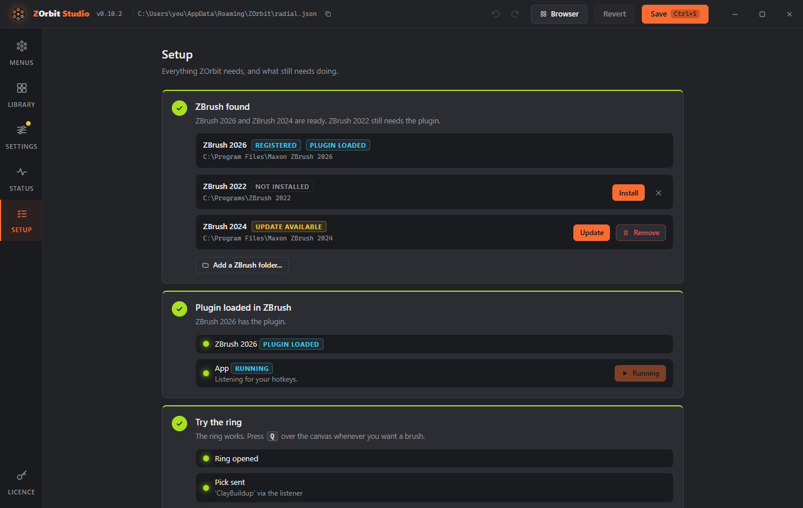

# Install and uninstall

## Requirements

- Windows 10 or 11
- ZBrush 2022 or newer. ZBrush 2026 and newer load the Python plugin that the installer sets up. ZBrush 2022 to 2025 have no Python API, so they get a ZScript plugin, which you install from Studio (see [ZBrush 2022 to 2025](#zbrush-2022-to-2025)).
- The Microsoft Edge WebView2 runtime, which Studio uses for its window. It is part of Windows 11 and of up-to-date Windows 10.

## Install

1. Download the installer from the [Releases page](https://github.com/combwizard/zorbit/releases).
2. Run it. It installs for your user only and does not need administrator rights. It adds the plugin folder to your `ZBRUSH_PLUGIN_PATH` user environment variable and creates a Start menu shortcut called **ZOrbit Studio**.
3. **Restart ZBrush once.** ZBrush reads `ZBRUSH_PLUGIN_PATH` only when it starts.
4. Open a canvas, hover over it and press **Q**.

The first time you open **ZOrbit Studio** it starts on its **Setup** screen. Setup walks through the rest: it finds your ZBrush, tells you whether to restart it, installs the plugin for ZBrush 2022 to 2025, and has you try the ring once. You can reopen it any time with Alt+6.

The first run puts a starter set of menus in `%APPDATA%\ZOrbit\radial.json`. They use only brushes that come with ZBrush.

### Upgrading from Radial Menu for ZBrush

ZOrbit used to be called Radial Menu for ZBrush. Run the new installer over the old install. It moves the program to `%LOCALAPPDATA%\Programs\ZOrbit` and removes the old folder, its Start menu shortcut and its plugin path entry. Your menus and settings are copied to `%APPDATA%\ZOrbit` on the first start, and learned auto slots to `%LOCALAPPDATA%\ZOrbit`. The old `RadialMenu` folders stay where they are; you can delete them.

In ZBrush 2026 the palette is now **Zplugin > ZOrbit**. If you bound F9 to the old **Apply** by hand, bind it again on **Zplugin > ZOrbit > Apply**: Ctrl+Alt+click it, press **F9**, then **Preferences > Hotkeys > Store**. In ZBrush 2022 to 2025, Studio shows the old plugin as **Update available**. **Update** replaces it with the ZOrbit plugin.

### ZBrush 2022 to 2025

These versions load plugins only from their own `ZStartup\ZPlugs64` folder, so Studio puts the plugin there:

1. Open **ZOrbit Studio** and go to **Settings > Older ZBrush**. It lists the 2022 to 2025 versions it found. If yours is missing, use **Add a ZBrush folder**. The **Setup** screen (Alt+6) lists the same versions with the same **Install** button.
2. Click **Install**. A ZBrush under Program Files asks for administrator rights once.
3. Restart that ZBrush.

The plugin has no listener window, so every pick in these versions goes through the bridge key, F9. The plugin binds F9 to **Zplugin > ZOrbit > Apply** itself, so there is nothing to set up. If you change the bridge key in Studio, bind the new key by hand in each version: Ctrl+Alt+click **Apply**, press the key, then **Preferences > Hotkeys > Store**. When a new version of ZOrbit has a newer plugin, **Settings** shows a badge and the row says **Update available**.

### Windows says "Windows protected your PC"

The installer is not code-signed yet. Code-signing certificates cost money every year, and this is a free hobby project, so Windows SmartScreen shows its warning for any program it does not recognise. The warning does not mean it found a problem.

To continue, click **More info**, then **Run anyway**. If you would rather not run a binary you did not build, the whole source is in this repository and [Build from source](building.md) explains how to make the installer yourself.

## Uninstall

Open **Windows Settings > Apps > Installed apps**, find **ZOrbit** and choose **Uninstall**. Restart ZBrush afterwards so it lets go of the plugin.

The uninstaller cannot reach the plugin inside a ZBrush 2022 to 2025. Remove it first with **Studio > Settings > Older ZBrush > Remove**, or afterwards by deleting `ZOrbitBridge.zsc` and the `ZOrbitData` folder from that ZBrush's `ZStartup\ZPlugs64`.

Your menus and logs are not part of the program. They live in `%APPDATA%\ZOrbit` and `%LOCALAPPDATA%\ZOrbit`; delete those folders if you want no trace.
