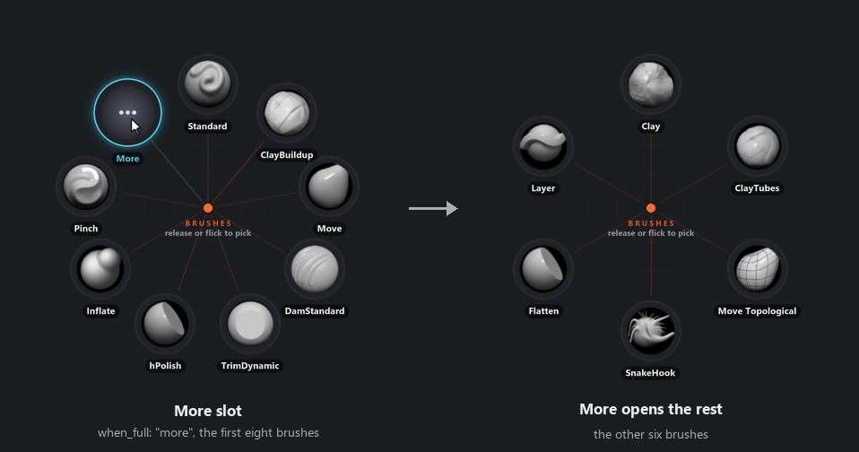
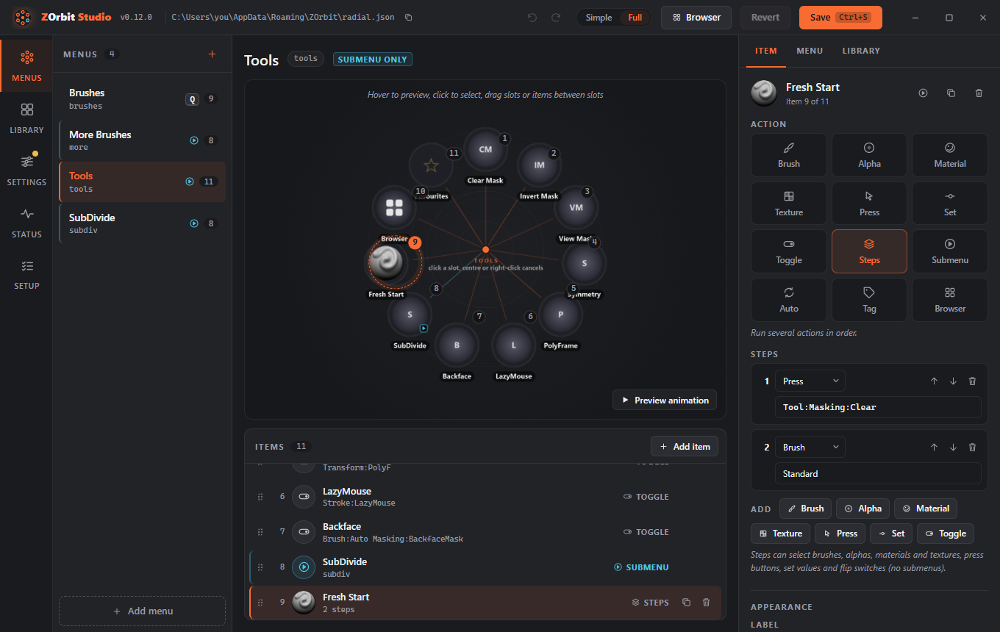
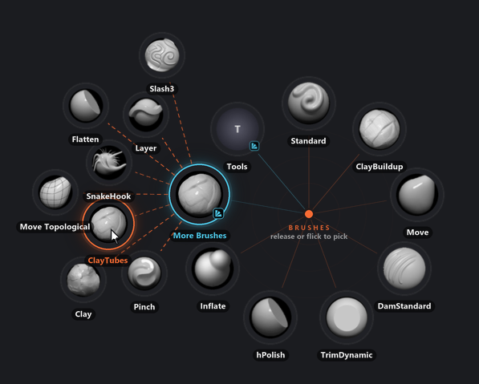
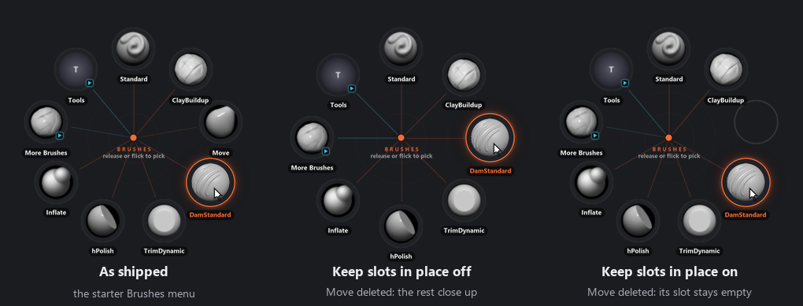
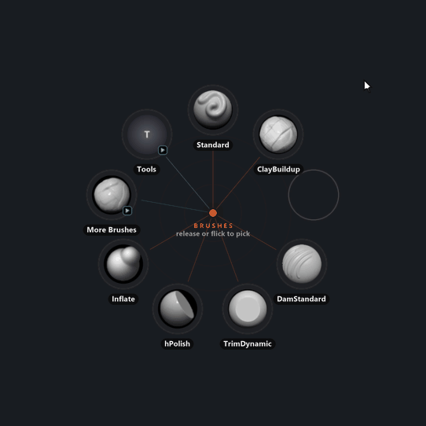

# Menus and items

## Menus

A menu is a named list of items shown as one ring. Menus live in one file, `%APPDATA%\ZOrbit\profiles\<profile>\radial.json`, one per profile; see [Profiles](profiles.md). Each has an id (its key in the file), a title, a list of items, and optionally a hotkey.

- A menu **with a hotkey** can be opened from ZBrush.
- A menu **without a hotkey** is a submenu: it opens when you pick an item of type `menu` in another ring.
- Items are spread evenly around the circle. **Ring radius** is a minimum: when a menu has more items than fit at that radius, the ring grows so the slots keep a gap (see [Appearance](appearance.md#appearance-and-behaviour-settings)). With the default sizes that starts at 10 items. The more items, the smaller the angle between neighbouring slots, so they get harder to hit. Studio shows a note above the item list when the ring is full, saying how many items fit and how big the ring grows. Raise **Ring radius**, lower **Slot size** or split the menu into submenus, or choose what a full ring does instead of growing (see [When a ring is full](#when-a-ring-is-full)).
- At least one menu needs a hotkey, otherwise nothing can open the ring.
- A menu can have its own open animation (`"animation": "spiral"`, or pick one in the **Opening** group of the Look screen at **This menu**, in Simple and Full mode). Without one it uses `ring.animation`. See [Opening](appearance.md#opening).
- A menu can **fan out** when it is opened as a submenu (`"fan": true`, or switch on **Fan out when opened from another menu** under **More** on the **Menu** tab in Studio's Full mode). See [Submenu](#submenu).

A menu has these fields, and no others (a name ZOrbit does not know is reported as a problem and ignored):

| Field | What it is |
|---|---|
| id | The menu's key in the `menus` object. Any text works in the file except one that starts with `tag:`, which is kept for the fans that tag slots open, or `more:`, which is kept for the More submenu of a full ring. The names a JavaScript object already has (`__proto__`, `constructor`, `toString` and the like) are reserved too, because Studio keeps the menus in such an object. Studio takes letters, digits, `-` and `_`, not only digits, and each id once. |
| `title` | The name in the middle of the ring and in Studio's lists. Without one, the id is shown. |
| `hotkey` | Optional. See [Hotkeys](hotkeys.md#hotkeys). |
| `swallow` | `true` (the default) or `false`: whether the hotkey is hidden from ZBrush. |
| `animation` | Optional. This menu's open animation. |
| `fan` | `true` or `false` (the default): whether the menu fans out as a submenu. |
| `look` | Optional. How this menu looks, instead of the ring's look. Either the name of a look (`"soft"`), or an object with a `preset` and any look keys that change on top of it (`{"preset": "soft", "hub": 14}`). A name that is no look is listed as a problem and the menu follows the ring. |
| `icon` | Optional. The picture in the middle of the ring when the hub style is `icon`: a brush name or a full path, as for an item's `icon`. |
| `keep_slots` | `true` or `false` (the default): whether Studio keeps the slots in place when you add, delete or move items. Studio only. See [Keep slots in place](#keep-slots-in-place). |
| `items` | The slots, clockwise from the top. |

A new menu's id comes from its title in Studio. **Sculpting** becomes `sculpting`, or `sculpting_2` if that is taken. Accents are dropped (`Détails` becomes `details`), any other run of characters becomes `_`, and a title of digits only gets `m_` in front. Until you save the menu, renaming it changes the id too; after the first save, or once you type an id yourself, the id stays. Auto slots learn under the id, so changing it resets them.

Starter menus ship with ZOrbit: **Brushes** (Q), with submenus **More Brushes** (its slot shows the ClayTubes picture) and **Tools** (masking, symmetry, PolyFrame, LazyMouse and other switches, a **Browser** slot that opens the [browser](browser.md), a **Favourites** slot, and a **SubDivide** submenu with a row of stroke subdivide sizes). **SubDivide** opens from **Tools**, not from **Brushes**. They use only brushes that come with ZBrush. **Swallow hotkey** is off for the starter **Brushes** menu, so ZBrush still sees **Q** and goes to Draw mode as the ring opens. New installs get the **Favourites** slot in **Tools**; existing menus are not changed.

## When a ring is full

A ring is full when its slots would sit closer than 1.25 slot widths apart at the ring's radius. With the default sizes that is 9 slots at a radius of 145. What happens then is the `when_full` setting. It is one of the look keys, so it can be set for the whole ring (`ring.when_full`) or for one menu (`look.when_full`).

| `when_full` | What the ring does |
|---|---|
| `grow` | The default. The ring gets bigger until the slots fit. |
| `rings` | The ring keeps its radius. The slots that do not fit go on a second ring outside the first. |
| `more` | The ring keeps its radius and shows as many slots as fit, less one. The last slot is **More**, drawn with three dots, and it opens another ring with the rest. |

With `more`, a menu of 12 items at the defaults shows 8 items and **More**, and **More** opens a ring with the other 4. In the picture, a menu of 14 brushes shows eight and **More**, and **More** opens a ring with the other six. A very long menu pages again: the second ring has its own **More**. Auto slots are filled before the menu is cut, so an auto slot on a later page holds the brush it would have held anyway. Empty slots count toward a page like any other slot, but the **More** submenu leaves them out, so if nothing past the first page is left, there is no **More** slot. The **More** slot always looks like the rest of its menu.



The third choice, `rings`, is described with the other [look settings](appearance.md#when-a-ring-is-full). In Studio all three are under **When full** on the Look screen (**Grow**, **Second ring** and **More slot**), and a menu can have its own choice: pick the menu in the bar at the top of the Look screen.

Two kinds of menu are never paged: a menu that fans out (`"fan": true`) and the fan a tag slot opens. A ring with room for fewer than three slots is not cut either, because **More** and one item would be all it could show.

The rest of the menu is a menu with an id that starts with `more:` (`more:main`, then `more:more:main`). These ids are made when the ring opens. They are never saved, they cannot be a menu's id and a menu file does not hold them, in the same way as the `tag:` ids of tag fans.

## Share a menu

**Export menu...** in the **Manage** row of the **Menu** tab saves one menu as a small `.json` file you can send to someone. The file is named after the menu, such as `Sculpt menu.json`.

The file holds:

- the menu, every submenu it opens, and the submenus those open;
- the tags its **Tag** and **Browser** items use, with their labels and colours, and the brushes, alphas, materials and textures that carry them, so a tag fan is not empty on the other PC;
- the looks of your own that these menus use (the `looks` section of `radial.json`, for any menu whose `look` names one). The built-in looks are in every copy of ZOrbit, so they are not in the file.

The hotkey and its **Swallow hotkey** switch, the ring settings and the bridge and browser settings stay behind, and so do the brush, alpha, material and texture files themselves. An icon that is a file path, such as `C:\Art\clay.png`, stays behind too, whether it is on an item, a step, a menu or a look. The slot shows its default picture, and a hub of style **icon** shows a placeholder disc in place of the menu's picture. An icon that is a brush name, such as `ClayBuildup`, travels with the file, since it means the same on any PC. **Import menu...** clears an icon path in the same way, so a file that still holds one loads with no problem.

The folder of a [Capture](#capture) item stays behind too. It usually holds your Windows name, so the item arrives with an empty folder and saves to that person's `Pictures\ZBrush`. **Import menu...** clears the folder of any capture item it brings in, for the same reason.

The paths of **Tool** and **Project** items stay behind too. They usually hold your Windows name, so a Tool or Project slot arrives as an empty slot that keeps its place. In `steps`, the Tool and Project actions are removed. **Export menu...** says how many were left out of the file.

**Import menu...**, under **Add menu** at the foot of the **Menus** list, asks for the file and shows what it holds before anything changes: the menu and its submenus, any title or id that is already taken, the tags it brings, and any brushes, alphas, materials or textures this PC does not have. Those still import, and show as missing until you install them.

**Import** adds the menus after your current ones and overwrites nothing. A title that is taken gets a number, such as Sculpt 2, and a taken id gets one too, such as `sculpt_2`. The menus have no hotkey: give one in the **Menu** tab, or open the menu from another one. The menus are an unsaved change, so **Undo** takes them out and **Save** keeps them. The tags are saved straight away and merged with yours, as **Merge tags** does in [Import and export](files.md#import-and-export), and **Undo** leaves them.

The looks come in with the menus, as part of the same unsaved change, so **Undo** takes them out too. A look of the file that has the same name as one of yours and the same settings joins yours, so nothing is added twice. A look with the same name and other settings is added under a new name, such as `Bold 2`, and the imported menus use that one. A look whose name is one of the built-in looks (`soft`, `tiles` and the rest) gets a number in the same way, and so does one whose name is not valid for a look.

## Item types

Every item does exactly one thing. Besides the action, an item can have a `label` (the text under the slot; if you leave it out, one is made from the action), an `icon` and a `style`.

| Type | What it does |
|---|---|
| `brush` | Selects a brush. If it is not loaded yet, it is loaded from its `.zbp` file first. |
| `alpha` | Selects an alpha. If it is not loaded yet, it is imported from its file first. |
| `material` | Selects a material. If it is not loaded yet, it is loaded from its file first. |
| `texture` | Selects a texture. If it is not loaded yet, it is imported from its file first. |
| `press` | Presses any ZBrush button, by its interface path. |
| `set` | Sets a slider or value. Needs a `value`. |
| `toggle` | Flips a switch on or off. |
| `capture` | Saves ZBrush's document as a PNG in a folder, with no dialog. See [Capture](#capture). |
| `tool` | Loads a tool from a `.ZTL` file into the Tool palette, with no dialog. See [Tool](#tool). |
| `project` | Opens a `.ZPR` project, or the newest one in a folder, with no dialog. See [Project](#project). |
| `steps` | Runs a list of the actions above, in order. |
| `menu` | Opens another ring in place of this one. |
| `auto` | A slot that holds a brush you pick often. ZOrbit fills it. |
| `tag` | Opens a fan of every installed item that carries a tag, or the Favourites tag: brushes first, most used first, then alphas, materials and textures. Favourites can follow your own order instead. |
| `browser` | Opens the [browser](browser.md) on one of its tabs, optionally on one tag. |
| `empty` | Holds a slot's place in the ring and does nothing. See [Empty](#empty). |

Studio's [Simple mode](studio.md#simple-and-full-mode) offers `brush`, `alpha`, `material`, `texture`, `press`, `toggle`, `menu` and `empty` in **Add item**. The other types (`set`, `capture`, `tool`, `project`, `steps`, `auto`, `tag` and `browser`) need Full mode. An existing item of one of those types still shows in the list and on the ring, and still works. Select it in Simple and the inspector shows its type and what it does on one line, with an **Edit in Full mode** link. Its label and icon can still be changed, except on an `auto` slot.

### Brush

```json
{"brush": "ClayBuildup"}
{"brush": "Inflat", "label": "Inflate"}
```

The name is the brush's name in ZBrush (the file name without `.zbp`), never a path: a name with `\`, `/`, `:` or `..` in it is listed as a problem. Spaces and capitals do not matter when ZOrbit looks the file up. The slot's icon is the brush's own thumbnail. If ZBrush already has the brush loaded, it is simply selected. If not, ZOrbit looks for a `.zbp` in your ZBrush brush folders and loads it. If it finds none, the pick is logged as "NOT loaded in ZBrush and no file known".

ZOrbit searches these folders, in order. The first folder that has the name wins, in the browser's list and on the ring alike:

1. `ZStartup\BrushPresets` in your user assets folder, the one ZBrush 2026 and newer record in `userassets_path.txt` under `%APPDATA%\Maxon` (shown as **My Brushes**).
2. In the ZBrush installation: `ZStartup\BrushPresets` (**My Brushes**), `ZData\BrushPresets` (**ZBrush**), then `Lightbox\Brushes` and `ZBrushes` (**Lightbox**).

For a pick in ZBrush 2022 to 2025, only the four folders of that ZBrush's own installation are searched, because an older ZBrush cannot always read a newer version's brushes. Subfolders are searched too, except folders whose name starts with `_`. Two files whose names differ only by capitals or spaces count as one brush.

### Alpha, material and texture

```json
{"alpha": "Alpha 058"}
{"material": "SkinShade4", "label": "Skin"}
{"texture": "Txtr01"}
```

The name is the file's name without its extension, never a path: a name with `\`, `/`, `:` or `..` in it is listed as a problem. Spaces and capitals do not matter when ZOrbit looks the file up. If
two folders hold a file with the same name (capitals and spaces in the name are ignored), the first folder searched wins, in the browser's list and on the ring alike. Subfolders are searched too, except folders whose name starts with `_`. ZOrbit searches these folders, in order:

- **ZBrush 2026 and newer:** `ZStartup\Alphas`, `ZStartup\Materials` and `ZStartup\Textures` in your user folder (shown
  as **My Alphas**, **My Materials** and **My Textures**), then the installation's `ZData\Alphas`, `ZData\Materials` and
  `ZData\Textures` (shown as **ZBrush**), then its `Lightbox\Alphas`, `Lightbox\Materials` and `Lightbox\Textures`
  (shown as **Lightbox**).
- **ZBrush 2022 to 2025:** `ZStartup\Alphas`, `ZStartup\Materials` and `ZStartup\Textures`, then the installation's
  `ZData\...` folders, then its `ZAlphas`, `ZMaterials` and `ZTextures` folders.

Alphas can be `.psd`, `.bmp`, `.jpg`, `.jpeg`, `.png`, `.tif` or `.tiff` files. Materials are `.zmt` files. Textures can be
`.psd`, `.jpg`, `.jpeg`, `.png`, `.bmp`, `.tif`, `.tiff` or `.exr` files.

If ZBrush already has the item loaded, it is simply selected. ZOrbit looks for a button with its name (`Alpha:<name>`,
`Material:<name>` or `Texture:<name>`). If there is none, ZOrbit loads the file with **Alpha > Import**, **Material > Load**
or **Texture > Import**, then selects the item.

**Material > Load** replaces the material in the currently selected material slot, the same as ZBrush does when you load
one yourself. Select the slot you do not mind overwriting before you pick a material that is not loaded yet.

Thumbnails: a material uses the icon stored in its `.zmt` file. A few old MatCap files have none, and they show the
placeholder. An alpha or texture uses its image file. EXR textures have no thumbnail, so they show the placeholder too.
Thumbnails are cached in `%LOCALAPPDATA%\ZOrbit\thumbs`.

ZBrush 2022 to 2025 get these through the [ZScript plugin](install.md#zbrush-2022-to-2025). Until you update it (**Update** on the ZBrush's row in Studio's **Setup** step 1, or in
**Settings > Older ZBrush** in Full mode), the old plugin skips them.

### Press

```json
{"press": "Tool:Masking:Clear", "label": "Clear Mask"}
```

An interface path is the chain of palette and button names, joined with colons, as ZBrush shows them. Capitals do not matter. Studio suggests common paths as you type. See [Finding a button's path](#finding-a-buttons-path).

A **Press** slot runs a macro. In Studio, type `Macro` in the path field to see your macros, or use a path such as `Macro:Misc:Toggle See-Through`.

Studio lists macros that have a button, from the macro folders of your ZBrush installs. A macro file without a button does not appear, because ZBrush does not make one for it.

If two macros share a name, ZBrush goes by the name, so it may run either. Rename one to tell them apart.

In `steps`, a macro has to be the last step in ZBrush 2022 to 2025. There the plugin also writes no result for a macro, so the app logs that none came (see [Bridge](bridge.md)).

### Set

```json
{"set": "Draw:Draw Size", "value": 64}
{"set": "Stroke:SubDivide Size", "value": 1.25, "label": "1.25"}
```

`value` is a number: what the slider shows in ZBrush, in the slider's own range (`64` for **Draw Size**, `0.25` for **SubDivide Size**).

### Toggle

```json
{"toggle": "Transform:Activate Symmetry", "label": "Symmetry"}
{"toggle": "Stroke:LazyMouse"}
```

### Capture

```json
{"capture": "D:/Pictures/ZBrush", "label": "Capture"}
{"capture": ""}
```

A **Capture** slot saves ZBrush's document as a PNG, with no dialog. The file is named for the time you picked it, such as `ZBrush_2026-11-04_14-30-05.png`. A name that is already taken gets `_2`, then `_3` and so on, so nothing is overwritten.

The folder is a full path to a folder on this PC, such as `D:/Pictures/ZBrush`. A network path does not work. The folder is made if it is missing. An empty `""` saves to the **ZBrush** folder in your **Pictures** folder: Windows' own Pictures folder, wherever you have moved it. With Pictures in its usual place, that is `C:\Users\you\Pictures\ZBrush`.

The picture is the canvas document at its own size, so the ring and ZBrush's interface are not in it. A capture can also be a step in `steps`.

In ZBrush 2026 and newer, a capture waits for the pen like any other pick. In ZBrush 2022 to 2025 it needs the plugin to be up to date: press **Update** on the ZBrush's row in Studio's **Setup** step 1. A plugin that is not up to date does not know the action. In ZBrush 2022 to 2025, a folder with characters outside plain ASCII in its name only works if Windows keeps a short name for it. Otherwise the message says so and nothing is sent (see [Troubleshooting](troubleshooting.md#the-ring-opens-but-picks-do-nothing)).

After an update, restart ZBrush 2026 or newer so it loads the new plugin; until then the slot does nothing and `bridge.log` says `unknown action`.

In Studio, **Capture** is a Full mode type. Its **Folder** field has a **Browse...** button that picks the folder.

### Tool

```json
{"tool": "D:/Models/Hero.ztl", "label": "Hero"}
```

A **Tool** slot loads that tool into ZBrush's **Tool** palette, with no dialog. The path is a `.ZTL` file, a full path on this PC such as `D:/Models/Hero.ztl`. A network path does not work. Without a `label`, the slot is named after the file, such as Hero.

A file that is not there does not stop the menu from loading, since a drive may be unplugged. It is a problem only when you pick the slot. Then nothing is sent, and the message says so (see [Troubleshooting](troubleshooting.md#the-ring-opens-but-picks-do-nothing)). A Tool slot can also be a step in `steps`. In `steps`, it should be the last step, since ZBrush finishes loading a file only after the pick returns, so a step after it may run too early.

In Studio, **Tool** is a Full mode type. Its **Tool file** field has a **Browse...** button that picks the file. In ZBrush 2022 to 2025 the slot needs the plugin to be up to date, as [Capture](#capture) does. A name outside plain ASCII needs a Windows short name, and a path that is too long is refused.

### Project

```json
{"project": "D:/Projects/Hero.zpr"}
{"project": "D:/Projects/Blockout"}
```

A **Project** slot opens that project, with no dialog. Give a folder instead, as in the second example, and the slot opens the newest `.zpr` directly in that folder, by the time it was saved. Subfolders are not searched. Saving `Blockout_012` after `Blockout_011` needs no change to the menu.

The path is a full path on this PC, not a network path. A value ending in `.zpr` is a file; anything else is a folder, so `D:/Work/v1.3` is a folder even though it has a dot in its name. A file or folder that is not there does not stop the menu from loading. It is a problem only when you pick the slot, since a drive may be unplugged. Then nothing is sent, and the message says so (see [Troubleshooting](troubleshooting.md#the-ring-opens-but-picks-do-nothing)). A Project slot can also be a step in `steps`, and as with a Tool slot, it should be the last step, since ZBrush finishes loading a file only after the pick returns, so a step after it may run too early. Neither a Tool nor a Project pick counts in **Recent**.

A Project slot goes through ZBrush's own check for unsaved work. If the open project has changes, ZBrush asks **Project has been changed. Would you like to save changes?**

- **Cancel** stays on your project.
- **No** opens the new one and drops your changes.
- **Yes** opens ZBrush's save window, which proposes your current project's name. If you cancel *that* window, ZBrush still opens the new project and your changes are gone. To keep working, choose **Cancel** in the first box.

(Measured in ZBrush 2022 and 2026.)

In Studio, **Project** is a Full mode type. Its **Project file or folder** field has **Browse file...** and **Browse folder...** buttons. In ZBrush 2022 to 2025 the slot needs the plugin to be up to date, as [Capture](#capture) does. A name outside plain ASCII needs a Windows short name, and a path that is too long is refused.

### Finding a button's path

A path names the palette, then the sub palette if the button sits in one, then the button or slider, joined with colons. The starter menus have three kinds:

| Path | Where it is |
|---|---|
| `Tool:Masking:Clear` | the **Tool** palette, the **Masking** sub palette, the **Clear** button (a `press`) |
| `Transform:Activate Symmetry` | the **Transform** palette, the **Activate Symmetry** switch, with no sub palette (a `toggle`) |
| `Stroke:SubDivide Size` | the **Stroke** palette, the **SubDivide Size** slider (a `set`, with a `value` such as `0.5`) |

The shelf button says **PolyF**, but its path is `Transform:Pf`. A menu with the old path `Transform:PolyF` still works.

Spell the names the way ZBrush spells them, spaces included. In Studio, the target field suggests paths as you type: a short list of common ones, the buttons you already gave a hotkey in ZBrush, which Studio reads from `ZStartup\HotKeys\StartupHotkeys.txt` in your user assets folder, and your macros (see [Press](#press)). Any other path can be pasted in.

A path that does not exist in your ZBrush does nothing in ZBrush. `bridge.log` has a line such as `press Tool:Masking:Cler: no such interface item`, and the app shows a short message near the cursor (see [Troubleshooting](troubleshooting.md#the-ring-opens-but-picks-do-nothing)).

Some buttons only exist while a 3D model is in Edit mode, such as everything under **Tool:Masking** and **Transform:Activate Symmetry**. With only a 2.5D tool on the canvas (ZBrush opens on one), a pick of those gives the same "no such interface item", even though the path is right.

### Steps

```json
{"steps": [{"press": "Tool:Masking:Clear"}, {"brush": "Standard"}],
 "label": "Fresh Start", "icon": "Standard"}
```

Steps run in order. Each step is a `brush`, `alpha`, `material`, `texture`, `press`, `set`, `toggle`, `capture`, `tool` or `project`. Steps cannot open menus, cannot contain more steps, and cannot hold `auto`, `tag` or `browser` items. Without an `icon`, a `steps` item uses the thumbnail of its first brush, alpha, material or texture step, or a placeholder if it has none.

A pick of a `steps` item does not count for auto slots or for **Recent**, even when a step is a brush. Only a brush, alpha, material or texture item picked on its own does (from a ring, a fan or the [browser](browser.md)).

The steps run one straight after another. A brush, alpha, material or texture that ZBrush has to load from its file first is selected a moment after the other steps have run, so a step that follows it does not see it selected. This needs the plugin's listener; with the bridge key alone, an item ZBrush has only just loaded may stay unselected. The log line for the pick says which items were selected afterwards.



### Submenu

```json
{"menu": "more", "label": "More Brushes"}
```

`"more"` is the id of another menu in the file. Moving the cursor onto the submenu's slot (or flicking past it) opens the new ring centred on that slot. If you are still holding the hotkey, it stays in hold-and-release mode. Releasing or clicking on the submenu's direction before you reach the slot opens it centred on your cursor, in tap-and-click mode. See [Pick modes](hotkeys.md#pick-modes).

A submenu slot has a small badge at its lower right, in the ring's highlight colour: an arrow when it opens a ring, a fan symbol when its menu is set to fan out (see below).

A submenu can open another way. Give its menu `"fan": true` (or switch on **Fan out when opened from another menu** under **More** on the **Menu** tab in Studio's Full mode) and its items spread out in an arc beyond its slot, joined to it by dashed lines, instead of a new ring opening on the slot. The ring you came from stays visible. An item of a fan can itself be a submenu of a fan, and it fans out further (up to three deep). The option only matters when the menu is opened as a submenu. A menu with a hotkey still opens as a normal ring when you press it. See [Pick modes](hotkeys.md#pick-modes) for how to pick from a fan.



### Auto

```json
{"auto": "brush"}
```

`"brush"` is the only value. An auto slot holds a brush that ZOrbit picked for you, not one you pinned. Every brush you pick from a ring or from the [browser](browser.md) scores a point, and points fade with a half-life of two weeks, so last week's brushes count for more than last month's. A menu's auto slots hold its best-scoring brushes, leaving out any brush that menu already has as an ordinary item.

The ring does not reshuffle under your hand:

- A brush keeps its slot until another brush takes it.
- A newcomer has to be among the best brushes after two picks in a row before it takes a slot. It takes the slot of the lowest-scoring brush that has dropped out of the best.
- An empty slot fills straight away.

An auto slot that nothing has filled yet is drawn as a faint **+**. Picking it sends nothing and says **This slot is empty** near the cursor. The slot shows the brush it holds, with that brush's thumbnail and name, so it takes no `label` or `icon` of its own. Each menu learns on its own, keyed by the menu's id: renaming the id in Studio resets what its auto slots learned. In Studio, the **Right now** field in the inspector shows which brush an auto slot holds at the moment. The scores are kept in `usage.json` (see [Files and logs](files.md#files-and-logs)).

### Tag

```json
{"tag": "blocking"}
{"tag": "detailing", "label": "Detail"}
{"tag": "favourite"}
```

The name is the tag's key, not its label. The key is made once, from the label, when the tag is created (`Blocking` becomes `blocking`), and it stays the same when you rename the tag, so slots keep working. In Studio you pick the tag from a list and never need to type the key. See [Tags](tags.md).

The slot opens a fan of every installed item with that tag. The brushes come first, most used first (the same count that fills auto slots, so their order can shift after you pick). Then come the alphas, materials and textures with that tag, by name. A fan holds up to 12 slots, or the number you set with **Tag fan slots** (4 to 24, see [Tag fans](tags.md#tag-fans)). If the tag has more items, the last slot is **More...**, which opens the [browser](browser.md) on the tab of the first item in the fan, on that tag. Picking a brush from the fan works like any brush pick and counts towards auto slots. Picking an alpha, material or texture works as it does from the browser. If there is no room for a fan, the tag's items open as a normal ring. The slot is a disc in the tag's colour with a tag symbol and a submenu badge. Without a `label`, it is named after the tag.

A tag that has no installed items is a faint tag symbol. Picking it sends nothing and says **This slot is empty** near the cursor. So is a key that is not in `tags.json`, which is also listed as a problem ("tag 'x' does not exist; the slot stays empty").

The `favourite` key is the built-in Favourites tag (see [Tags](tags.md)). A `{"tag": "favourite"}` slot opens a fan of
your starred items, in the same order as any tag, with the same slot cap and **More...** slot. If you have
[dragged a tab's Favourites into your own order](browser.md#favourites-and-recent), the items of that kind follow it
instead, and do not shift after you pick. Brushes still come first. It is drawn with a star instead of the tag symbol.
New installs have one in the starter **Tools** menu.

### Browser

```json
{"browser": ""}
{"browser": "blocking", "label": "Blocking"}
{"browser": "", "kind": "alpha", "label": "Alphas"}
```

Opens the [browser window](browser.md). `kind` chooses the tab it opens on: `brush` (the default), `alpha`, `material` or `texture`. Nothing is sent to ZBrush until you pick an item in it. `""` shows every item of that kind; a tag key opens it on that tag. A key that is not in `tags.json` is listed as a problem and the browser opens unfiltered. Without a `label`, the slot is called **Browser**, or the tag's name when it filters. In Studio, the **Shows** select in the inspector sets `kind`, and the **Tag filter** field lists your tags.

### Empty

```json
{"empty": true}
```

An empty slot takes up its place in the ring and holds nothing. In the ring it is a faint outline of the slot's shape, with no label and no line from the hub. Hovering it highlights nothing, and releasing or clicking over it does nothing, with no message. An empty slot cannot be a step of a `steps` item. A menu made only of empty slots still loads and opens, as a ring of outlines.

Empty slots are how a menu [keeps its slots in place](#keep-slots-in-place). In Studio they show dimmed and in italics in the item list. Drag something into one from the Library, or pick a type for it in the **Item** tab.

### Labels and icons

- `label`: text shown under the slot. Long labels are shortened with an ellipsis.
- `icon`: a brush name, the path to a `.zbp`, or the path to a `.png` file (an alpha image or a `.zmt` also works, and shows its thumbnail). Give the full path, such as `C:\Art\clay.png`. A text with a `\` or `/` in it, or one that ends in an image extension, counts as a path. A relative path (`icons\clay.png`) is listed as a problem, because it is looked up from the app's working directory, not from `radial.json`, so it is usually not found and the slot shows a letter tile. A full path to a file that does not exist is listed as a problem too ("icon file not found"); the item still works and picks up the file if it appears. Any other text is taken as a brush name. A network path (`\\server\share\...`) is refused and listed as a problem. Without one, brush, alpha, material and texture items use the item's own thumbnail, and a `steps` item uses the thumbnail of its first asset step. Other items show a round placeholder with a short text.
- `style`: an object that changes how this one slot looks, over the menu's look. It takes `slot_shape`, `slot_corner` (0 to 0.5), `border_width` (0 to 6), `icon_scale` (0.5 to 1), `label_color` and `glow_color` (they mean the same as the ring settings of those names, see [Appearance](appearance.md#appearance-and-behaviour-settings)), and three that exist only on a slot: `size` (0.75 to 1.25, default 1), `fill_color` and `border_color`. A colour is a theme colour (`bg`, `accent`, `highlight`, `text` or `lines`) or `"#rrggbb"`; `glow_color`, `fill_color` and `border_color` can also be `""` for none. `glow_color` is the colour of the slot's glow: the soft light around it and its rim when the pointer is on it, and the halo when **Glow** is on under [Tag colours](appearance.md#tag-colours). It wins over the slot's tag colour for the glow only; the tint and the band keep the tag colour. A value that is not valid is listed as a problem and left out. [Slot styles](appearance.md#slot-styles) shows each key on a ring.

## Keep slots in place

With **Keep slots in place** on, a menu's slots stay where they are while you edit it in Studio. Adding, deleting or moving an item does not shift the others round the ring. This is for people who know a menu by muscle memory: the brush they reach for is always in the same place.



It is the `keep_slots` setting of a menu, and only Studio reads it. The ring draws the same slots either way.

The switch is on the **Menu** tab. Its defaults:

- **On** for a menu made with **New menu**, which starts with eight empty slots; for a submenu made from an item; and for the starter menus in a fresh install.
- **Off** for menus you already have, so their behaviour does not change under you. Switch it on there if you want it.

With the switch on:

- Deleting an item (the **Delete** key, the trash button, or dropping it on the trash) leaves an empty slot where it was. The toast says `Cleared "X"` and has **Undo**. Deleting a slot that is already empty removes that slot.
- A new item fills the first empty slot, or goes in a new slot at the end when none is free. That holds for **Add item**, the **+** or a double-click in the Library, dropping a Library item on the menu in the list, **Duplicate**, and moving an item here from another menu.
- Dragging an item onto another slot in the ring preview swaps the two, and a short animation shows them trading places. Dropped on an empty slot, the item moves there and its old slot stays empty. A Library item dropped on an empty slot goes there. Dropped on a filled slot, it replaces that item, and **Undo** brings the old one back. The hint under the pointer says which will happen: "Swap with X", "Move to empty slot", "Put X here" or "Replace X".
- **Alt+Up** and **Alt+Down** swap an item with its neighbour. In the item list, dropping an item on a row swaps the two, or puts it there if the row is empty.
- **+** and **−** at the top left of the ring preview add an empty slot at the end or remove the last slot, and the count beside them says how many slots the menu has. **−** only removes an empty slot; while the last slot holds an item it is greyed out, with the note "The last slot is in use".

In the ring preview a move or a swap is animated: the picture of each slot glides along the ring to its new place, and two slots that trade pass each other on separate lanes. The glide takes a quarter of a second and is skipped when Windows has **Animation effects** switched off.



With the switch off, a new item goes in between two slots and the ones after it move along, and a deleted item leaves no gap. Switching it off also removes the menu's empty slots, so the items close up round the ring. The toast says how many went, and **Undo** brings them back.

An older version of ZOrbit skips the empty slots, so the items after each one close up, and it warns that `keep_slots` is an unknown setting.
