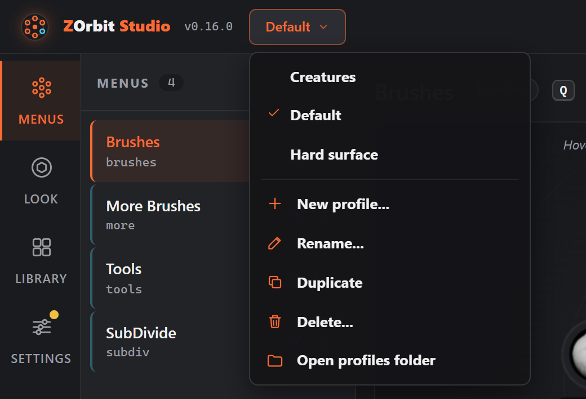
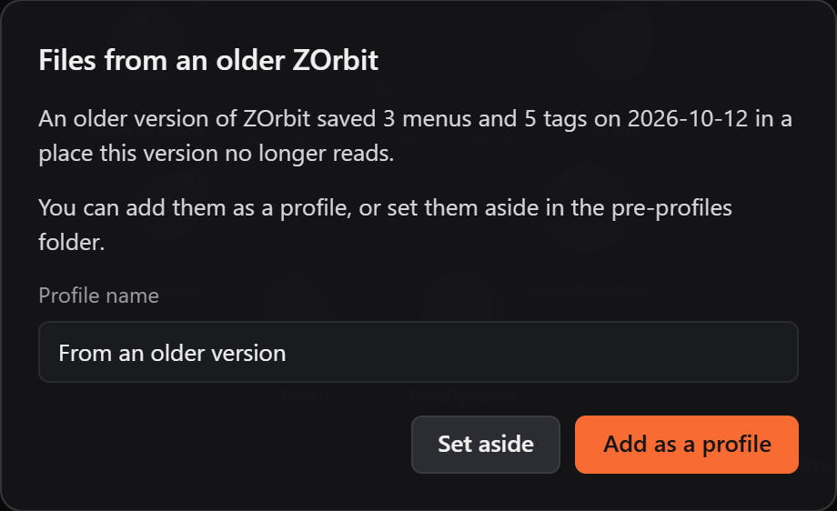

# Profiles

A profile is a whole setup: the menus and settings, the tags, and the usage that fills the auto slots and Recent. Keep one for sculpting and one for hard-surface work, say, and switch between them. Nothing restarts. Each profile is a folder, so you can copy, rename or delete one like any other folder.

## Switching

In Studio, the button right after the **ZOrbit Studio** wordmark in the top bar names the profile you are editing. Click it for the list, which has a tick on that one. Pick another name to switch.

From the tray icon's right-click menu, the **Profile** submenu lists the profiles, with a tick on the one in use. **Manage profiles...** opens Studio. The tooltip on the tray icon names the profile in use, and a switch from the tray shows a balloon, "Profile: X".

The ring follows a switch within half a second. The browser's tags and Recent follow within about five seconds. No restart is needed.

If you have unsaved edits in Studio, switching asks what to do: **Keep editing**, **Switch without saving** or **Save and switch**.

If the profile is switched from the tray while Studio is open, Studio follows when it has no unsaved edits, and says "The app switched to X". With unsaved edits it shows a warning with a **Reload** button, and the profile button shows that the profile you are editing is not the one the app uses. **Save** always writes the profile Studio loaded.

## Making a profile

Click the profile button and choose **New profile...**. Type a name, then pick where the new profile's menus, settings and tags come from:

- **Starter menus**: the menus a fresh install has.
- **Empty**: one menu called **Main**, with the first hotkey of the current profile and no items. The ring opens nothing until you add an item. It keeps the ring settings of the current profile and the looks you saved under `looks`, so the ring looks the same.
- **Copy of** the current profile: its menus, tags and usage.
- **From a file...**: a settings file from **Export...** (see [Sharing a profile](#sharing-a-profile)), or a plain `radial.json`. Its tags come along. A menu file from **Export menu...** is refused.

After you make a profile, Studio switches to it. **Duplicate** in the profile list makes a copy the same way.

Every new profile takes the ZBrush bridge settings and the browser hotkey from the profile you are editing. The bridge key must match the hotkey bound to **Apply** inside ZBrush on this PC, so a settings file from another PC never brings its bridge key. The bridge settings (**Settings > ZBrush bridge**) apply to the profile you are editing, and each profile keeps its own. If you change the bridge key in one profile, change it in the others too.

A name can be up to 60 characters. It must work as a Windows folder name: no `\ / : * ? " < > |`, no leading dot, no trailing dot or space, and not a reserved name such as `CON` or `COM1`. Two profiles cannot differ only by capitals, so `Sculpt` and `sculpt` count as one name.

## Rename, duplicate, delete

- **Rename...** changes the name and renames the folder. If a Windows folder window has that folder open, Windows refuses, and Studio asks you to close the window and try again.
- **Delete...** moves the folder to `%APPDATA%\ZOrbit\profiles\.deleted\<name>-<date>`. ZOrbit removes it 30 days later. To get a profile back before then, drag its folder out of `.deleted`.
- The last profile cannot be deleted. Deleting the profile in use switches the app to **Default**, or to the first other profile if there is no **Default**.

If Studio is editing a profile that you renamed or deleted elsewhere, Studio notices when its window gets focus and offers to switch. A save into a missing profile is refused, with an offer to switch or to make the profile again.

## Sharing a profile

To send a profile to another PC, press **Settings > Import and export > Export...**. It writes the profile you are editing (its menus, settings and tags) to one file. On the other PC, press the profile button, choose **New profile...** and then **From a file...**. See [Import and export](files.md#import-and-export).

**Import...** still loads a file into the profile you are editing, as before.

## Where the files are

Each profile is a folder under `%APPDATA%\ZOrbit\profiles\`, named after the profile.

| Path | What |
|---|---|
| `%APPDATA%\ZOrbit\profiles\<name>\` | One profile: `radial.json`, `tags.json` and `usage.json`, with their `.bak`, `.broken` and `.bad` copies beside them. |
| `%APPDATA%\ZOrbit\profile.json` | Which profile is in use, as `{"active": "Default"}`. |
| `%APPDATA%\ZOrbit\profiles\.deleted\` | Deleted profiles, kept for 30 days. |
| `%APPDATA%\ZOrbit\pre-profiles\` | Your files from before profiles existed. You can delete it. |

On the first start after the update, the old `radial.json` (with its `.bak` and `.broken`), `tags.json` (with its `.bak`) and `%LOCALAPPDATA%\ZOrbit\usage.json` (with its `.bad`) become the **Default** profile. The originals are moved to `%APPDATA%\ZOrbit\pre-profiles\`. People upgrading from the old Radial Menu name get their files into **Default** too.

`studio.json`, `popout.json` and `launch.json` stay in `%APPDATA%\ZOrbit`, because they belong to the PC and not to a profile. Logs and the thumbnail cache stay in `%LOCALAPPDATA%\ZOrbit`. See [Files, backups and logs](files.md#files-and-logs).

## Older versions

- A newer ZOrbit takes the place of an older one that is still running, such as a portable copy. It asks the old one to quit, waits for it, and then starts in its place. `radiald.log` says `taking over from ZOrbit <version> (pid <n>)`, and then `ZOrbit <version> has quit`. A browser window of the old version stays open until you close it. The installer already closes running copies before it updates, so this matters mostly for the portable zip. If the old copy is the same version or a newer one, or it will not quit (one running as administrator, say), the new one exits instead. [Troubleshooting](troubleshooting.md#a-second-copy-of-zorbit-exits-at-startup) gives the reasons.
- On **Studio > Status**, the **ZOrbit app** card turns amber and says the app running is older than Studio when that is the case. **Restart app** starts this version in its place. Studio also shows this as a message when it opens.
- Starting the app with `--config <file>` pins one menus file. Profiles are off in that app, so its tray menu has no **Profile** submenu. `--check` prints the profile name on its first line.

Going back to 0.12.0 works, but 0.12.0 does not know profiles. It finds no menus at the old place, so it starts with the starter menus, the three starter tags and no usage. Your real files are safe in `%APPDATA%\ZOrbit\profiles\Default\`. When you update again, what you changed on 0.12.0 is offered back, as described in [Files from an older version](#files-from-an-older-version).

### Files from an older version

After the update has moved your files, an older ZOrbit can write to the old places again. That happens after you go back to 0.12.0, or when an old copy is still running. The new version does not read those places, so it looks for them and offers what it finds:

- **Studio** opens **Files from an older ZOrbit** when it finds an old `radial.json` or `tags.json` that an older ZOrbit saved. The dialog shows when they were saved. Type a name in the profile name box (it starts as "From an older version") and press **Add as a profile**. The menus and tags become a new profile. It takes the bridge key and browser hotkey from the profile in use, as every new profile does, and Studio then offers **Switch**. Press **Set aside** instead to move the files into `%APPDATA%\ZOrbit\pre-profiles\<date and time>\`. Studio then offers **Open folder**. If you close the dialog without choosing, it asks again the next time Studio opens.
- **The brush usage** an older version recorded (`usage.json`) is added to the profile in use when the app starts, with no question asked. The file is set aside in `pre-profiles\<date and time>\`, and `radiald.log` says `usage: added <n> brushes from an older version`.

Not offered: an untouched copy of the starter menus (0.12.0 writes one on its first start when it finds none), the starter tags with nothing tagged, and a copy of the old Radial Menu files that 0.12.0 copies back. Files the update could not move away at first are not offered either. They are listed in `profiles\leftovers.json`, and the update moves them later.
