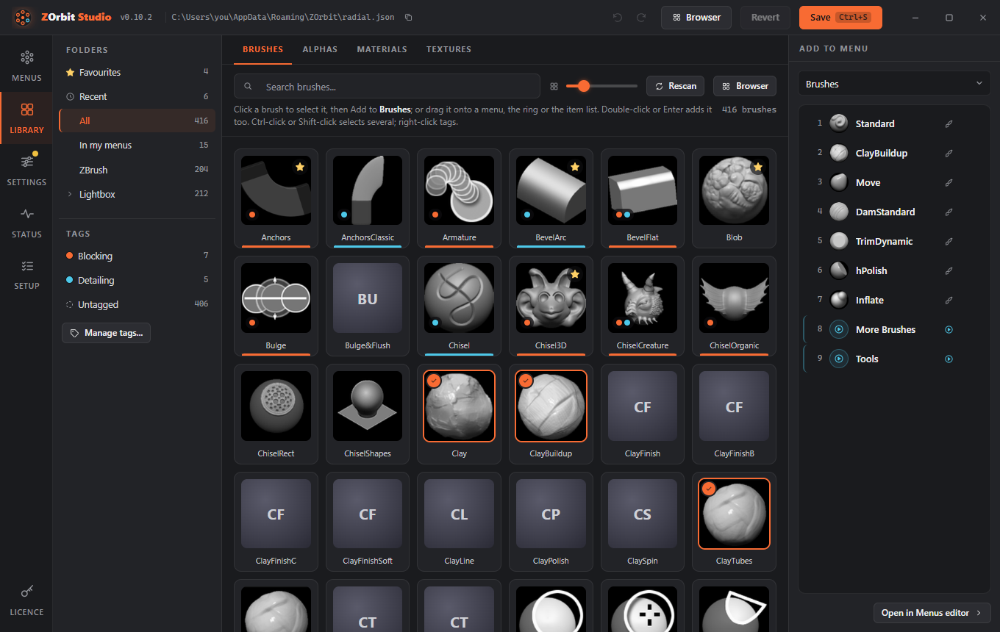

# ZOrbit Studio

Studio is where you edit everything. Open it from the Start menu (**ZOrbit Studio**) or from ZBrush with **Zplugin > ZOrbit > Studio**. Only one Studio window opens at a time; starting it again brings the open one forward. Studio reopens on the screen you left, and each screen keeps its scroll position while Studio is open.

| Screen | Shortcut | What it does |
|---|---|---|
| Menus | Alt+1 | Create and edit menus and their items, with a live ring preview. |
| Library | Alt+2 | Browse the brushes, alphas, materials and textures ZBrush can load, on four tabs, with search, folders and thumbnails. Click an item and press **Add to <menu>**, or drag it onto a menu, the ring or the item list. **Rescan** picks up items saved since Studio opened. Tag items and filter by tag (see [Tags](tags.md)). Star favourites; Recent lists what you have picked in ZBrush (see [Favourites and Recent](browser.md#favourites-and-recent)). |
| Settings | Alt+3 | Ring size, animation, labels, tag colours, colours, tap time, auto-close, the browser hotkey, tags, bridge, Studio's own preferences, and Import and export (see [Import and export](files.md#import-and-export)). |
| Status | Alt+4 | Is ZBrush running, is the app running, is the bridge connected; the app log with a Copy button. **Start app** on the app card starts the app when ZBrush is running. A dot on this button in the rail means the app is not running while ZBrush is. |
| Setup | Alt+6 | A checklist of five steps: ZBrush found (with the plugin set up for it), plugin loaded in ZBrush, try the ring, your brushes, and what's where. It shows live state and offers one action per step. An amber dot on this button in the rail means a check is failing: no ZBrush that Studio found has the plugin set up, or a running ZBrush does not. Finding no ZBrush at all does not count. |
| Licence | Alt+5 | A licence screen. Press its button once and you will see. **Settings > Studio** hides it or brings it back. |

## The tray icon

While the app runs, ZOrbit has an icon in the notification area. Left-click it to open Studio. Right-click it for these commands:

- **Browser** opens the [browser](browser.md).
- **Open Studio** opens this window.
- **Reload menus** reads `radial.json` again. The result is logged in `radiald.log`: "tray: menus reloaded", or "tray: reload failed" with the reason.
- **Open logs folder** opens `%LOCALAPPDATA%\ZOrbit`.
- **Quit ZOrbit** stops the app. The ring stays off until ZBrush is restarted or **Start app** is pressed on **Status**.

Setup sits between Status and Licence in the rail, but it is Alt+6. Licence stays on Alt+5.

The first time Studio runs (a fresh install, with no Studio preferences yet), it opens on **Setup**. Work down the steps, then press **Finish**, or **Skip for now**; either one marks Setup as done and takes you to Menus. If you close Studio without pressing either, Setup comes back the next time. People who upgrade from an earlier version are not sent to it. Once Setup is done, the bottom of the screen has a **Show Setup on next start** switch that brings it back.

The steps:

1. **ZBrush found.** Every ZBrush version Studio found. For ZBrush 2026 and newer, each row shows whether `ZBRUSH_PLUGIN_PATH` points at the plugin; **Fix** adds it the way the installer does. Restart ZBrush afterwards. Rows for [ZBrush 2022 to 2025](install.md#zbrush-2022-to-2025) have the same **Install**, **Update** and **Remove** buttons as **Settings > Older ZBrush**, and **Add a ZBrush folder** adds one Studio did not find.
2. **Plugin loaded in ZBrush.** Live: whether ZBrush is running, which version, whether it loaded the plugin, and whether it needs a restart because it was started before the plugin was set up. It also shows whether the app is running, with **Start app**.
3. **Try the ring.** Hover ZBrush's canvas, press Q and flick to a brush. Three checks tick off as it happens: ring opened, pick sent, ZBrush did it. If ZBrush does not confirm the pick within a few seconds, a hint says what to look at for the route the pick took. If ZBrush answered with a failure, the hint is that line from the log instead. **Start over** forgets the try so far. This step reads `activity.json` (see [Files and logs](files.md#files-and-logs)).
4. **Your brushes.** A preview of the Q ring, and **Change these brushes**, which opens it on the Menus screen.
5. **What's where.** A line on each of Menus, Library, Settings, Status and the user guide, which links to these pages.

Other shortcuts: **Ctrl+S** saves, **Ctrl+Z** undoes, **Ctrl+Y** (or Ctrl+Shift+Z) redoes. Undo and redo work wherever the focus is, even on a slider or a switch; inside a text box, Ctrl+Z undoes your typing there instead. Closing Studio with unsaved changes shows what would be lost, grouped by menu and setting, with **Save and close**, **Close without saving** and **Keep editing**; Escape keeps editing. The Undo and Redo buttons next to Revert do the same, and undoing puts the selection back on what you were editing. Each list (the menus, the items) is one stop for the Tab key. Inside it, **Up** and **Down** move through the rows, **Home** and **End** jump to the first and last, **Delete** removes the selected menu or item, **F2** renames a menu and **Alt+Up/Down** moves an item.

The version at the top links to its release notes. When Studio opens, it asks GitHub whether there is a newer release. If there is, the top shows your version, an orange dot and the new version in orange. Clicking it opens the new release's page, where you can download it. The check only asks GitHub for the latest release and sends nothing about you or your menus. Turn it off in **Settings > Studio > Check for updates**. It is never made while that is off.

How saving works:

- **Save** writes `radial.json` and keeps the previous version as `radial.json.bak`. The backup is only replaced when the
  file was readable and actually differs, so saving twice cannot swap a good backup for a bad one. When nothing has
  changed, Save says so and writes nothing.
- If the file changed on disk after Studio loaded it (you edited it by hand, say), Save asks whether to overwrite
  it or reload from disk. Reloading throws away your unsaved changes, and the dialog says so. **Cancel** is the
  button that has focus.
- A config that no ring can open from (no menus, or no menu with a hotkey) is not saved until you confirm.
- **Revert** goes back to what is saved on disk.
- The app re-reads the file as soon as it changes, so saved changes apply immediately, new hotkeys included. You do not need to restart ZBrush or the app.
- If something in the file is wrong, a **problems** pill appears at the top. Click it for the list: each entry says what is wrong in plain words and jumps to the menu, item or setting to fix, and the menu and item rows concerned carry an amber marker. Studio saves anyway, and the app skips the bad items and logs what it skipped. The list opens by itself after a save or an import only when there is a problem that was not there before; the toast and the pill give the count either way.

On the Menus screen you can:

- add, duplicate and delete menus (a duplicate has no hotkey, so it starts out as a submenu);
- add items with **Add item**, drag brushes, alphas, materials and textures from the Library onto the ring or the list, reorder items, and remove them (you can also drag an item from the [browser](browser.md) window onto a menu in the list, the ring or the item list);
- drag on the ring to place things exactly: a bright bar shows the gap between two slots a brush, alpha, material or texture (from the Library or the browser) or an item will go into, and dragging a slot itself reorders it. Drag a slot onto another menu in the list to move it there (hold **Ctrl** to copy it instead), or onto the **Delete** target that appears in the corner of the preview to remove it (you can undo that);
- drag an item from the item list onto another menu in the list to move it there (hold **Ctrl** to copy it instead, and press or release Ctrl while you drag to switch). Studio stays on the menu you were editing, the row of the menu it went to flashes, and the toast has **Undo**;
- open a submenu by double-clicking its item, by pressing the arrow button beside the submenu field in the inspector, or with the **Open it** link under that field; a **Back** chip above the item list returns to the parent menu;
- click empty space inside the ring to clear the selection (the inspector stays on the **Item** tab);
- edit each item's action, label and icon in the inspector. When you switch an item to another type, anything that cannot come along is dropped, and a toast lists it (**Switched to Press. Dropped the brush "ClayBuildup".**) with **Undo**. Brush, alpha, material and texture items say if the name is not in your library and which kind of file ZBrush needs; if the library could not be read, or ZBrush was not found, they say that and link to **Library** or **Setup**;
- record a hotkey by clicking the hotkey field (or focusing it and pressing **Enter**) and pressing the keys. Letters, digits, F1 to F24, the punctuation keys and `space`, `tab`, `enter`, `backspace`, `insert`, `delete`, `home`, `end`, `pageup` and `pagedown` can be recorded; **Esc** cancels. If another menu already uses the key, the field says which one comes first and wins;
- press the play button to preview the open animation.

The right-hand side has three tabs:

- **Item** edits the selected item: its type, target, label and icon.
- **Menu** edits the selected menu: its title, id, hotkey, **Swallow hotkey** switch (off and greyed out until the menu has a hotkey), open animation and **Fan out when opened from another menu**. Changing the **Id** updates every item that opens the menu. If the menu has auto slots, they forget what they learned, because they are kept under the id. **Used by** lists the items in other menus that open this one; click one to go to it.
- **Library** is the [browser](browser.md) in a narrow form, to drag items into the ring or the list.

Menu rows show the menu's title, id, hotkey (or a small submenu icon when it has none) and item count. When the window is narrow, hover a row for its full title and hotkey. A menu with more than 12 items gets a note above its list, because the slots start to overlap.
