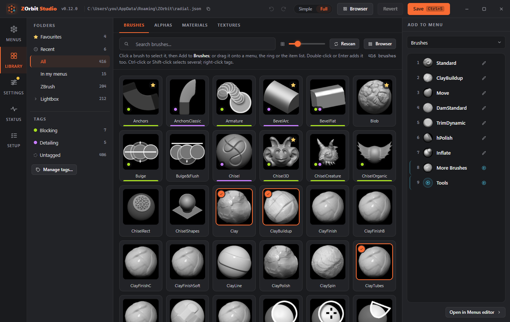
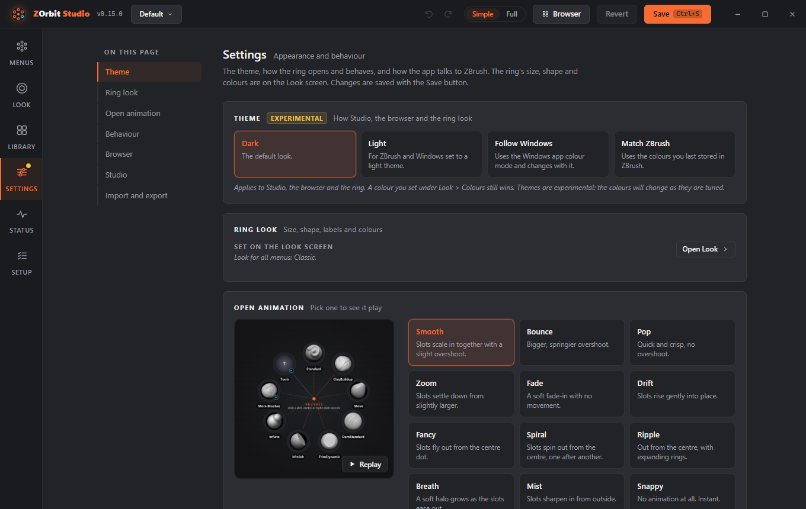
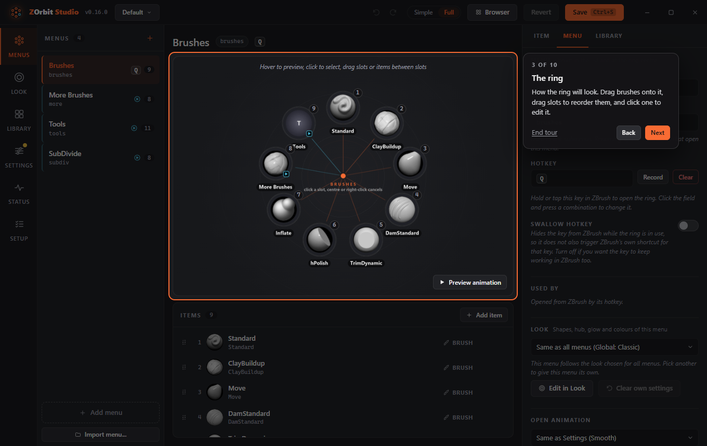
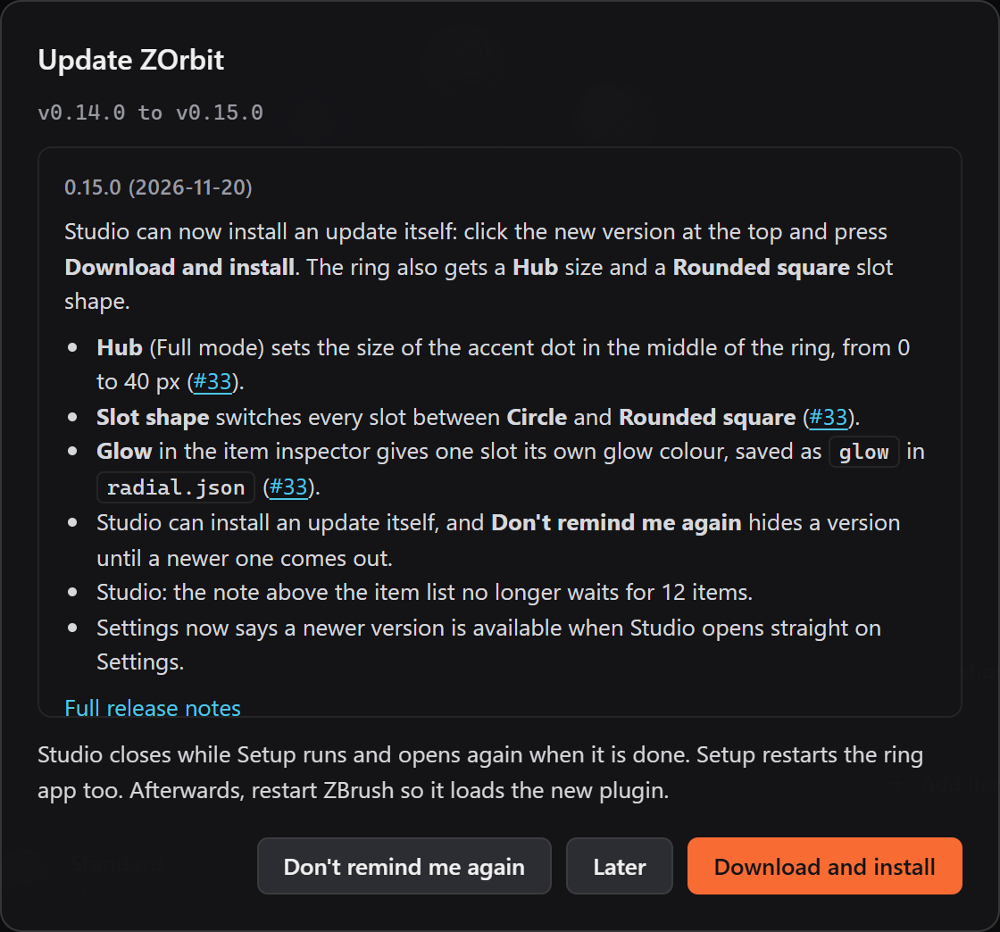
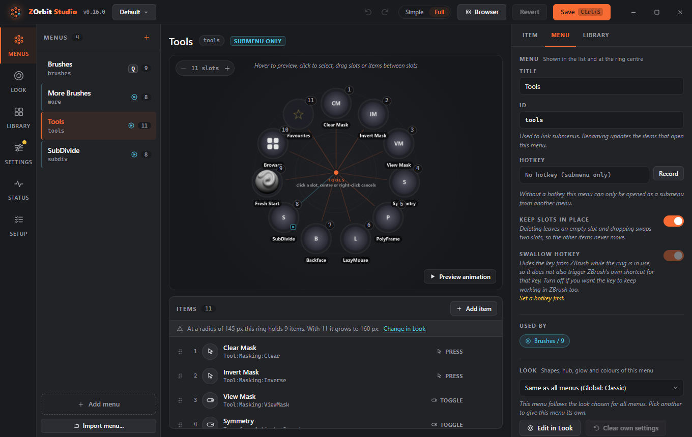
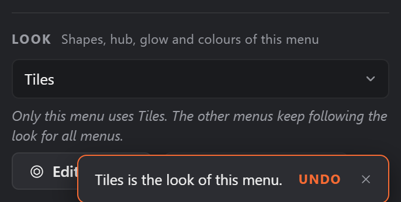
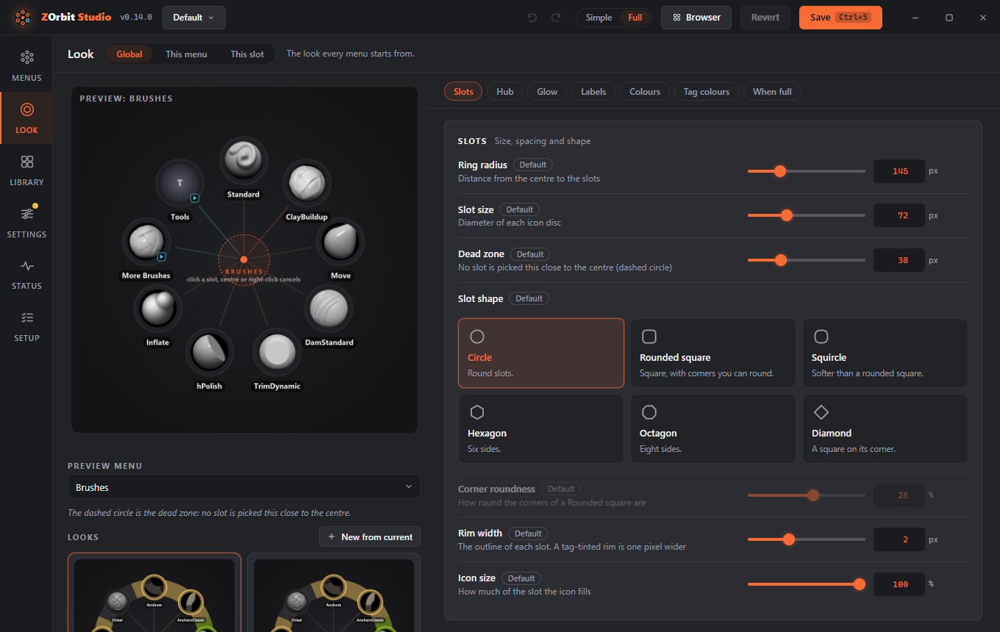
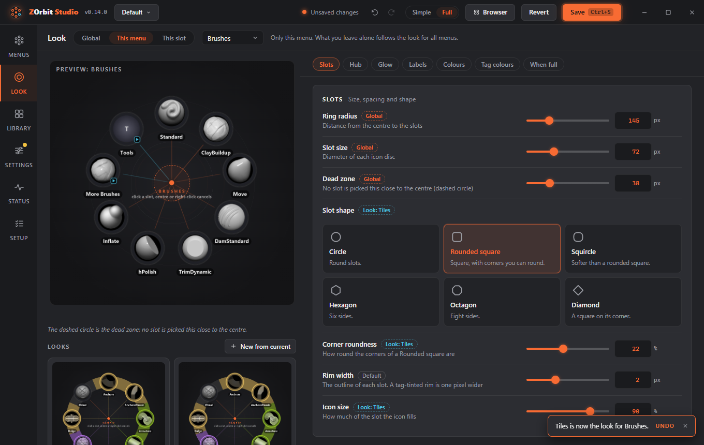
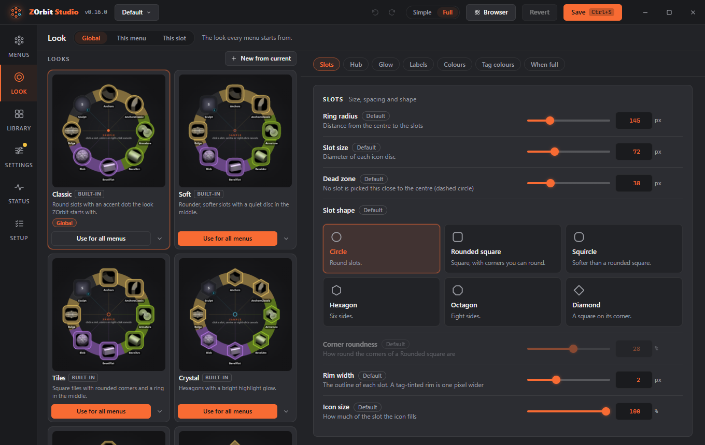
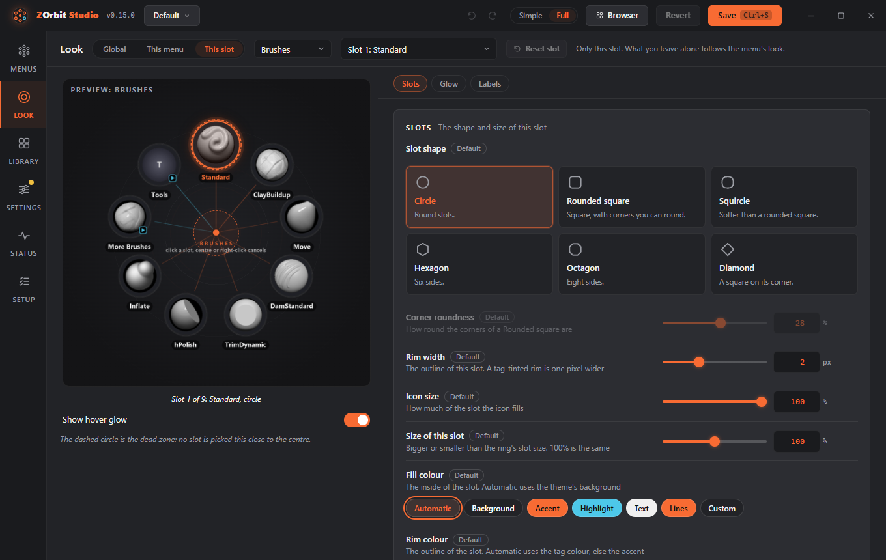

# ZOrbit Studio

Studio is where you edit everything. Open it from the Start menu (**ZOrbit Studio**) or from ZBrush with **Zplugin > ZOrbit > Studio**. Only one Studio window opens at a time; starting it again brings the open one forward. Studio reopens on the screen you left, and each screen keeps its scroll position while Studio is open.

| Screen | Shortcut | What it does |
|---|---|---|
| Menus | Alt+1 | Create and edit menus and their items, with a live ring preview. |
| Look | Alt+2 | How the ring looks, for every menu or for one: its size, slot shape, hub, glow, labels, colours and tag colours, a gallery of looks to use, and a live preview. See [The Look screen](#the-look-screen). |
| Library | Alt+3 | Browse the brushes, alphas, materials and textures ZBrush can load, on four tabs, with search, folders and thumbnails. Click an item and press **Add to <menu>**, or drag it onto a menu, the ring or the item list. **Rescan** picks up items saved since Studio opened. Tag items and filter by tag (see [Tags](tags.md)). Star favourites; Recent lists what you have picked in ZBrush (see [Favourites and Recent](browser.md#favourites-and-recent)). |
| Settings | Alt+4 | The theme, a **Ring look** card with a button that opens Look, the open animation, flick, the browser hotkey, Studio's own preferences, and Import and export (see [Import and export](files.md#import-and-export)). [Full mode](#simple-and-full-mode) adds hover submenus, tap time, auto-close, tags, the bridge and Older ZBrush. |
| Status | Alt+5 | Four cards: **ZBrush** (running or not), **ZOrbit app** (running or not, with **Start app** when ZBrush is running, or amber with **Restart app** when the app running is older than Studio: see [Older versions](profiles.md#older-versions)), **Bridge listener** (the small window the plugin keeps inside ZBrush: **Connected**, **Found, unverified**, **Stale** or **Not found**; **ZBrush closed** in grey when ZBrush is not running, since there is nothing to listen in; and **Not needed (key bridge)** when the bridge mode is `key` or only a ZBrush 2022 to 2025 is installed) and **Last pick** (the most recent item sent to ZBrush). Below them the last 40 lines of the app log, with **Copy log**, **Open logs folder** and **Open menus folder** (the folder of the profile you are editing, which holds its `radial.json`). The screen refreshes every 3 seconds. A dot on this button in the rail means the app is not running while ZBrush is. |
| Setup | Alt+6 | A checklist of five steps: ZBrush found (with the plugin set up for it), plugin loaded in ZBrush, try the ring, your brushes, and what's where. It shows live state and offers one action per step. An amber dot on this button in the rail means no ZBrush that Studio found has the plugin set up, or a running ZBrush does not. Finding no ZBrush at all does not count. |

The top bar has a profile button right after the **ZOrbit Studio** wordmark. It shows the profile you are editing. Click it to switch to another profile, or to make, rename, duplicate or delete one. See [Profiles](profiles.md).

## Simple and Full mode

The **Simple** / **Full** switch in the top bar, after the Undo and Redo buttons, chooses how much of Studio you see. Simple shows the everyday controls. Full shows every control.

The mode only changes what Studio shows. The ring, the app, `radial.json`, Save, export and undo are the same in both. A setting that Simple hides keeps its value, and so does an item it cannot edit.

| Screen | Simple shows | Full adds |
|---|---|---|
| Menus, **Add item** | Brush, Alpha, Material, Texture and Submenu. | Press, Set, Toggle, Steps, Auto, Tag and Browser. |
| Menus, **Menu** tab | Title, Hotkey, **Duplicate** and **Delete**. | Id, **Swallow hotkey**, **Used by**, **Look**, **Open animation** and **Fan out when opened from another menu**. |
| Library and the dock | Everything, with starring, tag chips and the right-click tag picker. | **Manage tags...**. |
| Look | **Applies to** (all menus or one), **Ring size**, **Slot shape**, **Labels** and **When full**, and the gallery with **Use for ...** and **New from current**. | **Ring radius**, **Slot size** and **Dead zone** in place of **Ring size**, **Corner roundness**, **Rim width**, **Icon size**, **Hub**, **Glow**, **Label colour**, **Colours** and **Tag colours**, **Edit**, **Duplicate**, **Rename** and **Delete** on a look, and the **This slot** level. |
| Menus, **Item** tab | A read-only **Style** line when the item has a style. | **Style** with **Edit in Look** and **Reset style**. |
| Settings | **Theme**, **Ring look**, **Open animation**, **Behaviour** with **Flick to pick**, **Browser**, **Studio** and **Import and export**. | **Open submenus on hover**, **Tap time**, **Auto-close**, **ZBrush bridge**, **Older ZBrush** and **Tags**. |
| Status and Setup | The same. | The same. |

In Simple, the **Ring size** slider on **Look** moves **Ring radius**, **Slot size** and **Dead zone** together and keeps their proportions. Its reset button puts all three back to their defaults.

An item of a type Simple does not offer still appears in the list and on the ring. The starter **Tools** and **SubDivide** menus are full of them. Select one and the inspector shows its type and what it does on one line, with an **Edit in Full mode** link. You can still change its **Label** and **Icon**, except on an Auto slot. You can move, duplicate and delete it as usual.

A menu with an open animation, **Fan out when opened from another menu**, **Swallow hotkey** switched off or a look of its own says so on its **Menu** tab, with a **Switch to Full mode** link. When a setting that only Full shows is not at its default, the top of the Look or Settings page says so: "Changed in Full mode and not shown here: Colours." It has a **Switch to Full mode** link too.

Studio switches to Full by itself when you ask for something Simple hides. Clicking a problem in the **problems** list that points at a hidden setting or item switches first and shows "Switched to Full mode to show this." Setup step 3's **Open Settings** button does the same.

Which mode Studio starts in:

- A fresh install starts in Simple. So does a setup that has never been through Studio's Setup screen, even one with edited menus: Setup opens first, and the switch is there afterwards.
- After an upgrade, if you have used Studio before, it opens in Full if your menus or settings use something Simple hides, and in Simple otherwise. The starter menus use Press, Set, Toggle, Steps, Tag and Browser items, so an upgrade that kept them opens in Full.
- After that, Studio opens in the mode you left it in.

The choice is kept in `studio.json` as `mode` (`simple` or `full`). It is a Studio preference, so it is not part of an [export](files.md#import-and-export) and it does not change the ring. The [browser](browser.md) window has no switch and always shows everything.

The **Theme** card on Settings (**Dark**, **Light**, **Follow Windows** or **Match ZBrush**) is also a Studio preference, kept in `studio.json` as `theme`. It changes how Studio, the [browser](browser.md) and the ring look, and the window frame (its border and a dark or light title bar) follows it. See [Theme](appearance.md#theme).

## The tray icon

While the app runs, ZOrbit has an icon in the notification area. Left-click it to open Studio. Its tooltip names the profile in use. If the app cannot read `radial.json`, it shows a balloon once and puts "menus file cannot be read" in the icon's tooltip until the file loads again. Right-click it for these commands:

- **Browser** opens the [browser](browser.md).
- **Open Studio** opens this window.
- **Profile** lists your profiles, with a tick on the one in use. Pick one to switch; the ring follows within half a second, with no restart. A switch shows a balloon, "Profile: X". See [Profiles](profiles.md#switching).
- **Manage profiles...** opens Studio.
- **Reload menus** reads `radial.json` again and shows the result as a balloon from the tray icon: **Menus reloaded**, or the reason the file cannot be read. It is also logged in `radiald.log`: "tray: menus reloaded", or "tray: reload failed" with the reason.
- **Open logs folder** opens `%LOCALAPPDATA%\ZOrbit`.
- **Quit ZOrbit** stops the app. The ring stays off until ZBrush is restarted or **Start app** is pressed on **Status**.

## Setup

The first time Studio runs (a fresh install, with no Studio preferences yet), it opens on **Setup**. Work down the steps (each check in a step shows its state as an icon and a word, not only a colour: a tick for **OK**, a triangle for **Needs attention**, a cross for **Not working**, a clock for **Not checked yet**), then press **Finish**, or **Skip for now**; either one marks Setup as done and takes you to Menus. If you close Studio without pressing either, Setup comes back the next time. People who upgrade from an earlier version are not sent to it. Once Setup is done, the bottom of the screen has a **Show Setup on next start** switch that brings it back.

The steps:

1. **ZBrush found.** Every ZBrush version Studio found. For ZBrush 2026 and newer, each row says **Plugin registered** or **Plugin not registered**, which is whether `ZBRUSH_PLUGIN_PATH` points at the plugin; **Fix** adds it the way the installer does. Restart ZBrush afterwards. If another ZOrbit folder is in that variable too, a line says **Also registered** with its path: ZBrush loads both, so remove the old one in Windows' environment variables. Rows for [ZBrush 2022 to 2025](install.md#zbrush-2022-to-2025) say **Plugin installed**, **Plugin not installed** or **Plugin update available**, with the same **Install**, **Update** and **Remove** buttons as **Settings > Older ZBrush** (Full mode). For a ZBrush under Program Files, **Install**, **Update** and **Remove** each ask you to approve a Windows prompt. **Add a ZBrush folder** adds a ZBrush Studio did not find.
2. **Plugin loaded in ZBrush.** Live: whether ZBrush is running, which version, whether it loaded the plugin, and whether it needs a restart because it was started before the plugin was set up. When it did not load the plugin, the line under it says what to do: press **Fix** in step 1 and restart ZBrush, or close ZBrush completely and start it from the Start menu (a ZBrush started from a program that was already open does not get the new setting), and read `bridge.log` or `zscript_launch.log` if that does not help. A ZBrush running as administrator cannot be read, so Studio says the ring will not open and asks you to start ZBrush without **Run as administrator**; if the plugin's listener is up in it, the plugin still counts as loaded. A ZBrush running from a folder Studio does not know gets a note to add that folder with **Add a ZBrush folder** in step 1. If the check itself fails, Setup says so and keeps showing the last steps that worked. It also shows whether the app is running, with **Start app**.
3. **Try the ring.** Hover ZBrush's canvas, press Q and flick to a brush. Three checks tick off as it happens: ring opened, pick sent, ZBrush did it. If the app could not send the pick, the hint says why and what to do: the bridge mode is **Message** and the plugin is not answering, no bridge key is set, ZBrush was not the front window, or the app could not write its request file. If ZBrush does not confirm a pick that was sent, the hint says what to look at for the route it took, naming your bridge key (F9 unless you changed it). If ZBrush answered with a failure, the hint is that line from the log instead. **Start over** forgets the try so far. This step reads `activity.json` (see [Files and logs](files.md#files-and-logs)).
4. **Your brushes.** A preview of the Q ring, and **Change these brushes**, which opens it on the Menus screen.
5. **What's where.** A line on each of Menus, Look, Library, Settings, Status and the user guide, which links to these pages. It also says that Studio starts in Simple mode and that the switch at the top turns on Full mode (see [Simple and Full mode](#simple-and-full-mode)). **Take the tour** starts [the tour](#the-tour) of the window.

## The tour

The tour walks you round the Studio window. It lights up one part at a time and puts a card beside it with a title, a sentence or two and a count such as "3 of 10". **Next** moves on (it reads **Done** on the last stop), **Back** goes back, and **End tour** stops at any point.

The tour starts on the Menus screen and stops at:

1. The rail of screens (**Alt+1** to **Alt+6**).
2. The list of menus.
3. The ring preview.
4. The **Item**, **Menu** and **Library** tabs.
5. The ring preview on the **Look** screen.
6. The **Library** button in the rail.
7. The profile button.
8. The **Simple** / **Full** switch.
9. **Revert** and **Save**.
10. **Status** and **Setup** in the rail.

A stop whose part is not on screen, such as the profile button when it is hidden, is skipped and left out of the count.

**Right** goes to the next stop, **Left** goes back and **Esc** ends the tour. **Tab** moves between the buttons on the card. While the tour is open you cannot click the rest of the window, and Studio's shortcuts (**Ctrl+S**, **Ctrl+Z**, **Alt+1** to **Alt+6**) do nothing until it ends.

The tour changes no menu and no setting. When it ends, Studio goes back to the screen you started it from.

Studio offers the tour once, after you press **Finish** or **Skip for now** on [Setup](#setup): "Take a short tour of Studio?" with **Not now** and **Take the tour**. If you close Studio before answering, it asks at the next start. Whatever you answer, **Esc** included, it does not ask again. People who used Studio before the tour existed are not asked.

To take it later, press **Take the tour** in Setup step 5 (**What's where**) or in **Settings > Studio**, next to **What's new**. Once the tour has been offered or taken, `studio.json` has `tour_seen` set to true.

## Keyboard shortcuts

Alt+1 to Alt+6 open the screens (see the table at the top). **Ctrl+S** saves, **Ctrl+Z** undoes, **Ctrl+Y** (or Ctrl+Shift+Z) redoes. Undo and redo work wherever the focus is, even on a slider or a switch; inside a text box, Ctrl+Z undoes your typing there instead. Closing Studio with unsaved changes shows what would be lost, grouped by menu and setting, with **Save and close**, **Close without saving** and **Keep editing**; Escape keeps editing. The Undo and Redo buttons next to Revert do the same, and undoing puts the selection back on what you were editing. Each list (the menus, the items, the Library's folders and the Library's cards) is one stop for the Tab key. Inside it, **Up** and **Down** move through the rows, **Home** and **End** jump to the first and last, **Delete** removes the selected menu or item, **F2** renames a menu, **Alt+Up/Down** moves a menu or an item up or down the list, and **M** on an item moves it to another menu: a list of the other menus opens, and **Enter** on one moves the item there. The **Move to menu** button at the top of the **Item** tab does the same. In the Library, the cards are a grid: **Left**, **Right**, **Up** and **Down** move from card to card (the card you land on is selected), and **Home** and **End** jump to the first and last. **Enter** on a card adds it to the menu you are editing, **Space** selects it, **Ctrl+Space** adds it to or takes it out of the selection, and **Ctrl+D** stars it; the star and add buttons on a card are for the mouse. In the folders list, **Up** and **Down** move the focus, **Enter** or **Space** opens a folder, and **Right** and **Left** unfold and fold one that has sub-folders.

Opening the **problems** list with the keyboard puts the focus on its first entry; **Esc** closes it and gives the focus back to the pill. When a menu is deleted from the **Menu** tab, or its id is renamed there, the focus moves to the next menu in the list instead of being lost.

A pen or a finger drags rows, cards and ring slots the same way a mouse does, so a drag on one of them does not scroll the list. Scroll with the scroll bar. When Windows has **Animation effects** switched off (Settings > Accessibility > Visual effects), Studio stops its looping animations too: the busy spinners, the pulsing dots and the loading shimmer stay still.

## Version and update check

The version at the top links to its release notes. When Studio opens, it asks GitHub whether there is a newer release. If there is, the top shows your version with the new one in orange under it, and an orange arrow beside them, and **Settings > Studio** says **Version x.y.z available** with an **Install update** button. The check only asks GitHub for the latest release and sends nothing about you or your menus. Turn it off in **Settings > Studio > Check for updates**. It is never made while that is off. **Settings > Studio** also shows the version, with a link to the GPL-3.0 licence ZOrbit is released under.

**Installing an update.** Click the new version at the top, or **Install update** in **Settings > Studio**. The dialog shows which version you go to and that version's release notes, taken from its page on GitHub, with **Full release notes** and, when the release has one, a link to its blog post.

- **Download and install** fetches the new installer from the GitHub release into `%LOCALAPPDATA%\ZOrbit\updates`, with a progress bar. Nothing is downloaded until you press it. Studio checks the file's size and SHA-256 against the ones the release lists, and deletes a file that does not match.
- When you have unsaved changes, Studio then asks first: **Save and update**, **Update without saving** or **Keep editing**.
- Studio starts Setup and closes. Setup runs on its own with a small progress window, closes the ring app and the browser, installs, and opens Studio again. If the ring app was running, Setup starts it again too. Studio then shows **What's new**.
- Restart ZBrush afterwards so it loads the new plugin. For ZBrush 2022 to 2025, see [Updating](install.md#updating).

**Later** closes the dialog, and the orange version stays at the top. **Don't remind me again** stops pointing out this version: the top shows only your version until a newer release comes out. **Settings > Studio** still offers the skipped version. Studio keeps it as `skipped_version` in `studio.json`.

Only a copy installed with Setup can update itself. A [portable copy](install.md#portable-zip) or a source checkout shows the same dialog with **Open the download page** instead.

**What's new.** The first time Studio opens after an update, it shows **What's new** with a short summary of each release since the one you last saw (at most three). **Full release notes** opens that release's page on GitHub. It appears once per update, and a fresh install does not show it. To see it again, press **What's new** next to the update check in **Settings > Studio**. Studio keeps the last version it showed as `seen_version` in `studio.json`. The text comes from `CHANGELOG.md`, which ships with the app.

## Saving

How saving works:

- **Save** writes `radial.json` and keeps the previous version as `radial.json.bak`. The backup is only replaced when the
  file was readable and actually differs, so saving twice cannot swap a good backup for a bad one. When nothing has
  changed, Save says so and writes nothing.
- If the file changed on disk after Studio loaded it (you edited it by hand, say), Save asks whether to overwrite
  it or reload from disk. Reloading throws away your unsaved changes, and the dialog says so. **Cancel** is the
  button that has focus.
- A config that no ring can open from (no menus, or no menu with a hotkey) is not saved until you confirm.
- **Revert** goes back to what is saved on disk.
- When the window is too narrow for everything in the top bar, the **Ctrl+S** hint on **Save** goes first, then the word Studio, then **Revert** and **Save** show only their icons (a clock with an arrow, and a disk), and last **Unsaved changes** shows only its dot. Hover any of them for its name. If that is still not enough, the profile name is shortened.
- The app re-reads the file as soon as it changes, so saved changes apply immediately, new hotkeys included. You do not need to restart ZBrush or the app.
- If something in the file is wrong, a **problems** pill appears at the top. Click it for the list: each entry says what is wrong in plain words and jumps to the menu, item or setting to fix, and the menu and item rows concerned carry an amber marker. Studio saves anyway, and the app skips the bad items and logs what it skipped. The list opens by itself after a save or an import only when there is a problem that was not there before; the toast and the pill give the count either way.

If the profile's files were made by a newer ZOrbit, Studio does not open them. It shows **These files are from a newer ZOrbit** with only an **Open folder** button, and nothing is saved. See [These files were made by a newer ZOrbit](troubleshooting.md#these-files-were-made-by-a-newer-zorbit).

## The Menus screen

On the Menus screen you can:

- add, duplicate and delete menus (a duplicate has no hotkey, so it starts out as a submenu);
- add items with **Add item** (in [Simple mode](#simple-and-full-mode) it offers Brush, Alpha, Material, Texture and Submenu; Full mode adds the other types), drag brushes, alphas, materials and textures from the Library onto the ring or the list, reorder items (**Alt+Up/Down** does it from the keyboard), and remove them (you can also drag an item from the [browser](browser.md) window onto a menu in the list, the ring or the item list);
- drag on the ring to place things exactly: a bright bar shows the gap between two slots a brush, alpha, material or texture (from the Library or the browser) or an item will go into, and dragging a slot itself reorders it. On a ring with a second ring, the bar sits on whichever ring the pointer is over. A gap beside a **More** slot says **Move into More**, and an item dropped there goes to the first place in that submenu. Drag a slot onto another menu in the list to move it there (hold **Ctrl** to copy it instead), or onto the **Delete** target that appears in the corner of the preview to remove it (you can undo that);
- drag an item from the item list onto another menu in the list to move it there, or press **M** on it (or **Move to menu** in the inspector) and pick the menu (hold **Ctrl** while dragging to copy it instead, and press or release Ctrl while you drag to switch). Studio stays on the menu you were editing, the row of the menu it went to flashes, and the toast has **Undo**;
- open a submenu by double-clicking its item, by pressing the arrow button beside the submenu field in the inspector, or with the **Open it** link under that field; a **Back** chip above the item list returns to the parent menu;
- click empty space inside the ring to clear the selection (the inspector stays on the **Item** tab). The outline of a slot you hover or select follows its shape, so a hexagon gets a hexagon. A **More** slot lights up but cannot be selected;
- edit each item's action, label and icon in the inspector. When you switch an item to another type, anything that cannot come along is dropped, and a toast lists it (**Switched to Press. Dropped the brush "ClayBuildup".**) with **Undo**. Brush, alpha, material and texture items say if the name is not in your brush (or alpha, material, texture) folders, that ZBrush can still select it if it is loaded there, and which kind of file a picture needs; if the library could not be read, or ZBrush was not found, they say that and link to **Library** or **Setup**;
- record a hotkey by clicking the hotkey field (or focusing it and pressing **Enter**) and pressing the keys. Letters, digits, F1 to F24, the punctuation keys and `space`, `tab`, `enter`, `backspace`, `insert`, `delete`, `home`, `end`, `pageup` and `pagedown` can be recorded; **Esc** cancels. If another menu already uses the key, the field says which one comes first and wins;
- press the play button to preview the open animation.

### The tabs on the right

The right-hand side has three tabs:

- **Item** edits the selected item: its type, target, label, icon and, in Full mode, its [style](#styling-one-slot). **Style** lists what the slot sets for itself, as chips such as **Hexagon**, **Larger** or **Glow #ff8800**, or says **Follows the menu's look**. **Edit in Look** opens the Look screen at that slot, and **Reset style** removes the item's style, with **Undo**. In Simple mode an item that has a style shows the chips and a link to Full mode.
- **Menu** edits the selected menu: its title, hotkey, **Duplicate** and **Delete** and, in Full mode, its id, **Swallow hotkey** switch (greyed out until the menu has a hotkey, and showing on unless you switched it off), its [look](#the-look-section-of-the-menu-tab), open animation and **Fan out when opened from another menu**. A new menu takes its id from its title: a menu you call **Sculpting** gets the id `sculpting`, or `sculpting_2` if that is taken. Until you save, renaming it changes the id too. After the first save, or once you type an id yourself, the id stays as it is. Changing the **Id** updates every item that opens the menu. If the menu has auto slots, they forget what they learned, because they are kept under the id. **Used by** lists the items in other menus that open this one; click one to go to it.
- **Library** is the [browser](browser.md) in a narrow form, to drag items into the ring or the list.

Menu rows show the menu's title, id, hotkey (or a small submenu icon when it has none) and item count. When the window is narrow, hover a row for its full title and hotkey. A menu whose ring is full gets a note above its list. It says what the menu's **When full** setting does about it:

- **Grow:** "At a radius of 145 px this ring holds 9 items. With 11 it grows to 160 px." When the grown ring would not fit on your screen, it adds "It is too big for this screen, so it is pushed against the edges." and the note turns amber.
- **Second ring:** "This ring is full: 3 items go on a second ring."
- **More slot:** "This ring is full: 4 items are in the More submenu."

A **Change in Look** link opens the **When full** group for that menu.

### The Look section of the Menu tab

In Full mode the **Menu** tab has a **Look** section for the selected menu. The list in it chooses the menu's look:

- **Same as all menus (Global: ...)** follows the look chosen for all menus. The text in brackets says which one that is.
- **Built-in** and **Yours** list the looks you can use. Picking one uses it for this menu only.
- A menu that has settings of its own shows them as one line you cannot pick, such as **Custom (2 changes)** or **Soft + 2 changes**.

Using a look here works like **Use for ...** on the Look screen: it removes the menu's own settings that would hide the look, and the toast says how many ("Cleared 3 of your own settings") with **Undo**. **Edit in Look** opens the Look screen at that menu. **Clear own settings** removes the settings the menu has of its own and keeps the look it uses.

The animation list stays below it: a menu's open animation is not part of a look.

## The Look screen

**Look** (Alt+2) is where the ring's looks are set. You can set them for every menu or for one menu, and you can save a group of settings as a named **look** to use again. The bar at the top shows what you are editing.

On the left is a preview of the real ring, drawn by the same code as the app, with the dead zone as a dashed circle, and under it the [gallery of looks](#looks). Hover a slot and it lights up in its own shape and shows the hover glow the app would draw. In Full mode, click a slot to [style it on its own](#styling-one-slot). The **Preview menu** list picks which menu the preview shows. It only changes the preview, not the menu you are editing on the Menus screen. **Sample ring with tags** shows a ring of library brushes in your tag colours, for the tag settings.

### Levels

The bar at the top says where what you set applies. In Simple mode it reads **Applies to**, with **All menus** and **Only** and a list of menus.

- **Global** is the look every menu starts from. What you set here is used by every menu.
- **This menu** is the look of one menu, picked in the list beside it. The whole screen then edits that menu and the preview shows it. A setting you leave alone follows Global.
- **This slot** (Full mode) is the look of one slot of the menu. See [Styling one slot](#styling-one-slot).
- **Look: Name** appears while you [edit a look](#editing-a-look).

For a menu the layers are, from the bottom: the default, the colours of the [theme](appearance.md#theme), the look chosen for all menus, your own global settings, the look chosen for the menu and your own settings for the menu. A later layer wins over an earlier one.

### Looks

A look is a named group of look settings. Seven are built in: **Classic** (the look ZOrbit starts with), **Soft**, **Tiles**, **Crystal**, **Circuit**, **Diamonds** and **Minimal**. They change the shape, the hub, the glow and the labels, never the size of the ring, and they use theme colours only, so they follow the theme. You can make looks of your own.

Each card in the gallery shows the sample ring in that look. Marks on a card say how it is used: **Global** (the look for all menus), **This menu**, **2 menus** (how many other menus use it) and **Editing**.

- **Use for all menus** (or **Use for** and the menu's title, at the menu level) uses the look. It also removes the settings of your own at that level that would hide the look, such as your own slot shape, hub or glow, and anything the look sets itself. The ring size (**Ring radius**, **Slot size** and **Dead zone**), your colours and your tag colours stay unless the look sets them. A toast says how many settings it removed ("Cleared 3 of your own settings") and has **Undo**.
- The arrow beside it (Full mode) opens a list. **Use, keep my changes** uses the look without removing anything. **Edit** changes a look (**View** for a built-in one, which cannot be changed). **Duplicate** makes a copy called, for example, "Soft copy". **Rename...** and **Delete...** are for your own looks.
- **New from current** saves what the preview shows as a look of your own. The name is 1 to 32 letters, digits, spaces, `-` or `_`. It cannot be the name of a built-in look or another of your looks apart from capitals. **Include ring size** is off, so the look leaves out the radius, slot size and dead zone and fits any ring. **Also use it here** is on: the new look is used at once, for all menus or for the menu you are on, and the settings it now holds are removed from that level.
- **Rename...** changes the name and every place that uses it.
- **Delete...** removes a look. If menus use it, a dialog lists them. **Delete and keep their look** gives each of them the look's settings as its own. **Delete, they lose it** sends them back to the look above them, which is the one for all menus or Classic. A toast has **Undo** either way.

In the gallery, Tab goes to the list, the arrow keys move between cards and Enter uses the look. A double click does too.

A look is a live link. A menu that uses a look follows it when you edit the look, and so do all the menus when it is the look for all menus.

### Styling one slot

**This slot** (Full mode) styles one slot of a menu and leaves the rest alone. Click a slot in the preview, press **This slot** in the bar and pick the slot in the list that appears (**Slot 3: Clay**), or choose **Edit in Look** in the **Style** field of the item inspector. The preview outlines the slot, and a line under it reads out where you are ("Slot 3 of 12: Clay, hexagon").

- With the preview focused, the **arrow keys** move to the next or previous slot, **Home** and **End** jump to the first and last, and **Esc** goes back to **This menu**. Clicking the middle of the ring, or anywhere no slot answers, does the same, and so does **This menu** in the bar.
- The settings are the ones a slot can have of its own: **Slot shape**, **Corner roundness**, **Rim width** and **Icon size**, **Size of this slot** (75% to 125% of the ring's slot size), **Fill colour** and **Rim colour**, **Glow colour** and **Label colour**. Groups a slot cannot set, such as **Hub**, **Colours**, **Tag colours** and **When full**, are not shown, and neither is the gallery.
- Each setting has a badge. **This slot** is yours. Any other badge says what the slot follows (**This menu**, **Global**, **Look: Name**, **Default**), and clicking it goes there. The reset button gives the setting back to the menu. **Reset slot** at the top removes everything the slot has of its own.
- A value is written unless it is what the slot would take from the default or the theme anyway, as at the other levels. Setting the slot's shape to the one the menu has is written, so the slot stays as it is if the menu changes later.
- **Show hover glow** keeps the hover glow of the selected slot in the picture while you edit it. It turns on by itself while the **Glow** group is on screen.
- A **More** slot is not an item, so it cannot be styled. An item in the More submenu has no slot on the ring, so the preview outlines nothing for it. Pick it from the list.

The settings are saved as `style` on the item in `radial.json`, which holds only what you changed. A problem in one (`menu brushes item 9: style.size: ...`) appears in the problems list and opens the Look screen at that slot and setting. Undo, Save and **Unsaved changes** treat it like any other change, and the last lists it as **Style of "Clay" changed**.

### Editing a look

**Edit** opens a look in the screen. The bar shows **Look: Name**, and a banner says "Editing look Name. 2 menus use it." with a **Done** button that returns to where you were. Every setting you change is saved in that look. The preview shows the menu you picked drawn with it. A built-in look is shown read-only, and its banner has **Duplicate to edit**.

### Settings

On the right are the settings, in groups. The buttons above them (**Slots**, **Hub**, **Glow**, **Labels**, **Colours**, **Tag colours**, **When full**) jump to a group, and the one you are reading is highlighted. Simple mode shows only some of them.

- **Slots:** **Ring radius**, **Slot size** and **Dead zone** (one **Ring size** slider in Simple mode), **Slot shape** (**Circle**, **Rounded square**, **Squircle**, **Hexagon**, **Octagon** or **Diamond**), and in Full mode **Corner roundness** (it only changes a Rounded square), **Rim width** and **Icon size**. At the slot level they come with **Size of this slot**, **Fill colour** and **Rim colour**.
- **Hub** (Full mode): **Hub size** (0 to 64 px, 0 for none), **Hub style** (**Dot**, **Disc**, **Ring** or **Menu icon**), **Hub colour** and **Hub glow**.
- **Glow** (Full mode): **Glow colour** and **Glow strength**.
- **Labels:** **Icon and name** or **Icon only**, and in Full mode **Label colour**.
- **Colours** (Full mode): the five ring colours, each with a swatch and a hex value, and **Reset all colours**.
- **Tag colours** (Full mode): the **Icon tint**, **Glow** and **Band** switches and their settings (see [Tag colours](appearance.md#tag-colours)). When the preview menu has no tagged brush, a note offers the sample ring.
- **When full:** what a ring does when a menu has more items than fit at its radius. **Grow** makes the ring bigger until every slot fits. **Second ring** puts the slots that do not fit in an outer ring. **More slot** ends the ring with a **More** slot that opens the rest as a submenu. A line under the cards says whether the menu in the preview is full.

**Hub colour**, **Glow colour**, **Label colour**, **Fill colour** and **Rim colour** are a row of chips. **Background**, **Accent**, **Highlight**, **Text** and **Lines** are theme colours, each drawn in the colour it has at that level, so they follow the theme and any colours you set under **Colours**. **Custom** shows a swatch and a hex value for any `#rrggbb` colour. **Automatic**, for **Glow colour**, uses the slot's tag colour when it has one, and the accent or highlight when it has not.

### Where a value comes from

Each setting has a badge beside its name that says where its value comes from:

- **Default** is the built-in value.
- **Theme** is a colour that comes from the Light or Match ZBrush [theme](appearance.md#theme). You have not set it yourself.
- **Look: Name** comes from a look, the one for all menus or the one for the menu.
- **Global** is a value you set for all menus.
- **This menu** is a value you set for the menu you are on.
- **This slot** is a value you set for the slot you are on.

Clicking a badge that shows a value from another level goes to that level (Global, or the look), with the setting selected. Clicking one at the level you are on moves the focus to its setting. A badge for a value from another level has a dashed outline.

The reset button at the right of a setting (it appears once you have set it) is **Reset to default** at the Global level and **Reset to inherited** on a menu or a slot.

When you set a value, Studio writes it unless it is what the level would take from the default or the theme anyway. Setting the hub of a menu to 10, the default, when nothing above sets it, writes nothing. A value that equals what a look gives is written, so the menu stays as it is if the look changes later. Only the reset button removes it.

### Saved in `radial.json`

Your looks are saved under `"looks"` in `radial.json`. A slot's own settings are `"style"` on its item. The look for all menus is `"look"` under `"ring"`, and the look of a menu is `"look"` in the menu: a look's name, or an object with the name as `"preset"` and the menu's own settings. The settings are the same ones `radial.json` keeps under `"ring"` (see [Appearance and behaviour settings](appearance.md#appearance-and-behaviour-settings)). Save, Revert and undo treat them like any other change, and **Unsaved changes** lists them under **Looks** and **Look**. Settings that only Full shows keep their value in Simple mode. If one is not at its default, the top of the page names it and has a **Switch to Full mode** link.
