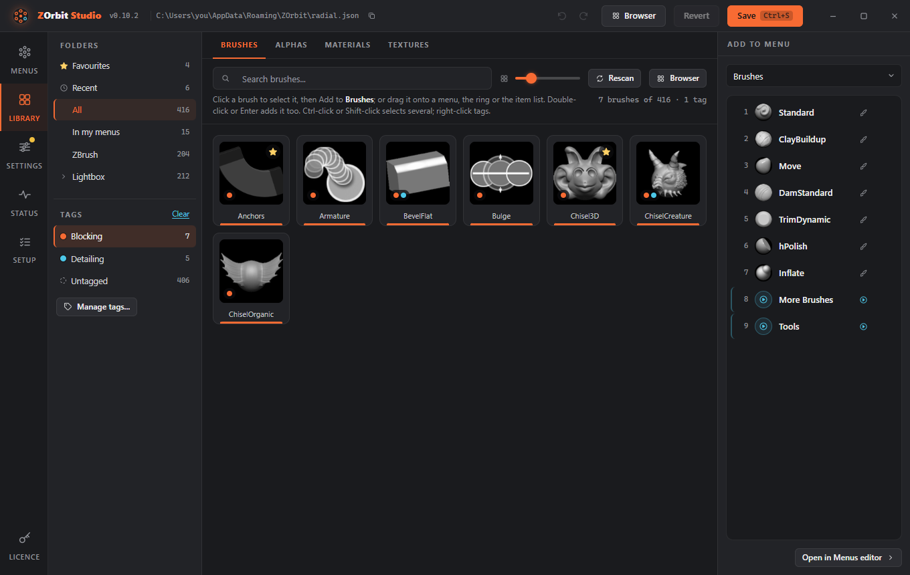

# Tags


A tag is a coloured label for items, like **Blocking** in orange or **Detailing** in blue. Brushes, alphas, materials and textures
can all carry tags, and one item can have several. There is one set of tags for all of them. An item's first tag is the one
that colours its slot on the ring and comes first in the Library. New installs start with those two tags; rename, recolour
or delete them as you like.

Tags let you do three things: filter the Library, colour slots on the ring (see [Tag colours](appearance.md#tag-colours)), and open all
the items with a tag from one slot (see [Tag](menus.md#tag)). The [browser](browser.md) filters by tag too.

**Favourites** is a built-in tag. It always exists and always comes first. It shows a star instead of a dot, and it
cannot be deleted, renamed or merged away, but you can change its colour in the tag manager. Starring an item never
changes its colour cue: the first *other* tag does that. Favourites has its own entry in the folders list rather than
a chip (see [Favourites and Recent](browser.md#favourites-and-recent)).

Your other tags are named, coloured sets. They work the same way: each one is a ring slot of its own (see
[Tag](menus.md#tag)). Favourites give you a one-click star; tags give you named sets.

## Tagging items

1. In the **Library**, or in the Library tab on the Menus screen, click an item to select it. **Ctrl-click** adds or removes items. **Shift-click** selects a range from the last plain click, over the items on show.
2. Press **Tag...** in the bar that shows the selection, or right-click an item. A right-click on an item that is in the selection tags the whole selection; on any other item it tags just that item.
3. In the picker, click a tag to put it on, or take it off, every selected item. A tag that only some of them carry shows as partly ticked. A tag you add goes at the end of the item's list, so the first tag you gave an item stays its colour. Favourites is first in the picker, with a star.
4. To make a new tag, type its name under **New tag...** and press Enter. It is created and put on the selected items. If a tag with that name exists, that one is used.

A card shows up to three small colour dots, first tag first. Tag names are 1 to 40 characters, and no two tags can have the same name, whatever the capitals.

## Filtering

Under **Folders** the Library lists your tags as chips (in the small list on the Menus screen they are a row under the folder box). Click a chip to filter. With several chips on, an item shows when it has any of them. The folder and the search box narrow the result further. **Untagged** shows items with no ordinary tag, and **Clear** switches the filter off. A starred item with no other tag
still counts as untagged.



## Managing tags

**Manage tags...** (under the chips in the Library, or on **Settings > Tags**) opens the tag manager. Each row has:

- a swatch: click it for the eight preset colours, or type any `#rrggbb` value;
- the name: edit it and press Enter, or leave the field, to rename the tag. If another tag already has that name, you are asked to **Merge into** it or keep them apart. Merging puts the items of this tag on the other one (in the same place in each item's list, so the colour cue stays) and removes this tag;
- the number of items it is on;
- a delete button. The confirmation says how many items it is on and how many ring items use it. **Items keep working**; they only lose the tag. Ring items that point at the deleted tag stay in `radial.json`: a `tag` slot becomes a faint empty slot, a `browser` slot opens unfiltered, and the problems pill lists both so you can point them elsewhere.

The Favourites row lets you change only its swatch. Its name is fixed, and it cannot be deleted or merged away.

Tags save as you make them. They are not part of **Save**, **Revert**, **Undo** or the unsaved-changes list. The app notices a change within a moment, and Studio refreshes its tags when you come back to its window, so a tag made in one place shows up in the other.

## Where tags live

Tags are in `%APPDATA%\ZOrbit\tags.json`, apart from your menus. The file does not exist until you change a tag; before that, the two starter tags are only held in memory. It looks like this:

```json
{"version": 1,
 "tags":  {"blocking":  {"label": "Blocking",  "color": "#F86B33"},
           "detailing": {"label": "Detailing", "color": "#4DC8E9"}},
 "items": {"brush:claybuildup": ["blocking"],
           "brush:dam_standard": ["detailing", "blocking"],
           "alpha:alpha058": ["blocking"]}}
```

An item's key is its kind, `brush:`, `alpha:`, `material:` or `texture:`, plus its name in lower case without spaces (`alpha:alpha058`). The first tag in an item's list is its colour cue. Items that are not installed keep their tags. You can edit the file by hand and the ring follows. If the file cannot be read (a stray comma, say), the app and Studio keep the last good tags, Studio shows the error in the Library, and nothing is changed or written until you fix it.
