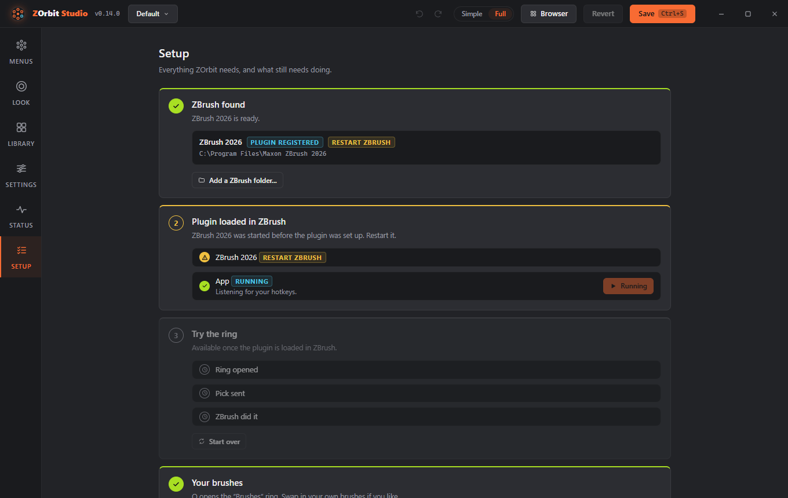

# Troubleshooting

Entries are grouped by what you see. Studio's **Setup** screen (Alt+6) is the quickest first check: it looks at ZBrush, the plugin and the app, and says which step is missing. The log files named below are listed under [Logs](#logs).

## Installing

### Windows protected your PC

The installer is not code-signed yet. Click **More info**, then **Run anyway**. [Install and uninstall](install.md#windows-says-windows-protected-your-pc) says why.

### The portable version stops at startup with "Failed to resolve Python.Runtime.Loader.Initialize"

Windows marked the unzipped files as downloaded, and ZOrbit could not remove the mark, usually because it is in a folder it cannot write to. Close ZOrbit, right-click the zip, choose **Properties**, tick **Unblock**, and unzip it again into a folder of your own, such as one under `Documents`.

### Install update in Studio does not work

- **The download stops with a message.** "The download did not work" means GitHub could not be reached: check your connection and try again. "does not match the SHA-256 of the release" means the file that arrived is not the one GitHub lists, so Studio deleted it. Try again later, or download the installer from the release page and run it yourself. `studio.log` has a line for each step that starts with `update:`.
- **Studio closed and did not come back.** Setup may have stopped, for example with "Close ZOrbit Studio first" when Studio took longer than 15 seconds to close. Open Studio from the Start menu. If the version at the top is still the old one, try again. Setup writes what it did to `%LOCALAPPDATA%\ZOrbit\update-setup.log`; send that file with a report.
- **The dialog says the copy was not installed with Setup.** It is a portable copy or a source checkout, which Setup does not know about. Download the new version from the release page. ZOrbit 0.18.0 and older said this on installed copies too, because they refused every release's setup file. Run the new installer from the release page once, and later updates work from Studio.
- **The dialog says Studio could not confirm the setup file.** The release has no setup file with a SHA-256 that Studio can check, or it is not on ZOrbit's release page. `studio.log` has a line with `no setup file Studio can trust`. Download the new version from the release page.
- **The orange version at the top is gone, but there is a newer release.** You chose **Don't remind me again** for it. **Settings > Studio** still offers it, and a newer release shows at the top again.
- **Studio never shows a newer version.** `studio.log` has a line with `update check failed` that says why. `SSLCertVerificationError` means GitHub's certificate was not trusted, and Windows' reason follows it. On a company network, the network's own certificate may be missing from Windows, and a PC clock that is far off has the same effect. ZOrbit 0.17.0 and older checked the certificate without Windows' help and failed like this on a freshly installed Windows, with `CERTIFICATE_VERIFY_FAILED` in the line. Download the new installer from the release page once, and later updates work from Studio. A line `truststore unavailable` only shows when you run from a checkout without the packages in `requirements.txt`.

### Setup says Plugin folder missing

ZBrush 2026 and newer load the plugin from the `bridge` folder of the ZOrbit install. **Plugin folder missing** means that folder is gone, so **Fix** cannot help. Reinstall ZOrbit, then restart ZBrush.

### A newer ZOrbit takes over from an older one

A newer ZOrbit started while an older one was running, such as a portable copy. The new one asks the old one to quit, waits for it, and starts in its place. `radiald.log` shows `taking over from ZOrbit <version> (pid <n>)`, then `ZOrbit <version> has quit`. This is normal, and nothing needs doing. A browser window of the old version stays open until you close it. On Studio's **Status** screen, **Restart app** does the same job when the app running is older than Studio. See [Profiles](profiles.md#older-versions).

### A second copy of ZOrbit exits at startup

Only one copy of the app runs at a time. A second copy that starts looks at the first one and then exits. `radiald.log` gives the reason in brackets, in a line that starts `another instance is already running; exiting`:

- **`same version`**: the same version is already running. Nothing needs doing.
- **`newer version <v>`**: a newer ZOrbit is already running, and it keeps going. Start that one instead.
- **`version unknown`**: the running copy was started with `--no-tray`, which does not report its version. It is left alone.
- **`it did not quit in time`**: the older copy was asked to quit and did not. Quit it from its tray icon with **Quit ZOrbit**, or end it in Task Manager, then start again.
- **`access denied`**: the older copy runs as administrator, so this one cannot ask it to quit. Quit it from its tray icon, or end it in Task Manager as administrator.

### I upgraded from Radial Menu for ZBrush and F9 stopped working

The palette was renamed, so a hotkey you bound by hand to the old **Apply** does not carry over in ZBrush 2026. Ctrl+Alt+click **Zplugin > ZOrbit > Apply**, press **F9**, then click **Preferences > Hotkeys > Store**. ZBrush 2022 to 2025: update the plugin in **Studio > Setup** step 1 (or **Settings > Older ZBrush** in Full mode); it binds F9 if **Apply** has no hotkey. Your menus were copied from `%APPDATA%\RadialMenu` to `%APPDATA%\ZOrbit` on the first start (into the **Default** [profile](profiles.md)), and learned auto slots from `%LOCALAPPDATA%\RadialMenu` to the same profile. The old folders are left in place; you can delete them.

## The ring does not open

### Pressing the hotkey does nothing

1. Open Studio's **Setup** screen (Alt+6). It checks ZBrush, the plugin and the app, and says which step is missing. An amber dot on its button in the rail means no ZBrush that Studio found has the plugin set up, or a running ZBrush does not. It does not appear when Studio finds no ZBrush at all. When step 2 says ZBrush has not loaded the plugin, close ZBrush completely and start it from the Start menu: a ZBrush started from a program that was already open before the plugin was registered does not know where the plugin is. If that does not help, read `bridge.log` (ZBrush 2026 and newer) or `zscript_launch.log` (ZBrush 2022 to 2025) in `%LOCALAPPDATA%\ZOrbit`; `bridge.log` does not exist if the plugin never ran.

    

2. Is ZBrush the front window? The hotkey is ignored everywhere else.
3. In ZBrush, open **Zplugin > ZOrbit**. If the palette is missing, ZBrush did not load the plugin. On Studio's **Setup** screen, press **Fix** next to your ZBrush if it shows that button, then restart ZBrush. If there is no **Fix**, or the palette is still missing, the next steps depend on your version:
    - **ZBrush 2026 and newer:** the plugin folder (`<install folder>\bridge`, the one that holds `zorbit_bridge.py`) must be in your user environment variable `ZBRUSH_PLUGIN_PATH` (in Windows' environment variables, user section). As a one-off you can also load `zorbit_bridge.py` with **ZScript > Python Scripting > Load**. **Zplugin > ZOrbit > Status** should say the listener is verified and the app is running. If the plugin failed while starting, `bridge.log` (in `%LOCALAPPDATA%\ZOrbit`) holds the error, after a line that says "the plugin could not start". Its listener line says whether the listener is up.
    - **ZBrush 2022 to 2025:** the **Zplugin > ZOrbit** palette comes from the ZScript plugin, not from `ZBRUSH_PLUGIN_PATH`. If it is missing, install the plugin from the **Setup** screen or from **Settings > Older ZBrush** (Full mode), then restart that ZBrush. `zscript_launch.log` and `zscript_bridge.log` (in `%LOCALAPPDATA%\ZOrbit`) show whether the plugin started the app and what the last pick did. See also [ZBrush 2022 to 2025: the ring opens, but picks do nothing](#zbrush-2022-to-2025-the-ring-opens-but-picks-do-nothing).
4. If the status says the app is not running, press **Start App**, then read `app_stderr.log` and `radiald.log`.
5. In Studio, check for the **problems** pill. A menu with no usable items, a duplicate hotkey or a hotkey the app cannot read all stop a ring from opening.
6. Another program may grab the same key before it reaches the app. Try a different hotkey.
7. Is ZBrush running as administrator? The app cannot read an elevated program's process, so it cannot tell that ZBrush is the front window, and it ignores the hotkey. `radiald.log` then says "zbrush.exe (pid 1234) could not be read, so it is probably running as administrator; hotkeys ignored in it", or, when the front window is the one it cannot read, "foreground window's process could not be read (is ZBrush running as administrator?); hotkeys ignored". Start ZBrush without "Run as administrator". Studio's **Setup** step 2 says the same: "ZBrush is running as administrator, so ZOrbit cannot see its window and the ring will not open."
8. Typing is affected too. A menu hotkey is swallowed in ZBrush's text fields (a rename box, a file name), so a plain letter such as **Q** cannot be typed there while a menu uses it. Use a key you do not type, add a modifier, or turn off **Swallow hotkey** for that menu.

## Picks do nothing

### The ring opens, but picks do nothing

When the app knows why a pick went nowhere, it shows a short message near the cursor for about two seconds. It is drawn in the colours of the [theme](appearance.md#theme), sits just below the cursor, ignores the mouse, never takes the focus and never shows for a pick that worked. A new message replaces the old one. If one cannot be drawn, `radiald.log` says "toast failed". The messages are:

- **No plugin listener in ZBrush (bridge mode is Message). Check Zplugin > ZOrbit > Status.** The bridge mode is `message` and the app found no live listener in that ZBrush. Start ZBrush, or load the plugin.
- **The plugin did not answer (bridge mode is Message). Check Zplugin > ZOrbit > Status.** The listener was there, but did not pick the request up within half a second, and in `message` mode the app never presses the bridge key instead.
- **ZBrush was not the front window, nothing sent**. The pick needed the bridge key, and the key is only pressed while ZBrush is in front. Do not click another program right after you pick. A [command from another program](hotkeys.md#commands-from-other-programs) gets it too, when ZBrush is not in front and no listener can take the pick.
- **A dialog or text box has the focus, nothing sent**. A command from another program was refused, because a native Windows dialog is in front or a Windows text box has the focus. A hotkey would be ignored there too.
- **There is no menu called**, **There is no tag called** or **There is no profile called**, followed by a name. A command from another program named something that does not exist. A menu's name here is its id in `radial.json`, and a tag's is its key.
- **This ZOrbit runs on one menus file, so it has no profiles**, or **Your files were changed by a newer ZOrbit, so the profile stays**. A `--profile` command or the next-profile hotkey was refused.
- **ZOrbit has no menus loaded**. A command from another program arrived before ZOrbit had read a menus file.
- **This slot is empty**. You picked an auto slot nothing has filled yet, or a tag slot whose tag has no items.
- **That menu has nothing usable in it**. You picked a submenu whose items are all empty or unusable.
- **A name followed by "could not be found in ZBrush"** or **"is not a ZBrush button"**, or **ZBrush could not carry out that pick. See bridge.log.** The plugin picked the request up and reported a problem: the brush, alpha, material or texture is not installed, the `press`, `set` or `toggle` path does not exist, or ZBrush raised an error. `bridge.log` has the details (see [The pick is logged as selected, but nothing changes](#the-pick-is-logged-as-selected-but-nothing-changes)). In ZBrush 2022 to 2025 they are in `zscript_bridge.log` and `radiald.log`. A pick there only searches [that ZBrush's own folders](menus.md#brush), so an item the browser lists can still be missing. That includes an item that only a [folder you added](browser.md#your-own-folders) has: folders added on **Settings > Library folders** are searched in ZBrush 2026 and newer only.
- **The capture folder cannot be used, nothing sent. See radiald.log.** A [Capture](menus.md#capture) item's folder is not a full path to a folder on this PC, or ZOrbit cannot make the folder or write a file into it. The picture's full path, folder and file name, is also refused when it is longer than 259 characters, or in ZBrush 2022 to 2025 when it is longer than 255 bytes in the ANSI code page. `radiald.log` gives the reason.
- **ZBrush 2022-2025 cannot save to that capture folder's name, nothing sent**. In ZBrush 2022 to 2025 the folder's name has characters outside plain ASCII, and Windows has no short name for the folder, so the plugin cannot be given its path. Choose another folder.
- **That file is not there, nothing sent. See radiald.log.** A [Tool](menus.md#tool) or [Project](menus.md#project) item names a file that is not on this PC, or its drive is not plugged in. Check the path and the drive.
- **That folder is not there, nothing sent. See radiald.log.** A [Project](menus.md#project) item names a folder that is not on this PC, or that cannot be read.
- **No project in that folder, nothing sent**. A [Project](menus.md#project) item names a folder with no `.zpr` file directly in it. Its subfolders do not count.
- **ZBrush 2022-2025 cannot read that file's name, nothing sent**. In ZBrush 2022 to 2025 the file's path has characters outside plain ASCII, and Windows has no short name for it, so the plugin cannot be given the path. Move the file to a place with a plain name.
- **That path is too long for ZBrush 2022-2025, nothing sent. See radiald.log.** In ZBrush 2022 to 2025 a path can be at most 255 bytes in the ANSI code page. Move the file to a place with a shorter path.
- **ZBrush did not take the pick. Check Zplugin > ZOrbit > Apply.** In ZBrush 2022 to 2025 the bridge key did not reach **Apply**, the fallback script did not either, and the app dropped the pick so it cannot land later. The app waits for as long as ZBrush is busy and not responding, up to five minutes, so this appears only once ZBrush is answering again and still has not taken the pick. Usually the pick was made in the first seconds after ZBrush started, before the plugin had loaded, or the plugin is not installed. See [ZBrush 2022 to 2025: the ring opens, but picks do nothing](#zbrush-2022-to-2025-the-ring-opens-but-picks-do-nothing).

If you see no message and nothing happens, work through the steps below.

On Studio's **Status** screen, the **Bridge listener** card should say **Connected**. In ZBrush, **Zplugin > ZOrbit > Status** should say the listener is "verified". If it is not, use the bridge key: [bind it](#use-or-test-the-bridge-key) and leave the mode on `auto`. Then read `bridge.log`; it names each action and says whether it worked. Common causes: a `press`, `set` or `toggle` path that does not exist in your ZBrush (logged as "no such interface item"), or a `brush`, `alpha`, `material` or `texture` whose file ZOrbit cannot find (logged as "NOT loaded in ZBrush and no file known"). A brush you saved after ZOrbit started is found anyway: when a name is missing, ZOrbit looks through your brush, alpha, material and texture folders again before it gives up (at most once every five seconds).

### ZBrush 2022 to 2025: the ring opens, but picks do nothing

Picks there only arrive through the bridge key. A pick that lands a few seconds late, or a `radiald.log` line saying the bridge key did not reach **Apply**, means that key is not bound to **Apply**. Hover **Zplugin > ZOrbit > Apply** in that ZBrush: its hotkey should match the bridge key in Studio (F9 unless you changed it). The plugin binds F9 itself when **Apply** has no hotkey, but only once it is up to date, so update it if **Setup** step 1 (or **Settings > Older ZBrush** in Full mode) says **Plugin update available**. For any other key, check that it is bound to **Apply** and that you clicked **Preferences > Hotkeys > Store**; a binding that was not stored is gone after a restart. If the palette is missing, install the plugin again from **Studio > Setup** step 1 and restart that ZBrush. `zscript_bridge.log` shows what the last pick did.

Messages Studio can give when you install the plugin:

- **Installed without the start shortcuts (PowerShell is restricted here).** The plugin is installed and works, but starts ZOrbit the slower way. `ZOrbitData\install.txt` in that ZBrush's `ZStartup\ZPlugs64` says why the shortcuts failed. Restart ZBrush; nothing else is needed.
- **The ZBrush 2022 to 2025 plugin cannot find ZOrbit's data folder from this account.** The path of `%LOCALAPPDATA%\ZOrbit` has characters outside the Windows code page and 8.3 short names are off, so ZScript cannot read it. Move the data folder, or turn on 8.3 names (`fsutil 8dot3name set 0` as administrator), then install again.
- **ZBrush 2021 is not supported (2022 or newer).** Older versions cannot use the plugin.

### Use or test the bridge key

In ZBrush, Ctrl+Alt+click **Zplugin > ZOrbit > Apply**, press **F9**, then store it in **Preferences > Hotkeys > Store**. With the bridge mode on `auto` (the default), ZOrbit presses the bridge key (F9 unless you changed it) when the listener does not answer. The rules for the key and the other modes are in [How picks reach ZBrush](bridge.md#how-picks-reach-zbrush-bridge-modes).

To test it, set `"mode": "key"` temporarily, pick something, and check `bridge.log` for the result. Switch back to `auto` afterwards.

### The pick is logged as selected, but nothing changes

`bridge.log` has a line for every pick the plugin carries out, such as `#7 'Clay' via listener: brush Clay: selected`. If a brush line ends in `(Edit mode is off)`, the brush was selected, but no 3D tool is in Edit mode, so ZBrush has nothing to draw with it. Put a model on the canvas and press **Edit**, then pick again. The note only appears on brush picks.

`via listener` means the pick came by message, and `via button` means it came by the bridge key (the **Apply** button). The other results you may read in `bridge.log`:

- **`selecting it once ZBrush has added it`**, with `(button there now: False)`. ZBrush did not have the item, so ZOrbit loaded it from its file. ZBrush finishes adding an item only after the pick returns, so the plugin presses its button a moment later. A following line, `... selected after loading`, says it worked. This needs the listener; with the bridge key alone the item may stay unselected, and picking it again selects it.
- **`loaded, but its button did not appear within a second; not selected`**. The file loaded, but ZBrush showed no button for it in time. Pick the item again. If the same line comes back, load the file by hand in ZBrush to see whether it opens.
- **`request #N is S s old; ignored`**. The plugin got a pick more than 10 seconds after the app wrote it, and dropped it on purpose, so an old pick never lands later by accident. ZBrush was probably busy or showing a dialog. Pick again.
- **`the left mouse button is down; waiting for the stroke to end`**. The pick arrived in the middle of a stroke. It waits until you lift the pen or the button, then runs. This is not an error. If no result line follows, a mouse button is held down or stuck.
- **`no pending request`**. **Apply** ran with no pick waiting, for example when you pressed the bridge key yourself. It does nothing.
- **`unreadable request`**. The pick file was damaged. Pick again.
- **`no such interface item`** or **`NOT loaded in ZBrush and no file known`**. See above.
- **`FAILED`** followed by an error name. ZBrush raised an error while carrying out one action; the rest of the line is its message. The app shows **ZBrush could not carry out that pick. See bridge.log.**
- **`app not found: launch.json missing or stale`**. The plugin does not know where ZOrbit is. Open **ZOrbit Studio** from the Start menu once, so it records where it lives.

### Picks feel late during a stroke

In ZBrush 2026 and newer that is intended. A pick waits until you release the mouse button or lift the pen, so a tool change never lands in the middle of a stroke. The bridge key waits too when it is the fallback: it is pressed half a second after you lift. ZBrush 2022 to 2025 cannot wait. Their plugin applies a pick as soon as the bridge key arrives, even in the middle of a stroke.

## The browser

### The browser does not appear

1. Is ZBrush (or the browser itself) the front window? The browser hotkey is ignored everywhere else. The tray menu, Studio's **Browser** button and the Start menu shortcut work from anywhere.
2. Does your `radial.json` have a `browser` hotkey (new installs have Alt+B)? Check **Browser hotkey** under **Settings > Behaviour**. If a menu uses the same key, the menu wins and the problems pill says so. A **Browser** slot on a ring opens it too.
3. After the app starts, the browser needs a few seconds to be ready. The first press can take a moment when it was not started in advance. If it is open but you cannot see it, it may be behind other windows (Keep on top is off): press the hotkey, or open it from the tray menu. A browser left on a screen you have since unplugged is brought back onto a screen the next time it opens.
4. Read `radiald.log` (lines that start with `browser`, and `popout exited with code N` when the browser stopped) and `popout.log`. Without the Microsoft Edge WebView2 runtime the browser cannot open: it shows **ZOrbit needs the Microsoft Edge WebView2 runtime for this window** with the download link, and `popout.log` says so. Install the runtime and press the hotkey again. Any other failure while it starts is written to `popout.log` as a traceback; send that with your report.

### The browser is empty

The browser and the Library read the folders of a ZBrush that has run at least once. When either says **ZBrush was not found**, the list stays empty until ZOrbit finds one. (It says so only when you have added no folder of your own. With a folder added on **Settings > Library folders**, the list shows without ZBrush.) Start ZBrush once, then press **Rescan**. In Studio, the Library's message has a **Find ZBrush in Studio** button that opens Setup. In the browser window, open Studio from the tray icon or the Start menu and go to **Setup**, where **Add a ZBrush folder** adds one that is not found.

### A folder you added cannot be read

A folder from **Settings > Library folders** shows **Missing** (it is not there) or **Cannot be read** on its row. In the browser and the Library a line above the list gives the reason, and the **Rescan** toast says it. The folder keeps the items it had and the other folders are read afresh, so the rest of the list is still there. Plug the drive back in, or forget the folder with **X** and add it again under its new name, then press **Rescan**. Hover **Cannot be read** to see the Windows error. When you add or forget a folder, `radiald.log` says `library folders changed: reading the library again` within a second, then `library read again: N kinds, generation G`. **Copy report** on **Status** lists every folder you added, with its state.

### A name in a folder I added has a bracket after it

That is on purpose. When a file's name is already taken, it is listed with its pack folder, such as **10 (Crack Alphas Vol 1)**. See [Names in a folder you added](browser.md#names-in-a-folder-you-added). If a pick of such an item selects another one with the same file name, ZBrush has loaded that one already: it names an item after its file.

### The browser opens but does not take the keyboard

Click the search box once. If you have to do that every time, send `popout.log` and the `browser` lines of `radiald.log`.

### A pick in the browser does nothing

After a pick, read the toast. A toast that says **Sent X to ZBrush** (X is the item's name) means the app took the pick, and `bridge.log` says what ZBrush did with it. **ZOrbit is not running. It starts and stops with ZBrush.** (followed by "Start ZBrush, or press Start app on Studio's Status screen.") means the browser found no app window: start ZBrush, and the app starts with it, or press **Start app** on Studio's **Status** screen. **ZOrbit did not answer. Try again in a moment.** means the app's window exists but did not answer within half a second. `popout.log` has a line `pick ... app window ..., result ...` for each pick.

**ZOrbit did not take that brush. Is it up to date?** (or that alpha, material or texture) means the app answered and refused the pick. An app older than the browser can do that, so quit it from the tray and start it again, or update it. **Could not reach ZOrbit:** and a reason means the call failed inside the browser window, before the pick got to the app. Close the browser and open it again.

In `radiald.log`, look for `pick from browser`. If it says the pick was dropped because ZBrush did not get the focus back in 2 s, you are in ZBrush 2022 to 2025, which can only take a pick through the bridge key while ZBrush is the front window: do not click another program right after you pick. Check that the app is running on the Status screen if the toast says it is not.

## Slots and tags

### A tag slot is faint and does nothing

No installed item carries that tag, or the tag no longer exists (the problems pill says which). Tag some items in the Library, or point the slot at another tag.

### My slots are not coloured by tag

Check **Look > Tag colours** (Full mode): the **Icon tint**, **Glow** and **Band** switches may all be off. Only an item's first tag colours its slot, and an item with no tag is not coloured. A change made by hand to `tags.json` shows within a moment.

### A slot shows letters instead of a picture

Letters mean ZOrbit could not read a picture for the slot: the file was not found, or its picture is in a format ZOrbit does not know. The pick still works when ZBrush already has the item loaded, such as a brush that comes with ZBrush. When it does not, and ZOrbit has no file for it, `bridge.log` says "NOT loaded in ZBrush and no file known". A brush with no `.zbp` found for its name shows letters. So do a material with no icon in its `.zmt` file (some old MatCap files) and an EXR texture, and those still pick fine. For other items the letters are the normal placeholder; set an `icon` to change it.

### Brush usage from an older version is added

The `usage.json` an older ZOrbit kept, which holds the brushes that fill the auto slots and Recent, is added to the profile in use when the app starts. The file is set aside in `%APPDATA%\ZOrbit\pre-profiles\<date and time>\`, and `radiald.log` says `usage: added <n> brushes from an older version`. Nothing needs doing. See [Files from an older version](profiles.md#files-from-an-older-version).

## Studio

### Studio does not open, opens blank, or does nothing on a second click

1. Studio draws its window with the Microsoft Edge WebView2 runtime. Without it (or with a version older than 86), Studio shows a message box, **ZOrbit needs the Microsoft Edge WebView2 runtime for this window. Install it from https://developer.microsoft.com/microsoft-edge/webview2/ and try again.**, and stops. `studio.log` then says "the Microsoft Edge WebView2 runtime is not installed; the window cannot open". Install the runtime and open Studio again. The browser window needs the same runtime.
2. A window that opens blank may only be slow. Studio shows its window once the page has drawn, or after 3 seconds. `studio.log` (in `%LOCALAPPDATA%\ZOrbit`) has one line per step with the time since the process started: "pywebview imported", "page loaded" and "window shown", and says which program started Studio. If "page loaded" never appears, the web view did not start; send the log with your report.
3. Studio is single-instance. A second start finds the first (the `Local\ZOrbitStudio` mutex), brings its window to the front and exits, and `studio.log` says "already open: bringing it forward". If the first Studio is stuck or its window is out of reach, the second click seems to do nothing. In Task Manager, end the process listed as **ZOrbit Studio**, then open Studio again. If you cannot tell which it is, sign out of Windows and back in.

### The window cannot be resized from its edges

`studio.log` (or `popout.log` for the browser) has a line `the window's resize border could not be set up: <reason>`. The window still moves and maximises, but its edges and corners do not resize it. The reason after the colon says what went wrong. Include the line when you send a report.

### I cannot find a setting in Studio

Studio may be in Simple mode, which hides some settings and item types. Press **Full** in the top bar. A hidden setting keeps its value, so nothing is lost by switching. If a Full-only setting is not at its default, the top of the Look or Settings page names it and has a **Switch to Full mode** link. [Simple and Full mode](studio.md#simple-and-full-mode) lists what each mode shows.

### Match ZBrush shows the Dark colours

ZOrbit found no stored colour scheme, or could not read the file, so **Match ZBrush** uses Dark and **Settings > Theme** says so. ZOrbit reads the scheme ZBrush saves when you press **Preferences > Config > Store Config**, so colours changed under **Preferences > Icolors** and not stored are not seen. Press **Store Config** in ZBrush and the ring follows within about half a second. With several ZBrush versions installed, ZOrbit uses the running one, otherwise the newest with a stored scheme. The card shows which version and when it was stored. See [Match ZBrush](appearance.md#match-zbrush).

## Your menus file

### I broke my menus file

Studio keeps the last version as `radial.json.bak`. If you edit the file by hand and the app cannot read it, it keeps using the last good version and logs the error. It also shows a balloon from the tray icon, **ZOrbit cannot read your menus file**, once for each saved version of the file, and the tray icon's tooltip says the menus file cannot be read until the file loads again. **Reload menus** in the tray menu shows the reason in a balloon. When Studio cannot read it either, it opens on a recovery screen that shows the error with its line and column, and has these buttons:

- **Open folder** opens the profile folder that holds `radial.json` (`%APPDATA%\ZOrbit\profiles\<profile>\`, see [Profiles](profiles.md)).
- **Open logs folder** opens the logs folder.
- **Restore backup** replaces the file with `radial.json.bak`. It only appears when that file exists. The file it replaces is kept as `radial.json.broken`, so you can open it in a text editor and recover what you need.
- **Start from defaults** replaces the file with the built-in menus, after a confirmation. The unreadable file is kept as `radial.json.broken`.
- **Try again** reloads Studio, for when you have fixed the file by hand.

The rail and the **Alt+1** to **Alt+6** keys do nothing, and the rail is dimmed, until the file loads. Nothing is changed or saved until you choose a button.

A section of the wrong type, for example `"ring": "big"`, is reported with the section name, and the defaults are used for it. A brush, alpha, material or texture name may not contain `\ / :` or `..`, and an `icon` may not point at a network path; the problem names the item, and a bad name skips the item. A byte-order mark left by an editor is accepted. Deleting the profile's `radial.json` makes the app create a fresh one from the starter menus, in that profile's folder.

If the file cannot be read when the app starts, the app still starts: the tray icon appears, no ring opens, and `radiald.log` says "cannot load radial.json" with the reason. Fix the file in Studio or by hand; the app reads it again as soon as it changes. **Reload menus** in the tray menu logs "tray: reload failed" with the reason when the file is still unreadable.

A setting name ZOrbit does not know, such as `raduis` for `radius` in `ring` or `itmes` in a menu, is listed as a problem and ignored, with a "did you mean" when a known name is close. A `swallow` that is not `true` or `false` is a problem too, and counts as `true`. A submenu slot that points at a menu with no usable items is listed and skipped.

### These files were made by a newer ZOrbit

The app does not start, and Studio shows **These files are from a newer ZOrbit**. The message box at startup says:

**These files were made by ZOrbit `<v>`, which is newer than this one (`<this version>`). Install ZOrbit `<v>` or newer.**

ZOrbit changed how it keeps the profiles folder, and wrote a number to `profiles\format.json` to say so. This version knows only an older layout, so it changes nothing and does not start. Studio shows the screen with only an **Open folder** button, and the browser does not open. `radiald.log` has a `fatal:` line with the same message.

Install the version the message names, or a newer one, and start ZOrbit again. The files are not changed in the meantime.

If a newer ZOrbit changes the files while an older one is already running, that app stops saving usage and switching profiles. Its tray tooltip says your files were changed by a newer ZOrbit.

### The app exits with "cannot create the first profile"

If `radiald.log` ends with `fatal: cannot create the first profile in ...`, the app could not write to its profiles folder and stopped. The line names the folder and gives the Windows error. Check that the folder can be written to, then start the app again.

### Checking a file without starting the app

`ZOrbit.exe --check > check.txt` writes every menu and any problems to `check.txt` without starting anything. The exe has no console window, so send its output to a file. From a source checkout, `python zorbit\main.py --check` prints the same.

### A command from another program does nothing

`radiald.log` has a line for each command that reached the app: `command: ` when it was taken, and `command refused: ` with the reason when it was not. No line means it never arrived, so look at the exit code, which the [list of commands](hotkeys.md#commands-from-other-programs) explains. The exe has no console window, so a command prompt does not wait for it. To read the code in PowerShell, use `(Start-Process ZOrbit.exe '--open brushes' -Wait -PassThru).ExitCode`. To see a message from it, send its error output to a file: `ZOrbit.exe --open brushes 2> out.txt`.

Exit code 2 with ZOrbit running usually means ZOrbit runs as administrator and the program sending the command does not. Windows does not let such a program send messages to it. Run ZBrush without administrator rights, or run the sending program as administrator too.

## Logs

`%LOCALAPPDATA%\ZOrbit` holds `radiald.log` (the app), `bridge.log` (ZBrush side), `zscript_bridge.log` (ZBrush 2022 to 2025: the last pick), `studio.log` (how Studio started), `popout.log` (the browser) and `app_stderr.log` (crashes at startup). Studio's **Status** screen shows the tail of the app log and has buttons that open the logs folder and the config folder. [Files, backups and logs](files.md#files-and-logs) lists every file ZOrbit keeps.

For a bug report, press **Copy report** on the **Status** screen and paste the result into the form. **Report a bug** next to it opens the form with the versions filled in. The report holds the ZOrbit and Windows versions, how ZOrbit was installed, your ZBrush installs and which of them runs (and whether as administrator), the bridge mode and key, the **Status** cards, the profile in use, any problems in the menus file, your Library folders (one line each: found with its file count, missing, or could not be read, or "none added"), and the end of each log that fits your setup, from the current session where the log marks one.

Before it copies, `%LOCALAPPDATA%` and your home folder are written back as `%LOCALAPPDATA%` and `%USERPROFILE%`, and your Windows user name, including the short form Windows can give it, becomes `<user>` where it comes right after a `\` or `/` in a path, or as a word on a line that runs an `.exe`. Brush names and menu ids stay, so a user called `brush` still has `brush Clay: selected` in the log. A folder name with your name joined to other text, such as `D:\Sam_art`, stays too, and so does your name anywhere else, so look the report over before you post it.

Read a log you copy by hand before you post it. Besides brush names and menu ids, the logs hold your Windows user name and folder paths: the plugin logs where it loaded from and the command it used to start the app, the app logs the command line of the browser, and `studio.log` and `popout.log` log the working directory. Black out or remove those parts first.
