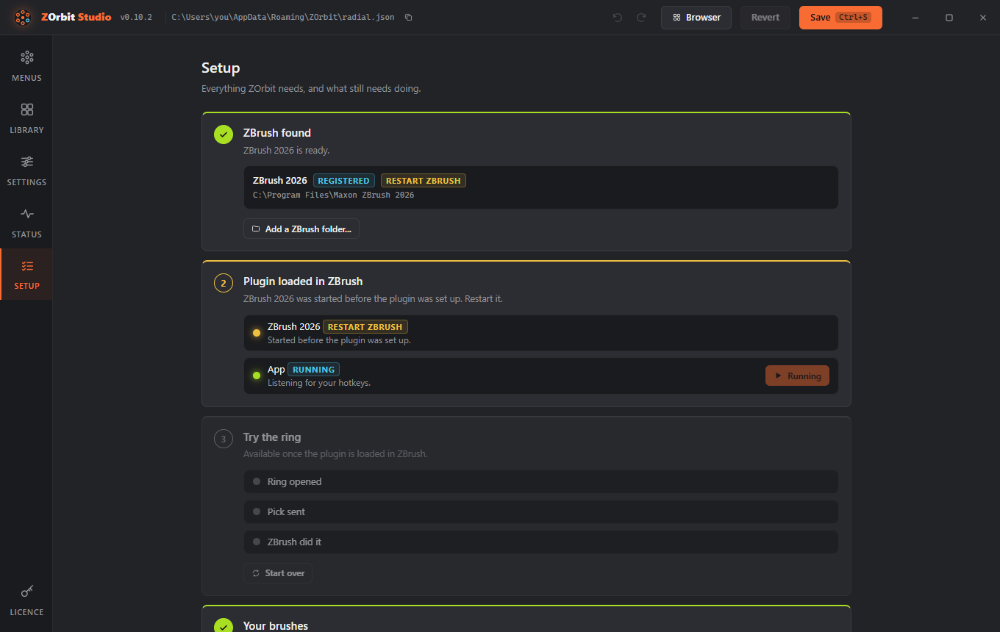

# Troubleshooting

Entries are grouped by what you see. Studio's **Setup** screen (Alt+6) is the quickest first check: it looks at ZBrush, the plugin and the app, and says which step is missing. The log files named below are listed under [Logs](#logs).

## Installing

### Windows protected your PC

The installer is not code-signed yet. Click **More info**, then **Run anyway**. [Install and uninstall](install.md#windows-says-windows-protected-your-pc) says why.

### The portable version stops at startup with "Failed to resolve Python.Runtime.Loader.Initialize"

Windows marked the unzipped files as downloaded, and ZOrbit could not remove the mark, usually because it is in a folder it cannot write to. Close ZOrbit, right-click the zip, choose **Properties**, tick **Unblock**, and unzip it again into a folder of your own, such as one under `Documents`.

### I upgraded from Radial Menu for ZBrush and F9 stopped working

The palette was renamed, so a hotkey you bound by hand to the old **Apply** does not carry over in ZBrush 2026. Ctrl+Alt+click **Zplugin > ZOrbit > Apply**, press **F9**, then click **Preferences > Hotkeys > Store**. ZBrush 2022 to 2025: update the plugin in **Studio > Settings > Older ZBrush**; it binds F9 itself. Your menus were copied from `%APPDATA%\RadialMenu` to `%APPDATA%\ZOrbit` on the first start, and learned auto slots from `%LOCALAPPDATA%\RadialMenu`. The old folders are left in place; you can delete them.

## The ring does not open

### Pressing the hotkey does nothing

1. Open Studio's **Setup** screen (Alt+6). It checks ZBrush, the plugin and the app, and says which step is missing. An amber dot on its button in the rail means a check is failing.

    

2. Is ZBrush the front window? The hotkey is ignored everywhere else.
3. In ZBrush, open **Zplugin > ZOrbit > Status**. It should say the listener is verified and the app is running. If the palette is missing, ZBrush did not load the plugin. Restart ZBrush and check that your user environment variable `ZBRUSH_PLUGIN_PATH` (in Windows' environment variables, user section) contains the plugin folder. As a one-off you can also load `zorbit_bridge.py` with **ZScript > Python Scripting > Load**.
4. If the status says the app is not running, press **Start App**, then read `app_stderr.log` and `radiald.log`.
5. In Studio, check for the **problems** pill. A menu with no usable items, a duplicate hotkey or a hotkey the app cannot read all stop a ring from opening.
6. Another program may grab the same key before it reaches the app. Try a different hotkey.

## Picks do nothing

### The ring opens, but picks do nothing

Check the listener on Studio's Status screen, or in ZBrush under **Zplugin > ZOrbit > Status**. It should say "verified". If it is not, use the fallback: [bind the bridge key](#use-or-test-the-fallback-key) and leave the mode on `auto`. Then read `bridge.log`; it names each action and says whether it worked. Common causes: a `press`, `set` or `toggle` path that does not exist in your ZBrush (logged as "no such interface item"), or a `brush`, `alpha`, `material` or `texture` whose file ZOrbit cannot find (logged as "NOT loaded in ZBrush and no file known").

### ZBrush 2022 to 2025: the ring opens, but picks do nothing

Picks there only arrive through the bridge key. Hover **Zplugin > ZOrbit > Apply** in that ZBrush: its hotkey should match the bridge key in Studio (F9 unless you changed it). The plugin brings F9 itself, but only once it is up to date, so update it if **Settings > Older ZBrush** says **Update available**. For any other key, check that it is bound to **Apply** and that you clicked **Preferences > Hotkeys > Store**; a binding that was not stored is gone after a restart. If the palette is missing, install the plugin again in **Studio > Settings > Older ZBrush** and restart that ZBrush. `zscript_bridge.log` shows what the last pick did.

### Use or test the fallback key

In ZBrush, Ctrl+Alt+click **Zplugin > ZOrbit > Apply**, press **F9**, then store it in **Preferences > Hotkeys > Store**. With the bridge mode on `auto` (the default), ZOrbit presses F9 when the listener does not answer. The rules for the key and the other modes are in [How picks reach ZBrush](bridge.md#how-picks-reach-zbrush-bridge-modes).

To test it, set `"mode": "key"` temporarily, pick something, and check `bridge.log` for the result. Switch back to `auto` afterwards.

### Picks feel late during a stroke

That is intended. A pick waits until you release the mouse button or lift the pen, so a tool change never lands in the middle of a stroke.

## The browser

### The browser does not appear

1. Is ZBrush (or the browser itself) the front window? The browser hotkey is ignored everywhere else. The tray menu, Studio's **Browser** button and the Start menu shortcut work from anywhere.
2. Does your `radial.json` have a `browser` hotkey (new installs have Alt+B)? Check **Settings > Browser**. If a menu uses the same key, the menu wins and the problems pill says so. A **Browser** slot on a ring opens it too.
3. After the app starts, the browser needs a few seconds to be ready. The first press can take a moment when it was not started in advance. If it is open but you cannot see it, it may be behind other windows (Keep on top is off) or on a screen you have unplugged: press the hotkey, or open it from the tray menu.
4. Read `radiald.log` (lines that start with `browser`) and `popout.log`. A missing WebView2 runtime stops it, as it stops Studio.

### The browser opens but does not take the keyboard

Click the search box once. If you have to do that every time, send `popout.log` and the `browser` lines of `radiald.log`.

### A pick in the browser does nothing

Look in `radiald.log` for `pick from browser`. If the line is there, the pick reached the app and `bridge.log` says what ZBrush did with it. If instead it says the pick was dropped because ZBrush did not get the focus back in 2 s, you are in ZBrush 2022 to 2025, which can only take a pick through the bridge key while ZBrush is the front window: do not click another program right after you pick. If neither line is there, the browser could not reach the app, and `popout.log` says why. Check that the app is running on the Status screen.

## Slots and tags

### A tag slot is faint and does nothing

No installed item carries that tag, or the tag no longer exists (the problems pill says which). Tag some items in the Library, or point the slot at another tag.

### My slots are not coloured by tag

Check **Settings > Tag colours**: the **Icon tint**, **Glow** and **Band** switches may all be off. Only an item's first tag colours its slot, and an item with no tag is not coloured. A change made by hand to `tags.json` shows within a moment.

### A slot shows letters instead of a picture

There is no thumbnail for it. For a brush, that means no `.zbp` was found. A material with no icon in its `.zmt` file (some old MatCap files) and an EXR texture show it too. For other items it is the normal placeholder; set an `icon` to change it.

## Your menus file

### I broke my menus file

Studio keeps the last version as `radial.json.bak`. If you edit the file by hand and the app cannot read it, it keeps using the last good version and logs the error. When Studio cannot read it either, it opens on a recovery screen that shows the error with its line and column, and offers **Open folder**, **Restore backup** and **Start from defaults** (the unreadable file is kept as `radial.json.broken`). A byte-order mark left by an editor is accepted. Deleting `radial.json` makes the app create a fresh one from the starter menus.

### Checking a file from a source checkout

`python zorbit\main.py --check` prints every menu and lists problems without starting anything.

## Logs

`%LOCALAPPDATA%\ZOrbit` holds `radiald.log` (the app), `bridge.log` (ZBrush side), `zscript_bridge.log` (ZBrush 2022 to 2025: the last pick), `studio.log` (how Studio started), `popout.log` (the browser) and `app_stderr.log` (crashes at startup). Studio's **Status** screen shows the tail of the app log and has a button that opens the folder. [Files, backups and logs](files.md#files-and-logs) lists every file ZOrbit keeps.
