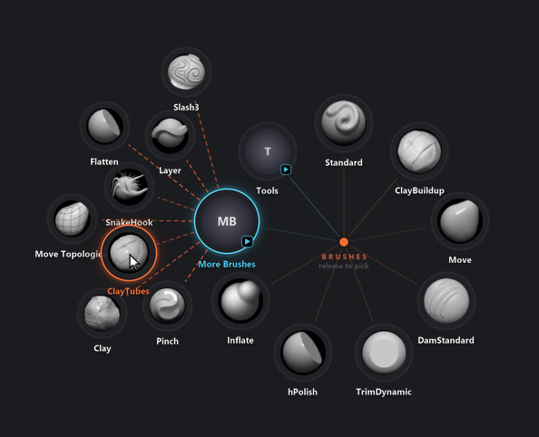

# ZOrbit: user guide

This guide covers everything ZOrbit can do. For installing, see the [README](../README.md).

- [The basics](#the-basics)
- [ZOrbit Studio](#zorbit-studio)
- [Menus](#menus)
- [Item types](#item-types)
- [Tags](#tags)
- [Brush browser](#brush-browser)
- [Hotkeys](#hotkeys)
- [Pick modes](#pick-modes)
- [Appearance and behaviour settings](#appearance-and-behaviour-settings)
- [Open animations](#open-animations)
- [How picks reach ZBrush (bridge modes)](#how-picks-reach-zbrush-bridge-modes)
- [Files and logs](#files-and-logs)
- [Troubleshooting](#troubleshooting)

## The basics

ZOrbit is two things that work together:

- a small **app** that watches for your hotkeys and draws the ring, and
- a **plugin inside ZBrush** (the bridge) that carries out what you picked.

You do not start either by hand. ZBrush loads the plugin when it starts, the plugin starts the app, and the app quits when ZBrush closes.

With ZBrush in front, press **Q**. The ring opens centred on your cursor. Pick a slot (see [Pick modes](#pick-modes)) and ZBrush does what the slot says.


Slots are laid out clockwise starting at the top. A slot with a small arrow badge opens another ring. The menu's title and a short hint sit in the middle.

## ZOrbit Studio

Studio is where you edit everything. Open it from the Start menu (**ZOrbit Studio**) or from ZBrush with **Zplugin > ZOrbit > Studio**. Only one Studio window opens at a time; starting it again brings the open one forward. Studio reopens on the screen you left, and each screen keeps its scroll position while Studio is open.

| Screen | Shortcut | What it does |
|---|---|---|
| Menus | Alt+1 | Create and edit menus and their items, with a live ring preview. |
| Library | Alt+2 | Browse every brush ZBrush can load, with search, folders and thumbnails. Click a brush and press **Add to <menu>**, or drag it onto a menu, the ring or the item list. **Rescan** picks up brushes saved since Studio opened. Tag brushes and filter by tag (see [Tags](#tags)). |
| Settings | Alt+3 | Ring size, animation, labels, tag colours, colours, tap time, auto-close, the brush browser hotkey, tags, bridge, and Studio's own preferences. |
| Status | Alt+4 | Is ZBrush running, is the app running, is the bridge connected; the app log with a Copy button. **Start app** on the app card starts the app when ZBrush is running. A dot on this button in the rail means the app is not running while ZBrush is. |
| Licence | Alt+5 | A licence screen. Press its button once and you will see. **Settings > Studio** hides it or brings it back. |

Other shortcuts: **Ctrl+S** saves, **Ctrl+Z** undoes, **Ctrl+Y** (or Ctrl+Shift+Z) redoes. Closing Studio with unsaved changes shows what would be lost, grouped by menu and setting, with **Save and close**, **Close without saving** and **Keep editing**; Escape keeps editing. The Undo and Redo buttons next to Revert do the same, and undoing puts the selection back on what you were editing. In the lists, **Delete** removes the selected menu or item, **F2** renames a menu and **Alt+Up/Down** moves an item.

The version at the top links to its release notes. When Studio opens, it asks GitHub whether there is a newer release. If there is, the top shows your version, an orange dot and the new version in orange. Clicking it opens the new release's page, where you can download it. The check only asks GitHub for the latest release and sends nothing about you or your menus. Turn it off in **Settings > Studio > Check for updates**. It is never made while that is off.

How saving works:

- **Save** writes `radial.json` and keeps the previous version as `radial.json.bak`. The backup is only replaced when the
  file was readable and actually differs, so saving twice cannot swap a good backup for a bad one. When nothing has
  changed, Save says so and writes nothing.
- If the file changed on disk after Studio loaded it (you edited it by hand, say), Save asks whether to overwrite
  it or reload from disk.
- A config that no ring can open from (no menus, or no menu with a hotkey) is not saved until you confirm.
- **Revert** goes back to what is saved on disk.
- The app re-reads the file as soon as it changes, so saved changes apply immediately, new hotkeys included. You do not need to restart ZBrush or the app.
- If something in the file is wrong, a **problems** pill appears at the top. Click it for the list: each entry says what is wrong in plain words and jumps to the menu, item or setting to fix, and the menu and item rows concerned carry an amber marker. Studio saves anyway, and the app skips the bad items and logs what it skipped.

On the Menus screen you can:

- add, duplicate and delete menus (a duplicate has no hotkey, so it starts out as a submenu);
- add items with **Add item**, drag brushes from the Library onto the ring or the list, reorder items, and remove them (you can also drag a brush from the [brush browser](#brush-browser) window onto a menu in the list, the ring or the item list);
- drag on the ring to place things exactly: a bright bar shows the gap between two slots a brush (from the Library or the brush browser) or an item will go into, and dragging a slot itself reorders it. Drag a slot onto another menu in the list to move it there (hold **Ctrl** to copy it instead), or onto the **Delete** target that appears in the corner of the preview to remove it (you can undo that);
- drag an item from the item list onto another menu in the list to move it there (hold **Ctrl** to copy it instead);
- open a submenu by double-clicking its item or pressing **Open** in the inspector; a **Back** chip above the item list returns to the parent menu;
- edit each item's action, label and icon in the inspector;
- record a hotkey by clicking the hotkey field and pressing the keys;
- press the play button to preview the open animation.

## Menus

A menu is a named list of items shown as one ring. Menus live in one file, `%APPDATA%\ZOrbit\radial.json`. Each has an id (its key in the file), a title, a list of items, and optionally a hotkey.

- A menu **with a hotkey** can be opened from ZBrush.
- A menu **without a hotkey** is a submenu: it opens when you pick an item of type `menu` in another ring.
- Rings work best with 4 to 12 items. They are spread evenly around the circle.
- At least one menu needs a hotkey, otherwise nothing can open the ring.
- A menu can have its own open animation (`"animation": "spiral"`, or pick one in the menu settings in Studio). Without one it uses `ring.animation`. See [Open animations](#open-animations).
- A menu can **fan out** when it is opened as a submenu (`"fan": true`, or switch on **Fan out when opened from another menu** in the menu settings in Studio). See [Submenu](#submenu).

Starter menus ship with ZOrbit: **Brushes** (Q), with submenus **More Brushes**, **Tools** (masking, symmetry, PolyFrame, LazyMouse and other switches, and a **Browser** slot that opens the [brush browser](#brush-browser)) and **SubDivide** (a row of stroke subdivide sizes). They use only brushes that come with ZBrush.

## Item types

Every item does exactly one thing. Besides the action, an item can have a `label` (the text under the slot; if you leave it out, one is made from the action) and an `icon`.

| Type | What it does |
|---|---|
| `brush` | Selects a brush. If it is not loaded yet, it is loaded from its `.zbp` file first. |
| `press` | Presses any ZBrush button, by its interface path. |
| `set` | Sets a slider or value. Needs a `value`. |
| `toggle` | Flips a switch on or off. |
| `steps` | Runs a list of the actions above, in order. |
| `menu` | Opens another ring in place of this one. |
| `tag` | Opens a fan of every installed brush that carries a tag, most used first. |
| `browser` | Opens the [brush browser](#brush-browser), optionally on one tag. |

### Brush

```json
{"brush": "ClayBuildup"}
{"brush": "Inflat", "label": "Inflate"}
```

The name is the brush's name in ZBrush (the file name without `.zbp`). Spaces and capitals do not matter when ZOrbit looks the file up. The slot's icon is the brush's own thumbnail. If ZBrush already has the brush loaded, it is simply selected. If not, ZOrbit looks for a `.zbp` in your ZBrush brush folders and loads it. If it finds none, the pick is logged as "not loaded in ZBrush and no .zbp file known".

### Press

```json
{"press": "Tool:Masking:Clear", "label": "Clear Mask"}
```

An interface path is the chain of palette and button names, joined with colons, as ZBrush shows them. Capitals do not matter. Studio suggests common paths as you type.

### Set

```json
{"set": "Draw:Draw Size", "value": 64}
{"set": "Stroke:SubDivide Size", "value": 1.25, "label": "1.25"}
```

`value` is a number.

### Toggle

```json
{"toggle": "Transform:Activate Symmetry", "label": "Symmetry"}
{"toggle": "Stroke:LazyMouse"}
```

### Steps

```json
{"steps": [{"press": "Tool:Masking:Clear"}, {"brush": "Standard"}],
 "label": "Fresh Start", "icon": "Standard"}
```

Steps run in order. Each step is a `brush`, `press`, `set` or `toggle`. Steps cannot open menus, cannot contain more steps, and cannot hold `tag` or `browser` items. Without an `icon`, a `steps` item uses the thumbnail of the first brush among its steps, or a placeholder.

### Submenu

```json
{"menu": "more", "label": "More Brushes"}
```

`"more"` is the id of another menu in the file. Moving the cursor onto the submenu's slot (or flicking past it) opens the new ring centred on that slot. If you are still holding the hotkey, it stays in hold-and-release mode. Releasing or clicking on the submenu's direction before you reach the slot opens it centred on your cursor, in tap-and-click mode. See [Pick modes](#pick-modes).

A submenu can open another way. Give its menu `"fan": true` (or switch on **Fan out when opened from another menu** in the menu settings in Studio) and its items spread out in an arc beyond its slot, joined to it by dashed lines, instead of a new ring opening on the slot. The ring you came from stays visible. An item of a fan can itself be a submenu of a fan, and it fans out further (up to three deep). The option only matters when the menu is opened as a submenu. A menu with a hotkey still opens as a normal ring when you press it. See [Pick modes](#pick-modes) for how to pick from a fan.



### Tag

```json
{"tag": "blocking"}
{"tag": "detailing", "label": "Detail"}
```

The name is the tag's key, not its label. The key is made once, from the label, when the tag is created (`Blocking` becomes `blocking`), and it stays the same when you rename the tag, so slots keep working. In Studio you pick the tag from a list and never need to type the key. See [Tags](#tags).

The slot opens a fan of every brush with that tag that is installed, most used first (the same count that fills auto slots, so the order can shift after you pick). A fan holds up to 12 slots. If the tag has more brushes, the last slot is **More...**, which opens the [brush browser](#brush-browser) on that tag. Picking a brush from the fan works like any brush pick and counts towards auto slots. If there is no room for a fan, the tag's brushes open as a normal ring. The slot is a disc in the tag's colour with a tag symbol and a submenu badge. Without a `label`, it is named after the tag.

A tag that has no installed brushes is a faint tag symbol, and picking it does nothing. So is a key that is not in `tags.json`, which is also listed as a problem ("tag 'x' does not exist; the slot stays empty").

### Browser

```json
{"browser": ""}
{"browser": "blocking", "label": "Blocking"}
```

Opens the [brush browser](#brush-browser). Nothing is sent to ZBrush until you pick a brush in it. `""` shows every brush; a tag key opens it on that tag. A key that is not in `tags.json` is listed as a problem and the browser opens unfiltered. Without a `label`, the slot is called **Browser**, or the tag's name when it filters. In Studio, the **Tag filter** field offers **All brushes** and your tags.

### Labels and icons

- `label`: text shown under the slot. Long labels are shortened with an ellipsis.
- `icon`: a brush name, the path to a `.zbp`, or the path to a `.png` file. Without one, brush items use the brush thumbnail. Other items show a round placeholder with a short text.

## Tags

A tag is a coloured label for brushes, like **Blocking** in orange or **Detailing** in blue. A brush can have several tags. Its first tag is the one that colours its slot on the ring and comes first in the Library. New installs start with those two tags; rename, recolour or delete them as you like.

Tags let you do three things: filter the Library, colour slots on the ring (see [Tag colours](#tag-colours)), and open all the brushes with a tag from one slot (see [Tag](#tag)). The [brush browser](#brush-browser) filters by tag too.

### Tagging brushes

1. In the **Library**, or in the brush list on the Menus screen, click a brush to select it. **Ctrl-click** adds or removes brushes. **Shift-click** selects a range from the last plain click, over the brushes on show.
2. Press **Tag...** in the bar that shows the selection, or right-click a brush. A right-click on a brush that is in the selection tags the whole selection; on any other brush it tags just that brush.
3. In the picker, click a tag to put it on, or take it off, every selected brush. A tag that only some of them carry shows as partly ticked. A tag you add goes at the end of the brush's list, so the first tag you gave a brush stays its colour.
4. To make a new tag, type its name under **New tag...** and press Enter. It is created and put on the selected brushes. If a tag with that name exists, that one is used.

A card shows up to three small colour dots, first tag first. Tag names are 1 to 40 characters, and no two tags can have the same name, whatever the capitals.

### Filtering

Under **Folders** the Library lists your tags as chips (in the small brush list on the Menus screen they are a row under the folder box). Click a chip to filter. With several chips on, a brush shows when it has any of them. The folder and the search box narrow the result further. **Untagged** shows brushes with no tag, and **Clear** switches the filter off.

### Managing tags

**Manage tags...** (under the chips in the Library, or on **Settings > Tags**) opens the tag manager. Each row has:

- a swatch: click it for the eight preset colours, or type any `#rrggbb` value;
- the name: edit it and press Enter, or leave the field, to rename the tag. If another tag already has that name, you are asked to **Merge into** it or keep them apart. Merging puts the brushes of this tag on the other one (in the same place in each brush's list, so the colour cue stays) and removes this tag;
- the number of brushes it is on;
- a delete button. The confirmation says how many brushes it is on and how many ring items use it. **Brushes keep working**; they only lose the tag. Ring items that point at the deleted tag stay in `radial.json`: a `tag` slot becomes a faint empty slot, a `browser` slot opens unfiltered, and the problems pill lists both so you can point them elsewhere.

Tags save as you make them. They are not part of **Save**, **Revert**, **Undo** or the unsaved-changes list. The app notices a change within a moment, and Studio refreshes its tags when you come back to its window, so a tag made in one place shows up in the other.

### Where tags live

Tags are in `%APPDATA%\ZOrbit\tags.json`, apart from your menus. The file does not exist until you change a tag; before that, the two starter tags are only held in memory. It looks like this:

```json
{"version": 1,
 "tags":  {"blocking":  {"label": "Blocking",  "color": "#F86B33"},
           "detailing": {"label": "Detailing", "color": "#4DC8E9"}},
 "items": {"brush:claybuildup": ["blocking"],
           "brush:dam_standard": ["detailing", "blocking"]}}
```

A brush is `brush:` plus its name in lower case without spaces. The first tag in a brush's list is its colour cue. Brushes that are not installed keep their tags. You can edit the file by hand and the ring follows. If the file cannot be read (a stray comma, say), the app and Studio keep the last good tags, Studio shows the error in the Library, and nothing is changed or written until you fix it.

## Brush browser

The brush browser is a window with all your brushes in it: search, folders, tag chips and thumbnails. Pick a brush and ZBrush selects it, without going through the ring. It is a window like any other: it has a taskbar button, you can move, resize, minimise and maximise it, and snap or dock it to a screen edge (drag its header to an edge, or press Win+Arrow). It does not close by itself. It stays up until you close it with the **X** button or Alt+F4, so you can keep it beside ZBrush all day.

While Studio is open you can drag a brush from the browser onto a menu in Studio's menu list, onto the ring or onto the item list. It is added exactly as when you drag it from the Library, and you can undo it. A drag carries only the brush you pick up, even when several are selected.

### Opening it

- Press the browser hotkey (`browser.hotkey`; **Alt+B** on new installs). It works while ZBrush **or the browser** is in front. If the browser is hidden it appears; if it is open behind other windows it comes to the front; if it is already in front, the keyboard goes back to ZBrush and the window stays where it is.
- Pick a **Browser** slot on a ring (new installs have one in **Tools**).
- Pick **More...** in a tag's fan: the browser opens on that tag.
- Choose **Brush browser** in the tray menu (the ZOrbit icon in the notification area).
- Press **Brush browser** in Studio's Library toolbar, or on **Settings > Brush browser**.
- Start it from the Start menu (**ZOrbit Brush Browser**).

The Studio button and the Start menu shortcut work without ZBrush running, so you can browse and tag brushes on their own. The first time it appears centred on a screen. After that it comes back where, and as large as, you left it, maximised or not.

### Using it

- Type to search by name: any letter you type goes to the search box.
- Click chips to filter by tag, and folders to filter by folder, as in the Library.
- **Arrow keys** move from brush to brush. After a search the first match is highlighted.
- **Enter** or a **double-click** picks the highlighted brush. ZBrush gets the keyboard back, then the brush is selected the same way as a ring pick, and counts towards auto slots. The browser stays open.
- **Esc** clears the search, then the selection, then gives the keyboard back to ZBrush. It never closes the window. The browser hotkey does the same when the browser is in front.
- The pin button in the header is **Keep on top**. It is on by default: the browser stays above other windows, so it is there when you glance at it. Switch it off and it sits in the stack like any other window. The choice is remembered.

### Picks, focus and ZBrush 2022 to 2025

The browser is a separate program that sends your pick to the ZOrbit app, which hands it to ZBrush like any other pick (see [bridge modes](#how-picks-reach-zbrush-bridge-modes)). In ZBrush 2026 and newer that is a window message to the listener. In ZBrush 2022 to 2025 every pick presses the bridge key, which needs ZBrush to be the front window again. The browser hands the focus back before it sends, and the app waits up to 2 seconds for ZBrush to have it. If it does not, the pick is dropped and logged. So do not click another program right after you pick.

### In the background

The browser takes a moment to start, so when your config has a browser hotkey or a **Browser** slot, the app starts it hidden a few seconds after it starts itself, and the first press is quick. It stays hidden until you call it and holds its web view in memory while it waits. Closing it with **X** hides it again, ready for the next press. Without a hotkey or a Browser slot it starts the first time you use **More...**, the tray menu, Studio or the Start menu.

It does not depend on ZBrush. When ZBrush and the app quit, a browser you have open stays open; it just cannot select anything, and a pick says **ZOrbit is not running** until ZBrush is back. Closing it then ends it. A hidden one quits with the app. Its window position, whether it is maximised, Keep on top and the thumbnail size are in `popout.json`, and its log is `popout.log`.

## Hotkeys

A menu hotkey is written like this:

```
Q          Alt+G          Ctrl+Shift+1          F9          `
```

- Keys: letters, digits, F1 to F24, and `space tab enter backspace insert delete home end pageup pagedown` and the punctuation keys `` ` - = [ ] \ ; ' , . / ``.
- Modifiers: `Ctrl`, `Alt`, `Shift`, in any combination, joined with `+`.
- Each hotkey can belong to only one menu. Duplicates are reported as problems and ignored.
- A hotkey only works while **ZBrush is the front window**. In every other program the key behaves normally. The browser hotkey is the one exception: it also works while the brush browser is in front, where it hands the keyboard back to ZBrush.
- Keys sent by other programs (macro tools, for example) are ignored.
- Press the hotkey again while its ring is open to close it. **Esc** also closes the ring.
- The brush browser has a hotkey of its own, `browser.hotkey`, written the same way (see [Brush browser hotkey](#brush-browser-hotkey)). It cannot be a key a menu already uses: the menu wins and the browser hotkey is reported as a problem. It is swallowed like a menu hotkey. Press it again while the browser is in front to hand the keyboard back to ZBrush; the browser stays open.

By default a menu **swallows** its hotkey: ZBrush never sees it, so it does not also run its own shortcut for that key. Set `"swallow": false` (or switch it off in the menu settings in Studio) if you want the key to keep working in ZBrush too.

## Pick modes

There are two ways to pick, and the same hotkey does both.

**Hold and release.** Hold the hotkey, move the cursor toward a slot, and release. The slot under the cursor is picked. If the cursor is in the middle (the dead zone) when you release, nothing is picked and the ring closes.

**Tap and click.** Tap the hotkey quickly (shorter than the **tap time**, 250 ms by default). The ring stays open. Move to a slot and click it. The middle of the ring, a right-click, **Esc**, a click outside the ring, or the auto-close timer all cancel without picking.

**Flick.** In either mode, move the cursor out past a slot's outer edge and that slot is picked straight away. You don't have to release the hotkey or click. Press the hotkey, flick toward a slot, and it's done. Turn this off with **Flick to pick** in Settings (`"flick": false`). With flicking on, moving out of the ring always picks something, so a click outside the ring can no longer cancel. Use the middle of the ring, a right-click or **Esc** instead.

**Submenus.** Move the cursor onto a submenu's slot and the submenu opens right away, centred on that slot. If you are still holding the hotkey, you stay in hold-and-release mode, so one movement can go into a submenu and on to one of its items:

- Release over an item, or flick past it, to pick it.
- Release in the middle (where the submenu slot was) to keep the submenu open and click an item.

Turn this off with **Open submenus on hover** in Settings (`"hover_submenus": false`). Submenus then open when you release or click on them, as before.

**Fans.** A submenu whose menu has `"fan": true` opens as a fan instead of a new ring: its items spread out beyond the submenu's slot with dashed lines to each one, and the ring you came from stays where it is. The rules are the same as above:

- Release over a fan item, click it, or flick past it to pick it.
- Release on the fan's own slot to keep the fan open and click an item.
- A fan item that is itself a fan submenu fans out further, up to three deep, and the earlier fans stay visible.
- Moving the cursor out of a fan closes it.
- If there is no room for the fan (the ring is near a screen edge), or the fan would lead back to a menu that is already open, the submenu opens as a normal ring instead.

Notes:

- A slot is chosen by the *direction* of the cursor from the centre, not by hitting the icon. You can point toward a slot and release without moving far. Within the **dead zone** radius no slot is chosen. Each slot covers at most a quarter of the circle, so in a ring with one to three slots, pointing away from all of them chooses nothing.
- The slot under the cursor grows slightly, gets an accent ring, and its label changes colour.
- The ring never takes keyboard focus, so ZBrush keeps working normally behind it.
- If the cursor is near a screen edge, the ring is moved to stay fully on screen.

## Appearance and behaviour settings

These are on the Settings screen in Studio, and under `"ring"` in `radial.json`. Studio shows live previews.

| Setting (`ring.`) | Default | Range | Meaning |
|---|---|---|---|
| `radius` | 145 | 60 to 400 | Distance from the centre to the slots, in pixels. |
| `slot` | 72 | 32 to 160 | Diameter of each icon disc. |
| `dead_zone` | 38 | 10 to 120 | Radius around the centre where no slot is picked. |
| `tap_ms` | 250 | 0 to 1000 | A hotkey press shorter than this is a tap. |
| `timeout_s` | 20 | 2 to 120 | An open ring closes itself after this many seconds. |
| `animation` | `smooth` | see below | The open animation. |
| `labels` | `name` | `name`, `none` | Show names under the slots, or icons only. |
| `flick` | `true` | `true`, `false` | Moving out past a slot picks it without releasing or clicking. |
| `hover_submenus` | `true` | `true`, `false` | Reaching a submenu slot opens the submenu, centred on that slot. |
| `tag_colors` | `tint` | `none`, `tint`, `glow`, `both` | How a brush's first tag shows on its slot. See below. |

Sizes are scaled for high-DPI screens automatically.

### Colours

`ring.colors` takes `#rrggbb` values:

| Colour | Default | Used for |
|---|---|---|
| `bg` | `#222327` | Slot fill |
| `accent` | `#f86b33` | Centre dot, hover, title |
| `highlight` | `#4dc8e9` | Submenu slots and badges |
| `text` | `#f0f0f0` | Labels |
| `lines` | `#f86b33` | Spokes and guide circles |

```json
"ring": {
  "radius": 160,
  "animation": "spiral",
  "colors": {"accent": "#7bd88f", "lines": "#7bd88f"}
}
```

Anything you leave out keeps its default. Values outside the allowed range are reported as problems and the default is used.

### Tag colours

`ring.tag_colors` sets how the colour of a brush's first tag (see [Tags](#tags)) shows on its slot. In Studio it is the **Tag colours** card on the Settings screen, with a choice of four.

| Mode | What you see |
|---|---|
| `none` | Brush slots are not coloured. |
| `tint` | A rim in the tag colour and a disc tinted towards it. The default. |
| `glow` | A soft halo in the tag colour around the slot. |
| `both` | The tint and the halo together. |

Except in `none`, the hovered slot's border, its spoke and its label take the tag colour too, and the fan of a `tag` slot is drawn in that tag's colour. A `tag` slot always shows its tag's colour, whatever the mode. Brushes without a tag look as before. The colours are drawn when the ring opens, so they cost no speed.

### Brush browser hotkey

```json
"browser": {"hotkey": "Alt+B"}
```

The hotkey that opens the [brush browser](#brush-browser) and, pressed over it, hands the keyboard back to ZBrush. On Settings it is the **Brush browser** card, where you record it like a menu hotkey and Studio warns if a menu already uses it. New installs get **Alt+B**. An existing `radial.json` has no `browser` section until you add one, so the hotkey does nothing there. Leave it out for no hotkey; the browser then opens from **Browser** slots only.

## Open animations

Set `ring.animation` (or pick one in Studio, which plays a preview). Closing is always instant, so a pick never waits for an animation.

Any menu or submenu can use a different one: give it its own `animation`, or pick one under **Open animation** in its menu settings in Studio. Menus without one use `ring.animation`.

```json
"more": {
  "title": "More Brushes",
  "animation": "spiral",
  "items": [ ... ]
}
```

| Mode | What you see |
|---|---|
| `smooth` | Slots scale in together with a slight overshoot. The default. |
| `bounce` | A bigger, springier overshoot. |
| `pop` | Quick and crisp, no overshoot. |
| `zoom` | Slots settle down from slightly larger. |
| `fade` | A soft fade-in with no movement. |
| `drift` | Slots rise gently into place. |
| `fancy` | Slots fly out from the centre dot. |
| `spiral` | Slots spin out from the centre, one after another, clockwise. |
| `ripple` | Slots move out from the centre while rings expand from the dot. |
| `breath` | A soft halo grows behind the dot as the slots ease out. |
| `mist` | Slots sharpen in from beyond their seats. |
| `snappy` | No animation. The ring appears instantly. |

Only `spiral` staggers its slots; every other mode animates all slots at the same time.

Frames from a few modes, partway through opening:


## How picks reach ZBrush (bridge modes)

When you pick a slot, the app has to tell ZBrush. It writes the request to a file and then triggers the plugin in one of two ways. The `bridge` section of `radial.json` (and **Settings > ZBrush bridge** in Studio) chooses:

```json
"bridge": {"mode": "auto", "key": "F9"}
```

| Mode | How it works |
|---|---|
| `auto` (default) | Uses the message route if the listener inside ZBrush is alive. Otherwise, or if a message is not picked up within half a second, presses the bridge key. |
| `message` | Posts a window message to a hidden listener inside ZBrush. No keystroke is sent, so nothing can collide with your own shortcuts. If the listener is not available, the pick is dropped and logged. |
| `key` | Presses the bridge key every time. |

The **message** route needs nothing from you. It works once the plugin has loaded and its listener is verified (see **Zplugin > ZOrbit > Status**).

The **bridge key** is the fallback. To set it up:

1. In ZBrush, Ctrl+Alt+click **Zplugin > ZOrbit > Apply**.
2. Press the key you want, such as **F9**.
3. Open **Preferences > Hotkeys** and click **Store**.

Rules for the bridge key: use a bare F-key if you can (`Alt` combinations are allowed). `Ctrl` and `Shift` are rejected, because ZBrush reads them as mask and smooth. The app only presses the key while ZBrush is the front window, and releases any modifiers you are holding first.

Picks that arrive while you are in the middle of a stroke (mouse button down) wait until you lift. Right after a pick the app also makes a zero-distance mouse move, which wakes ZBrush's cursor and pen tracking.

### ZBrush 2022 to 2025

These versions have no Python API, so they get a ZScript plugin with the same palette. Studio installs it: **Settings > Older ZBrush** lists the 2022 to 2025 versions it found, with **Install**, **Update** and **Remove** for each, and **Add a ZBrush folder** for one it missed (a folder you added can be forgotten again with the x next to it). The plugin goes into that ZBrush's `ZStartup\ZPlugs64` (the only place these versions load plugins from), together with a `ZOrbitData` folder. A ZBrush under Program Files asks for administrator rights: the row says "approve the prompt" while Windows waits for you, for up to five minutes. The elevated step checks that the destination is a ZBrush plugin folder and builds the plugin files from the installation's own copies, so nothing from a user-writable folder is copied with administrator rights.

Differences from ZBrush 2026 and newer:

- There is no listener, so **every pick uses the bridge key**, whatever the mode. The plugin binds **F9** to **Apply** itself, so the default key needs no setup. If you choose another bridge key, bind and store it in each of these versions (the steps above); each version keeps its own hotkeys.
- Brushes load from that version's own `.zbp` files, because an older ZBrush cannot always read a newer version's brushes.
- Status shows where picks arrive, whether one is waiting, and the last pick. The plugin also writes that last pick to `zscript_bridge.log`, which Studio's Status screen shows.

When this version of ZOrbit has a newer plugin than one you installed, **Settings** shows a badge and that row says **Update available**. After **Update**, restart that ZBrush.

### The Zplugin > ZOrbit palette

| Button | What it does |
|---|---|
| Studio | Opens ZOrbit Studio. |
| Apply | Carries out the pending pick. Bound to the bridge key for the fallback route. In ZBrush 2022 to 2025 it comes with F9 already bound. |
| Start App | Starts the app if it is not running. Normally unnecessary. |
| Status | Shows whether the listener is verified, whether the app is running, and the last pick. |

## Files and logs

| Path | What |
|---|---|
| `%APPDATA%\ZOrbit\radial.json` | Your menus and settings. Created from the starter menus on first run. |
| `%APPDATA%\ZOrbit\radial.json.bak` | The version before your last save in Studio (only replaced when the file was readable and changed). |
| `%APPDATA%\ZOrbit\radial.json.broken` | The file Studio could not read, kept when you chose **Start from defaults** on the recovery screen. |
| `%APPDATA%\ZOrbit\launch.json` | Tells the plugin how to start the app and Studio. Rewritten on each start. |
| `%LOCALAPPDATA%\ZOrbit\radiald.log` | The app: config loads, hotkeys, rings, hand-offs. Trimmed automatically. |
| `%LOCALAPPDATA%\ZOrbit\bridge.log` | The plugin inside ZBrush: what each pick actually did. |
| `%LOCALAPPDATA%\ZOrbit\app_stderr.log` | Output when the app crashes on startup. |
| `%LOCALAPPDATA%\ZOrbit\listener.json` | The verified listener window (written by the plugin). |
| `%LOCALAPPDATA%\ZOrbit\request.json` | The pick in transit. Normally gone in a moment. |
| `%LOCALAPPDATA%\ZOrbit\request.txt` | The same pick for the ZBrush 2022 to 2025 plugin. |
| `%LOCALAPPDATA%\ZOrbit\zscript_bridge.log` | ZBrush 2022 to 2025: what the last pick did. |
| `%LOCALAPPDATA%\ZOrbit\zscript_launch.log` | ZBrush 2022 to 2025: how the plugin last started the app or Studio. |
| `%LOCALAPPDATA%\ZOrbit\zscript_hotkey.log` | ZBrush 2022 to 2025: the hotkey Apply had when the plugin loaded, and the one it has after (88 is F9). |
| `%APPDATA%\ZOrbit\studio.json` | Studio's own preferences (Licence button, update check) and window placement. |
| `%APPDATA%\ZOrbit\tags.json` | Your brush tags: each tag's label and colour, and which brushes carry which tags. Created the first time you change a tag. See [Tags](#where-tags-live). |
| `%APPDATA%\ZOrbit\popout.json` | The brush browser's window position and size, whether it is maximised, Keep on top and thumbnail size. Safe to delete. |
| `%LOCALAPPDATA%\ZOrbit\popout.log` | The brush browser: how it started, what it showed, the picks it sent to the app. |
| `%LOCALAPPDATA%\ZOrbit\studio.log` | How Studio started: which program launched it and how long each step took. A failed update check is noted here. |
| `%LOCALAPPDATA%\ZOrbit\thumbs\` | Cached brush thumbnails. Safe to delete. |
| `<ZBrush>\ZStartup\ZPlugs64\ZOrbitBridge.zsc` | ZBrush 2022 to 2025: the plugin. Its `ZOrbitData` folder says where picks arrive and how to start the app. |

When you report a bug, paste the last lines of `radiald.log` and `bridge.log` (and `popout.log` for a problem with the brush browser). They contain brush names and menu ids, but have a quick look before you post them.

## Troubleshooting

**Pressing the hotkey does nothing.**

1. Is ZBrush the front window? The hotkey is ignored everywhere else.
2. In ZBrush, open **Zplugin > ZOrbit > Status**. If the palette is missing, ZBrush did not load the plugin. Restart ZBrush and check that your user environment variable `ZBRUSH_PLUGIN_PATH` contains the plugin folder. As a one-off you can also load `zorbit_bridge.py` with **ZScript > Python Scripting > Load**.
3. If the status says the app is not running, press **Start App**, then read `app_stderr.log` and `radiald.log`.
4. In Studio, check for the **problems** pill. A menu with no usable items, a duplicate hotkey or a hotkey the app cannot read all stop a ring from opening.
5. Another program may grab the same key before it reaches the app. Try a different hotkey.

**The ring opens, but picks do nothing.**
Check the listener on the Status screen. If it is not verified, use the fallback: bind the bridge key (see above) and leave the mode on `auto`. Then read `bridge.log`; it names each action and says whether it worked. Common causes: a `press`, `set` or `toggle` path that does not exist in your ZBrush (logged as "no such interface item"), or a `brush` with no `.zbp` file (logged as "NOT loaded in ZBrush and no .zbp file known").

**ZBrush 2022 to 2025: the ring opens, but picks do nothing.**
Picks there only arrive through the bridge key. Hover **Zplugin > ZOrbit > Apply** in that ZBrush: its hotkey should match the bridge key. The plugin brings F9 itself, but only once it is up to date, so update it if **Settings > Older ZBrush** says **Update available**. For any other key, check that it is bound to **Apply** and that you clicked **Preferences > Hotkeys > Store**; a binding that was not stored is gone after a restart. If the palette is missing, install the plugin again in **Studio > Settings > Older ZBrush** and restart that ZBrush. `zscript_bridge.log` shows what the last pick did.

**I upgraded from Radial Menu for ZBrush and F9 stopped working.**
The palette was renamed, so a hotkey you bound by hand to the old **Apply** does not carry over in ZBrush 2026. Ctrl+Alt+click **Zplugin > ZOrbit > Apply**, press **F9**, then click **Preferences > Hotkeys > Store**. ZBrush 2022 to 2025: update the plugin in **Studio > Settings > Older ZBrush**; it binds F9 itself. Your menus were copied from `%APPDATA%\RadialMenu` to `%APPDATA%\ZOrbit` on the first start, and learned auto slots from `%LOCALAPPDATA%\RadialMenu`. The old folders are left in place; you can delete them.

**The brush browser does not appear.**

1. Is ZBrush (or the browser itself) the front window? The browser hotkey is ignored everywhere else. The tray menu, Studio's **Brush browser** button and the Start menu shortcut work from anywhere.
2. Does your `radial.json` have a `browser` hotkey? Check **Settings > Brush browser**. If a menu uses the same key, the menu wins and the problems pill says so.
3. After the app starts, the browser needs a few seconds to be ready. The first press can take a moment when it was not started in advance. If it is open but you cannot see it, it may be behind other windows (Keep on top is off) or on a screen you have unplugged: press the hotkey, or open it from the tray menu.
4. Read `radiald.log` (lines that start with `browser`) and `popout.log`. A missing WebView2 runtime stops it, as it stops Studio.

**The brush browser opens but does not take the keyboard.**
Click the search box once. If you have to do that every time, send `popout.log` and the `browser` lines of `radiald.log`.

**A pick in the brush browser does nothing.**
Look in `radiald.log` for `pick from browser`. If the line is there, the pick reached the app and `bridge.log` says what ZBrush did with it. If instead it says the pick was dropped because ZBrush did not get the focus back in 2 s, you are in ZBrush 2022 to 2025, which can only take a pick through the bridge key while ZBrush is the front window: do not click another program right after you pick. If neither line is there, the browser could not reach the app, and `popout.log` says why. Check that the app is running on the Status screen.

**A tag slot is faint and does nothing.**
No installed brush carries that tag, or the tag no longer exists (the problems pill says which). Tag some brushes in the Library, or point the slot at another tag.

**My slots are not coloured by tag.**
Check **Settings > Tag colours**: **None** turns the colour off. Only a brush's first tag colours its slot, and a brush with no tag is not coloured. A change made by hand to `tags.json` shows within a moment.

**A slot shows letters instead of a picture.**
There is no thumbnail for it. For brushes, that means no `.zbp` was found. For other items it is the normal placeholder; set an `icon` to change it.

**Picks feel late during a stroke.**
That is intended. A pick waits until you release the mouse button or lift the pen, so a tool change never lands in the middle of a stroke.

**I want to test the key fallback.**
Set `"mode": "key"` temporarily, pick something, and check `bridge.log` for the result. Switch back to `auto` afterwards.

**Windows protected your PC (SmartScreen).**
The installer is not code-signed yet. Click **More info**, then **Run anyway**. The README explains why.

**I broke my menus file.**
Studio keeps the last version as `radial.json.bak`. If you edit the file by hand and the app cannot read it, it keeps using the last good version and logs the error. When Studio cannot read it either, it opens on a recovery screen that shows the error with its line and column, and offers **Open folder**, **Restore backup** and **Start from defaults** (the unreadable file is kept as `radial.json.broken`). A byte-order mark left by an editor is accepted. Deleting `radial.json` makes the app create a fresh one from the starter menus.

**Checking a file from a source checkout.**
`python zorbit\main.py --check` prints every menu and lists problems without starting anything.
