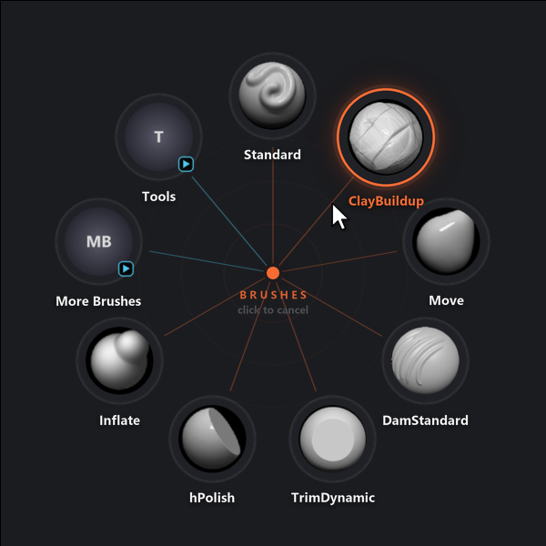
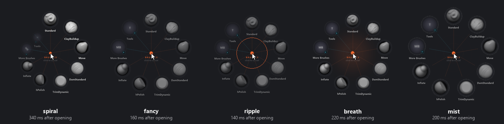

# Radial Menu for ZBrush: user guide

This guide covers everything Radial Menu can do. For installing, see the [README](../README.md).

- [The basics](#the-basics)
- [Radial Menu Studio](#radial-menu-studio)
- [Menus](#menus)
- [Item types](#item-types)
- [Hotkeys](#hotkeys)
- [Pick modes](#pick-modes)
- [Appearance and behaviour settings](#appearance-and-behaviour-settings)
- [Open animations](#open-animations)
- [How picks reach ZBrush (bridge modes)](#how-picks-reach-zbrush-bridge-modes)
- [Files and logs](#files-and-logs)
- [Troubleshooting](#troubleshooting)

## The basics

Radial Menu is two things that work together:

- a small **app** that watches for your hotkeys and draws the ring, and
- a **plugin inside ZBrush** (the bridge) that carries out what you picked.

You do not start either by hand. ZBrush loads the plugin when it starts, the plugin starts the app, and the app quits when ZBrush closes.

With ZBrush in front, press **Q**. The ring opens centred on your cursor. Pick a slot (see [Pick modes](#pick-modes)) and ZBrush does what the slot says.



Slots are laid out clockwise starting at the top. A slot with a small arrow badge opens another ring. The menu's title and a short hint sit in the middle.

## Radial Menu Studio

Studio is where you edit everything. Open it from the Start menu (**Radial Menu Studio**) or from ZBrush with **Zplugin > Radial Menu > Studio**. Only one Studio window opens at a time; starting it again brings the open one forward. Studio reopens on the screen you left, and each screen keeps its scroll position while Studio is open.

| Screen | Shortcut | What it does |
|---|---|---|
| Menus | Alt+1 | Create and edit menus and their items, with a live ring preview. |
| Library | Alt+2 | Browse every brush ZBrush can load, with search, folders and thumbnails. Click a brush and press **Add to <menu>**, or drag it onto a menu, the ring or the item list. **Rescan** picks up brushes saved since Studio opened. |
| Settings | Alt+3 | Ring size, animation, labels, colours, tap time, auto-close, bridge, and Studio's own preferences. |
| Status | Alt+4 | Is ZBrush running, is the app running, is the bridge connected; the app log with a Copy button. **Start app** on the app card starts the app when ZBrush is running. A dot on this button in the rail means the app is not running while ZBrush is. |

Other shortcuts: **Ctrl+S** saves, **Ctrl+Z** undoes, **Ctrl+Y** (or Ctrl+Shift+Z) redoes. The Undo and Redo buttons next to Revert do the same, and undoing puts the selection back on what you were editing. In the lists, **Delete** removes the selected menu or item, **F2** renames a menu and **Alt+Up/Down** moves an item.

The version at the top links to its release notes. When Studio opens, it asks GitHub whether there is a newer release. If there is, the top shows your version, an orange dot and the new version in orange. Clicking it opens the new release's page, where you can download it. The check only asks GitHub for the latest release and sends nothing about you or your menus. Turn it off in **Settings > Studio > Check for updates**. It is never made while that is off.

How saving works:

- **Save** writes `radial.json` and keeps the previous version as `radial.json.bak`. The backup is only replaced when the
  file was readable and actually differs, so saving twice cannot swap a good backup for a bad one. When nothing has
  changed, Save says so and writes nothing.
- If the file changed on disk after Studio loaded it (you edited it by hand, say), Save asks whether to overwrite
  it or reload from disk.
- A config that no ring can open from (no menus, or no menu with a hotkey) is not saved until you confirm.
- **Revert** goes back to what is saved on disk.
- The app re-reads the file as soon as it changes, so saved changes apply immediately, new hotkeys included. You do not need to restart ZBrush or the app.
- If something in the file is wrong, a **problems** pill appears at the top. Click it for the list: each entry says what is wrong in plain words and jumps to the menu, item or setting to fix, and the menu and item rows concerned carry an amber marker. Studio saves anyway, and the app skips the bad items and logs what it skipped.

On the Menus screen you can:

- add, duplicate and delete menus (a duplicate has no hotkey, so it starts out as a submenu);
- add items with **Add item**, drag brushes from the Library onto the ring or the list, reorder items, and remove them;
- drag an item onto another menu in the list to move it there (hold **Ctrl** to copy it instead);
- open a submenu by double-clicking its item or pressing **Open** in the inspector; a **Back** chip above the item list returns to the parent menu;
- edit each item's action, label and icon in the inspector;
- record a hotkey by clicking the hotkey field and pressing the keys;
- press the play button to preview the open animation.

## Menus

A menu is a named list of items shown as one ring. Menus live in one file, `%APPDATA%\RadialMenu\radial.json`. Each has an id (its key in the file), a title, a list of items, and optionally a hotkey.

- A menu **with a hotkey** can be opened from ZBrush.
- A menu **without a hotkey** is a submenu: it opens when you pick an item of type `menu` in another ring.
- Rings work best with 4 to 12 items. They are spread evenly around the circle.
- At least one menu needs a hotkey, otherwise nothing can open the ring.
- A menu can have its own open animation (`"animation": "spiral"`, or pick one in the menu settings in Studio). Without one it uses `ring.animation`. See [Open animations](#open-animations).

Starter menus ship with Radial Menu: **Brushes** (Q), with submenus **More Brushes**, **Tools** (masking, symmetry, PolyFrame, LazyMouse and other switches) and **SubDivide** (a row of stroke subdivide sizes). They use only brushes that come with ZBrush.

## Item types

Every item does exactly one thing. Besides the action, an item can have a `label` (the text under the slot; if you leave it out, one is made from the action) and an `icon`.

| Type | What it does |
|---|---|
| `brush` | Selects a brush. If it is not loaded yet, it is loaded from its `.zbp` file first. |
| `press` | Presses any ZBrush button, by its interface path. |
| `set` | Sets a slider or value. Needs a `value`. |
| `toggle` | Flips a switch on or off. |
| `steps` | Runs a list of the actions above, in order. |
| `menu` | Opens another ring in place of this one. |

### Brush

```json
{"brush": "ClayBuildup"}
{"brush": "Inflat", "label": "Inflate"}
```

The name is the brush's name in ZBrush (the file name without `.zbp`). Spaces and capitals do not matter when Radial Menu looks the file up. The slot's icon is the brush's own thumbnail. If ZBrush already has the brush loaded, it is simply selected. If not, Radial Menu looks for a `.zbp` in your ZBrush brush folders and loads it. If it finds none, the pick is logged as "not loaded in ZBrush and no .zbp file known".

### Press

```json
{"press": "Tool:Masking:Clear", "label": "Clear Mask"}
```

An interface path is the chain of palette and button names, joined with colons, as ZBrush shows them. Capitals do not matter. Studio suggests common paths as you type.

### Set

```json
{"set": "Draw:Draw Size", "value": 64}
{"set": "Stroke:SubDivide Size", "value": 1.25, "label": "1.25"}
```

`value` is a number.

### Toggle

```json
{"toggle": "Transform:Activate Symmetry", "label": "Symmetry"}
{"toggle": "Stroke:LazyMouse"}
```

### Steps

```json
{"steps": [{"press": "Tool:Masking:Clear"}, {"brush": "Standard"}],
 "label": "Fresh Start", "icon": "Standard"}
```

Steps run in order. Each step is a `brush`, `press`, `set` or `toggle`. Steps cannot open menus and cannot contain more steps. Without an `icon`, a `steps` item uses the thumbnail of the first brush among its steps, or a placeholder.

### Submenu

```json
{"menu": "more", "label": "More Brushes"}
```

`"more"` is the id of another menu in the file. Moving the cursor onto the submenu's slot (or flicking past it) opens the new ring centred on that slot. If you are still holding the hotkey, it stays in hold-and-release mode. Releasing or clicking on the submenu's direction before you reach the slot opens it centred on your cursor, in tap-and-click mode. See [Pick modes](#pick-modes).

### Labels and icons

- `label`: text shown under the slot. Long labels are shortened with an ellipsis.
- `icon`: a brush name, the path to a `.zbp`, or the path to a `.png` file. Without one, brush items use the brush thumbnail. Other items show a round placeholder with a short text.

## Hotkeys

A menu hotkey is written like this:

```
Q          Alt+G          Ctrl+Shift+1          F9          `
```

- Keys: letters, digits, F1 to F24, and `space tab enter backspace insert delete home end pageup pagedown` and the punctuation keys `` ` - = [ ] \ ; ' , . / ``.
- Modifiers: `Ctrl`, `Alt`, `Shift`, in any combination, joined with `+`.
- Each hotkey can belong to only one menu. Duplicates are reported as problems and ignored.
- A hotkey only works while **ZBrush is the front window**. In every other program the key behaves normally.
- Keys sent by other programs (macro tools, for example) are ignored.
- Press the hotkey again while its ring is open to close it. **Esc** also closes the ring.

By default a menu **swallows** its hotkey: ZBrush never sees it, so it does not also run its own shortcut for that key. Set `"swallow": false` (or switch it off in the menu settings in Studio) if you want the key to keep working in ZBrush too.

## Pick modes

There are two ways to pick, and the same hotkey does both.

**Hold and release.** Hold the hotkey, move the cursor toward a slot, and release. The slot under the cursor is picked. If the cursor is in the middle (the dead zone) when you release, nothing is picked and the ring closes.

**Tap and click.** Tap the hotkey quickly (shorter than the **tap time**, 250 ms by default). The ring stays open. Move to a slot and click it. The middle of the ring, a right-click, **Esc**, a click outside the ring, or the auto-close timer all cancel without picking.

**Flick.** In either mode, move the cursor out past a slot's outer edge and that slot is picked straight away. You don't have to release the hotkey or click. Press the hotkey, flick toward a slot, and it's done. Turn this off with **Flick to pick** in Settings (`"flick": false`). With flicking on, moving out of the ring always picks something, so a click outside the ring can no longer cancel. Use the middle of the ring, a right-click or **Esc** instead.

**Submenus.** Move the cursor onto a submenu's slot and the submenu opens right away, centred on that slot. If you are still holding the hotkey, you stay in hold-and-release mode, so one movement can go into a submenu and on to one of its items:

- Release over an item, or flick past it, to pick it.
- Release in the middle (where the submenu slot was) to keep the submenu open and click an item.

Turn this off with **Open submenus on hover** in Settings (`"hover_submenus": false`). Submenus then open when you release or click on them, as before.

Notes:

- A slot is chosen by the *direction* of the cursor from the centre, not by hitting the icon. You can point toward a slot and release without moving far. Within the **dead zone** radius no slot is chosen. Each slot covers at most a quarter of the circle, so in a ring with one to three slots, pointing away from all of them chooses nothing.
- The slot under the cursor grows slightly, gets an accent ring, and its label changes colour.
- The ring never takes keyboard focus, so ZBrush keeps working normally behind it.
- If the cursor is near a screen edge, the ring is moved to stay fully on screen.

## Appearance and behaviour settings

These are on the Settings screen in Studio, and under `"ring"` in `radial.json`. Studio shows live previews.

| Setting (`ring.`) | Default | Range | Meaning |
|---|---|---|---|
| `radius` | 145 | 60 to 400 | Distance from the centre to the slots, in pixels. |
| `slot` | 72 | 32 to 160 | Diameter of each icon disc. |
| `dead_zone` | 38 | 10 to 120 | Radius around the centre where no slot is picked. |
| `tap_ms` | 250 | 0 to 1000 | A hotkey press shorter than this is a tap. |
| `timeout_s` | 20 | 2 to 120 | An open ring closes itself after this many seconds. |
| `animation` | `smooth` | see below | The open animation. |
| `labels` | `name` | `name`, `none` | Show names under the slots, or icons only. |
| `flick` | `true` | `true`, `false` | Moving out past a slot picks it without releasing or clicking. |
| `hover_submenus` | `true` | `true`, `false` | Reaching a submenu slot opens the submenu, centred on that slot. |

Sizes are scaled for high-DPI screens automatically.

### Colours

`ring.colors` takes `#rrggbb` values:

| Colour | Default | Used for |
|---|---|---|
| `bg` | `#222327` | Slot fill |
| `accent` | `#f86b33` | Centre dot, hover, title |
| `highlight` | `#4dc8e9` | Submenu slots and badges |
| `text` | `#f0f0f0` | Labels |
| `lines` | `#f86b33` | Spokes and guide circles |

```json
"ring": {
  "radius": 160,
  "animation": "spiral",
  "colors": {"accent": "#7bd88f", "lines": "#7bd88f"}
}
```

Anything you leave out keeps its default. Values outside the allowed range are reported as problems and the default is used.

## Open animations

Set `ring.animation` (or pick one in Studio, which plays a preview). Closing is always instant, so a pick never waits for an animation.

Any menu or submenu can use a different one: give it its own `animation`, or pick one under **Open animation** in its menu settings in Studio. Menus without one use `ring.animation`.

```json
"more": {
  "title": "More Brushes",
  "animation": "spiral",
  "items": [ ... ]
}
```

| Mode | What you see |
|---|---|
| `smooth` | Slots scale in together with a slight overshoot. The default. |
| `bounce` | A bigger, springier overshoot. |
| `pop` | Quick and crisp, no overshoot. |
| `zoom` | Slots settle down from slightly larger. |
| `fade` | A soft fade-in with no movement. |
| `drift` | Slots rise gently into place. |
| `fancy` | Slots fly out from the centre dot. |
| `spiral` | Slots spin out from the centre, one after another, clockwise. |
| `ripple` | Slots move out from the centre while rings expand from the dot. |
| `breath` | A soft halo grows behind the dot as the slots ease out. |
| `mist` | Slots sharpen in from beyond their seats. |
| `snappy` | No animation. The ring appears instantly. |

Only `spiral` staggers its slots; every other mode animates all slots at the same time.

Frames from a few modes, partway through opening:



## How picks reach ZBrush (bridge modes)

When you pick a slot, the app has to tell ZBrush. It writes the request to a file and then triggers the plugin in one of two ways. The `bridge` section of `radial.json` (and **Settings > ZBrush bridge** in Studio) chooses:

```json
"bridge": {"mode": "auto", "key": "F9"}
```

| Mode | How it works |
|---|---|
| `auto` (default) | Uses the message route if the listener inside ZBrush is alive. Otherwise, or if a message is not picked up within half a second, presses the bridge key. |
| `message` | Posts a window message to a hidden listener inside ZBrush. No keystroke is sent, so nothing can collide with your own shortcuts. If the listener is not available, the pick is dropped and logged. |
| `key` | Presses the bridge key every time. |

The **message** route needs nothing from you. It works once the plugin has loaded and its listener is verified (see **Zplugin > Radial Menu > Status**).

The **bridge key** is the fallback. To set it up:

1. In ZBrush, Ctrl+Alt+click **Zplugin > Radial Menu > Apply**.
2. Press the key you want, such as **F9**.
3. Open **Preferences > Hotkeys** and click **Store**.

Rules for the bridge key: use a bare F-key if you can (`Alt` combinations are allowed). `Ctrl` and `Shift` are rejected, because ZBrush reads them as mask and smooth. The app only presses the key while ZBrush is the front window, and releases any modifiers you are holding first.

Picks that arrive while you are in the middle of a stroke (mouse button down) wait until you lift. Right after a pick the app also makes a zero-distance mouse move, which wakes ZBrush's cursor and pen tracking.

### ZBrush 2022 to 2025

These versions have no Python API, so they get a ZScript plugin with the same palette. Studio installs it: **Settings > Older ZBrush** lists the 2022 to 2025 versions it found, with **Install**, **Update** and **Remove** for each, and **Add a ZBrush folder** for one it missed (a folder you added can be forgotten again with the x next to it). The plugin goes into that ZBrush's `ZStartup\ZPlugs64` (the only place these versions load plugins from), together with a `RadialMenuData` folder. A ZBrush under Program Files asks for administrator rights: the row says "approve the prompt" while Windows waits for you, for up to five minutes. The elevated step checks that the destination is a ZBrush plugin folder and builds the plugin files from the installation's own copies, so nothing from a user-writable folder is copied with administrator rights.

Differences from ZBrush 2026 and newer:

- There is no listener, so **every pick uses the bridge key**, whatever the mode. The plugin binds **F9** to **Apply** itself, so the default key needs no setup. If you choose another bridge key, bind and store it in each of these versions (the steps above); each version keeps its own hotkeys.
- Brushes load from that version's own `.zbp` files, because an older ZBrush cannot always read a newer version's brushes.
- Status shows where picks arrive, whether one is waiting, and the last pick. The plugin also writes that last pick to `zscript_bridge.log`, which Studio's Status screen shows.

When this version of Radial Menu has a newer plugin than one you installed, **Settings** shows a badge and that row says **Update available**. After **Update**, restart that ZBrush.

### The Zplugin > Radial Menu palette

| Button | What it does |
|---|---|
| Studio | Opens Radial Menu Studio. |
| Apply | Carries out the pending pick. Bound to the bridge key for the fallback route. In ZBrush 2022 to 2025 it comes with F9 already bound. |
| Start App | Starts the app if it is not running. Normally unnecessary. |
| Status | Shows whether the listener is verified, whether the app is running, and the last pick. |

## Files and logs

| Path | What |
|---|---|
| `%APPDATA%\RadialMenu\radial.json` | Your menus and settings. Created from the starter menus on first run. |
| `%APPDATA%\RadialMenu\radial.json.bak` | The version before your last save in Studio (only replaced when the file was readable and changed). |
| `%APPDATA%\RadialMenu\radial.json.broken` | The file Studio could not read, kept when you chose **Start from defaults** on the recovery screen. |
| `%APPDATA%\RadialMenu\launch.json` | Tells the plugin how to start the app and Studio. Rewritten on each start. |
| `%LOCALAPPDATA%\RadialMenu\radiald.log` | The app: config loads, hotkeys, rings, hand-offs. Trimmed automatically. |
| `%LOCALAPPDATA%\RadialMenu\bridge.log` | The plugin inside ZBrush: what each pick actually did. |
| `%LOCALAPPDATA%\RadialMenu\app_stderr.log` | Output when the app crashes on startup. |
| `%LOCALAPPDATA%\RadialMenu\listener.json` | The verified listener window (written by the plugin). |
| `%LOCALAPPDATA%\RadialMenu\request.json` | The pick in transit. Normally gone in a moment. |
| `%LOCALAPPDATA%\RadialMenu\request.txt` | The same pick for the ZBrush 2022 to 2025 plugin. |
| `%LOCALAPPDATA%\RadialMenu\zscript_bridge.log` | ZBrush 2022 to 2025: what the last pick did. |
| `%LOCALAPPDATA%\RadialMenu\zscript_launch.log` | ZBrush 2022 to 2025: how the plugin last started the app or Studio. |
| `%LOCALAPPDATA%\RadialMenu\zscript_hotkey.log` | ZBrush 2022 to 2025: the hotkey Apply had when the plugin loaded, and the one it has after (88 is F9). |
| `%APPDATA%\RadialMenu\studio.json` | Studio's own preferences (Licence button, update check) and window placement. |
| `%LOCALAPPDATA%\RadialMenu\studio.log` | How Studio started: which program launched it and how long each step took. A failed update check is noted here. |
| `%LOCALAPPDATA%\RadialMenu\thumbs\` | Cached brush thumbnails. Safe to delete. |
| `<ZBrush>\ZStartup\ZPlugs64\RadialMenuBridge.zsc` | ZBrush 2022 to 2025: the plugin. Its `RadialMenuData` folder says where picks arrive and how to start the app. |

When you report a bug, paste the last lines of `radiald.log` and `bridge.log`. They contain brush names and menu ids, but have a quick look before you post them.

## Troubleshooting

**Pressing the hotkey does nothing.**

1. Is ZBrush the front window? The hotkey is ignored everywhere else.
2. In ZBrush, open **Zplugin > Radial Menu > Status**. If the palette is missing, ZBrush did not load the plugin. Restart ZBrush and check that your user environment variable `ZBRUSH_PLUGIN_PATH` contains the plugin folder. As a one-off you can also load `radial_menu_bridge.py` with **ZScript > Python Scripting > Load**.
3. If the status says the app is not running, press **Start App**, then read `app_stderr.log` and `radiald.log`.
4. In Studio, check for the **problems** pill. A menu with no usable items, a duplicate hotkey or a hotkey the app cannot read all stop a ring from opening.
5. Another program may grab the same key before it reaches the app. Try a different hotkey.

**The ring opens, but picks do nothing.**
Check the listener on the Status screen. If it is not verified, use the fallback: bind the bridge key (see above) and leave the mode on `auto`. Then read `bridge.log`; it names each action and says whether it worked. Common causes: a `press`, `set` or `toggle` path that does not exist in your ZBrush (logged as "no such interface item"), or a `brush` with no `.zbp` file (logged as "NOT loaded in ZBrush and no .zbp file known").

**ZBrush 2022 to 2025: the ring opens, but picks do nothing.**
Picks there only arrive through the bridge key. Hover **Zplugin > Radial Menu > Apply** in that ZBrush: its hotkey should match the bridge key. The plugin brings F9 itself, but only once it is up to date, so update it if **Settings > Older ZBrush** says **Update available**. For any other key, check that it is bound to **Apply** and that you clicked **Preferences > Hotkeys > Store**; a binding that was not stored is gone after a restart. If the palette is missing, install the plugin again in **Studio > Settings > Older ZBrush** and restart that ZBrush. `zscript_bridge.log` shows what the last pick did.

**A slot shows letters instead of a picture.**
There is no thumbnail for it. For brushes, that means no `.zbp` was found. For other items it is the normal placeholder; set an `icon` to change it.

**Picks feel late during a stroke.**
That is intended. A pick waits until you release the mouse button or lift the pen, so a tool change never lands in the middle of a stroke.

**I want to test the key fallback.**
Set `"mode": "key"` temporarily, pick something, and check `bridge.log` for the result. Switch back to `auto` afterwards.

**Windows protected your PC (SmartScreen).**
The installer is not code-signed yet. Click **More info**, then **Run anyway**. The README explains why.

**I broke my menus file.**
Studio keeps the last version as `radial.json.bak`. If you edit the file by hand and the app cannot read it, it keeps using the last good version and logs the error. When Studio cannot read it either, it opens on a recovery screen that shows the error with its line and column, and offers **Open folder**, **Restore backup** and **Start from defaults** (the unreadable file is kept as `radial.json.broken`). A byte-order mark left by an editor is accepted. Deleting `radial.json` makes the app create a fresh one from the starter menus.

**Checking a file from a source checkout.**
`python radial_menu\main.py --check` prints every menu and lists problems without starting anything.
